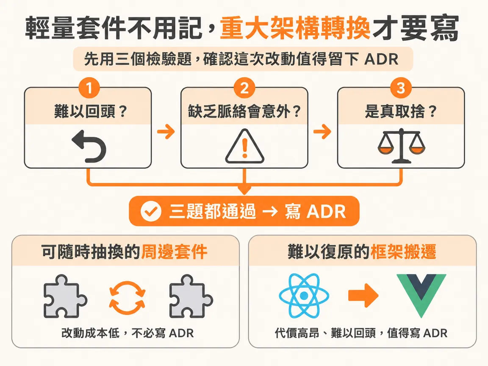
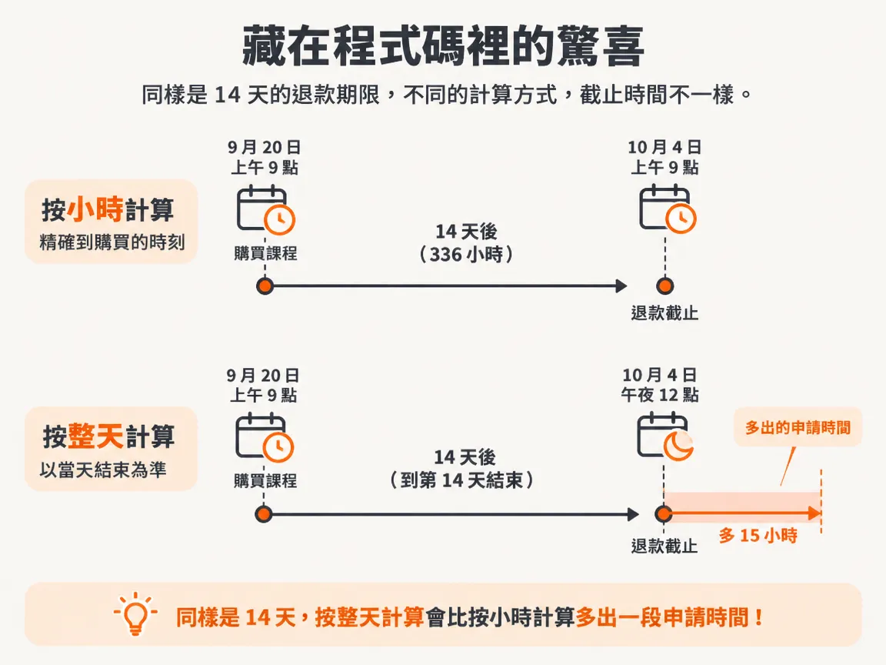

# 三道檢驗題，判斷決策該不該寫進 ADR

如果把架構決策記錄（ADR）的權限交給 AI Agent，只要給它一個放 Markdown 文件的資料夾，它往往會一股腦地把大小細節全寫進去，導致文件數量無限膨脹，最後根本沒人想看。

為了避免這種混亂，記錄 ADR 時必須秉持「非常謹慎節制」的原則。一個技術或商業決策到底值不值得立案存檔，可以用三道題目來檢視：

1. **難以回頭嗎？**（Hard to reverse）
2. **缺乏脈絡時會讓人感到意外嗎？**（Surprising without context）
3. **這是不是真正取捨後的結果？**（Result of a real trade-off）

### 輕量套件不用記，重大架構轉換才要寫

舉例來說，如果團隊決定用 recharts 來畫圖表，或者改用 sonner 來彈出提示通知（toast），這需要寫 ADR 嗎？

答案通常是不需要。因為這些周邊套件隨時都能抽換，改動成本很低。但如果是決定把整個專案從 React 搬遷到 Vue，要走回頭路就極其困難，必須投入大量工程工時才能完成。這種代價高昂、難以復原的決定，才值得認真留下一份 ADR。



### 藏在程式碼裡的驚喜：退款天數的計算案例

決策不一定都是「更換前端框架」這種顯眼的大事，許多關鍵決定其實藏在細微的業務邏輯裡。如果少了上下文，接手的人或 AI 很容易做出錯誤假設。

在課程頁面的邏輯中，有一個負責計算學員退款資格的函式：

<!-- source: sources/real-engineer/20261116/supplement/cohort-005-project/app/routes/courses.$slug.tsx#L434-L464 -->

```tsx
// Compare whole days, not hours — a purchase at 23:00 should still get its
// full fourteenth day.
function asDayString(when: Date) {
  const year = when.getFullYear();
  const month = String(when.getMonth() + 1).padStart(2, "0");
  const day = String(when.getDate()).padStart(2, "0");
  return `${year}-${month}-${day}`;
}
...
  const purchasedDay = asDayString(new Date(purchase.createdAt));
  const windowEnd = new Date(purchase.createdAt);
  windowEnd.setDate(windowEnd.getDate() + CANCEL_WINDOW_DAYS);
  const lastDayInWindow = asDayString(windowEnd);
  const todayDay = asDayString(new Date());
  const isWithinWindow =
    todayDay >= purchasedDay && todayDay <= lastDayInWindow;

  if (!isWithinWindow) return null;
```

這段程式碼的關鍵在於 `isWithinWindow` 的天數判定。如果一位學員在 9 月 20 日上午 9 點買課，退款期限如果精確計算到小時，截止時間就會是 14 天後的 10 月 4 日上午 9 點。



然而，系統並沒有照小時算，而是透過 `asDayString` 把時間抹平為「整天」。換句話說，退款期限會一路延續到 10 月 4 日的午夜 12 點，讓學員多出一大段可以申請退款的時間。

如果沒有背景脈絡，這樣的實作方式非常令人意外。當 AI Agent 讀過這段程式碼並嘗試重構時，很可能會覺得「為什麼不用精確的時間戳記計算？」然後順手把它改回按小時比對，完全踩爛當初刻意為學員爭取緩衝時間的美意。

### 在決策當下留下紀錄

實務上的專案往往塞滿了這類只隨手寫在程式碼中、在其他地方完全看不出原委的微小決策。

把這類「有真實取捨、事後看會意外」的關鍵決策統一存放在專案頂層的 `docs/adr` 資料夾，AI Agent 在規劃與修改功能時，就能輕鬆找到並參照這些歷史脈絡。

更重要的是，記錄必須發生在拍板定案的瞬間。當你正在針對需求進行深度推敲與盤問（grilling）時，正是各種架構與業務決策成型的時刻。這也是為什麼在透過文件進行深度梳理時，領域建模與架構決策記錄往往會同時進行。
