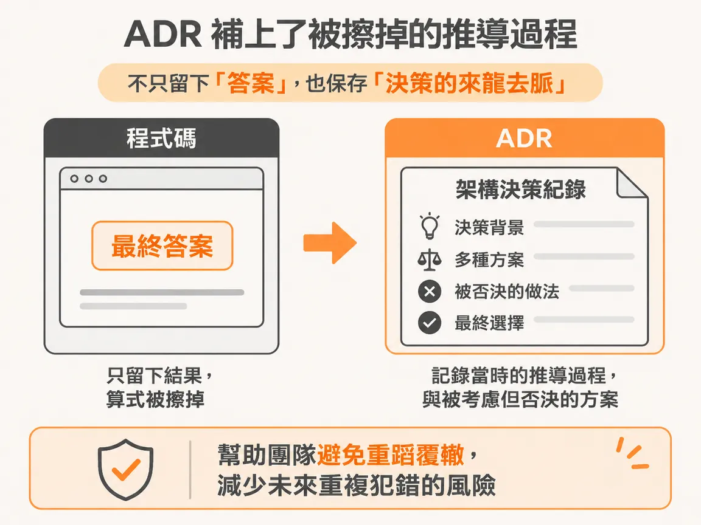
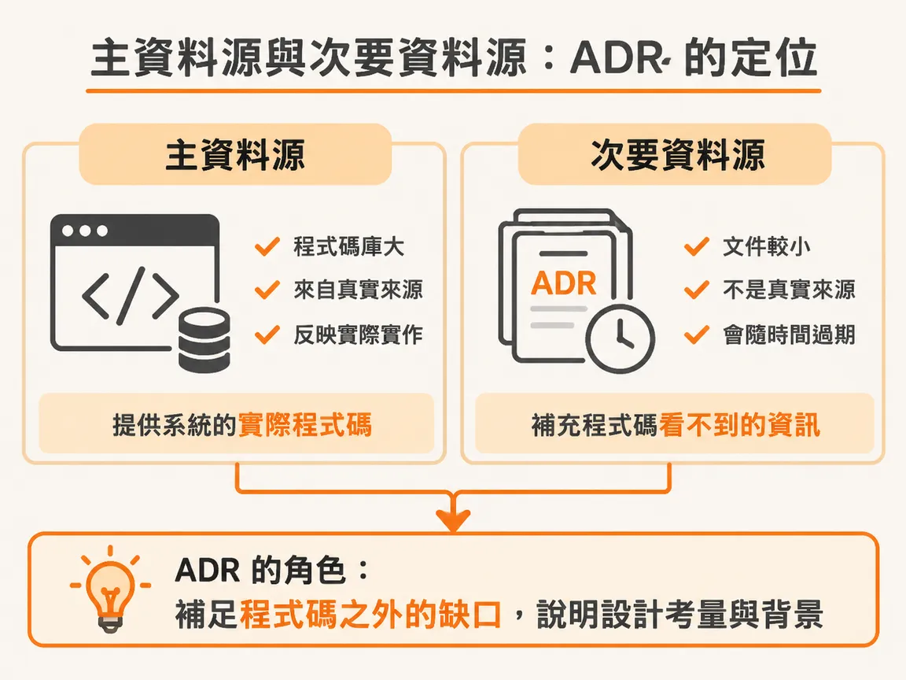

# 為什麼需要架構決策紀錄（ADR）？

當你在專案中接手一段現有程式碼時，只要程式結構夠好、命名使用了清楚的領域語言（Domain Language），甚至搭配了恰當的註解，程式碼通常能清楚告訴你：它現在在做什麼、接收什麼參數、回傳什麼結果。

然而，程式碼無法告訴你的是：當初為什麼選了這個做法？團隊曾經考慮過哪些替代方案、又否決了哪些路徑？

換句話說，**程式碼就像是算式全被擦掉後留下來的最終答案**。

## ADR 補上了被擦掉的推導過程

這正是架構決策紀錄（Architecture Decision Record，簡稱 ADR）存在的原因。ADR 用來記錄專案或程式碼庫（repository）中做出的重大架構決策，它的價值在於保存決策的歷史背景，避免團隊在未來重複踩進相同的坑、犯下一樣的錯誤。

ADR 的格式應該保持得非常精簡。在 domain modeling skill 裡所定義的基本範本，往往只需要一到三句話，說清楚兩件事：

1. 我們決定了什麼？
2. 為什麼這樣決定？

你也可以視需要加上考慮過的替代方案（considered options）或帶來的後續影響（consequences）等選填區段，但核心原則是篇幅必須非常小巧緊湊，不要寫成冗長的文件。

## 主資料源與次要資料源：ADR 的定位

在專案的 `docs/adr` 目錄裡加入 Markdown 文件時，許多工程師會保持戒心。因為隨便在程式庫中增加描述程式行為的 Markdown 文件，往往會帶來維護上的隱憂。

這裡可以借用歷史學的觀念來理解：

* **主資料源（Primary source）**：實際運行的程式碼庫。雖然它體積龐大，但它是唯一的真實來源（source of truth），因為只有真正被執行的程式碼才代表系統的現狀。
* **次要資料源（Secondary source）**：規格書、架構說明文件或 ADR。它們的體積小得多，但並不是真實來源。

次要資料源最大的風險是極容易過期失效（out of date）。一旦文件與實際程式脫節，不僅會誤導人類工程師，還會混淆依賴文件理解專案的 AI agent。

## 填補程式碼說不清楚的空白

那麼，為什麼我們仍然值得在 `docs/adr` 中維護 ADR？

因為 ADR 的目的不是去當「程式碼應該做什麼」的新真實來源，而是**專門填補程式碼本身看不出來的空白**。程式碼能解釋它自己現在如何運作，但解釋不了那些被放棄的選擇與背後的考量。

專案中的詞彙表（glossary）也是同樣的道理。先讀懂詞彙表，可以讓人更容易在程式碼中穿梭理解；而 ADR 則記錄了決策的脈絡。

在與文件反覆推敲釐清（grilling sessions）的過程中，產生的洞察非常重要，值得好好做筆記留存。這兩種文件都不是要取代程式碼，而是攜手補足程式碼無法自我說明的盲點。以維護成本來看，它們所花費的時間與 token，絕對值得投入。
