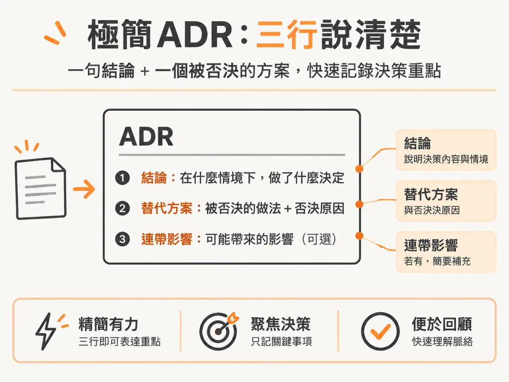
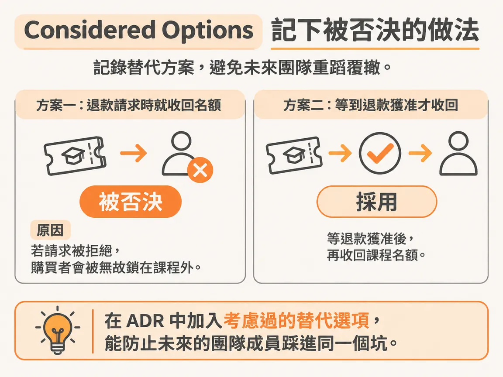

# 把架構決策寫成極簡 ADR：用三行記錄結論與被否決的方案

梳理複雜的商業邏輯時，團隊常會做出大量密集又細碎的決定。有些工作流程會認為，只有同時具備「難以逆轉」且「伴隨重大取捨」的決定，才需要寫架構決策紀錄（ADR）。

但只要業務牽涉到金錢交易與權限變更，輕易放過這些脈絡，後續維護就很容易遺失當初推導出的關鍵邊界。這種情況下，寫下精準的 ADR 非常必要。ADR 完全不需要長篇大論，只要清楚交代結論，並記下被否決的替代方案即可。

## 短到只有三行的決策紀錄

好的 ADR 往往極其精簡，甚至只有三行 Markdown。

以處理退款時的學員權限為例：

> **核准退款請求時保留學員進度**  
> 平台管理員核准退款請求時，購買者會失去該課程名額，但保留原本的章節學習進度。

這段紀錄沒有冗長背景或多餘引言。它直接交代誰在什麼情境下操作，系統會收回什麼、保留什麼。篇幅極短，卻能讓開發者實作退款功能時，一眼看懂資料狀態該怎麼處理。

## 用 Considered Options 記下被否決的做法

除了最後定案的做法，最容易被遺忘的往往是「當初為什麼不那樣做」。在 ADR 記錄考慮過的替代選項（considered options），能避免未來的團隊成員重踩覆轍。

以課程名額何時結束為例：

* **決策**：退款請求正式核准時，課程名額才終止。
* **考慮過的選項（Considered options）**：使用者送出退款申請當下，立刻收回名額。  
  **結果**：否決（rejected）。要是管理員最後拒絕退款，購買者在審核期間就會被無故鎖在課程外。

團隊授權退款也能用相同結構記錄：

* **決策**：團隊授權退款只分全額退或不退；審核期間凍結所有剩餘席位。
* **考慮過的選項**：審核期間仍允許領取剩餘席位，但只要有人領取，後續審核就一律拒絕退款。  
  **結果**：否決。

把否決原因寫成一句話，往後再有人提議「為什麼不一申請就鎖權限」，團隊就不必再花時間重啟辯論。

## 交代清楚決策牽動的後果

有些決策看似單純，卻會影響到底層資料庫關聯與程式寫法。這時可以在 ADR 補充連帶影響（consequences）。

以學員身分認定為例：

> 每一門課程，學員只會有一個名額。名額無論來自個人購買或團隊席位，本身都不記錄來源類別。

這個規則會直接影響實作。當使用者發起退款，系統程式碼必須主動推導，把退款請求正確綁定到該購買者該門課程最新的購買紀錄上。

## 扎實的底層語言，讓後續規劃站穩腳步

在 `docs/adr` 目錄下建立的決策紀錄都很簡短，卻都記錄了解決非顯而易見問題（non-obvious）的思考過程。

專案初期先建好領域詞彙表（Glossary），再搭配簡短的 ADR 記下邊界條件。團隊後續在探索方向（wayfinding）與規劃系統時，底層語言就會凝聚成形，讓每一步實作都建立在踏實的共識之上。
