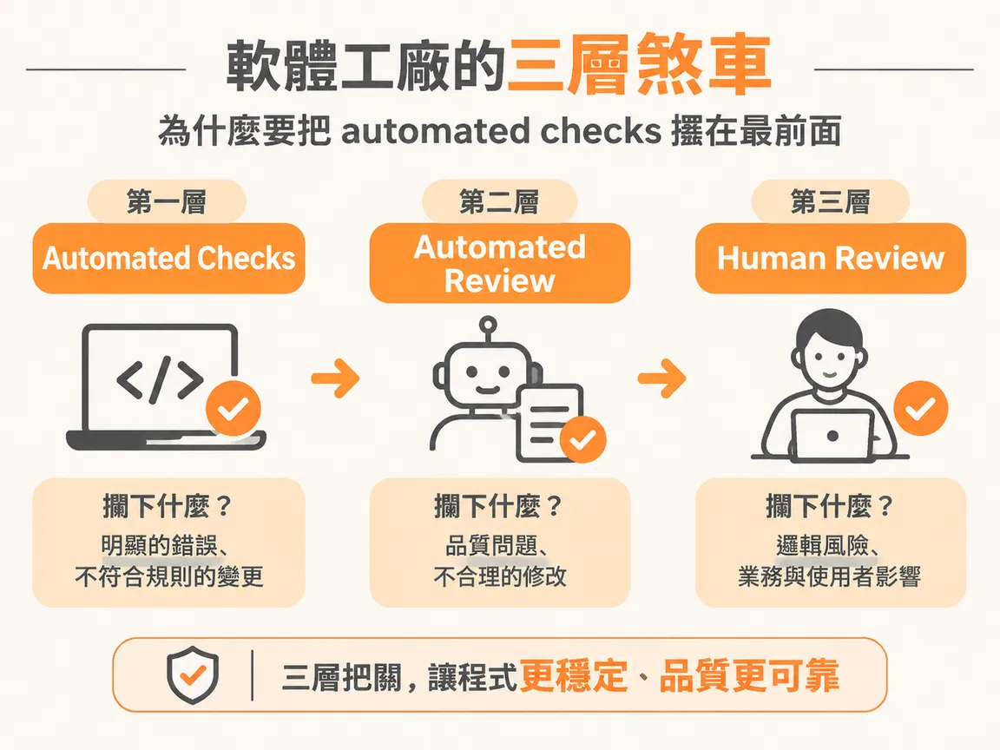
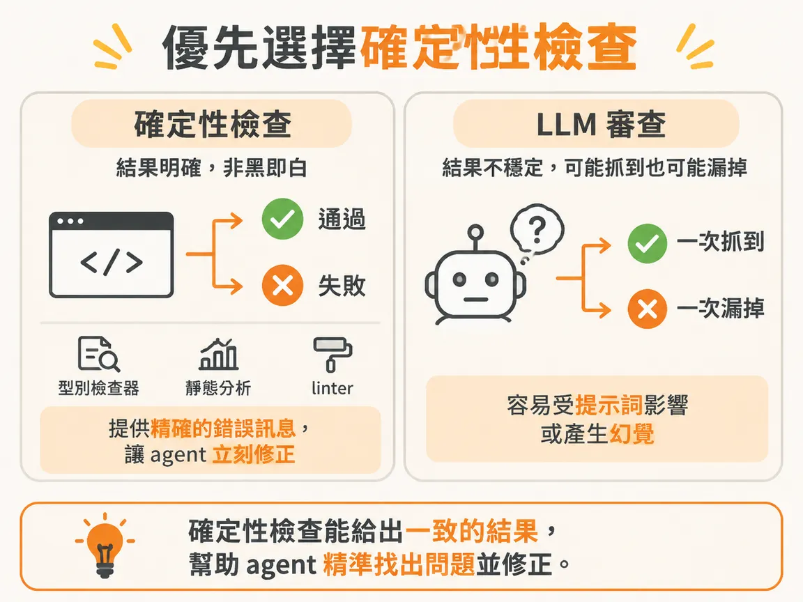
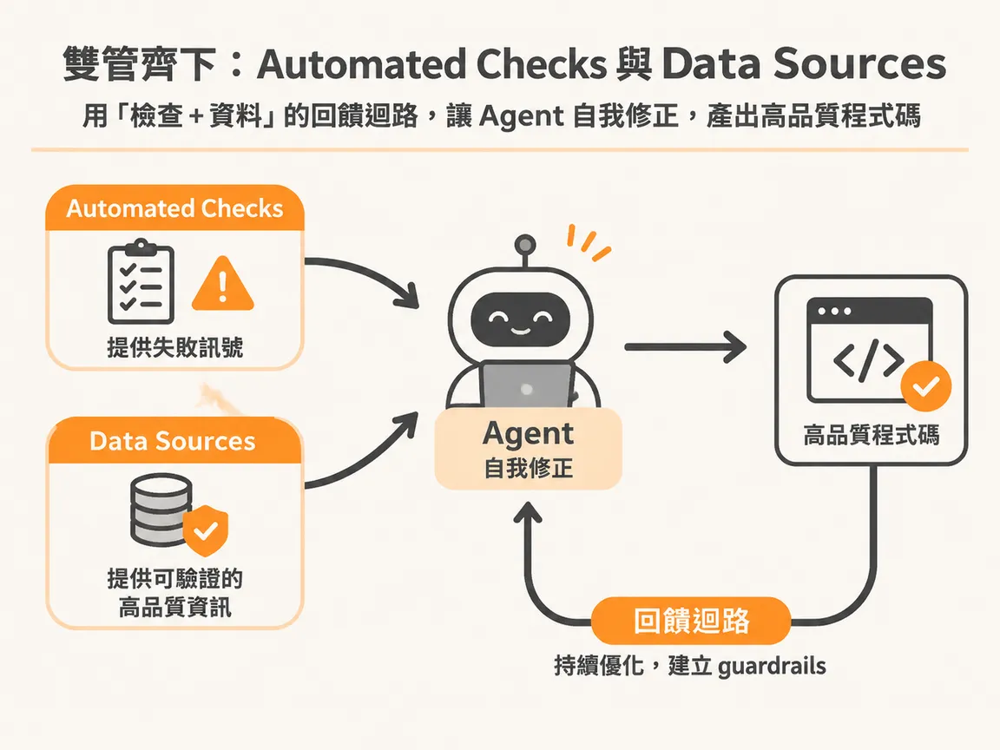

# 軟體工廠的三層煞車：為什麼要把 automated checks 擺在最前面

讓 AI agent 寫程式時，最容易遇到的問題不是寫不出來，而是產出品質不穩定。如果每次都等程式碼寫完，才交給真人或另一套 LLM 去審查，不僅耗時，還會把力氣浪費在低階語法或型別錯誤上。

要把軟體工廠的產線穩定下來，需要建立三層煞車機制：



1. **Human review（人工審查）**：最後的人工驗收與業務邏輯確認。
2. **Automated review（自動化審查）**：使用 LLM 或自動化工具對程式碼風格與架構進行評估。
3. **Automated checks（自動化檢查）**：在程式碼進入任何審查階段前，最先觸發的確定性防線。

前兩者偏向啟發式或經驗判斷，而第三層煞車「automated checks」則是透過工具建立硬性標準，在 agent 的產出送進 automated review 之前，就先擋下不合格的程式碼。

## 優先選擇確定性檢查

相較於 LLM 審查容易受提示詞影響或產生幻覺，確定性（deterministic）檢查的結果非黑即白：通過就是通過，失敗就是失敗。型別檢查器、靜態分析與 linter 能提供精確的錯誤訊息，讓 agent 能明確知道哪裡不合規範，立刻修正。



以專案的程式碼規範為例，團隊通常會要求用嚴格的規則取代模糊的約定：

- **失敗時丟出回應，而不是回傳錯誤物件**：讓路由只有一條成功路徑，避免前端元件漏掉錯誤處理。

<!-- source: sources/real-engineer/20261116/supplement/cohort-005-project/CODING_STANDARDS.md#L8-L10 -->

```ts
if (!course) throw data("Course not found", { status: 404 });
```

- **使用 schema 解析不可信的輸入**：表單資料或請求內容必須先經過驗證，不能直接用型別斷言（`as string`）欺騙型別檢查器。
- **禁止使用 `any` 與非空斷言 `!`**：在最不確定的地方關閉型別檢查只會埋下隱患；如果型別無法確定，代表資料結構本身需要調整。

這類規範可以直接轉化為自動化檢查工具的規則，成為 agent 寫程式時最可靠的邊界。

## 雙管齊下：Automated Checks 與 Data Sources

要讓 agent 產出高品質的程式碼，核心在於強化它的回饋迴路（feedback loop）。這可以拆成兩個關鍵部分：



第一是 **Automated checks（自動化檢查）**。這是一整套用來提升品質的檢查技術。當檢查失敗時，系統會傳回明確的失敗原因，agent 就能根據這些確定性的錯誤訊息反覆修正，不用等到進入審查流程才發現問題。

第二是 **Data sources（資料來源）**。使用 agent 時如果沒有提供足夠的背景資訊，agent 就沒有依據去驗證自己的工作。提供給 agent 的資訊越多、品質越高，產出的結果就越好。

結合這兩者——藉由 automated checks 失敗時提供的精準回饋，搭配高品質的 data sources 作為驗證依據——就能為 agent 架起穩固的防護欄（guardrails）。當 agent 學會先檢查自己的工作再交件，產出的程式碼才會真正讓人放心。既然確定性檢查是守護品質的第一道防線，下一步就要檢視專案裡現存的每一條 coding standard，決定它們的去留。
