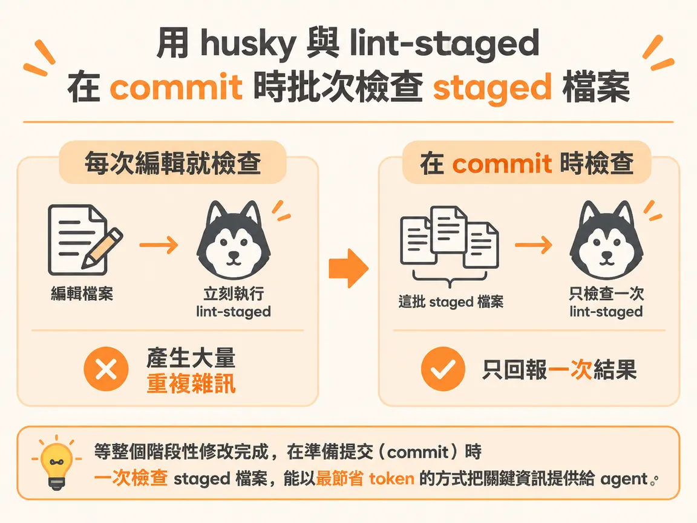
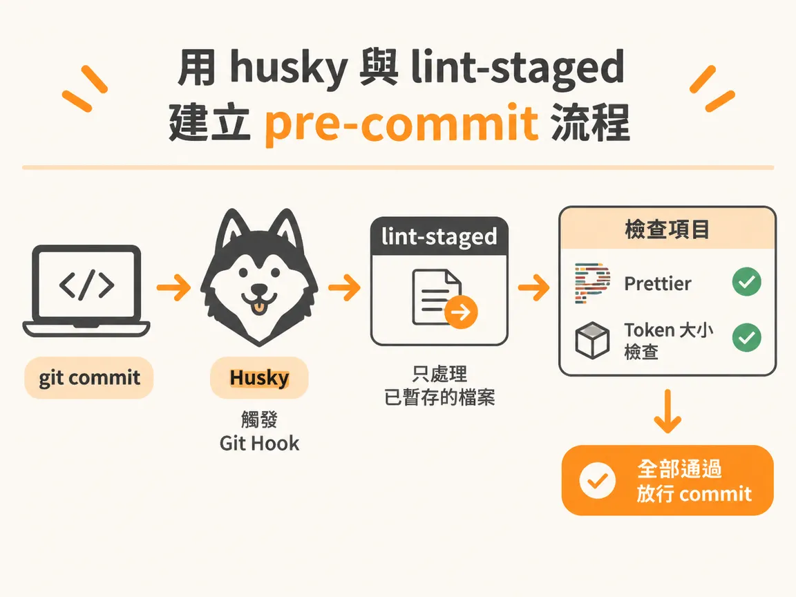
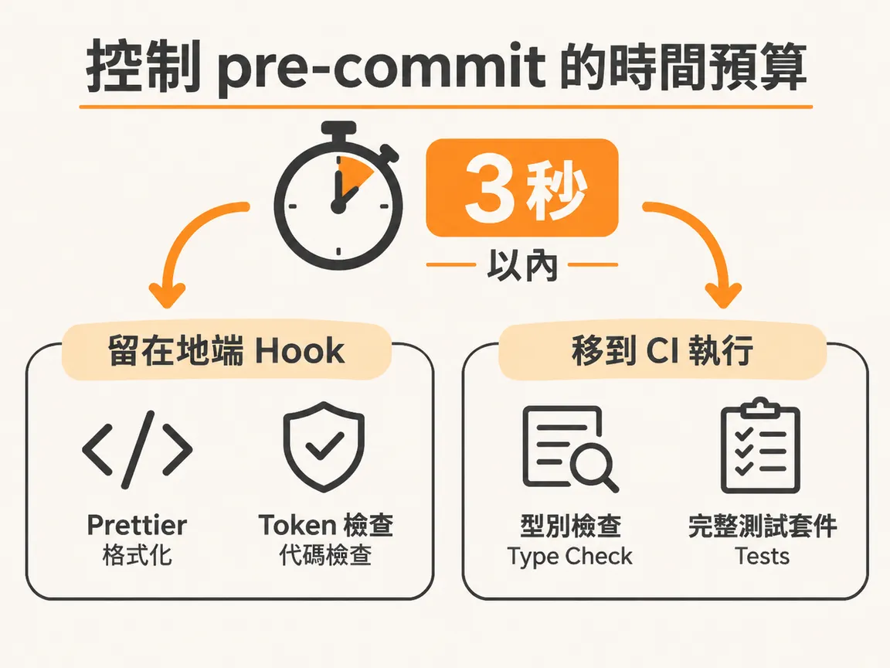
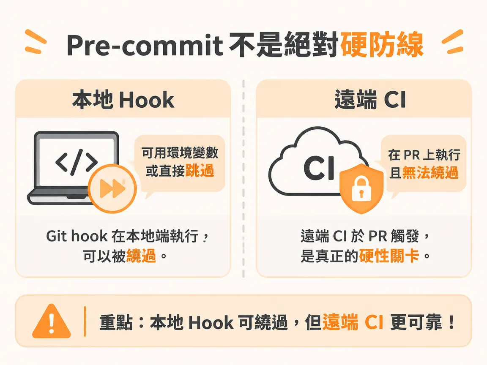

# 用 husky 與 lint-staged 在 commit 時批次檢查 staged 檔案

把程式碼規範修剪成明確的自動化規則後，下一個問題是：這些檢查該在什麼時機執行？

讓 AI agent 寫程式時，常見的做法是設定「只要檔案被修改，就立刻執行自動化檢查」的 hook。但在大型重構或單次作業中，agent 通常會連續修改大量檔案。如果每次存檔都觸發檢查，不僅執行變慢，還會產生許多雜訊、消耗大量 token。agent 在編輯過程中往往就知道檔案正處於未完成狀態，這時 linter 回報的錯誤毫無意義。

更合理的做法是等整個階段性修改告一段落，在 agent 準備提交變更的瞬間，更好的做法是要求代理在完成一段工作並準備提交（commit）時。這能以最節省 token 的方式，在對的時間把關鍵資訊提供給 agent。



## 為什麼要檢查檔案大小？

自動化檢查不一定只能依賴像 ESLint 這類的現成工具，也可以加入簡單實用的客製檢查。

專案變大時，agent 往往會寫出上萬個 token 的龐大檔案。這類巨大檔案很難放進上下文視窗（context window），agent 必須在檔案內部不斷進行搜尋（grep），大幅降低工作效率。

一個有效的做法是在 commit 前限制 staged 檔案不得超過 5,000 個 token（計算方式可用「位元組數除以 4」估算）。如果超出限制，檢查就直接中斷並拋出錯誤，同時附上指引告訴 agent 如何拆分檔案：

* 將 `root-modules` 內的 loader、action 與頁面元件保留，商業邏輯移到 `app-modules` 的深度模組，子元件則移到 `app-components`。
* 測試檔案則依照被測試的行為拆分，每個領域一個檔案。
* 拆分完成後重新執行檢查再嘗試 commit。

這項檢查只針對 staged 檔案，因此現存超過大小的檔案不會立刻讓整個專案無法運作，只有在修改那些檔案時，才會要求就地重構拆分。

像以下這類龐大的路由元件檔案，就是典型的拆分目標：

<!-- source: sources/real-engineer/20261116/supplement/cohort-005-project/app/routes/instructor.$courseId.tsx#L1-L2264 -->

```tsx
import { useState, useRef, useEffect } from "react";
import { Link, useFetcher } from "react-router";
import { toast } from "sonner";
...
export async function loader({ params, request }: Route.LoaderArgs) {
  const currentUserId = await getCurrentUserId(request);

  if (!currentUserId) {
    throw data("Select a user from the DevUI panel to manage courses.", {
      status: 401,
    });
...
export default function InstructorCourseEditor({
  loaderData,
}: Route.ComponentProps) {
```

## 使用 husky 與 lint-staged 建立 pre-commit 流程

在 JavaScript / TypeScript 專案中，通常會搭配兩套工具來管理這套機制：



* **husky**：用來設定並管理 Git hooks（例如 pre-commit hook）的工具。
* **lint-staged**：針對目前處於 staged 狀態的檔案批次執行指定指令的 CLI 工具。

在 `package.json` 中配置 `lint-staged`，使其在所有 staged 檔案上執行 Prettier 格式化檢查與客製的 token 大小檢查指令（例如 `node scripts/check-file-tokens.js`），並且排除 `package-lock.json` 或 Drizzle 遷移檔等特定大檔。

## 控制 pre-commit 的時間預算

設定 pre-commit 時，常見的失誤是把所有的檢查與測試通通塞進去：Prettier、TypeScript 型別檢查、架構界線檢查，甚至是整個測試套件。

pre-commit hook 的執行時間應該嚴格控制在 3 秒以內。



pre-commit 不是上線前的最後一道防線，它存在的目的是給提交者（或 agent）即時反饋。實際量測往往會發現，雖然執行測試套件可能只要 2 秒，但型別檢查卻可能耗費 7 到 8 秒。超出預算的耗時項目（如型別檢查或完整測試）應該移至遠端的持續整合（CI）平台執行，而非拖慢每一次的本地 commit。至於 pre-push hook，由於容易打斷工作流程，通常也不建議使用。

## Pre-commit 不是絕對硬防線

當專案剛導入 Prettier 全域格式化時，往往會一口氣修改上百個檔案。如果這些暫存檔案中有原先就超過 5,000 token 的現存檔案（例如高達 23,000 token 的 seed 腳本），pre-commit 檢查就會失敗並中斷提交。

Git hook 本質上是在本地端執行，它是可以被繞過的。使用 husky 時，可以藉由設定環境變數來跳過檢查：



<!-- derived -->
```bash
HUSKY=0 git commit -m "style: run prettier format"
```

pre-commit hook 只是本地的輔助防線，用來引導 agent 改善程式碼品質；真正不能被繞過的硬性關卡，依然是遠端 CI 平台的把關機制。但如果希望本地 hook 能承擔更多即時檢查，就必須認真面對時間預算，把速度逼到極限。
