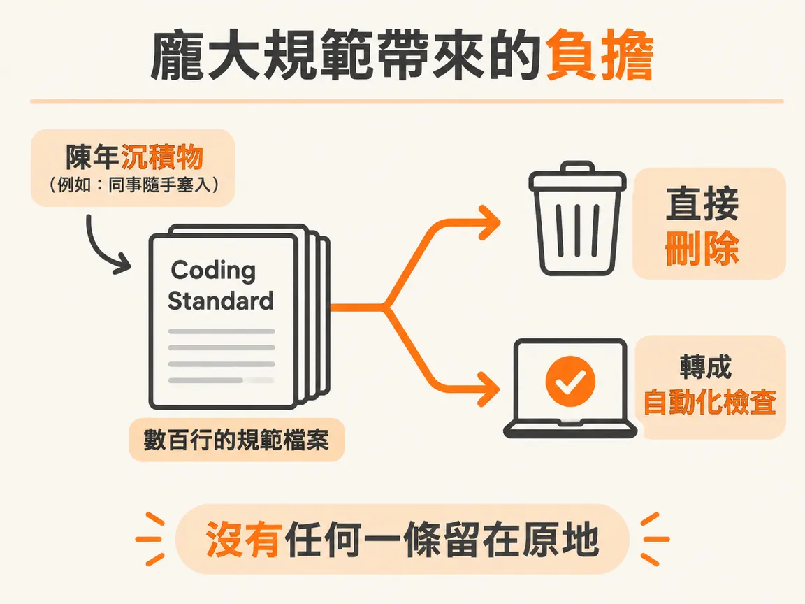
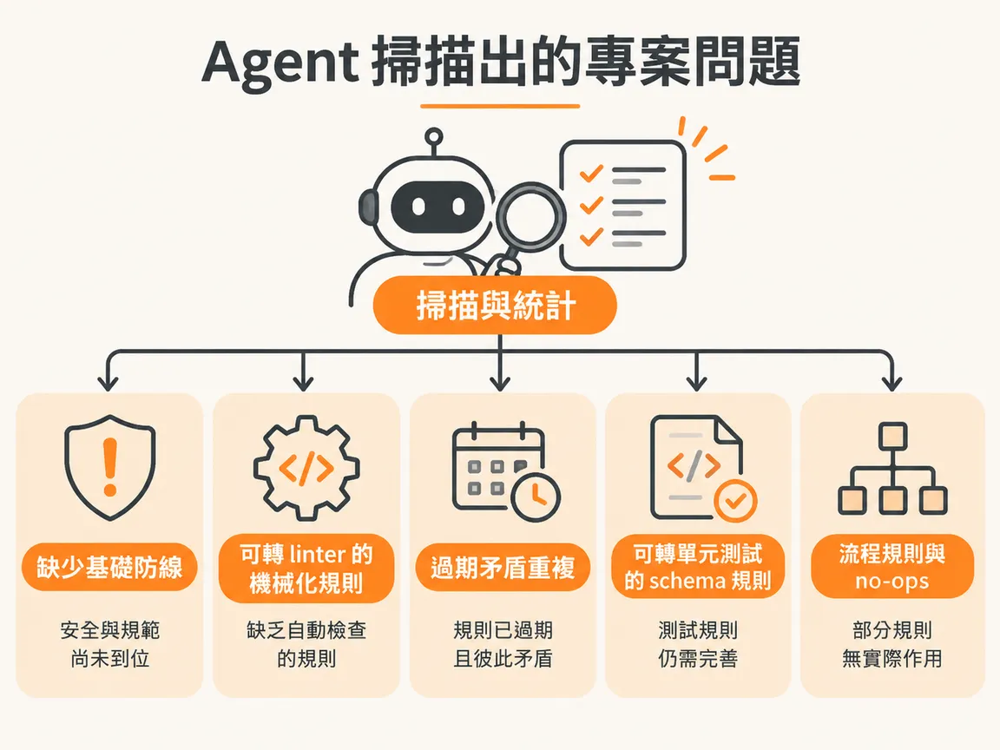
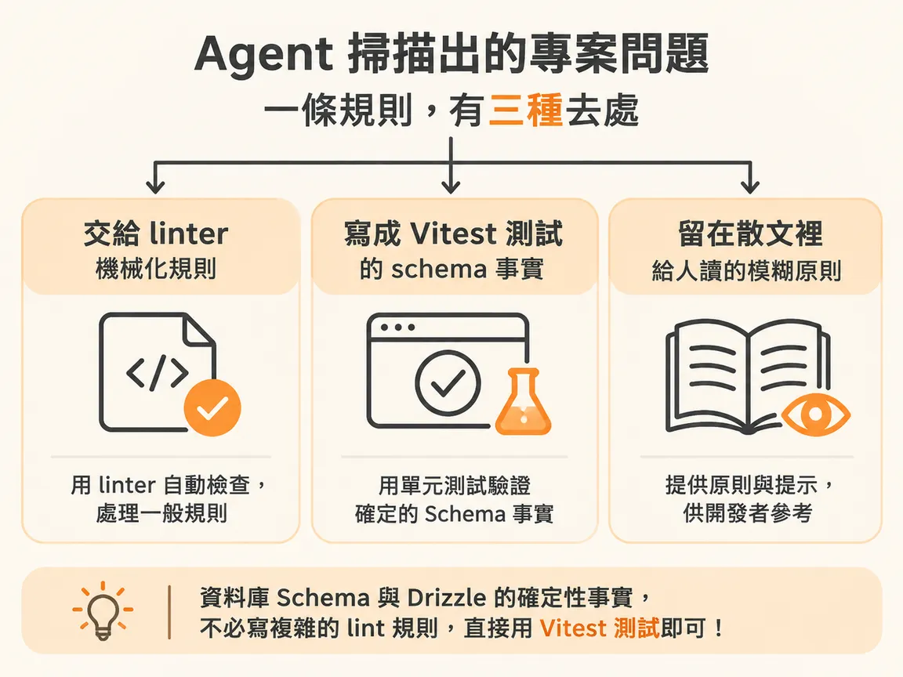
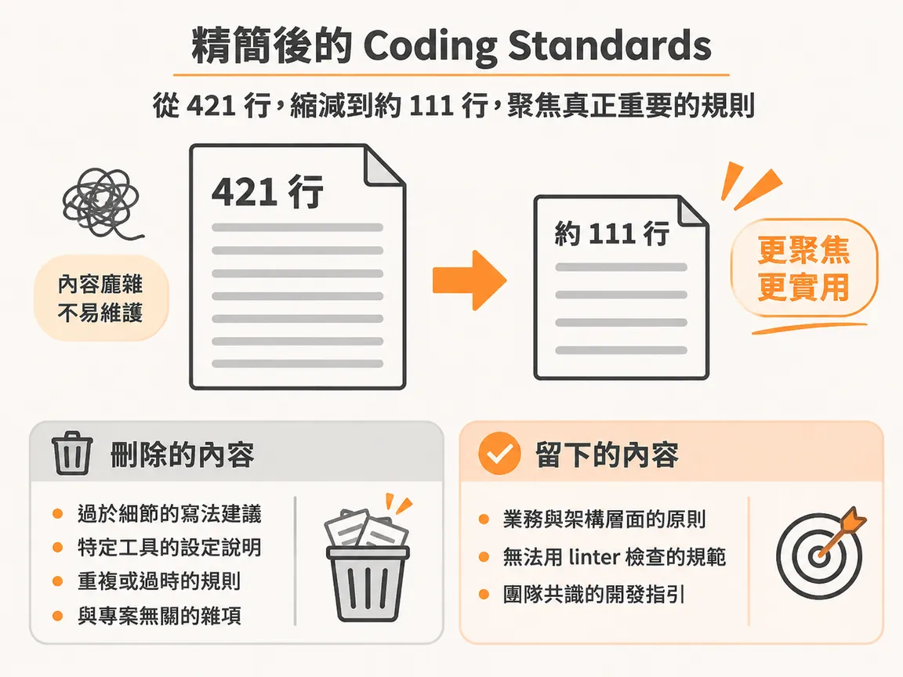

# 修剪 Coding Standards：將規範轉為自動化檢查與精簡原則

在 AI 輔助開發中，有一個核心原則：**在「確定性」（deterministic）與「非確定性」（non-deterministic）之間有選擇時，幾乎永遠應該選擇確定性**。

讓 AI agent 進行的自動審查（automated review）本質上是非確定性的。它是具有機率特性的模型，或許大部分時候都能抓出想抓的問題，但無法保證每次都抓得到。相對地，自動化檢查（automated checks，如 linter、formatter、單元測試）每一次執行的行為都完全一致。

使用 agent 時，預測能力與穩定度至關重要。只要條件允許，就應該檢視專案中的程式碼規範（coding standards），並盡可能將它們轉化為自動化檢查。

## 龐大規範帶來的負擔

如果執行指令重置並注入過度膨脹的規範：

<!-- source: sources/real-engineer/20261116/course/059 Pruning CODING_STANDARDS.md.en.txt#L5-L5 -->

```bash
npm run reset seed bloated coding standards
```

分支上的 `CODING_STANDARDS.md` 可能會一路暴增到 421 行。

在開發流程中，實作階段往往已經承載過多資訊，而程式碼審查則相對缺乏精準的約束力。儘管如此，仍要盡可能減輕人工或 agent 審查時的負擔。

一個高達數百行的規範檔案，裡面通常累積了許多陳年沉積物（sediment）——例如同事隨手塞進去、隨著專案演進卻從未整理的條文。面對每一條 coding standard，只有兩個出口：面對這些內容，處理方式只有兩種



1. **直接刪除**。
2. **轉成自動化檢查**。

## 善用 Retro Skill 進行體質檢驗

要完成修剪，不需要額外安裝花俏的新工具，只要執行既有的 agent 並呼叫 `retro`。

一般來說，`retro` 是用來回顧先前的作業階段（sessions），但這次不需要掃描過去的對話歷史，而是借用內建的規則指引，嗅出規範檔案中的異常。多數 skill 通常由兩部分組成：
- 一套具體執行的操作步驟。
- 一套理解目標與執行方向的參考指引（reference material）。

這次打破一般的步驟流程，只取用參考指引與判斷邏輯。在提示詞中明確說明這一點，agent 就能理解並勝任。

提示詞的核心方向如下：
- 目前有一個由多人長時間累積、非常龐大的 `CODING_STANDARDS.md`。
- 掃描目前的專案庫，不用回顧之前的對話 session。
- 逐條檢視規範，判斷該**刪除**還是**轉成自動化檢查**。

## Agent 掃描出的專案問題

Agent 在調查專案中現有的防護機制（guardrails）與自動化檢查後，會逐一統計違反項目與規則性質，並歸納出幾個關鍵問題：



### 1. 缺乏基礎自動化防線

專案內目前沒有設定 pre-commit hook，也沒有 CI。雖然專案配置了 Prettier，但從未被執行過。Prettier 能確保格式一致並保持乾淨的 git diff。

建議在專案中透過 pre-commit hook 執行檢查腳本（例如 `npm run check`），並加入格式檢查指令（如 `format check`）。一旦格式不符合規定就直接報錯，強制開發者執行 Prettier，而不是留到 code review 才用肉眼抓排版。

### 2. 能轉成 Linter 規則的機械化規範

規範中有大約 30 條屬於機械化規則，完全可以由工具代勞。例如規範中寫道：

> Do not write `any`, and do not write `!`

這類規定交給 linter 非常容易捕捉。在 `@typescript-eslint` 中就有現成的規則：
- `@typescript-eslint/no-explicit-any`
- `@typescript-eslint/no-non-null-assertion`

另外，像「禁止匯出僅被單一檔案引用的變數或函式」（no export used by only one file）這類要求，也能透過輕量的 CLI 工具來強制約束。

### 3. 過期、矛盾與重複的規則（應直接刪除）

檔案中存在不少應立即剔除的內容：
- **過期規則**：例如要求「透過 `progress cache` 讀取課程進度」，但整個 `app` 目錄中根本找不到 `progress cache`。程式碼改動了，規範卻沒有同步更新。
- **互相矛盾**：第 187 行寫著物件形狀優先使用 `interface`（prefer interface for object shapes），但第 326 行卻規定元件的 props 必須是 `type`。
- **重複贅述**：例如「避免 N+1 查詢問題」（avoid the n+1）與「不要在迴圈中讀取資料庫」（do not read from the database in a loop）本質上是同一件事。

### 4. Schema 規則可轉為單元測試

有些規則描述的是資料庫 Schema 與 Drizzle 之間的確定性事實（deterministic facts）。這類規則不需要寫成複雜的 lint 規則，而是可以直接寫成單一的 Vitest 單元測試。



<!-- source: sources/real-engineer/20261116/supplement/cohort-005-project/app/lib/ppp.test.ts#L1-L214 -->

```typescript
import { describe, it, expect } from "vitest";
import {
  getTierForCountry,
  getDiscountForCountry,
  calculatePppPrice,
  getCountryTierInfo,
  checkPppAccess,
} from "./ppp";
...
    it("blocks Tier 3 purchase when accessed from different country", () => {
      const result = checkPppAccess(4999, true, "IN", "US");
      expect(result.blocked).toBe(true);
      expect(result.blockedCountry).toBe("US");
      expect(result.purchaseCountry).toBe("IN");
    });
  });
});
```

透過測試直接驗證 Schema 定義是否合規，既精準又能確保 CI 每次都能驗證。

### 5. 不屬於審查範圍的流程規則與空操作（No-ops）

- **流程規則**：規範檔案中夾雜了工作流程相關的指示，這些內容並不屬於 code reviewer 在審查 diff 時該處理的範疇。
- **無效規則（No-ops）**：指那些從提示詞或規範中刪除後、輸出結果完全不會有任何改變的語句。它們要麼是在描述模型原本就會做的事，要麼語意過於模糊以致無法具體執行。例如：
  - 「最佳化前先測量」（measure before you optimize）
  - 「行動優先」（mobile first）
  - 「折疊線以上延遲載入」（lazy load before the fold）
  - 「防抖按鍵事件」（debounce keystrokes）

這些模糊的空泛建議對維持程式碼品質沒有具體幫助，應該全數刪除。

## 真正該留在 Coding Standards 的內容

經過大刀闊斧的修剪，原先 421 行的龐雜內容可以精簡到大約 111 行。留下來的規範通常屬於無法直接用 linter 簡單檢查、具有業務與架構語境的原則：



- 遇到無法繼續執行的錯誤時拋出 Response，而不是回傳錯誤物件：

<!-- source: sources/real-engineer/20261116/supplement/cohort-005-project/CODING_STANDARDS.md#L8-L10 -->

```ts
if (!course) throw data("Course not found", { status: 404 });
```

- 在邊界處使用 Schema 解析不受信任的輸入（Pass untrusted input with a schema at the edge）。
- 在 action 內部驗證權限（Check permission in the action）。
- 透過受測模組來安排測試（Arrange test through the module under test）。
- 將具關聯性的寫入操作包裹在同一個 Transaction 內（Wrap related writes in a transaction）。

這些情境對於目前的自動化檢查工具來說過於模糊或複雜，保留在 `CODING_STANDARDS.md` 中，能為 agent 與團隊成員提供最適切的架構決策指引。

最後，可以讓 agent 將篩選出的建議 lint 規則儲存成 GitHub Secret Gist。這樣既能快速為程式碼規範瘦身，又能將這些具體可落實的自動化規則留存下來。把規則拆解好之後，緊接著就要把它們掛上本地的 commit 流程，讓每次提交自動觸發檢查。
