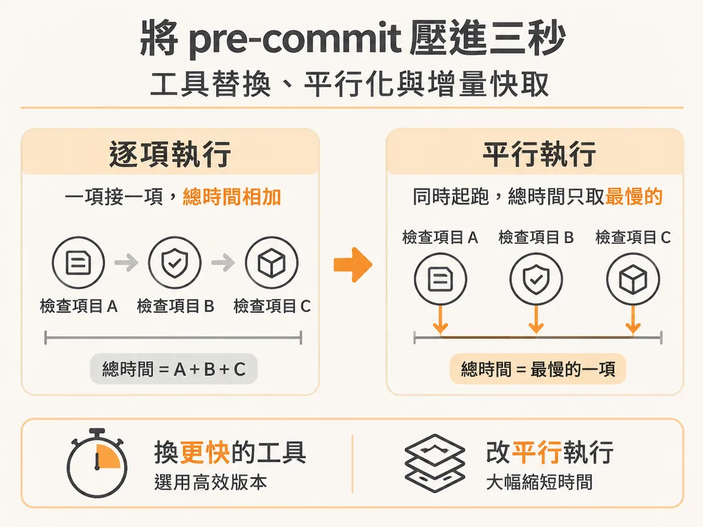
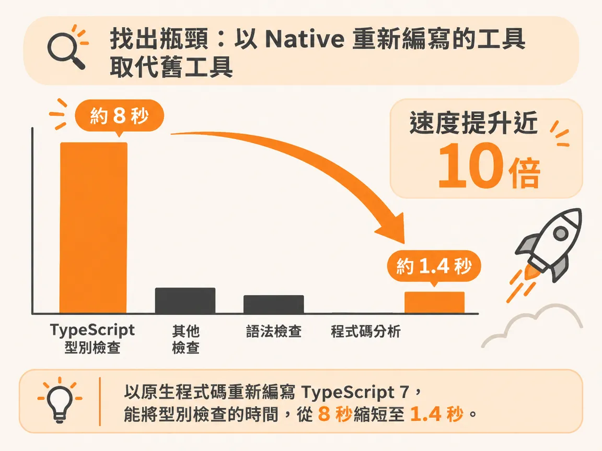
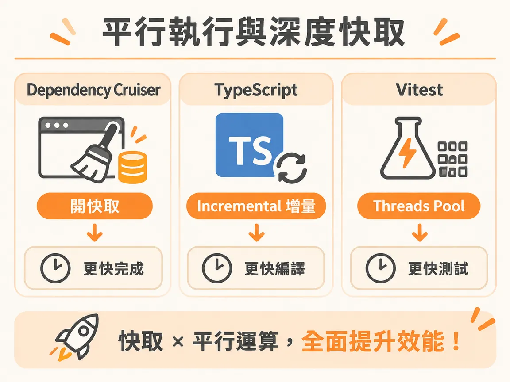
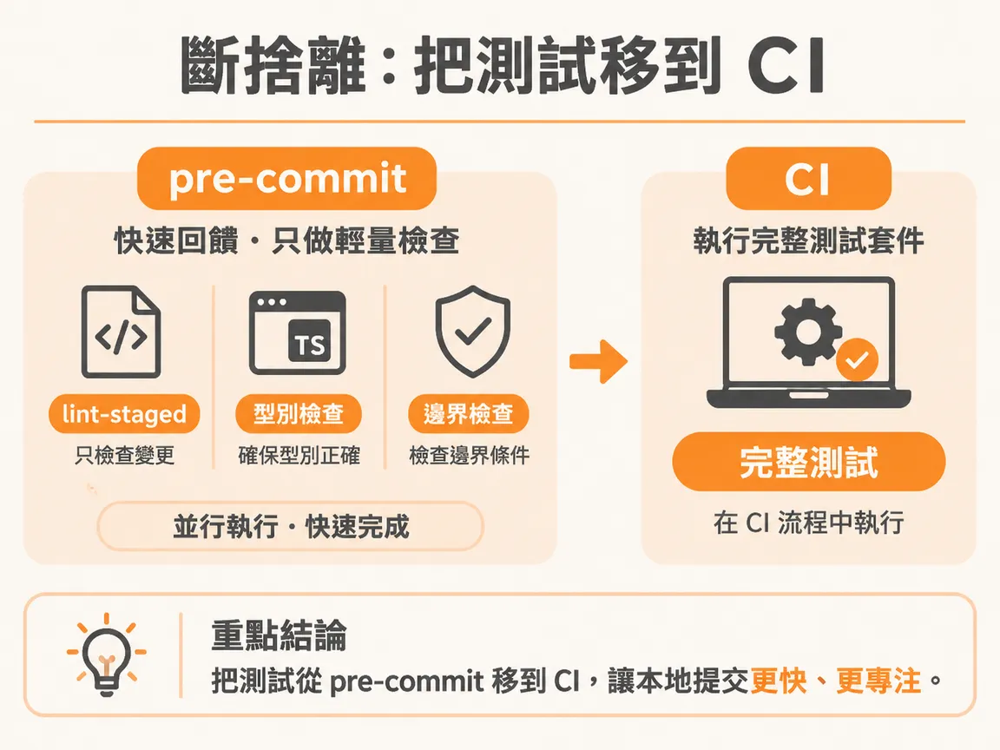

# 將 pre-commit 壓進三秒：工具替換、平行化與增量快取

在前面設定 pre-commit 時，時間預算劃定了一條界線：太慢的檢查只能丟到 CI。但檢查各項指令的執行時間時，很容易看到「型別檢查要幾秒、格式化要兩三秒」，加總起來不到十秒，便覺得「還可以接受，能繼續用」。

自動化檢查對 AI agent 的拖慢程度經常被低估。當 agent 頻繁執行改動並需要即時反饋時，這幾秒的延遲會反覆累積。只要花點時間把檢查速度拉上去，帶來的開發效益非常巨大。

要讓 pre-commit 變得俐落，關鍵是在嚴格的三秒時間預算內，重新梳理檢查機制。最直接的方向有兩個：把工具換成更快的高效版本，以及將原本逐項排隊的指令改成平行執行。原本依序執行的指令，改為平行化後通常能把時間壓到約三分之一。

這類效能最佳化任務不需要複雜的提示技巧或反覆追問，只要提供充足的資訊，agent 本身非常擅長找出調校空間。

## 找出瓶頸：以 Native 重新編寫的工具取代舊工具

在進行任何改動前，先讓 agent 為每項檢查測量兩次時間，建立基準數據。

測量後會發現，耗時約八秒的 TypeScript 型別檢查是最大的卡點。如果換上以原生程式碼（native code）重新編寫的 TypeScript 7，執行速度往往能提升近十倍，實測直接從八秒縮短至 1.4 秒。

不過升級時常會遇到相容性問題。例如架構檢查工具 Dependency Cruiser 無法讀取 TypeScript 7 的 API，導致靜默解析失敗。這時可以在專案中保留 TypeScript 5.9 供 Dependency Cruiser 專用，其餘程式碼檢查則使用新版本，兼顧相容與效能。

格式化工具也是替換重點。同樣以原生語言打造的 Biome，能大幅取代 Prettier。在檢查 144 個檔案的測試中，Prettier 耗費 2.6 秒，而 Biome 僅花了 28 毫秒。雖然兩秒看似差距不大，但在頻繁觸發的 pre-commit 流程中，這類微小差距會不斷疊加。

## 平行執行與深度快取

將工具替換並全部改為平行執行後，總耗時落在三秒左右，雖然快了許多，但依然稍微超出三秒的時間預算。

為了榨出更多效能，需要加入快取與平行運算策略：

- **Dependency Cruiser**：開啟快取（cache）機制。
- **TypeScript 7**：加上 `incremental` 旗標啟用增量快取。
- **測試工具（Vitest）**：配置執行緒池（threads pool）。

這些設定帶來的提速效果非常明顯：

- **格式檢查**：從 2.6 秒降至 0.03 秒。
- **型別檢查**：從 TypeScript 5.9 升級到 7.0.2 加上增量快取後，降至 0.2 秒。
- **架構依賴檢查**：從 2 秒縮短至 0.45 秒。
- **測試執行**：Vitest 的耗時相對沒變，成了整套檢查裡最慢的一環。

## 斷捨離：把測試移到 CI

各項檢查的執行時間，會隨著專案檔案增加而持續增長。在專案規模尚小、測試數量還不多的情況下，測試就已經逼近預算極限，未來一定會嚴重超標。

把測試塞在每次提交都要觸發的 pre-commit hook 裡並不合適。Pre-commit 的核心在於快速回饋，慢速而完整的測試應該推遲到 CI 流程中執行，本地端則保留在完整的檢查指令（例如 `npm run check`）即可。

將測試移出 pre-commit 後，hook 只需要平行執行 lint-staged、型別檢查與邊界檢查，遇到小型提交時，整體耗時能一口氣壓在 1 秒以內。

更換格式化工具至 Biome 後，由於排版規則與 Prettier 略有不同，通常會產生一些格式修正。在提交變更時，若 pre-commit 的檔案大小防護機制因檔案過大而阻擋提交，依提示選擇對應處理選項即可完成 commit。

讓 pre-commit 檢查保持迅捷，能讓 agent 在最少等待下拿到驗證反饋，開發節奏自然就會快上許多。確定性規則已成功從散文搬進 pre-commit 與 CI，三秒預算也徹底守住。
