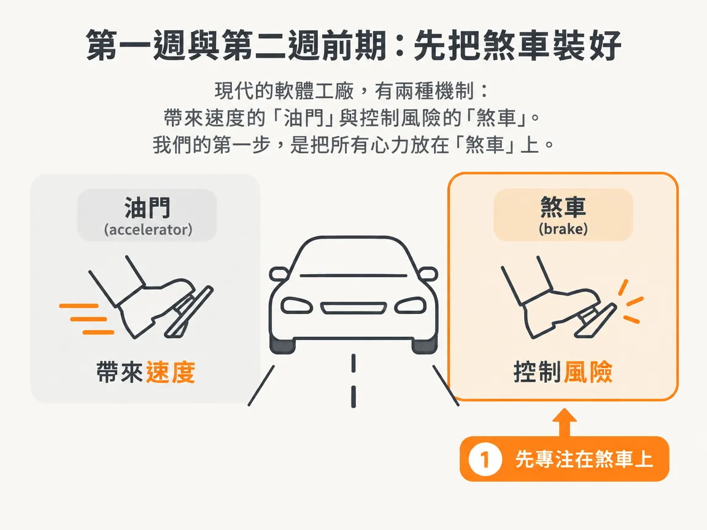

# 先裝煞車再踩油門：打造真正可靠的軟體工廠

AI Agent 最核心的承諾是速度，讓人能以極快的節奏交付程式碼。

多數團隊導入時都會碰壁。
難題在於：如何對 Agent 建立足夠的信任，敢放手讓它把程式碼推上線？
有了信任之後，又該如何全力加速，同時避免失控撞牆？

這套工程實踐正是為了解決這兩個問題。

## 基礎核心觀念

要駕馭這套流程，必須先熟練幾項關鍵概念：

- context window
- smart zone
- steering（引導與轉向）
- grilling（提問盤問）技巧
- skills 的基本用法

這些是底層基石，所有進階流程都是從這些觀念疊加與延伸。

## 階段一：先把煞車裝好

如果把現代的軟體工廠拆成兩種機制——也就是帶來速度的 accelerator（油門）與負責控制風險的 brake（煞車）——第一步必須把心力完全放在煞車上。

急著踩油門，只會更快產出無法維護的 slop。
要避免失控撞牆，必須先建立完整的控制機制：

- **Review（審查機制）**：涵蓋自動化審查與人工審查。
- **Code-based design（以程式碼為基礎的設計）**：讓架構本身成為規範。
- **Domain language（領域語言）**：使用精確詞彙，確保人與 Agent 理解完全一致。
- **Wayfinder**：運用這套工具來規劃大區塊的複雜工作。

這套以煞車為核心的思維會一路延續到第二週前期。接著需要進一步建立：

- **Automated checks（自動化檢查）**
- **Feedback loops（回饋迴圈）**
- **Data sources（資料來源）**

這些設計的目的，是讓 Agent 具備自我除錯能力，在問題進入主分支前就自行攔截修正。

## 階段二：重重踩下油門

煞車系統完備、信任建立起來之後，有了煞車保護，才能全力踩下油門，啟動軟體工廠：

- **Software Factory 第一階段**：建立真實運作的軟體工廠具體運作模型。
- **Software Factory 第二階段**：配置相應的基礎架構，打造專屬加速器，讓大量高品質程式碼穩定推進 repository。

## 工具條件與最終成果

這套工作流不綁死特定平台。
選用的 Agent 只要符合兩個基本條件即可：

1. 能在 terminal 環境中執行。
2. 支援擴充 skills。

實作上可以選用 Claude Code 進行操作。

完整建置後，就能擁有一套貼合自身基礎架構的流暢工作流。
對 Agent 的信任得以規模化：從原本手忙腳亂盯著 1 到 5 個 Agent，升級到能安心放行 50 個 Agent 平行運轉。

整套系統的核心，是用扎實的傳統軟體工程基本功來當作煞車，守住品質底線。
所有做法都奠基於扎實且歷久彌新的工程原則。
