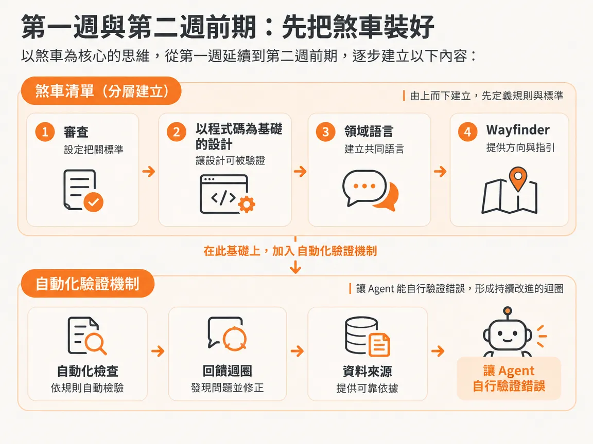
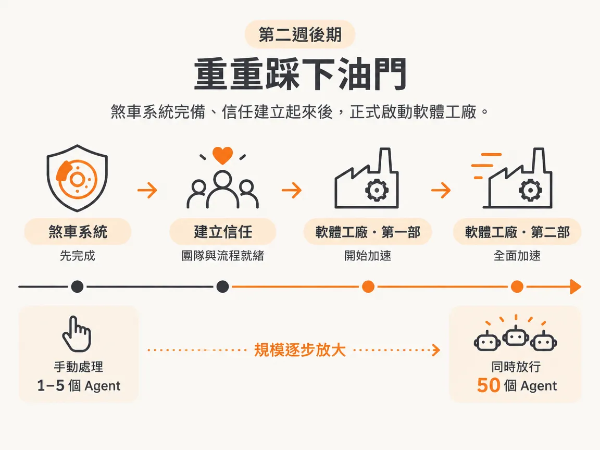

# 先裝煞車再踩油門：打造真正可靠的軟體工廠

AI Agent 最吸引人的核心承諾就是速度——讓我們能以過去無法想像的節奏，快速交付更多程式碼。

但很多團隊在導入時都會碰壁。真正的難題在於：你要如何對 Agent 建立足夠的信任，才敢放手讓它把程式碼推上線？就算有了信任，又該如何狠狠踩下油門加速，卻不會直接失控撞牆？

這門課《Software Factories for Real Engineers》正是為了回答這兩個問題。我是 Matt Pocock，這篇文章會清楚說明我們接下來的學習路徑。

## 基礎打底：速成課

在正式進入主課之前，你隨時都能存取先行的速成課（crash course）。速成課是幫你打穩地基的地方，讓你熟悉幾項關鍵概念：

- 上下文視窗（context window）
- 聰明區間（smart zone）
- 引導與轉向（steering）
- 提問盤問（grilling）的基礎技巧
- Skills 的基本用法

如果你之前已經看過，建議重新複習一遍；如果你還沒看過，請務必先走完那一門課。接下來兩週，我們會把在那裡學到的觀念，用全新的方式疊加與延伸。

## 第一週與第二週前期：先把煞車裝好

如果把現代的軟體工廠拆成兩種機制——帶來速度的「油門（accelerator）」與負責控制風險的「煞車（brake）」——我們的第一步是把所有心力放在「煞車」上。

很多人急著踩油門，結果只是更快產出無法維護的垃圾程式碼（slop）。為了避免撞牆，第一週我們會專注於控制機制：

- **審查機制（Review）**：涵蓋自動化審查與人工審查。
- **以程式碼為基礎的設計（Code-based design）**：讓架構本身成為規範。
- **領域語言（Domain language）**：使用精確的領域詞彙，確保你與 Agent 步調完全一致。
- **Wayfinder**：運用這套工具來規劃大區塊的複雜工作。

這套以煞車為核心的思維會一路延續到第二週前期。我們會進一步建立：

- **自動化檢查（Automated checks）**
- **回饋迴圈（Feedback loops）**
- **資料來源（Data sources）**

這些設計的目的只有一個：讓 Agent 具備自我檢驗錯誤的能力，在問題溜進主分支前就自行攔截修正。

## 第二週後期：重重踩下油門

煞車系統完備、信任建立起來之後，我們才在第二週正式踩下油門，啟動軟體工廠：

- **軟體工廠第一部（Software Factory Part 1）**：帶你看一個真實運作的軟體工廠具體範例。
- **軟體工廠第二部（Software Factory Part 2）**：開始配置並思考你自己的基礎架構，設計出專屬的加速器，讓更多高品質的程式碼源源不絕推進你的專案庫（repository）。

## 需要的工具與最終目標

這套工作流並不綁死單一平台，只要你的 Agent 符合兩個基本條件即可：

1. 能夠在終端機（terminal）環境中執行。
2. 支援使用擴充技能（skills）。

課程中的範例會使用 Claude Code 來示範。

走到最後，你會建立起一套完全貼合自身基礎架構需求的龐大流暢工作流。你對 Agent 的信任將大幅規模化：從原本手忙腳亂、只能手動盯著 1 到 5 個 Agent，升級到能安心同時放行 50 個 Agent 平行運轉。

最關鍵的是，我們是用扎實的傳統軟體工程基本功來充當煞車，守住品質底線。這不是空泛的話術，而是貨真價實的工程原則——過程中我甚至會直接從書架上抓下經典名著，一本一本翻給你看。
