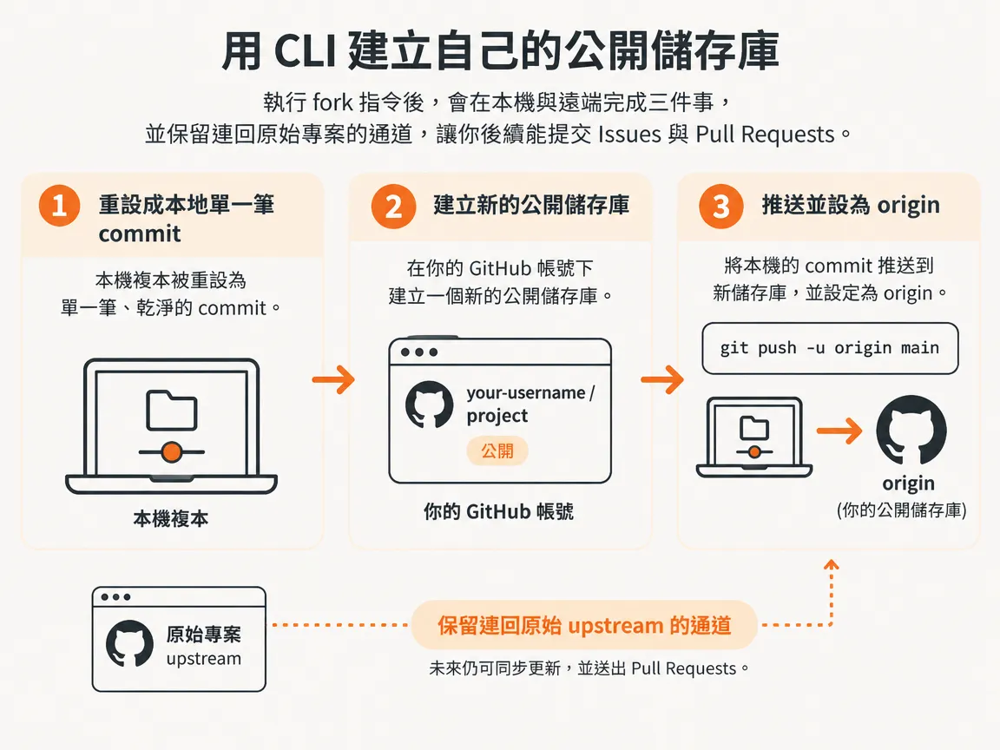
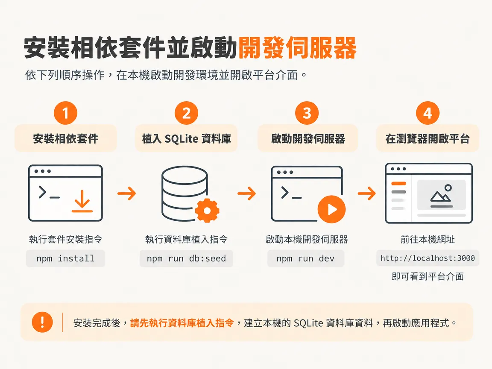

# 建置 Cadence 專案：從 Clone、建立自己的 Public Repo 到啟動開發伺服器

進行實作前，需要把專案倉庫（Cohort005project）下載到本機，並在 GitHub 上建立屬於自己的版本。

就算先前在速成課程（crash course）做過類似設定，也不能跳過這一步。這次使用的是完全不同的儲存庫（repository）與操作環境。

## 複製專案並開啟編輯器

首先將專案 clone 到本機。在專案頁面複製 HTTPS 網址（習慣的話也可以用 SSH，此處以 HTTPS 為主），在終端機執行：

<!-- derived -->
```bash
git clone https://github.com/ai-hero-dev/cohort-005-project.git
cd cohort-005-project
```

進入資料夾後，輸入 `code .` 用 VS Code 開啟專案。也可以自由改用偏好的 IDE 或只用終端機操作。

## 用 CLI 建立自己的公開儲存庫

接著我們要在 GitHub 上建立自己的版本。這不只是為了拿到程式碼，更重要的是必須擁有自己的 Issues 與 Pull Requests，做為後續的任務追蹤系統（ticket tracker）。



專案內建了一道簡化流程的指令：

<!-- derived -->
```bash
npx aihero-cli fork
```

終端機會詢問是否安裝指定版本的 `aihero-cli`。確認後輸入自訂的儲存庫名稱，例如專案名稱加上後綴。

執行時終端機會提示以下動作：
- 將目前資料夾的 Git 歷史記錄重設，替換成單一筆全新的 commit。
- 在個人的 GitHub 帳號下建立新的公開（public）儲存庫。
- 將檔案推送到該儲存庫並設為 `origin`。

本機 Git 歷史被重設只會影響這個專案。專案內已有自訂指令連回原始專案的 upstream，因此重置歷史記錄是預期中的做法。在提示出現時按下 `Y` 確認，公開儲存庫即建立完成。

儲存庫務必設為公開。後續高度依賴 GitHub Actions 執行自動化工作。GitHub 對公開儲存庫提供免費的 GitHub Actions 額度；私有（private）儲存庫的免費額度非常有限，公開儲存庫最適合練習。

## 安裝相依套件並啟動開發伺服器

這個專案架構在 Cadence 線上課程平台之上。沿用相同架構可以省去重新理解新系統的時間，專注於新功能。

在專案目錄下安裝相依套件：

<!-- derived -->
```bash
npm install
```

安裝時若出現棄用警告（deprecation warnings）或安全性弱點（vulnerabilities），直接忽略即可。

安裝完成後不要急著啟動應用程式，請先執行資料庫植入指令，建立本機的 SQLite 資料庫資料：



<!-- derived -->
```bash
npm run db:seed
```

資料庫植入完成後，啟動本機開發伺服器：

<!-- derived -->
```bash
npm run dev
```

終端機會顯示伺服器運行在 `http://localhost:5175`。在瀏覽器開啟該網址，就能看到 Cadence 平台介面。

## 需要用到的第三方服務

完成基本環境建置後，有兩項服務會在後續步驟使用到：

1. **Knock**：實作通知系統時使用。註冊免費開發者帳號只要電子信箱，不需綁定信用卡，也不需付費。
2. **tldraw**：繪製白板架構圖時使用的線上畫布工具，直接用 Google 帳號登入即可。

安裝或啟動時若遇到問題，可前往 Discord 發問，或參考文末的常見問題排解說明。
