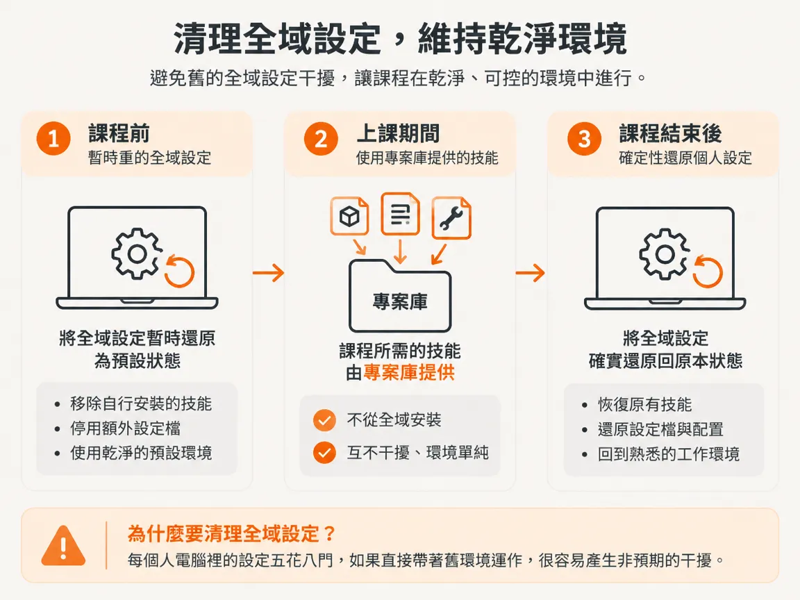

# 挑選模型方案與清理全域設定：讓 Agent 進入起跑狀態

進入實作練習與課程專案庫（repo）之前，必須先把你的 agent 調整到位。這件事主要分成兩部分：你打算用哪一個等級的模型與訂閱方案，以及你的 agent 身上帶了哪些原本的全域設定。

## 為什麼需要 Opus 等級與高額度方案？

這裡挑選的模型與方案，重要性會遠高於入門速成班。接下來的實作中，我們會讓多個 agent 長時間運作，常常是好幾個同時在跑，而且後續會交由它們做出高價值、相當關鍵的自主決策。

多個 agent 同時並行，消耗的速度會非常快，過於便宜的方案一下子就會被燒光。因此，免費方案完全行不通；即使是每個月一般的 Pro 方案，恐怕也不太夠用。

這背後的原因是：我們預計全程使用 Opus 等級的模型。

Opus 等級的模型成本較高，如果想要不被用量卡死，最低限度大概會需要每月 100 美元左右的方案。如果堅持留在 Pro 方案上，硬靠 Sonnet 等級的模型勉強支撐，就必須隨時節制用量、精打細算，這樣很難真正體會到「軟體工廠」（software factory）全力運轉的完整能力。

不過，如果你還不確定自己需要多少用量，或者不想一開始就花大錢，也可以先從 Pro 方案起步，等到額度見底時再升級。以課程示範來說，講師日常使用的版本是接近每月 200 美元的較高階 Max 方案。

另外要特別提醒的是，實作中完全不需要走 API 計費。要完成相同的工作量，直接使用 API 往往會比購買個人訂閱、團隊方案或企業方案花費更多金錢。

## 挑選工具與基準評測

不論你使用的是 Claude Code 還是 Codex，只要滿足兩個條件，用哪一套 agent 與哪種訂閱方式其實都可以：

1. 背後使用的是 Opus 等級的模型。
2. 方案具備足夠的 token 額度，能讓你順暢完成所有實作。

若想了解當前哪些模型表現最好，可以參考 Deep SWE 這套基準測試。雖然這份評測只能算是粗略值得參考，但至少能幫你找出表現落在正確範圍內的模型；基本上，只要模型落在評測圖表的「右上象限」即可。

示範中使用的 Opus 5.5 並沒有列在這份榜單上，但判斷標準依然相同：認明 Opus 等級、準備至少每月 100 美元的方案。如果一開始不確定哪種方案適合自己，先買便宜的方案，額度不夠時再向上調整即可。

## 清理全域設定，維持乾淨環境

只要能在終端機（terminal）執行、並且支援技能（skills）機制的 agent，都能跟著這門課操作。

課程後段會用到的各項技能，全部都直接內建在我們作業的專案庫中。你不需要從外部安裝任何講師的全域技能，需要用到的工具都會在專案內直接提供。

真正需要留意的是你在自己電腦上全域安裝的技能、設定檔或額外配置。每個人電腦裡的設定五花八門，如果直接帶著舊環境運作，很容易產生非預期的干擾。

為了避免這種情況，建議在啟動時提供提示詞（prompt）給 agent，請它把全域設定暫時重設回預設值。清空複雜的自訂環境、從乾淨的白紙狀態起跑，能減少系統內的雜訊，讓你的執行結果更容易對齊示範內容。同時，這段清理流程也應該包含確定性的還原步驟，在練習結束後能完整恢復你原本的設定，並清除課程期間新增的雜物。

確認模型等級、額度足夠，並把全域設定暫時歸零後，你的 agent 就具備了乾淨的起跑狀態，可以隨時進入後續的實作課程。
