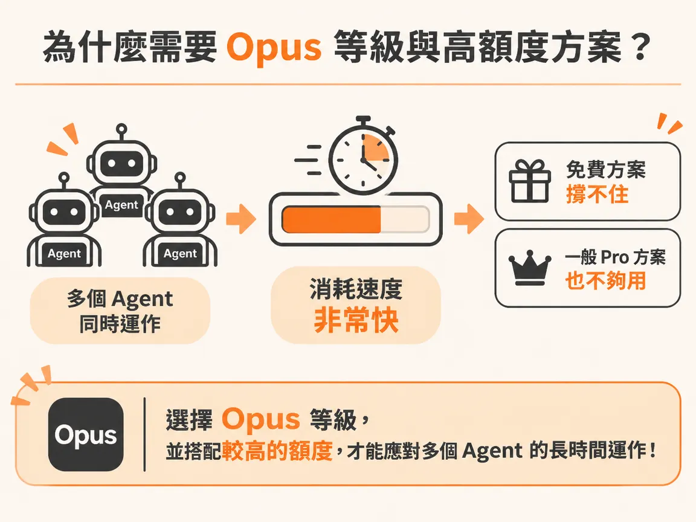
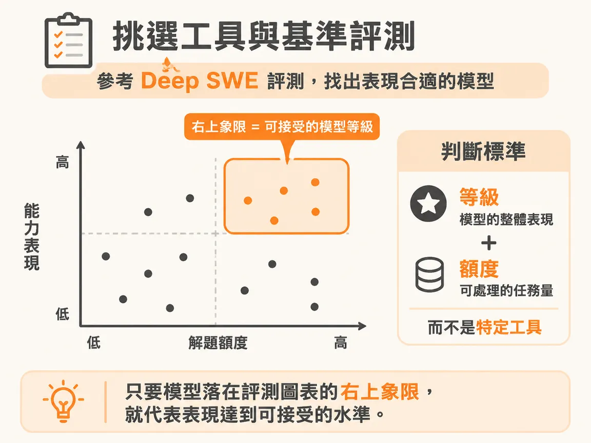

# 挑選模型方案與清理全域設定：讓 Agent 進入起跑狀態

使用 agent 時，前置設定必須先調整到位。這主要分成兩個部分：選擇的模型等級與訂閱方案，以及 agent 目前套用的全域設定。

## 為什麼需要 Opus 等級與高額度方案？

模型與方案的選擇非常關鍵。

實際運作時，經常需要讓多個 agent 長時間並行運轉。後續許多高價值、相當關鍵的決策，也都會交由它們自主完成。

多個 agent 同時並行，消耗的速度會非常快，過於便宜的方案很快就會把額度用盡。免費方案完全無法負荷，一般的每月 Pro 方案通常也不太夠用。

主要原因在於整體流程需要全程採用 Opus 等級的模型。

Opus 等級的模型成本較高。想避免被用量限制卡住，最低門檻大約需要每月 100 美元左右的方案。如果留在 Pro 方案並改用 Sonnet 等級的模型硬撐，就必須隨時節制用量，很難完全發揮 software factory 全速運轉的能力。

如果還不確定實際用量，或不想一開始投入太多預算，可以先從 Pro 方案開始。額度耗盡時再往上升級即可。高用量情境通常會使用接近每月 200 美元的較高階 Max 方案。

整個過程完全不需要走 API 計費。處理相同的工作量時，直接調用 API 往往比購買個人訂閱、團隊方案或企業方案昂貴許多。

## 挑選工具與基準評測

不論使用 Claude Code 還是 Codex，只要符合兩個條件，選用哪套 agent 與訂閱形式都可以：

1. 底層使用 Opus 等級的模型。
2. 方案具備足夠的 token 額度，能順暢支撐所有工作流程。

若想了解當前哪些模型表現最好，可以參考 Deep SWE 這套基準測試。這份評測能協助找出表現符合標準的模型，只要模型落在評測圖表的「右上象限」即可。

即使使用的 Opus 5.5 沒有列在榜單上，判斷標準依然相同：認明 Opus 等級，並準備至少每月 100 美元的方案。不確定方案是否合適時，先從較便宜的方案著手，額度不足時再向上調整。

## 清理全域設定，維持乾淨環境

只要能在 terminal 執行並支援 skills 機制的 agent，都能適用。

後續所需的所有技能，都會直接內建在專案的 repo 中。不需要從外部安裝額外的全域技能，所需工具在 repo 內都會備齊。

真正需要留意的是你在自己電腦上全域安裝的技能、設定檔或額外配置。每台電腦的現有環境各不相同，直接帶著舊設定運作很容易產生非預期的干擾。

建議在啟動時提供 prompt 給 agent，請它把全域設定暫時重設回預設值。清空自訂環境能減少系統雜訊，確保執行結果穩定一致。這段清理流程也必須包含明確的還原步驟，在工作結束後能完整恢復原本的設定，並清除期間新增的暫存項目。

確認模型等級、額度充足，並將全域設定暫時歸零後，agent 就具備了乾淨的初始狀態，隨時可以投入運作。
