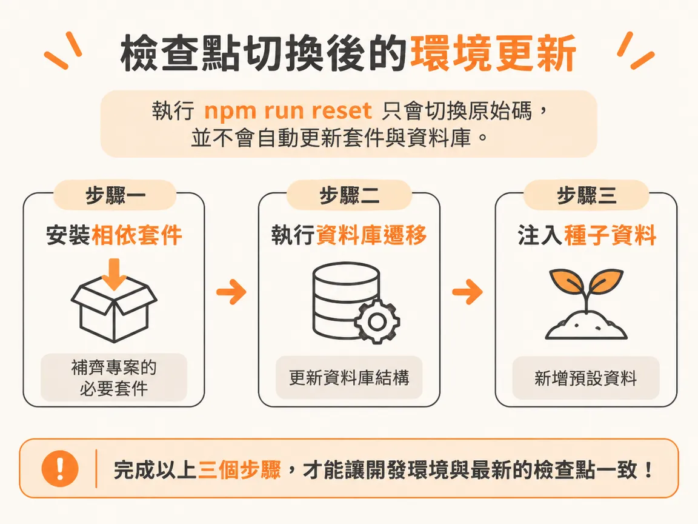

# 如何在實作課程中同步程式碼檢查點

實作的核心在於動手練習：規劃功能、修復錯誤、審查程式碼變更（diff），並逐步打造軟體工廠（Software Factory）的各個組件。

實作時最大的挑戰，是讓程式碼與示範進度保持一致。如果程式碼出現偏差，AI 代理人（Agent）產出的結果就會完全不同。為了避免進度脫節，專案提供三個指令來管理程式碼狀態：`npm run reset`、`npm run cherry-pick` 與 `npm run pull`。

## 用 npm run reset 完全對齊檢查點

只要完成初步的 `npm install`，隨時都可以執行：

<!-- derived -->
```bash
npm run reset
```

執行後終端機會列出所有檢查點（checkpoint），例如「seed Liam's refund」、「create glossary and fix refund drift」或是「add grill and domain skills」。

選定要跳轉的檢查點後，系統會詢問：
1. 重設目前的 branch。
2. 保留目前的 branch 內容，並從該 commit 開一個新 branch。


選擇直接重設當前 branch 時，終端機會跳出警告，提醒即將捨棄未儲存的變更。確認後，程式碼就會完全切換到該進度。

`npm run reset` 的運作方式類似 Git 的 `git reset`，會抹除所有既有的修改。如果寫了不想遺失的程式碼，務必先 commit 或開新 branch 保存；若想回到專案最初始的狀態，可以直接重設回 `main`。

## 用 npm run cherry-pick 保留自己的修改

若要在保留自身修改的前提下帶入後續進度的程式碼，可以使用：

<!-- derived -->
```bash
npm run cherry-pick
```

執行後會列出與 reset 相同的檢查點清單。選定檢查點後，系統會把該進度的 commit 疊加（cherry-pick）在目前的進度之上，而不是直接取代。

舉個具體的例子：假設在 `package.json` 裡把專案名稱從「awesome course platform」改成「awesome horse platform」，並 commit 了一筆紀錄「course to horse」。
- 執行 `npm run cherry-pick` 跳到「add grill and domain skills」時，這段「horse」的修改依然會完整保留。
- 若執行 `npm run reset` 跳到「seed Liam's refund」，原本「course to horse」的修改就會被徹底覆蓋還原。


`npm run cherry-pick` 能保留現有的修改，但當改動與新進度有重疊時，可能需要手動解 conflict（合併衝突）。後續打造軟體工廠時會頻繁使用這個指令，這樣既能自由選擇工廠中使用的模型，又能同步套用新增的程式碼架構。

## 用 npm run pull 同步上游的即時修復

第三個指令是：

<!-- derived -->
```bash
npm run pull
```

如果官方儲存庫（repo）推送了最新修正，只要執行 `npm run pull`，就能把變更合併到本機 repo。

與 cherry-pick 類似，`npm run pull` 會盡量保留現有的工作成果，過程中有可能遇到 conflict 需要手動解決，但不會像 reset 那樣直接刪除現有修改。

## 檢查點切換後的環境更新

執行 `npm run reset` 只會切換專案的原始碼，並不會自動更新套件與資料庫。



例如切換到「admin refund approval ADR」後，如果新進度增加了相依套件或資料表，還需要執行以下步驟：

1. **更新套件**：執行 `npm install`，安裝該 commit 新增或升級的相依套件。
2. **執行資料庫遷移**：執行 `npm run db:migrate`，套用資料庫架構（schema）的最新變更。
3. **注入測試資料**：執行 `npm run db:seed`，將資料庫初始化為指定階段所需的種子資料（seed data）。

各階段程式碼都有對應的 commit 檢查點。善用這三個指令，並在切換後確認套件與資料庫同步更新，就能確保本機環境隨時與示範版本保持一致。
