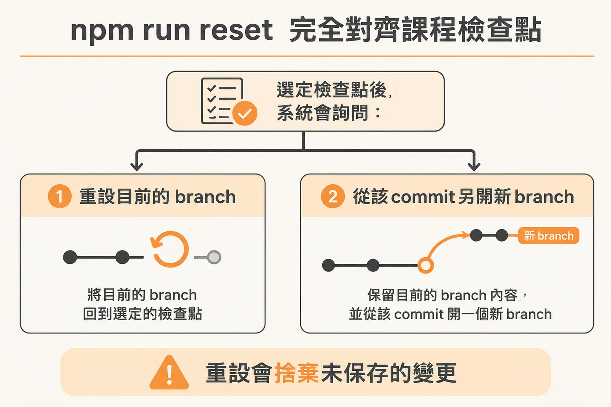
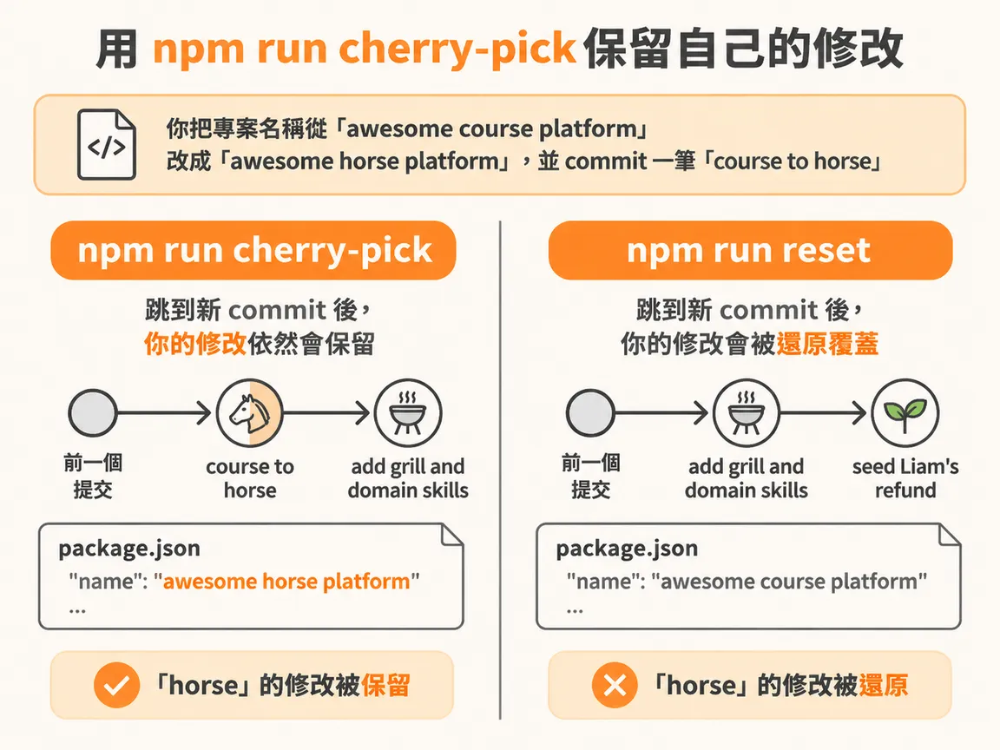

# 如何在實作課程中同步程式碼檢查點

這門課的核心圍繞著動手練習：我們要一起規劃功能、修復錯誤、審查程式碼變更（diff），並逐步打造軟體工廠（Software Factory）的各個組件。

在這樣的實作過程中，最大的挑戰是「如何跟上講師的進度」。如果你的程式碼與示範出現偏差，AI 代理人（Agent）產出的結果就會跟講師完全不同。為了避免進度脫節，專案設計了三個指令來管理程式碼狀態：`npm run reset`、`npm run cherry-pick` 與 `npm run pull`。

## 用 npm run reset 完全對齊課程檢查點

只要完成初步的 `npm install`，隨時都可以執行：

<!-- derived -->
```bash
npm run reset
```

執行後終端機會列出課程的所有檢查點（checkpoint），數量非常多，例如「seed Liam's refund」、「create glossary and fix refund drift」或是「add grill and domain skills」等。

選定要跳轉的檢查點後，系統會詢問：
1. 重設目前的 branch。
2. 保留目前的 branch 內容，並從該 commit 開一個新 branch。



如果你選擇直接重設當前 branch，終端機會跳出警告，提醒即將捨棄未儲存的變更。確認後，程式碼就會完全切換到該進度。

`npm run reset` 就像 Git 的 `git reset`，它會抹除所有既有的修改。如果中途寫了不想弄丟的程式碼，務必先 commit 或開新的 branch 保存；若想回到專案最初始的狀態，也可以直接重設回 `main`。

## 用 npm run cherry-pick 保留自己的修改

如果你想在保留自己改動的前提下，帶入新章節的程式碼，請使用：

<!-- derived -->
```bash
npm run cherry-pick
```

執行後會出現與 reset 相同的檢查點清單。但不同的是，選定檢查點後，系統會把該課程的 commit 疊加（cherry-pick）在你的目前進度之上，而不是取代它。

舉個具體的例子：假設你在 `package.json` 裡把專案名稱從「awesome course platform」改成「awesome horse platform」，並且 commit 了一筆紀錄「course to horse」。
- 如果執行 `npm run cherry-pick` 跳到「add grill and domain skills」，這段「horse」的修改依然會完整保留在專案中。
- 但如果這時執行 `npm run reset` 跳到「seed Liam's refund」，原本「course to horse」的修改就會被徹底還原覆蓋。



`npm run cherry-pick` 能保留現有的心血，但代價是當你的改動與課程內容有重疊時，可能需要手動解 conflict（合併衝突）。在後面打造軟體工廠的單元中，我們會大量使用這個指令，這樣一來既能自選要在工廠中使用的模型，又能同時吸收講師新增的程式碼架構。

## 用 npm run pull 同步上游的即時修復

第三個指令是：

<!-- derived -->
```bash
npm run pull
```

在開課期間，如果講師發現專案有瑕疵或需要修正，會把修復直接推送到課程的官方儲存庫（repo），並在 Discord 上通知大家。這時只要執行 `npm run pull`，就能把最新修正合併到你本機的 repo。

與 cherry-pick 類似，`npm run pull` 會盡量保留你現有的工作成果，因此也可能會遇到需要解 conflict 的情況，但它不會像 reset 那樣粗暴地直接刪除現有修改。

## 檢查點切換後的環境更新

執行 `npm run reset` 只會切換專案的原始碼，並不會自動更新套件與資料庫。


例如重設到「admin refund approval ADR」後，如果新進度增加了相依套件或資料表，你還需要補跑以下步驟：

1. **更新套件**：執行 `npm install`，拉進該 commit 新增或升級的相依套件。
2. **執行資料庫遷移**：執行 `npm run db:migrate`，套用資料庫架構（schema）的最新變更。
3. **注入測試資料**：執行 `npm run db:seed`，把資料庫初始化成該堂課所預期的種子資料（seed data）。

每堂涉及程式碼的課程都有對應的 commit 檢查點。只要善用這三個指令，並在重設後確認套件與資料庫已同步更新，就能確保自己的本機環境隨時與課程示範保持一致。
