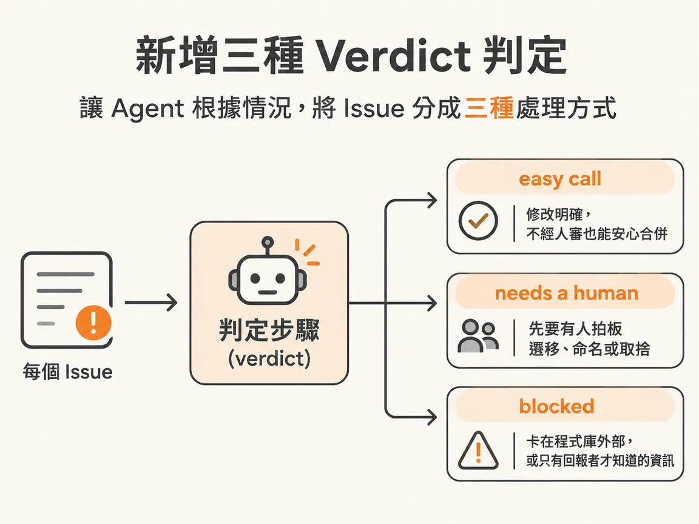
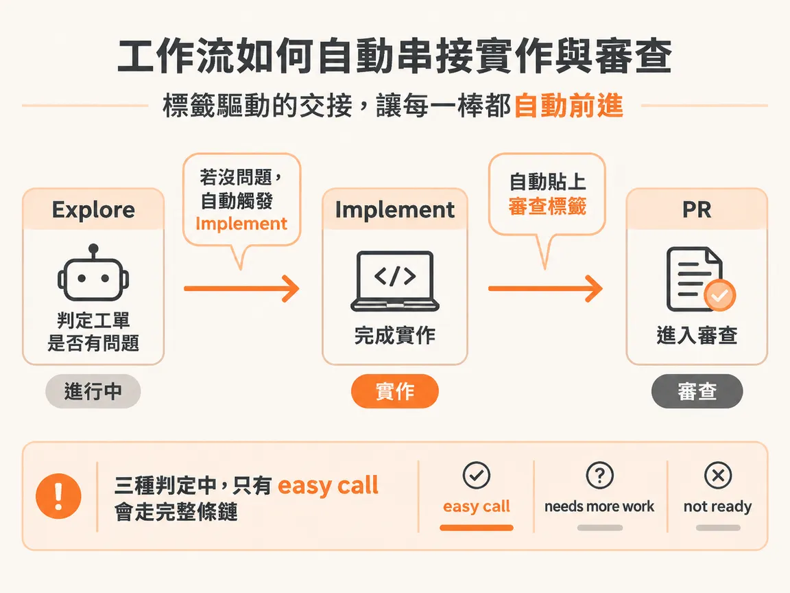
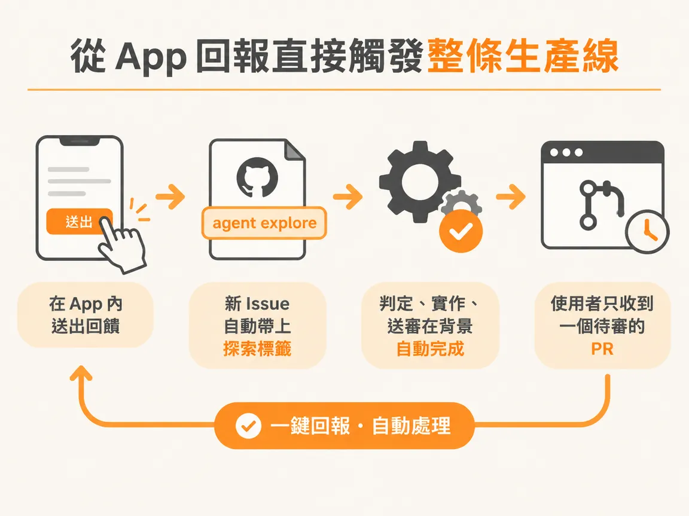

# 串接軟體工廠：用三種判定讓 Explore 自動分派任務

在 Explore 流程跑起來之後，整個流程其實還卡著不少手動步驟。每次探索完畢，你得手動挑出哪些工單要交給實作者處理；實作者改完程式、開好 Draft PR 之後，你還得手動幫它加上 `agent review` 標籤；最後，你依然得自己決定要不要合併。

這讓軟體工廠顯得不夠自主，因為你隨時得停下手邊工作，跳進去確認工廠有沒有繼續運轉。

要解決這個問題，我們需要把中間的斷點接起來：實作完成後自動送審，更重要的是，讓 Explore 在分析工單時，就能自己判斷哪些項目可以直接交給 Implementer 實作。

## 引入串接改動

透過專案內的指令把準備好的改動抓進來：

<!-- derived -->
```bash
npm run cherry pick
```

在選單中選取 `chain factory end-to-end` 這個 commit。接著把這個本地提交推送到遠端：

<!-- derived -->
```bash
git push
```

## 替 Explore Prompt 加上三種 Verdict 判定

打開 Agent 的 Explore Prompt，會看到裡面新增了一個叫做「判定」（verdict）的步驟。Agent 會替每個 Issue 打上一種標籤，工作流程接著根據標籤走不同的分支：



- **`easy call`（明確可做）**：該做的修改非常明確，沒有人會反對裡面的任何決定，就算這個 PR 完全不經過審查就直接合併也讓人放心。符合這條件的工單，會直接送進 Implementer。
- **`needs a human`（需要人工介入）**：必須先有人做出決定才能繼續。例如涉及資料遷移（migration）、命名選擇、規範政策、功能取捨（trade-off），或者工單本身的描述與實際情況不符。
- **`blocked`（受阻）**：正在等待這個儲存庫外部的事物，或者需要只有回報者才知道的資訊。

這段判定標準的敘述非常關鍵，因為它給了 Agent 做決策的依據。在建置軟體工廠時，可以根據團隊需求微調這些規則，甚至在 Prompt 裡面附上幾則具體範例，示範哪些工單算 `easy call`、哪些算 `needs a human`。

## 工作流如何自動串接實作與審查

在定義產出格式的 plan schema 裡，每個 Issue 都會被標註對應的判定標籤。

而在工作流程中，一旦 Issue 的標籤被判定為 `easy call`，系統就會認定這是一件明確可做的事，不需要先詢問任何人，直接交由 Implementer 處理。具體動作是：移除 Issue 上的 `agent in progress` 標籤，並自動加上 `agent implement` 標籤。

第一條串接線就這樣接上了：Explore 只要判定工單沒問題，就會自動觸發 Implement。



接著看 Implement 怎麼銜接 Review。在 `agent.implement` 中也加了一個新步驟：完成實作後，直接把 PR 交給審查者。它會呼叫 `github.pr.edit`，替開出來的 PR 自動貼上 `agent review` 標籤。

整條管線一路通到了審查階段。只要給一個 Issue 貼上 `agent explore` 標籤，Agent 就會一路分析、實作，並在完成時自動送出 PR 等待審查。

## 從 App 回報直接觸發整條生產線

這次改動還包含一個方便的機制：只要透過 App 內建的表單送出回饋（feedback），新建立的 Issue 就會自動帶上 `agent explore` 標籤。



這在實際開發應用程式時特別有用。在 QA 測試別的功能時，順手發現某個畫面怪怪的，只要填表單送出，Agent 就會在背景開始探索、實作並送出 PR，人類稍後直接看成果就好。

可以用一個容易通過 `easy call` 標準的微小修改來測試整條管線，例如調整首頁排版：

> 「我不喜歡目前 landing page 的排版，希望能改成靠左對齊。現在的置中排版看起來有點俗氣，整體像半成品，不夠吸睛。」

按下送出工單的那一瞬間，整個軟體工廠就正式啟動，自主完成後續的探索與開發。
