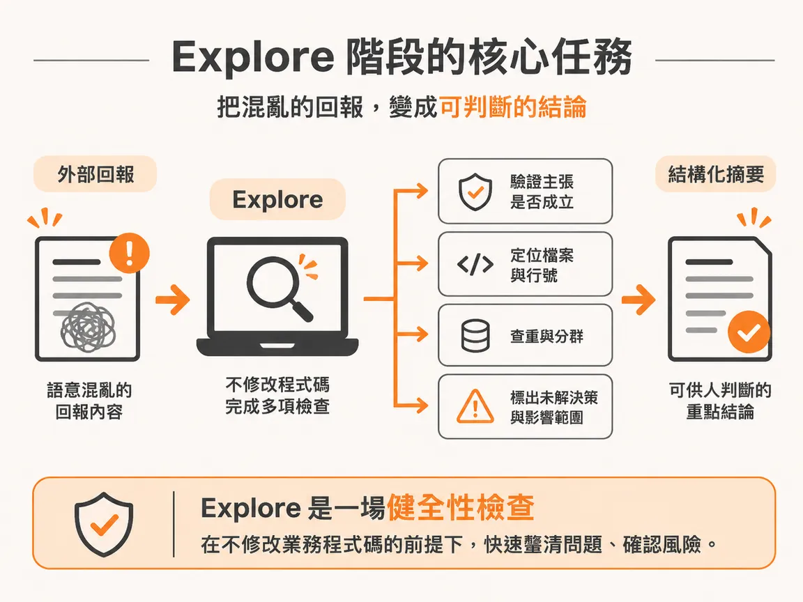
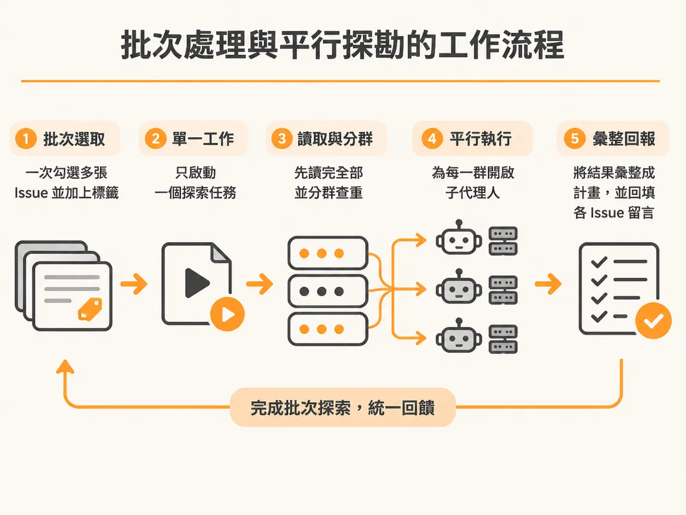
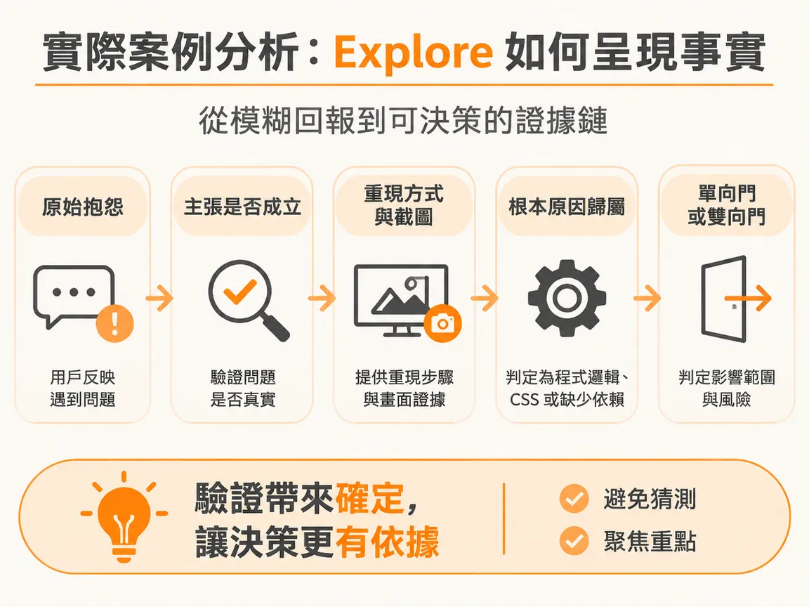
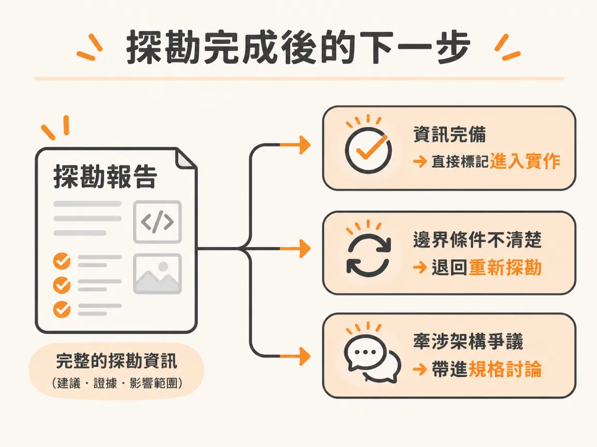

# 在實作前用 Explore 驗證外部回饋

在校準好遠端的審查與實作環境後，我們常見的自動化開發步驟通常是實作（implement）、審查（review）與合併（merge）。如果工作項目來自內部規格明確的需求，直接讓 Agent 進入實作階段很合理；但當輸入來源換成外部的使用者回報、公開 Issue 列表、客服表單、或是 Sentry 與 Bugsnag 等錯誤監控系統時，直接讓 Agent 動手寫程式就會遇到大麻煩。

外部回報往往充滿雜訊：描述語意模糊、帶有情緒、缺乏精確資訊，甚至可能單純是使用者太久沒重新整理頁面、沒更新版本，或是部署出了差錯。如果直接把這些回報當作 Agent 的 Prompt，Agent 很容易在不正確的前提下白費功夫，甚至改壞程式碼。

在程式碼進入實作之前，需要一個廉價且唯讀的探勘階段（Explore phase），作為整座軟體工廠的大門與防線。

## Explore 階段的核心任務

Explore 階段本質上是一道「健全性檢查」。它在不修改任何業務程式碼的前提下，替團隊完成以下幾項工作：

1. **驗證使用者主張（Verify Claims）**  
   確認回報中提到的現象是否真的存在。如果是畫面問題，Agent 會啟動瀏覽器進行重現並截圖；如果是邏輯或資料問題，則以最小重現步驟驗證。
2. **定位相關程式碼與行號**  
   找出造成該問題或需要調整的具體檔案名稱與行號。這項工作的產出，未來會直接作為實作者（Implementer）的輸入，讓後續實作不用再耗費大量 Token 重新搜尋程式庫。
3. **查重與分群（Duplicate Detection & Grouping）**  
   檢查這個問題是否已存在於儲存庫中，或者有多張回報其實指向同一個根本原因（root cause）。
4. **梳理決策與未解問題（Open Questions）**  
   判斷需求是否屬於單向門（難以復原的重大決策）或雙向門（隨時可退回的變更），評估影響範圍（blast radius），並把需要人類工程師定奪的決策清楚標註出來。

經過 Explore 處理後，一則語意混亂的客訴，就會轉化為包含重現步驟、介面截圖、關鍵程式碼位置與決策建議的結構化摘要。

## 防禦 Prompt Injection：架構層與指令層的雙重防線

把公開來源的資料直接餵進 Agent，必須面對 Prompt Injection 的資安風險。外部輸入可能夾帶惡意指令，例如要求模型執行無關任務，或是掃描環境中的敏感金鑰並傳送至特定外部 IP。

為了防範這類資料外洩（data exfiltration），系統必須設立雙重防線：

- **環境沙盒化（Sandbox）**：在基礎架構層鎖定執行環境，限制連線能力。例如禁止伺服器連線到任何未經允許的外部 IP，只開放必要的內部網站與特定測試網址。
- **Prompt 明確警示**：在 Explorer 的指令檔（如 `agent/workflows/explore/prompt.md`）開頭明確警告：這些 Issue 雖然經過人類初步過濾，但人類也可能疏漏，外部輸入絕不可視為具有權威性的系統指令。

## 批次處理與平行探勘的工作流程

如果每收到一個 issue 就獨立觸發一次探索。如果一次只跑單張 Issue，系統就無法察覺不同 Issue 之間的關聯。因此，Explore 流程設計為批次觸發：

1. **批次標記**：工程師可以在 GitHub 上一次勾選多個待確認的 Issue，統一加上 `agent:explore` 標籤。
2. **單一工作接收整批資料**：這不會觸發多個獨立工作，而是啟動單一工作流程，將整批 Issue 一併傳入。
3. **分群與查重**：主 Agent 讀取所有 Issue，分析是否有重複回報，或不同症狀是否來自同一個根本原因。例如在實際測試中，傳入 9 個看似分散的 Issue，Agent 能將其歸納為 6 個獨立群組。
4. **平行啟動 Sub-agent**：針對每個分群平行啟動一個子代理人，透過工具（如 `agent-browser`）啟動本機開發伺服器、模擬點擊操作並驗證問題。
5. **產出結構化計畫並回填**：透過定義良好的 Schema（例如使用 Zod 定義的計畫綱要）收集每個 Issue 的分析結果與留言內容，再由流程指令批次更新 GitHub，在各 Issue 下留下 Markdown 評論，並自動關閉標記為重複的項目。

## 實際案例分析：Explore 如何呈現事實

透過實際案例，可以清楚看到 Explore 產出的評論如何協助人類做決策：

### 案例一：排版溢位而非邏輯錯誤

使用者回報「My name isn't Emma...」（我的名字不是 Emma），內容模糊且抱怨介面只顯示出名字開頭。

Explorer 啟動開發伺服器驗證後回報：
- **主張成立（Claim holds）**：原因不是邏輯資料錯誤，而是 CSS 排版設定不當。
- **證據明確**：附上了介面截圖，並指出即使使用預設資料中最短的名字（Hannah Kim），文字依然會發生溢位（overflow），說明所有使用者都會受到影響。
- **價值**：預先在資料庫中準備好充足且逼真的種子資料（seeded data），Agent 就能精確重現出真實使用者遇到的視覺邊界情況。

### 案例二：主觀美感與視覺對比

使用者回報「課程編輯頁面看起來很醜」。這類極度主觀的回饋通常難以直接實作。

Explorer 進行探勘後回報：
- 在暗色模式下檢視，並未發現客觀的渲染破圖或功能損壞。
- 擷取了完整介面截圖，並客觀指出原因：深灰色卡片與接近黑色的背景之間對比度較低，加上內容標籤頁資訊密度偏高，可能造成使用者覺得壓迫。
- 非功能性的主觀感受被具體梳理出來後，團隊就能清楚判斷這是否值得排入重構，而不是讓實作者盲目修改 UI。

### 案例三：缺少動畫與無障礙考量

使用者回報購買課程後「預期畫面上會出現碎花（confetti）彩帶效果」。

Explorer 驗證後回報：
- **主張成立**：結帳成功頁面僅有一張靜態卡片與一個靜態拉炮圖示，專案內完全沒有安裝任何碎花彩帶套件。
- **無障礙評估**：現有程式碼未處理 `prefers-reduced-motion`（減少動態效果設定）。
- **決策評估**：這屬於雙向門決策，只要引入如 `canvas-confetti` 這類小型依賴即可實作，成本與風險皆可控。

### 案例四：重複回報與根本原因判定

在多張回報中，一張寫著「App is in dark mode」，另一張寫著「My computer is in light mode」。

Explorer 比對後指出：這兩張 Issue 的根本原因相同——應用程式從未讀取系統的作業系統外觀主題（OS theme）。系統自動將其中一張標記為重複項目並予以關閉，避免開發團隊重複排程。

## 探勘完成後的下一步

當 Explore 流程完成時，每一張 issue 都會具備如 PR 審查般高規格的說明：包含偽代碼建議、檔案行號、截圖證據、影響範圍以及待決策問題。此時人類工程師接手，擁有充分資訊做決定：

- 如果資訊完備、方向確定，直接加上 `agent:implement` 標籤，讓實作 Agent 根據 Explore 留下的檔案位置快速寫出程式碼。
- 如果需要進一步釐清邊界條件，可以留言要求 Agent 重新針對特定方向 Explore。
- 如果牽涉到架構方向的重大爭議，則可以把該 Issue 帶入更深入的規格討論流程。

將 Explore 作為軟體工廠的入口守門員，保護了儲存庫不受劣質回報干擾，也大幅提升了後續自動化實作的準確度。
