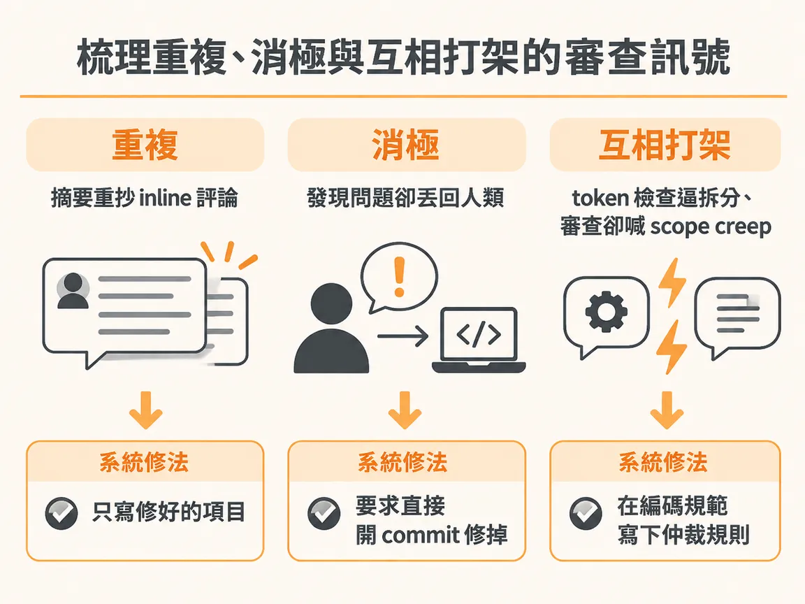
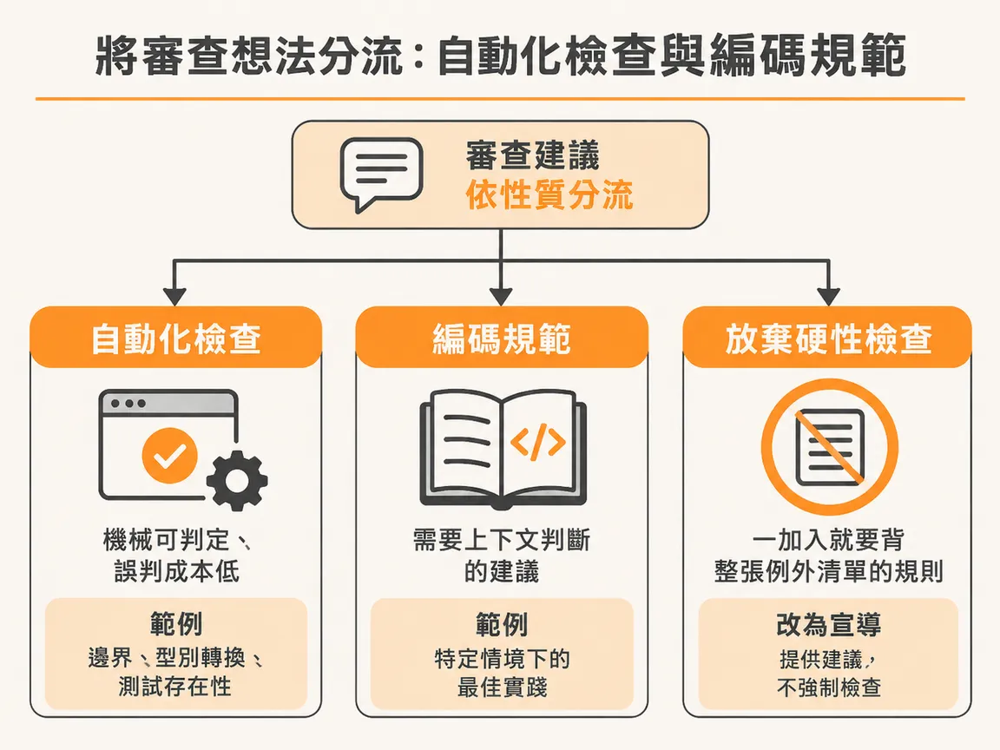
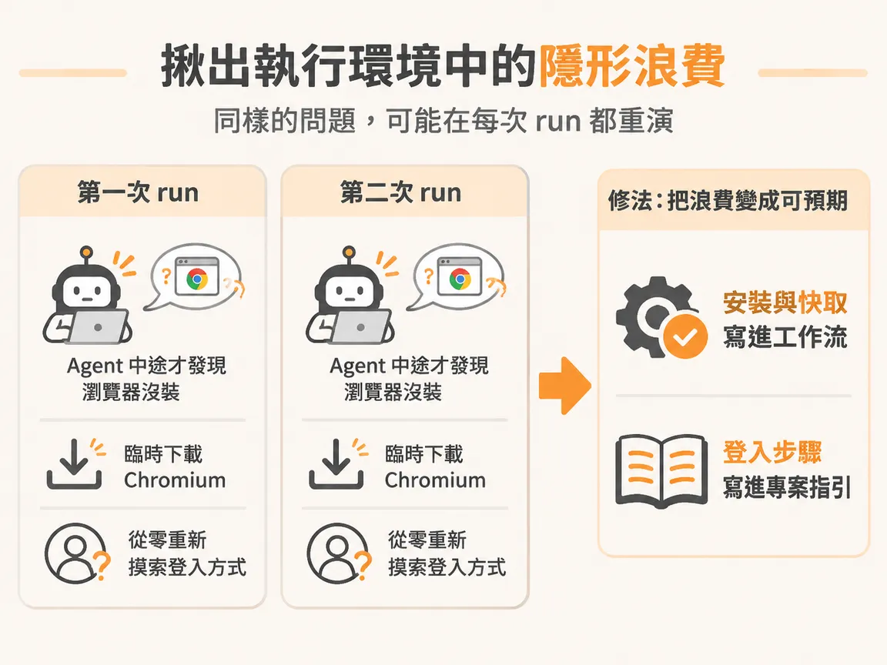
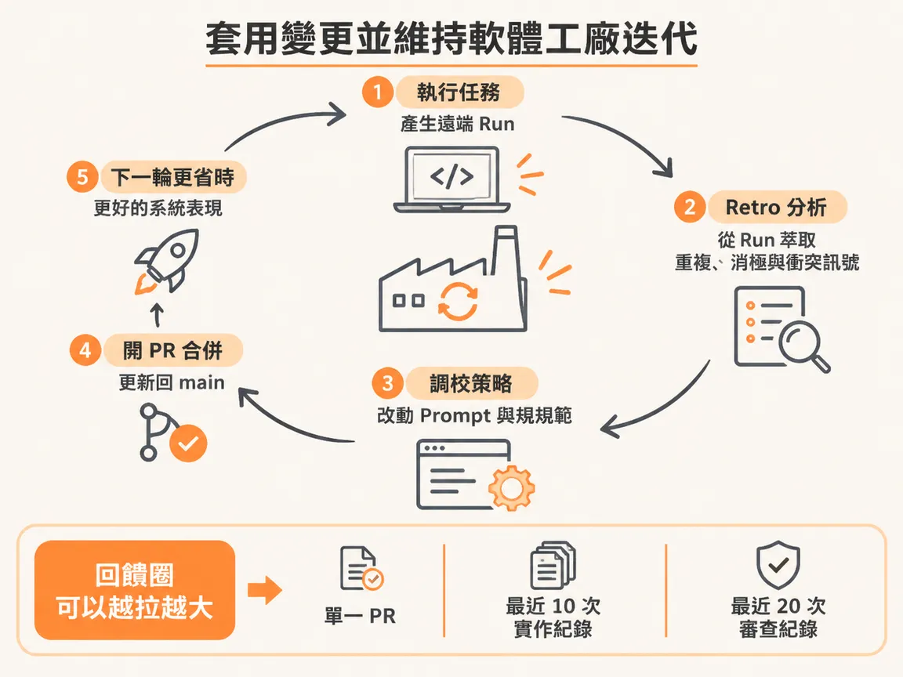

# 對遠端 Review Run 做 Retro：把混亂訊號淬鍊成工廠規則

GitHub 上由 Agent 跑完的自動審查，常常產出讓人頭痛的場面：PR 留言區被長篇文字淹沒，摘要重抄程式碼行內的 inline 評論；審查工具抓出一堆架構問題，卻只留下一句抱怨就丟回給人類處理；更糟的是，系統內部的不同工具還會互相打架——例如 Token 檢查工具逼著實作者把大檔案拆開，審查 Agent 卻在 PR 裡跳出來指責這是超出需求範圍（scope creep）。

這種混亂不是代表自動化審查沒用，而是這座軟體工廠缺乏校準。`retro` 技能不僅能用在本地端開發，也能直接拿來分析遠端的 GitHub Actions 執行紀錄。

## 收集 Run 紀錄並發起遠端 Retro

要校準遠端審查，首先要把整段流程中所有相關的 Action 執行網址找齊，包含前面的實作階段（implement runs）以及最後的審查階段（agent review run）。

把這些 URL 傳給 `retro` 技能，並附上一段具體的 Prompt，直接寫出你對這次程式碼審查的感受：

<!-- derived -->
```text
I found that the code review contains a lot of duplication between the summary and the code comments.
The code review also pulled up a bunch of stuff that we could potentially add into coding standards.
You should also check out the runs themselves to check for any inefficiencies.
```

發起 retro 後，Agent 會爬梳整段 Action 紀錄，找出執行過程中掙扎或浪費時間的地方，整理出一份具體的工廠改善清單。

## 梳理重複、消極與互相打架的審查訊號

分析遠端紀錄時，Retro 通常會抓出三種最常見的審查雜訊：



### 1. 摘要與行內評論重複

審查結果最怕出現冗長的文字。如果審查結論（verdict）把每一則 inline 評論又抄了一遍，人類工程師就得看兩次一樣的東西。

這項改善要改在 `prompt.md`：要求 Agent 在總結區只寫下真正修復的項目（fixed entries），每個評估維度只保留一行推導原因，讓摘要保持精簡。

### 2. 審查態度過於消極

審查 Agent 不該只列問題。如果它發現某個模組缺乏測試、介面過於淺薄（shallow interface）、有重複程式碼，或是伺服器模組直接依賴了 UI 元件，它應該直接開一個 commit 把問題修掉，而不是把雜事整包丟回給人類。自動化審查如果不動手修復，最後只會拖慢人類審查的速度。

### 3. 工具彼此矛盾與打架

在這次 Run 裡，實作者碰到了 Token 檢查上限，被迫在後期將檔案拆分重構；審查 Agent 看到拆分後的程式碼，卻警告這不是 Issue 裡提到的功能，屬於 scope creep。

為了解決這個衝突，必須在編碼規範（coding standards）中明確寫下一條仲裁規則：

> 因 Token 檢查強制執行的程式碼拆分，屬於任何 Ticket 的合法範圍。只要確認沒有改變外部行為，就不得將其標記為 scope creep。

Retro 原本可能會建議「在實作 Prompt 裡規定每次編輯檔案前都跑一次拆分檢查腳本」，但這種做法太過繁瑣。如果在每個檔案編輯當下都觸發檢查，只會給 Agent 製造太多雜訊。更好的策略是把檢查留在後面，但在 `AGENTS.md` 加上簡短說明，讓實作 Agent 提前知道有這條規則。

## 將審查想法分流：自動化檢查與編碼規範

審查 Agent 往往會在審查意見中提出許多「希望有但找不到」的標準。這些標準必須依照性質，分流到硬性自動化檢查或軟性編碼規範中：



### 適合放進自動化檢查的項目（Automated Checks）

- **架構邊界防護**：伺服器模組不得從前端元件（`app/components`）引用程式碼。這類依賴問題可以直接用 Dependency Cruiser 寫成靜態規則。
- **型別與轉換規範**：將字串轉為數字時，應使用 Zod 解析而不是直接呼叫 `Number()`。這可以寫成一條自訂的 oxlint 規則。
- **測試存在性檢查**：新模組必須自帶測試。用簡單的檔案系統檢查腳本，確認每個新模組目錄下都有 `tests/` 資料夾與測試檔。

專案裡累積了這些自動化檢查工具後，Agent 在未來執行 retro 時就會知道這些工具已經在武器庫裡，能更自然地提出對應的規則配置。

### 適合放進編碼規範的項目（Coding Standards）

需要上下文判斷的決策不適合寫成硬性阻擋的腳本，應歸入編碼規範：

- **表單受控欄位的 Key 命名**：受控欄位（controlled field）必須綁定該實體（entity）的標識。在這次 Run 裡發生過真實 Bug：課程 A 的編輯草稿覆蓋掉了課程 B 的筆記。寫明規範就能杜絕這種狀態錯亂。
- **字串清理一致性**：前端與後端必須共用同一個正規化函式來處理文字修剪（trimming）與長度限制，避免前端永遠清不掉未儲存變更的狀態。

### 當自動化檢查遇到現實包袱

Retro 原本建議加入一條自動化邊界檢查：「Route 不得直接查詢模組私有的資料」。掃描現有程式碼後發現，專案中有 24 條 Route 同時引用了模組與 Drizzle ORM 的資料庫連線。

如果硬要做成檢查腳本，第一天就會產生一張龐大的例外清單。這時應放棄將其做成硬性檢查，改列入編碼規範中逐步宣導，避免檢查工具失去公信力。

### 程式碼註解裡不該留存決策原因

Retro 在回顧中發現，主線上一段原本記錄「筆記放在影片下方是為了讓學生邊看邊寫」的註解被刪除了，因而建議「PR 如果推翻了註解裡的決策原因，要在 PR 說明中提及並更新註解」。

把產品決策寫在程式碼註解裡極度容易過期發霉。這類為什麼這樣設計的紀錄，應該寫進架構決策紀錄（ADR）中，而不是留在程式碼裡。在工作流程中，應主動把程式碼裡記載產品決策的註解清理掉，而不是要求維護過時的註解。

## 揪出執行環境中的隱形浪費

Retro 技能最擅長挖出那些人類難以察覺的環境開銷：



1. **重複安裝工具**：在兩個不同的 Run 裡，Agent 都在中途嘗試呼叫 `agent-browser`，發現沒安裝才臨時執行下載與 Chromium 安裝。修復方式是在 GitHub Actions 工作流程中加入前置步驟，並開啟 Chromium 快取，避免每次白白浪費下載時間。
2. **每次都重新摸索登入方式**：兩個 Run 都在從零摸索如何登入為正式學生。在專案指引（例如 `AGENTS.md`）補上一小段身分切換與登入說明，就能省下大把推論成本。
3. **無效的 PR 截圖**：審查 Agent 過去常常貼出無意義的畫面截圖。直接在審查 Prompt 中規範：只截圖自己的修復造成了哪些改變，並且必須在瀏覽器裡確認 PR 修改後的實際畫面。

## 套用變更並維持軟體工廠迭代

確認好改進清單後，可以讓 Agent 開立一個獨立分支與 PR，將這些改動寫進儲存庫中。

在 Agent 執行修改時仍需要保持監督。如果它又在 `AGENTS.md` 裡塞進剛才拒絕的「編輯大檔案前請跑腳本」，要立刻打斷它，將文字調整為「編輯大檔案時，拆分工作必須包含在同一個變更內」：

<!-- derived -->
```markdown
<!-- 在 AGENTS.md 中明確提醒實作者，避免過度頻繁的腳本干擾 -->
Editing a large file means splitting it in the same change.
```

所有新加入的自動化檢查腳本，都應該在拋棄式檔案（throwaway files）上實際測試，確認能抓到錯誤。GitHub Actions 工作流程修改屬於影響工廠內部的雙向門決策（two-way door），驗證無誤後即可直接合併進 `main`。

這就是軟體工廠持續進化的循環：執行任務、收集遠端 Run、用 retro 萃取改進點、調校 Prompt 與規範。隨著系統越來越成熟，甚至可以一次餵給 retro 過去 10 次的實作紀錄或 20 次的審查紀錄，讓審查經驗持續沉澱為系統的自動防線。


