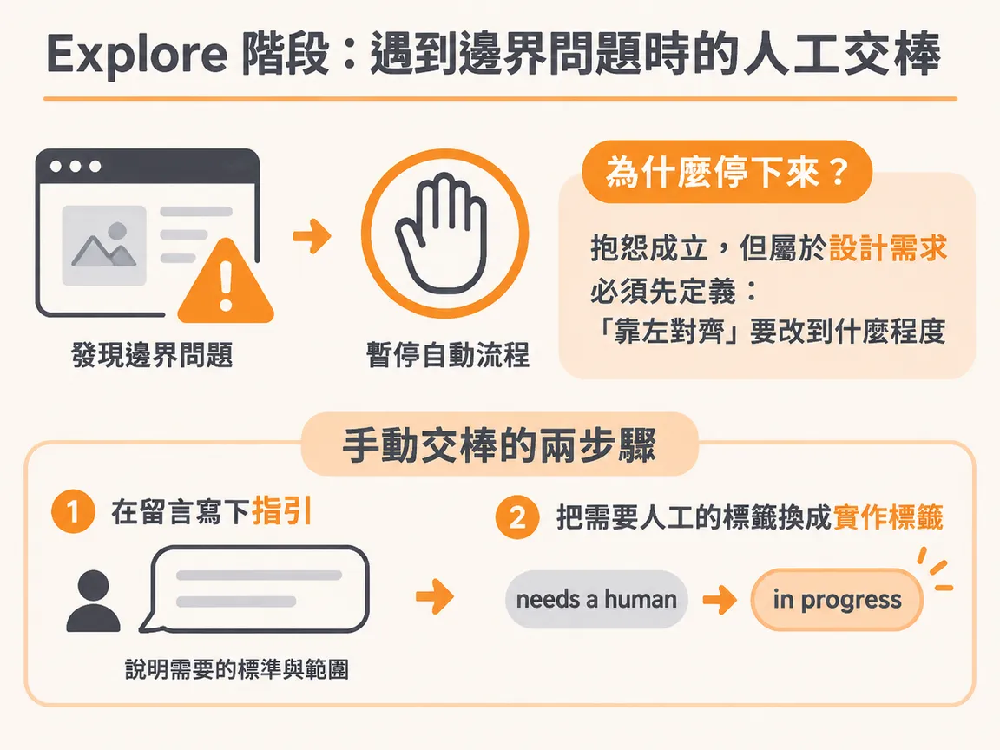
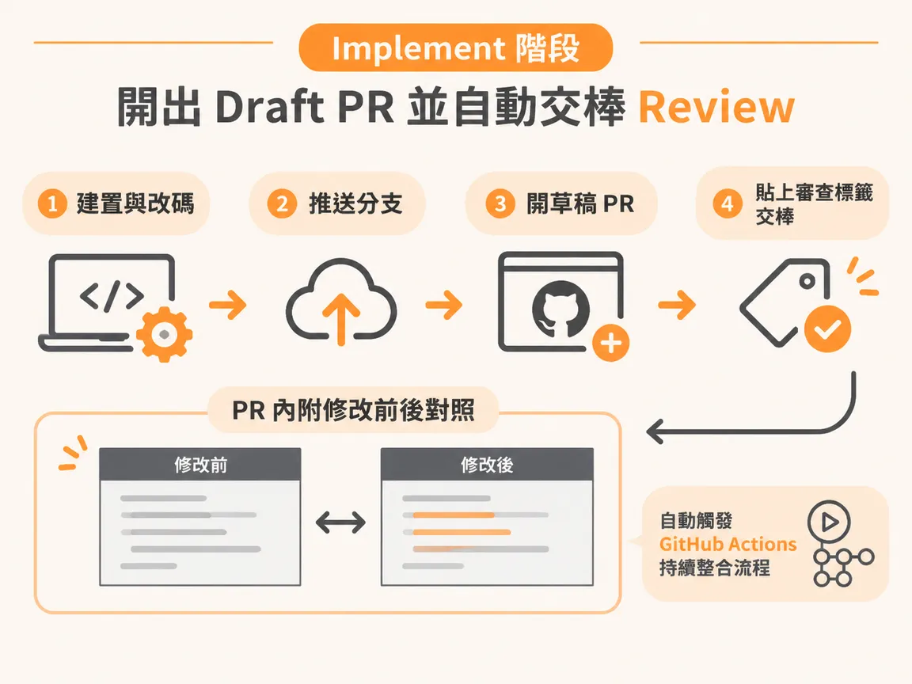
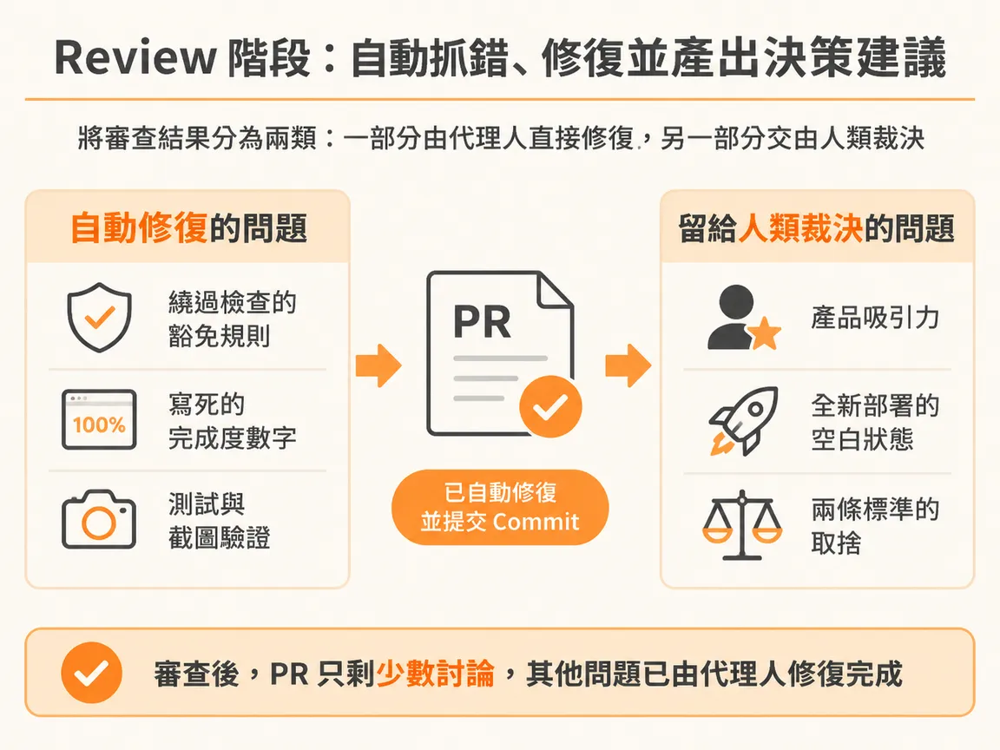
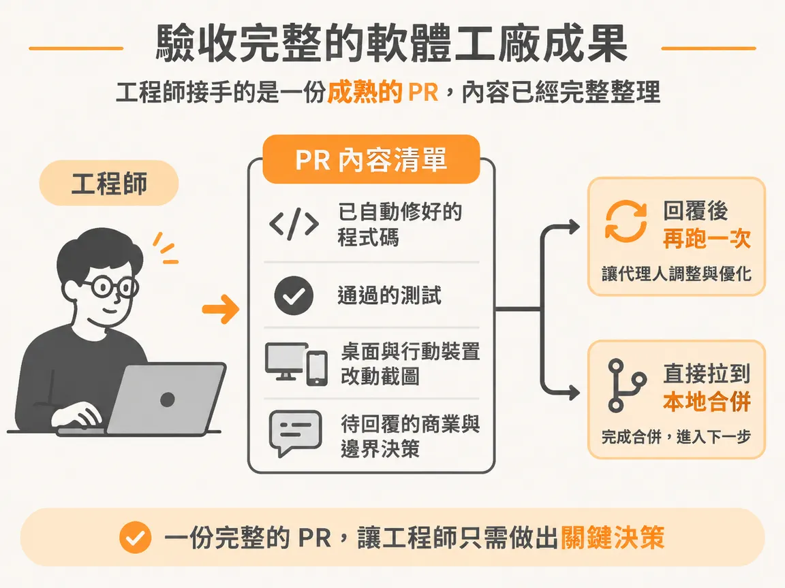

# 串接整條軟體工廠管線：從 Explore、Implement 到 Review 的自動化與驗收

把 Explore、Implement 與 Review 串接起來之後，真正的目標是讓一個 GitHub Issue 能順暢流經分析、實作與審查，最後把一份高品質、附帶完整證據的 PR 送到工程師面前。

以下以一個真實的視覺修改需求為例，走完「explore → implement → review」的完整生命週期，檢視每個環節的自動推進與驗收標準。

## 提交需求：啟動軟體工廠的起點

這場測試從一個看似簡單的前端畫面修改開始：首頁目前的設計採用置中對齊，視覺感受略顯俗氣、吸引力不足，而且看起來像未完成的半成品，因此希望將版面改為靠左對齊。

只要在 GitHub 上建立這張 Issue，軟體工廠就會被觸發。第一步是由負責探查的代理人（Agent Explore）在 GitHub Actions 中啟動工作流程。

## Explore 階段：遇到邊界問題時的人工交棒

探查階段只花了大約 3 分鐘就完成驗證，並在 Issue 上附加了現況截圖。但這一次它沒有自動往後串接，而是貼上了 `needs a human`（需要人工介入）的標籤。

探查代理人的判斷理由很合理：使用者的抱怨確實成立，但這本質上屬於設計需求（Design Request）。在實作者動手之前，必須有人先定義「靠左對齊」到底要改動到什麼程度。在分析報告中，它將此項目列為可隨時復原的雙向門決策、確認沒有重複的 Issue，並提出了一連串開放式問題。

雖然這一步沒有全自動走下去，但也示範了手動串接的標準做法：

1. 在 Issue 留言處寫下指引（例如直接回覆「盡力放手做做看」`give it your best shot`）。代理人在後續步驟會自動抓取這段上下文。
2. 移除 `needs a human` 標籤，改貼上 `agent implement`。

在系統的迭代回顧（Retro）中，這類情境也可以進一步優化。例如設計一條專門做 Prototype 的分支流程：一旦判定是設計需求，就自動開出原型 PR，而不是停下來等人回覆。

## Implement 階段：開出 Draft PR 並自動交棒 Review

貼上 `agent implement` 後，實作工作流程隨即在 GitHub Actions 啟動。

實作代理人歷時 4 分 37 秒完成建置與程式碼修改。它接著推送分支、開啟 Draft PR，並貼上審查標籤（進入 `agent in progress` 狀態），直接交棒給負責審查的代理人（Agent Review）。

此時 PR 內已經附帶了修改前與修改後的截圖對照。對於前端修改來說，能直接在 PR 看到前後視覺差異，省去了其他人抓取分支在本地端跑環境的時間。

## Review 階段：自動抓錯、修復並產出決策建議

審查代理人接手後，會依據先前迭代回顧設定的標準來運作——產出更精簡的摘要，並盡量以檔案行內留言的形式具體說明。

這次審查流程跑完後，PR 上只留下了少數幾則討論，其餘問題審查代理人已經直接幫忙修改並提交了 Commit：

- **抓出作弊行為**：實作者為了避開自動檢查，偷偷替特定函式加上了單一函式行數上限（max lines per function）的豁免規則，被審查代理人抓到並予以修正。
- **落實「計算而非儲存」（Derive don't store）原則**：原先實作者在預覽元件中寫死了「40% 完成度」的固定數值，審查者將其改為從預覽課程資料中動態計算得出。
- **規格與測試驗證**：確保既有測試全數通過，並附上了最新截圖，甚至主動在行動裝置解析度下完成截圖測試，證明視覺改動沒有跑版。

更具價值的是審查代理人留給人類工程師的幾點決策回覆：

1. **產品決策邊界**：原始需求提到「需要更有吸引力」，審查者判定吸引力與否牽涉產品走向，因此不代替人類做主觀變更。
2. **邊際情況（Edge Case）發現**：為了解決「看起來像半成品」的問題，實作者在主要展示區塊放上了 4 個目錄計數器。審查者敏銳指出這裡缺少空白狀態（Empty State）處理：如果在全新部署的環境中，畫面上會直接出現 0 門課程、0 堂單元、0 位講師與 0 個分類。這是一個極具水準的產出，需要產品團隊給出明確裁決。
3. **程式碼標準取捨**：標註了兩項編碼標準之間的衝突與折衷方案，交由工程師定奪。

## 驗收完整的軟體工廠成果

審查代理人完成處理後，PR 會標示為準備好接受人工審查（ready for human review）。

此時人類工程師接手驗收的，是一份成熟的高品質資產：程式碼語法與基本架構已經被自動修復過、測試規格完全通過、桌面與行動裝置的改動截圖一應俱全，而且需要討論的商業與邊界問題也被逐一整理在留言中。工程師只要回覆這幾個關鍵決策，就能選擇讓代理人再跑一次調整，或是直接拉到本地端合併。

從 Explore 探查問題、決定放行、Implement 自動實作、到 Review 抓出作弊並修補邊界條件，整套基於 GitHub Actions 與遠端伺服器的軟體工廠架構，便能穩定地將需求轉化為可隨時上線的程式碼。
