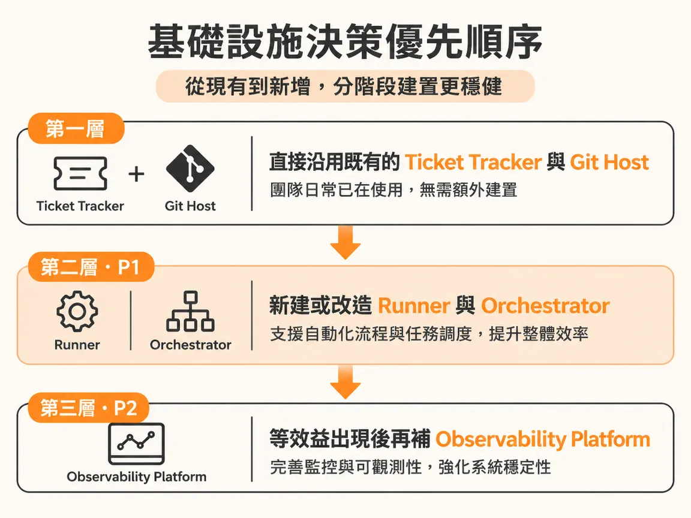
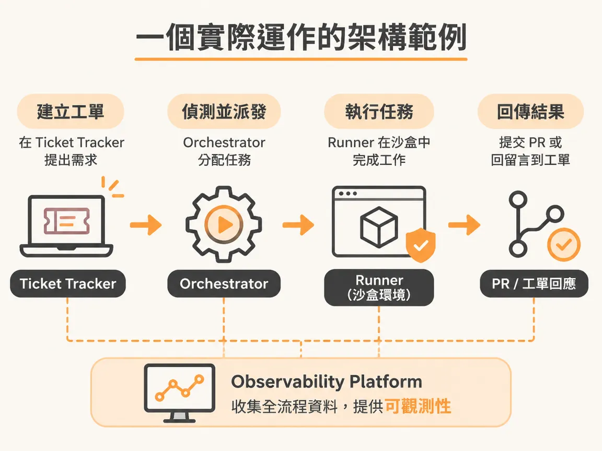

# 軟體工廠基礎設施的決策順序

要打造一套能自動運轉的軟體工廠，通常會牽涉到五種基礎設施部件。如果一開始就打算把整套架構從頭挑選、全部換新，往往會卡在巨大的遷移成本中。

釐清決策順序的關鍵原則很簡單：**已有就沿用、runner 與 orchestrator 先做、observability 後補**。

## 現有系統直接沿用：工單追蹤系統與 Git 託管平台

在五大基礎設施中，前兩項通常已經深植在團隊的日常工作流程裡：

1. **工單追蹤系統（Ticket Tracker）**：團隊八成已經有一套正在使用的系統。要整隊搬遷到新的工單工具幾乎是不可能的任務，直接配合現有工具運作即可。
2. **Git 託管平台（Git Host）**：更換 Git 平台的工程極其龐大，成本太高，同樣應該直接沿用團隊現有的環境。

這兩項在多數情況下早已成定局，不需要重新決策。

## 核心新設施優先建置（P1）：Runner 與協調器

接下來的三個元件，才是真正需要做架構決策的核心。它們通常是全新引進的基礎設施，或者是以全新方式複用現有的虛擬機器（VM）與雲端容器：

- **Runner（執行環境）**：負責實際跑自動化任務的環境。它需要足夠安全、具備良好沙盒隔離，且能快速啟動與客製化。
- **協調器（Orchestrator）**：負責監聽事件、排程工作並把任務分派給 runner。

這兩者是軟體工廠能夠動起來的骨幹，屬於最高優先級的 **P1**。

在處理協調器時，通常會面臨自建還是購買（build vs buy）的抉擇。自建簡易伺服器雖然彈性大，但需要持續花心力維護與修復穩定性；直接採用現成方案則能省去維運負擔。

## 效益出來後再補（P2）：可觀測性平台

可觀測性平台（Observability Platform）用來追蹤任務執行狀況與記錄數據。在軟體工廠真正產出價值、發揮實際用途之前，這項元件其實算是可選配的。

因此，可觀測性平台的優先級排在 **P2**，等前面的工作管線打通、確認有實際運作效益後，再來補上即可。

---

## 一個實際運作的架構範例

以一套實際運行且效果良好的配置為例，各元件的搭配如下：

- **Ticket Tracker**：Linear。介面設計極佳，整理與操作任務非常順手。
- **Git Host**：GitHub。團隊既有的程式碼庫所在地，沒有遷移的必要。
- **Runner（P1）**：Daytona。雖然計費結構較特殊，但啟動速度極快，且能有效做到沙盒隔離與客製化，安全性相當高。
- **協調器（P1）**：自建的 custom server。底層採用 Sandcastle，以相對單純的行程負責在 Daytona 中排程工作。雖然維護上需要花功夫修復小問題，但能滿足排程需求。
- **Observability Platform（P2）**：Langfuse。用來記錄即時數據與執行狀況。

這套系統的運作流程十分流暢：

1. Linear 建立了一張新工單。
2. 協調器監控到這張工單，隨即把工作指派給 Daytona runner。
3. Runner 在沙盒環境中完成任務，可能是建立一個 Pull Request，或是直接在工單底下留言回覆進度。
4. 整個過程的所有數據都會即時送進 Langfuse，方便隨時掌握系統正在發生的事。

按照「既有沿用、P1 核心先跑通、P2 觀測後補」的決策順序，就能避免一開始陷入工具挑選的泥淖。接下來的問題是：在敲定 P1 與 P2 的開放選項時，該如何逐一驗證並做出最終選擇？
