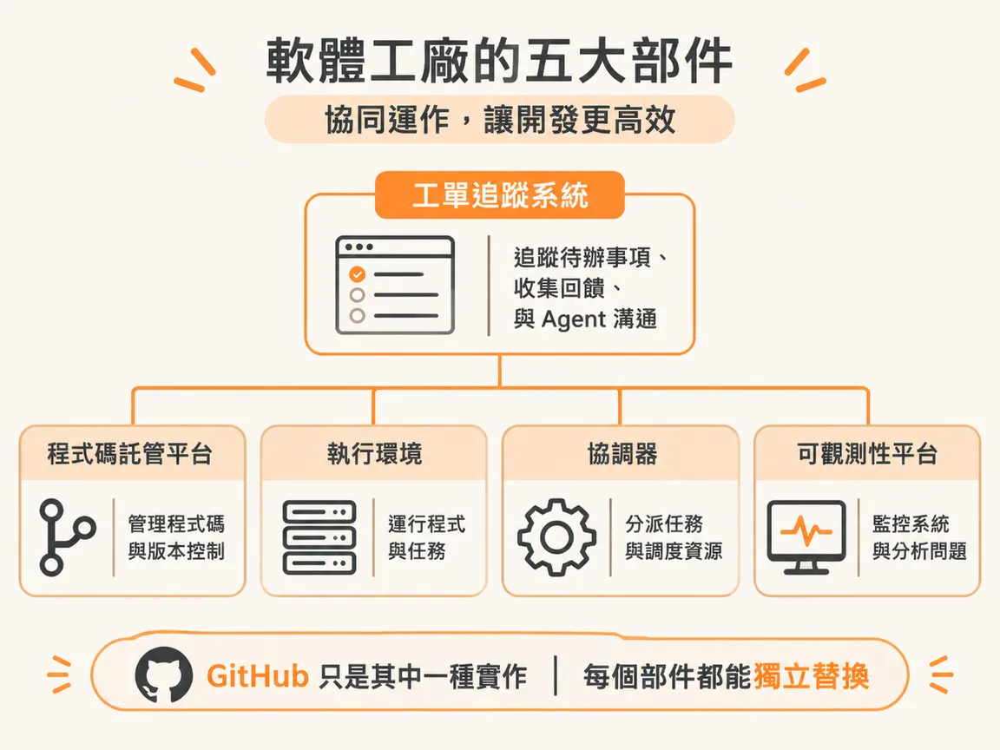
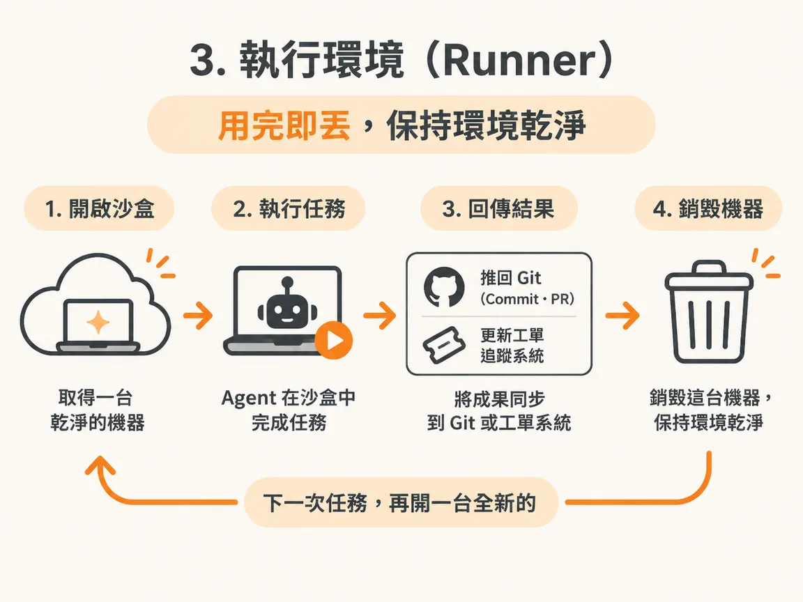
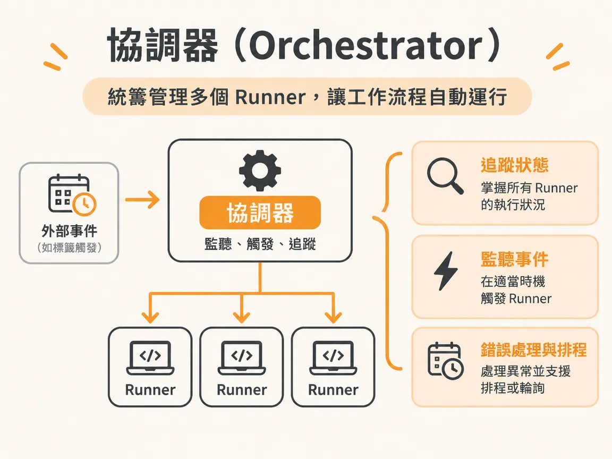

# 打造軟體工廠必備的五大基礎設施

要讓 AI agent 真正替團隊寫程式、解 issue，不能只把模型掛在聊天視窗裡，而是要建立一座能持續運作的「軟體工廠」（software factory）。

這座工廠底層的基礎設施可以拆解成五個核心部件。在常見的展示範例中，大家習慣全部交給 GitHub 處理，但 GitHub 只是其中一種實作方式；這五個部件各自有清楚的職責，而且每一個都可以依團隊需求獨立替換。

## 1. 工單追蹤系統（Ticket Tracker）

每個軟體工廠都需要一個人機互動的介面。這是追蹤待辦事項、人類提供回饋、以及人類與 agent 互相溝通的地方。

在許多預設架構中，這個角色由 GitHub Issues 擔任。但實務上完全不必綁定 GitHub，也可以換成 Linear、Jira、Trello 或 Asana。只要具備票券清單、指派成員、標籤分類等組織功能，並且能讓人類與 agent 雙方同時存取與更新狀態即可。

GitHub 的優勢在於提供 CLI 讓 agent 容易操作；不過像 Linear 和 Jira 也都有推出 Model Context Protocol（MCP）伺服器。現今各類專案管理工具都在積極優化，讓 agent 能順暢協作與回報進度。

## 2. 程式碼託管平台（Git Host）

有了追蹤與排程票券的機制後，工廠還需要一個地方存放分支、發起 Pull Request（PR），並進行程式碼審查。

這是程式碼實際落腳的空間，也是團隊檢視變更並決定是否合併的地方。最常見的選擇是 GitHub 的分支與 PR 機制。但如果團隊原本就使用 Atlassian 生態系，通常會搭配 Jira 使用 Bitbucket；其他常見的替代方案還包括 GitLab。若是程式碼受限於內部資安政策不能離開內網，也可以採用 Forgejo 或 Gitea 這類自建平台。

## 3. 執行環境（Runner）

有了票券與程式碼庫之後，還需要提供一個沙盒環境讓 agent 實際動工，這就是 Runner。

Runner 的關鍵在於必須盡可能「用完即丟」Runner 的核心原則是拋棄式（disposable）。Agent 在乾淨的機器上執行任務，例如審查 PR 或實作功能；任務結束後，產生的所有狀態都必須回傳——要嘛推回 Git 倉庫成為 commit、分支與 PR，要嘛更新回工單追蹤系統，隨後該機器即可銷毀。

在 GitHub 生態裡，這個角色就是 GitHub Actions 的 Runner。除了 GitHub Actions 之外，市面上也有專門提供程式化沙盒的服務，例如 E2B 或 Daytona，隨時開出一台環境、跑完任務就立刻關閉。如果想完全掌控底層，也可以自建虛擬私人伺服器（VPS），每次執行時動態啟動全新的容器來處理。

## 4. 協調器（Orchestrator）

既然有多個 Runner 在平行運作，就必須有一套機制負責調度與監控這些 Runner，這就是協調器。

編排器的職責包含三項：
- 追蹤所有 Runner 的狀態。
- 監聽外部事件並在適當時機觸發 Runner（例如當 issue 被貼上特定標籤時自動啟動）。
- 處理過程中的錯誤，並支援排程或輪詢等循環邏輯。

如果直接使用 GitHub Actions，它本身就兼任了協調器：只要監聽到特定標籤（例如 `Agent Explore` 或 `Agent Implement`），就會自動掛載對應的 Runner。但協調器同樣能替換，例如使用 GitLab CI 等 CI 平台，或是自己架設一組帶有資料庫的伺服器（OpenAI 的 Symphony 規範就是具代表性的參考架構）。若團隊大量採用特定模型廠牌，也可以直接使用託管型的 agent 平台（例如網頁版的 Claude Code）。

## 5. 可觀測性平台（Observability Platform）

最後一塊拼圖是監控整個工廠運作的可觀測性平台。工廠需要有能力衡量整體花費的 token 成本、成功率，以及不同實作策略的效果差異。

GitHub Actions 雖然能讓人點進單次執行紀錄查看細節，但缺乏全域的彙整數據，無法直接看出長期來看哪一種 prompt 或流程架構效益較佳。

針對這個缺口，市面上有許多專門的工具可供選擇，例如 Langfuse 與 LangSmith 等可觀測性產品。如果原本就高度綁定單一模型供應商，也可以直接採用該廠商提供的監控後台；而若是團隊選擇自建協調器，由於協調器本身已經掌握了每個 Runner 的執行細節，也很適合順道把全域觀測功能整合進去。

既然軟體工廠由這五個獨立部件組成，當要為自己的團隊選型時，該從哪裡開始著手？面對五個槽位，最忌諱同時全部重選；建立一套清晰的決策順序，才是降低落地阻力的關鍵。
