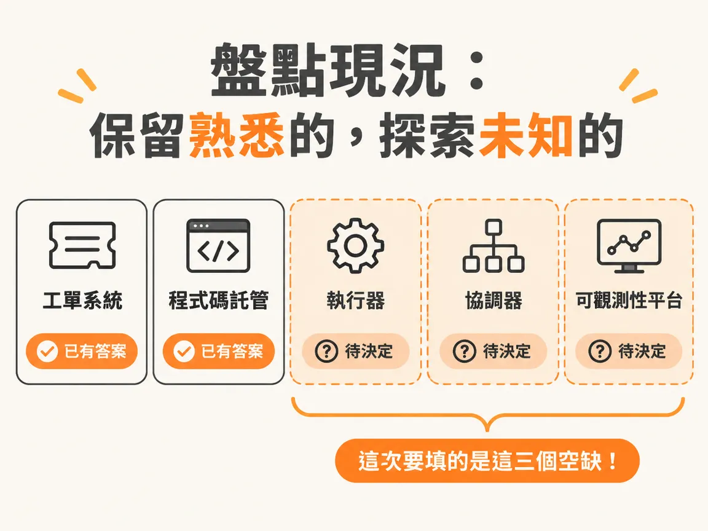
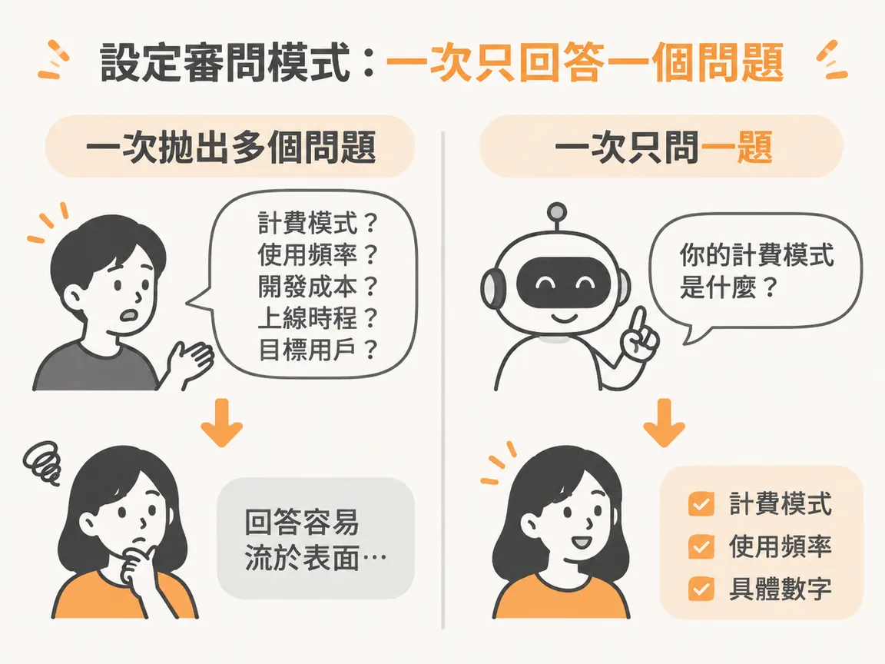
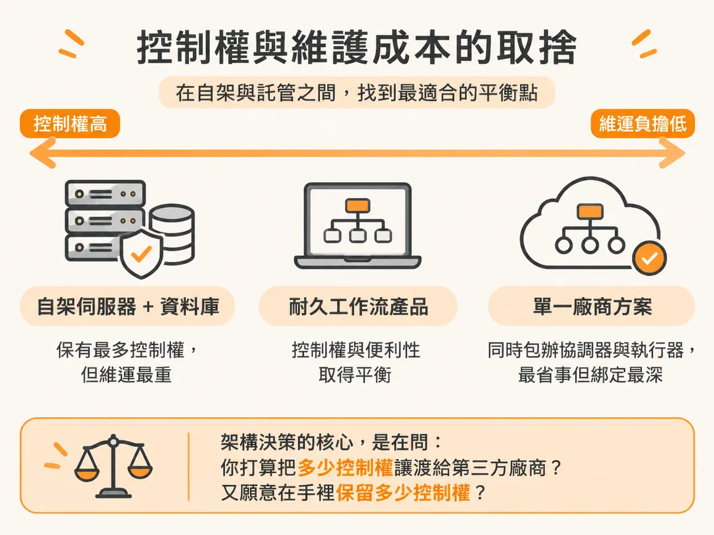

# 用一次一題的 Grilling 釐清軟體工廠架構與掌控權

建立專屬的軟體工廠時，最讓人頭痛的往往不是寫出第一隻自動化程式，而是面對五花八門的基礎設施時不知從何選起。在進入具體功能之前，必須先決定背後運作的骨架。

這一步並不需要立刻動手開機器或建立雲端資源，重點是在合理的範圍內挑出第一批值得嘗試的工具。只要把各個位置的角色定下來，後續繪製系統架構圖時，思路就會清楚許多。

## 盤點現況：保留熟悉的，探索未知的

評估軟體工廠的基礎設施時，可以直接沿用剛才的優先級邏輯：團隊很可能早就有了偏好的工單系統（Ticket Tracker，例如 Linear）以及程式碼託管平台（Git Host，例如 GitHub）。

多數人真正缺乏定見的，是剩下的三個核心角色：



- **Runner（執行環境）**：實際啟動環境並執行 agent 任務的地方。
- **協調器（Orchestrator）**：接收事件觸發、管理流程狀態、調度任務的中樞。
- **可觀測性平台（Observability Platform）**：追蹤 agent 執行紀錄、消耗量與狀態的監控系統。

為了快速掌握常見的工具選項，可以先將軟體工廠技能庫加入專案：

<!-- source: sources/real-engineer/20261116/course/088 Choosing Your Infrastructure.en.txt#L15-L15 -->

```bash
npm run cherry pick add software factory skill
```

加入後，可以在 `skills/software-factory` 目錄下看到一份參考技能定義，裡面整理了各種角色對應的產品型態。例如在 Runner 方面，就涵蓋了傳統 CI Runner、MicroVM API、整包式 agent 平台（bundled agent platform）以及自架工作節點（bring your own worker）等類型。

這些參考資料是初步研究的整理，產品生態變動極快，文件無法保證永遠最新。最好的用法是先藉此建立對不同產品型態的概念框架，再透過即時調研確認最新規格與計費方式。

## 設定審問模式：一次只回答一個問題

決定好已知與未知之後，就可以讓 AI 扮演審問者（grilling session），逼自己做出切實的架構選擇。

你可以向 agent 提出這樣的指令：

> 請針對建立新的 `/software-factory` 對我展開審問（grill me）。我想把現有的 GitHub Actions 架構遷移到新的基礎設施上。先不用考慮新的任務類型，專注在服務架構本身。因為這個題目很大，請**一次只問我一個問題**。

面對極度發散、有多種可能路線的架構討論時，「一次一題」特別有效。如果 agent 一次拋出五個大問題，回答往往會流於表面；緊湊的一問一答，才能逼出真實的決策細節，包含計費模式、預估使用頻率等硬指標。



這類探索未知方向的情境，也是 Wayfinder 這類探索型 agent 的經典應用場景；不過直接使用單題審問模式，節奏通常更緊湊明快。

## 校準語彙與聚焦核心矛盾

啟動審問後，agent 會先讀取現有的工作流程（例如 `.github/workflows` 底下的設定），理解目前軟體工廠在做哪些事。

有時候 agent 可能沒有主動載入剛才安裝的技能庫，而用自己的方式提問。例如它可能會問：「誰來負責控制平面（Control Plane）？必須有人接收 Linear 的 Webhook、決定下一步、啟動任務並套用結果。」

這時只要提醒 agent：

> 請使用 `software-factory` 技能庫中定義的語彙。

校準術語後，問題就會立刻收斂到標準的角色槽位上：「誰來填補協調器（Orchestrator）的位置？」

針對這個問題，常見的方案通常有三種：

1. **耐久工作流程產品（Durable Workflow）**：採用專門處理長時間等待、具備狀態復原能力的既有工作流平台。
2. **自架伺服器配資料庫**：自己維護常駐主機與狀態儲存庫。
3. **單一廠商包辦 Orchestrator 與 Runner**：選用同時提供觸發器與佇列機制的沙盒（Sandbox）廠商。

## 控制權與維護成本的取捨

架構決策的核心，本質上是在問：**你打算把多少控制權讓渡給第三方廠商，又願意在手裡保留多少控制權？**



如果選擇由單一沙盒廠商通包協調器與 Runner，省去了整合兩者的麻煩，但代價是高度鎖定（vendor lock-in），一旦廠商調整定價或服務中斷，很難輕易抽換；如果選擇自己架設伺服器與資料庫，能保有最高的自主權，卻得自己扛起維運與狀態管理的複雜度。

在審問過程中，如果對選項的優劣與代價沒有把握，不需要急著給答案。直接告訴 agent：「我需要更多關於這些方案優缺點的資訊，我還不清楚前兩者的權衡，而且我對通包的第三種方案有所疑慮。」

當一切都還處在迷霧中時，只要能透過逐題審問咬住這個最關鍵的控制權問題，剩下的 Runner 類型與可觀測性工具，往往就會順著這個核心決策自然落定。那麼，一套真實世界裡經過嚴格審問後的技術棧，具體長什麼樣子？
