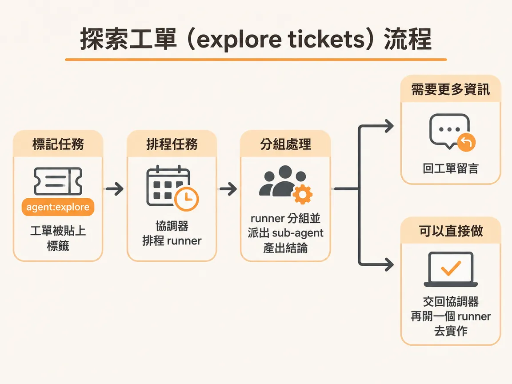
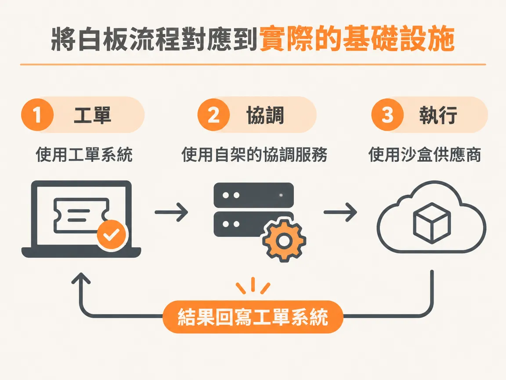

# 在白板上規劃軟體工廠的 Task：同時標出動作與執行位置

在規劃好軟體工廠需要的基礎設施之後，接下來要解決的核心問題是：工廠到底要執行哪些具體工作？

在著手實作之前，先把討論時使用的名詞統一起來：

- **Runner**：用完即丟的拋棄式執行機器。
- **Run**：Task 在 Runner 上執行的一次具體過程。
- **Task**：Runner 真正要去執行的工作內容。例如「探索問題（explore）」、「實作功能（implement）」或「審查程式碼（review）」，都可以視為指派給 Runner 的獨立 Task。

在這個階段，先暫時離開 agent 的程式碼，回到最適合用來釐清思緒的工具——白板。我們要練習的是系統設計（System Design），在白板上把工廠可能要處理的各種 Task 模擬出來。

## 準備白板工具與基本操作

這裡使用 tldraw 來繪製流程圖。打開提供的 tldraw 範本時，預設是唯讀模式（Read-only），無法直接拖曳元件。只要點擊畫面左上方的三個點，選擇「Copy to my workspace」，就能把範本完整複製到自己的工作區中。

如果沒有 tldraw 帳號，過程可能需要免費註冊；如果平時習慣使用 Excalidraw 等其他白板工具，也可以把相同概念搬過去使用。即使在 AI 輔助開發的時代，使用繪圖工具進行軟體架構設計依然是不可或缺的基本功。

在畫布上有幾個常用的快捷鍵：

- 按住 `Ctrl` 或 `Cmd` 搭配滾輪縮放畫布。
- 按住 `空白鍵`（Space）點擊並拖曳以移動畫面。
- 選取元件後，按住 `Alt` 並拖曳即可快速複製。

範本左側提供了一些預先定義好的基礎元件，可以直接用 `Alt` 拖曳到右側的設計區域中。

## 繪製原則：同時標出「做什麼」與「在哪裡做」

畫這類流程圖時，最關鍵的原則是：**畫布上的每一個步驟方塊，不僅要寫出「做了什麼動作」，還要清楚標示「這個動作是在哪一個系統部件上執行」。**

以「探索工單（explore tickets）」這個 Task 為例，完整的流轉過程如下：

1. **工單追蹤系統（Ticket Tracker）**：這是整個流程的觸發點（trigger）。使用者在工單追蹤系統中，替一張或多張工單加上 `agent:explore` 的標籤。
2. **協調器（Orchestrator）**：接收到觸發事件後，協調器會排程並啟動一個 Runner。
3. **Runner**：所有的分析動作都在這個 Runner 機器上進行。它會先把工單分組，針對每一組分派 Sub-agent（子代理）進行分析，最後產出結論（verdict）。
4. **分支邏輯（Branching Logic）**：根據 Runner 的探索結論，流程會走向不同部件：
   - 如果發現需要更多補充資訊，Runner 就會在**工單追蹤系統（Ticket Tracker）**的工單底下留言提問。
   - 如果確認這是一項能直接處理的工作，Runner 就會回報給**協調器（Orchestrator）**，要求進入實作階段；協調器接著再啟動另一個 Runner 去執行實作。

設計單一 Task 時，不需要把後續衍生的所有旁支流程一次畫完。遇到後續承接的流程，只要在節點旁放個省略號（`...`）標註即可，重點是把當前 Task 的邊界與權責交代清楚。

## 將圖表對應到真實的基礎設施

在白板上排定步驟時，隨時對照先前規劃好的實體基礎架構：

- 這一步發生在 Linear（工單追蹤系統）。
- 接著送進自己的客製化 Ingest 服務（協調器）。
- 然後在 Daytona 上啟動 Runner 執行分析。
- 最後再把結果寫回 Linear。

隨時將白板上的方塊與具體的應用工具連繫起來，系統設計就不會流於空泛的流程圖，工廠中每個 Task 的輸入、輸出與執行邊界也會變得非常明確。
