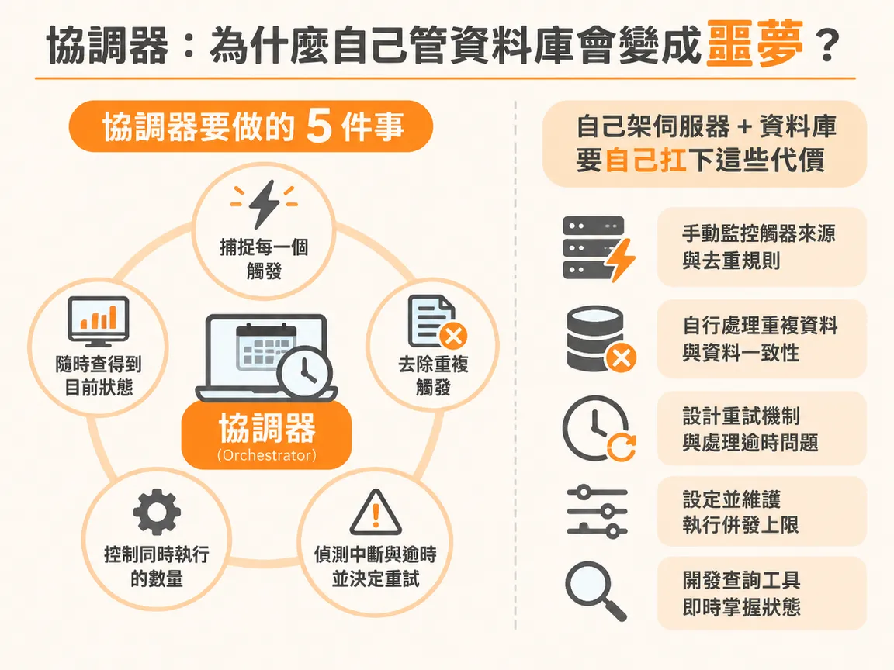
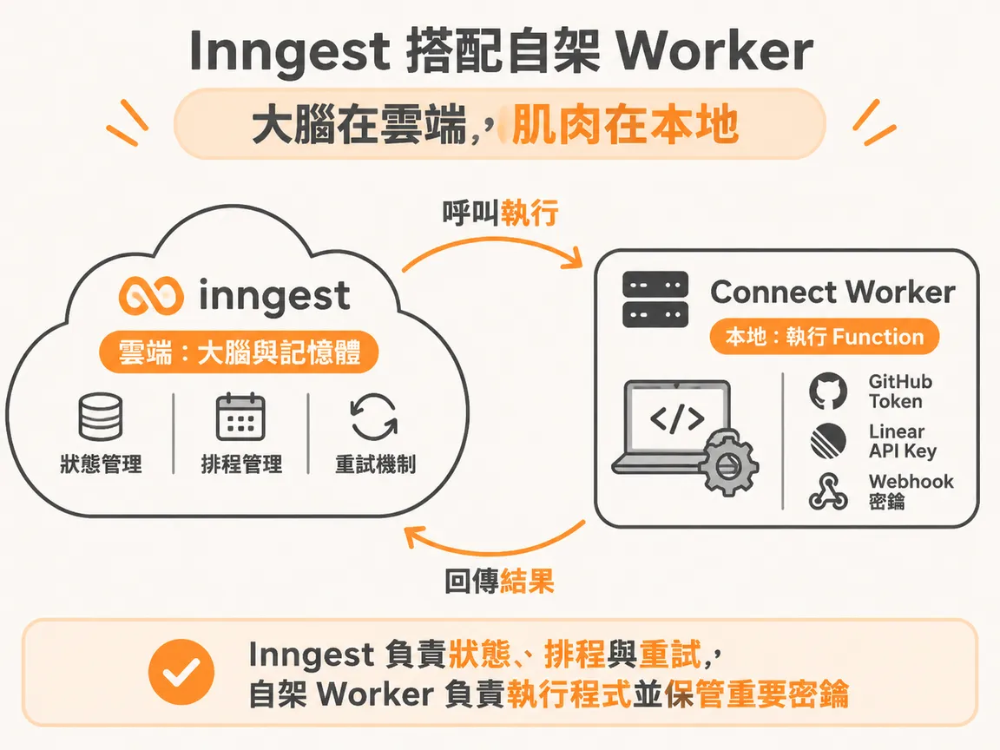
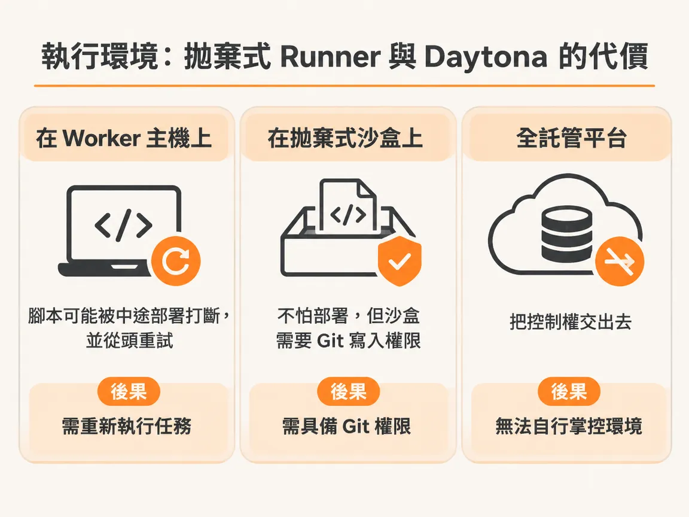
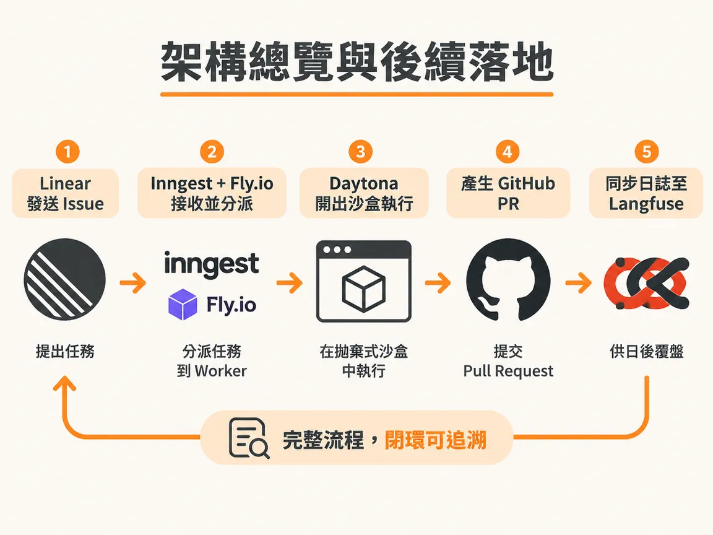

# 自架 Worker、Daytona 與 LangFuse：打造 AI 軟體工廠的真實選型與踩坑紀錄

當嘗試讓 AI agent 自動依據專案票券寫程式、發 PR，也就是搭建一套軟體工廠時，很快就會發現核心挑戰往往不是模型本身，而是底層架構：誰來監聽事件、任務掛掉誰來重試、長時間運行的環境怎麼隔離，以及 agent 踩雷後的紀錄該留在哪裡。

在評估從 GitHub Actions 遷移到專屬架構的過程中，我們經歷了一輪嚴格的技術選型盤點。這裡完整記錄以 Inngest 搭配自架 Worker、Daytona 沙盒以及 Langfuse 作為核心技術棧的真實考量、所需代價與實際避坑經驗。

---

## 協調器：為什麼自己管資料庫會變成噩夢？

一個合格的排程協調者（Orchestrator）必須把關幾件關鍵任務：

1. **捕獲每一個觸發（Trigger）**：當專案管理工具（如 Linear）的留言被更新、issue 狀態改變時，必須確保有對應的程式碼開始執行。
2. **處理重複觸發（Deduplication）**：Linear 和 GitHub 都可能因為重試機制多次發送同一筆 webhook，協調器必須去重，避免同一張票重跑好幾次。
3. **處理中斷與逾時**：如果 agent 莫名卡死或 Runner 當機，協調器必須察覺、發出逾時信號，並決定是否重試。
4. **併發控制（Concurrency）**：限制同時運行的 Runner 數量，避免無限迴圈拖垮系統或耗盡額度。
5. **掌握當前狀態**：隨時能查出目前有幾隻任務在跑、狀態為何。

過去如果自己架一台主機加上 PostgreSQL（自建伺服器模式），你得自己承擔主機上線時間（uptime），自己寫程式去處理掛掉的任務；除非另外自己寫前後台或忍受「SQL 查詢加上陽春監控平台」，否則根本沒有操作介面可用。更致命的是部署衝突：當系統正在中途執行一個耗時任務，這時如果你更新 Worker，部署流程就可能讓正在等待 Runner 的任務變成孤兒（orphaned run）。

因此，耐久工作流程（durable workflow）產品成為首選，例如 Inngest。

---

## Inngest 搭配自架 Worker：大腦在雲端，肌肉在本地

選用 Inngest 的主因在於它直接解決了去重、重試、併發與狀態保存的問題。在免費額度上，Inngest 每月提供 5 萬次執行（executions），日誌與追蹤保留 24 小時。雖然 24 小時紀錄偏短，但這部分可以由外部可觀測性平台補足。

但必須認清一個關鍵限制：**Inngest 本身不執行你的程式碼。**

Inngest 扮演的是大腦與記憶體，真正的邏輯必須跑在自己託管的環境中。這個架構由兩部分組成：

- **Inngest 雲端服務**：負責狀態排程與重試邏輯。
- **自架 Connect Worker**：由自己託管的小型主機，負責執行具體函式。同時，GitHub token、Linear API key 與 webhook 密鑰等機密也都存放在這裡。

在部署該 Worker 時，常見的 Serverless 方案（如 Vercel 或 Cloudflare Workers）並不適合，原因在於這類排程工作需要 Git 與實體檔案系統。因此實務上建議使用常駐的容器環境（例如 Fly.io 上的 Connect Worker）來承接任務。

---

## 執行環境：拋棄式 Runner 與 Daytona 的代價

當任務進來後，具體的 Agent 腳本（例如 Sandcastle）該在哪裡跑？有三種實作方式：

1. **直接跑在 Worker 主機上**：
   這意味著一個長達 60 分鐘的任務會一直霸佔這台主機。致命傷在於：軟體工廠本身的程式碼迭代非常頻繁，只要你在任務執行中途部署 Worker，該步驟就會被中斷，Inngest 就必須從頭重試整整一小時的流程。
2. **在拋棄式沙盒（Throwaway Runner）上跑完整腳本**：
   每次觸發就開一個拋棄式沙盒，跑完就銷毀。這樣即使頻繁部署 Worker，也不會干擾正在運行的任務。缺點是拋棄式 Runner 必須拿到 Git 寫入憑證（write token），才能把修改推回儲存庫。
3. **採用全託管平台**：
   例如 Claude Managed Agents 或類似整合服務。

考量到頻繁部署的彈性，選擇方案二（拋棄式沙盒）最為穩健。在供應商方面，Sandcastle 支援 Vercel Sandbox、Fly Machines 與 Daytona。由於採用 Claude 訂閱憑證時，模型 token 的費用遠遠高過機器運算成本（每趟運算費用僅幾美分），運算成本差距不大。最終選用 Daytona（或可依手邊額度選擇 Fly Machines）作為沙盒供應商。

此外在專案整合面上，改用 Linear 的 Agent App 取代 GitHub 上略顯簡陋的標籤機制，能讓 agent 像真人成員一樣直接在 Linear 被指派 issue，體驗更為原生。

---

## 可觀測性：短命沙盒帶來的日誌黑洞與 Langfuse

選用拋棄式沙盒（Daytona）會立刻引發一個嚴重的副作用：**沙盒是短命的（ephemeral）。**

當 Runner 執行完畢或中途崩潰，整個沙盒被即刻刪除，內部的 agent 執行日誌也會隨之蒸發。如果日誌沒有即時同步出來，日後想要做覆盤（retro）、分析 agent 到底在哪個步驟卡住或下錯指令，就會完全沒有資料可用。

因此，外掛可觀測性平台是絕對不可或缺的環節：

- **自建 vs. SaaS**：如果團隊原本就付費使用 Datadog、Grafana 或 Honeycomb，可以直接把 agent 紀錄倒進去；若沒有，專門針對 LLM 的 Langfuse 是一個標準選擇。
- **成本與限制**：Langfuse 的 Hobby 方案提供每月 5 萬 units、保留 30 天歷史紀錄。換算下來，每天大約只能支援 5 到 8 次完整的 agent 執行，用量限制相當嚴苛。
- **因應方案**：如果評估用量會超過，可以選擇付費升級方案，或是直接利用開源版本自行架設 Langfuse 來兼顧成本與追蹤需求。

---

## 架構總覽與後續落地

在釐清所有細節後，軟體工廠的架構正式成型：

- **工單系統**：Linear（透過 Linear Agent App 將 issue 派發給工廠）。
- **程式碼託管**：GitHub。
- **排程協調**：Inngest + 架設在 Fly.io 上的 Connect Worker（負責管理憑證與分發任務）。
- **沙盒環境**：Daytona 拋棄式沙盒（隔離執行長時間任務，避免部署中斷）。
- **可觀測與覆盤**：Langfuse（接收並永久留存沙盒中的 agent 執行日誌）。

另外在儲存庫架構上，建議將軟體工廠的程式碼獨立存放在一個專屬的私有 repo 中，不要跟產品程式碼混在一起。一家公司只需要一套軟體工廠，該工廠應該具備拉取多個不同 repo 進同一個沙盒的能力，這樣單一 agent 才能在多專案架構下順暢穿梭、跨 repo 提交程式碼。

選好整套基礎設施後，工廠要執行的具體工作到底該如何設計與組裝？這就需要回到白板上，把任務一步步視覺化。
