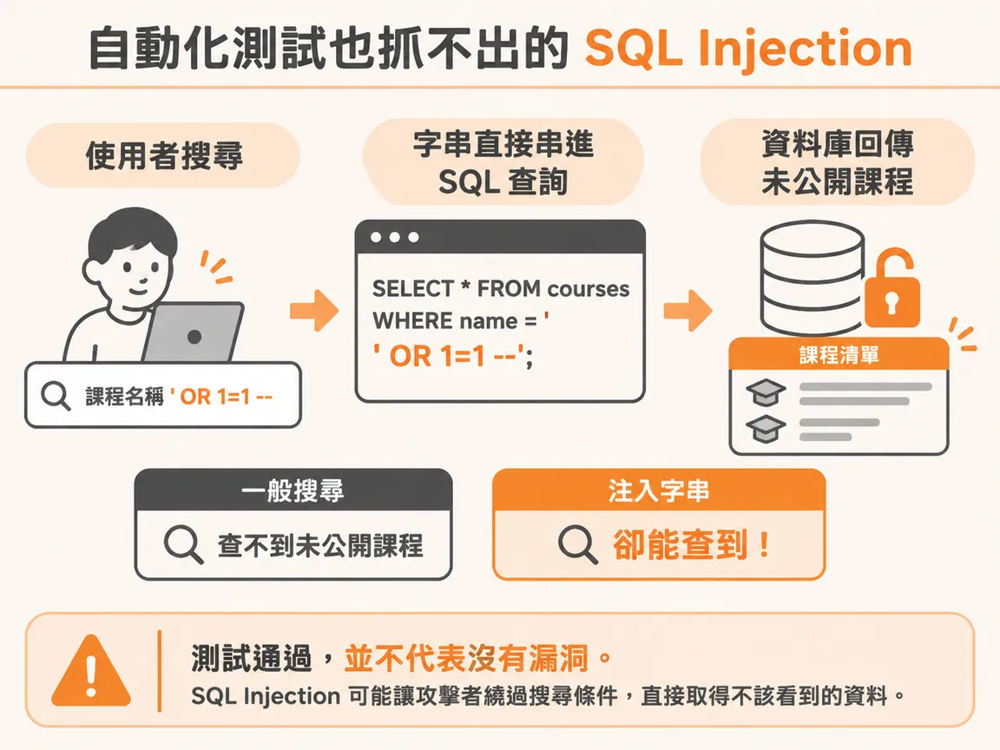
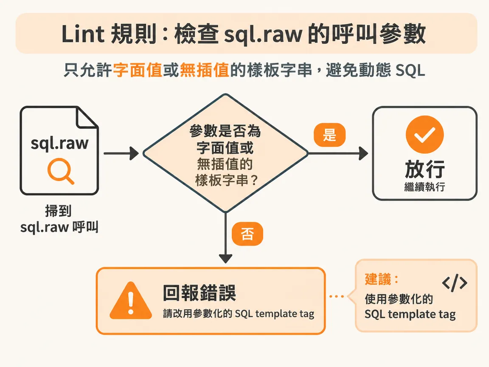
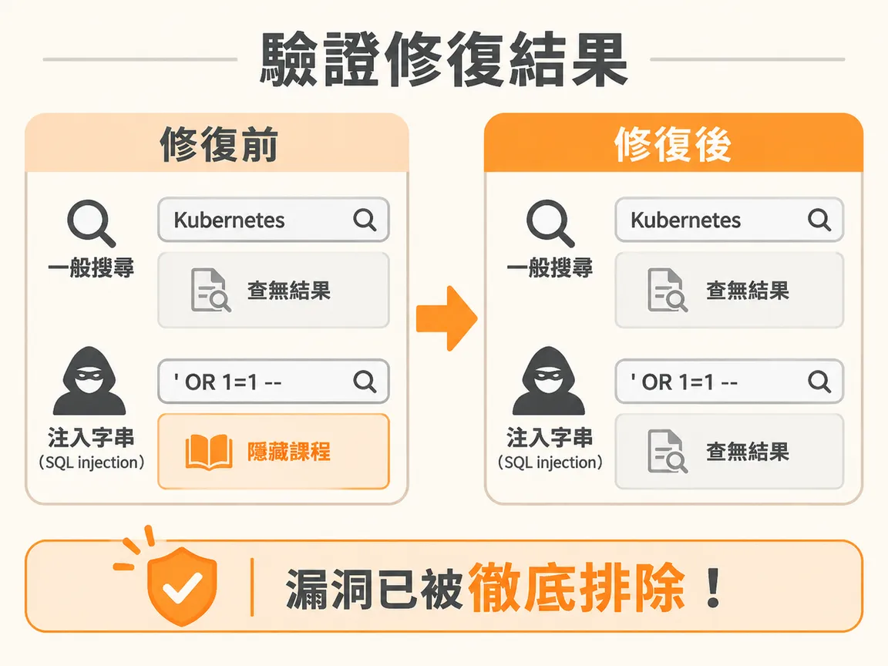

# 為程式碼漏洞撰寫自訂 Lint 規則：精準防堵 sql.raw 動態字串

在規劃專案的程式碼檢查規則時，許多團隊會從 ESLint 起步。但在大型專案中，oxlint 往往是更合適的選擇；它的執行速度比 ESLint 快上許多，能輕易守住 CI 與 pre-commit 的時間預算。

為了套用這套工具，可以在終端機執行 `npm run reset`、搜尋 `built with sql raw`，並執行 `npm install` 安裝 oxlint 套件。接著在 `lint-staged` 的設定中，讓它執行 `oxlint oxlintrc.json`，對專案內所有 JavaScript 與 TypeScript 檔案進行檢查（即便設定中帶有像 `no-error-on-unmatched-pattern` 這類參數，也不影響整體運作）。`oxlintrc.json` 能完整承接原本整理在 Gist 裡的檢查項目，把繁瑣的 `codingstandards.md` 文件，精簡收斂成一組全自動的檢查機制。

不過，自動化檢查的潛力遠不止於一般的排版與語法規範。

## 自動化測試也抓不出的 SQL Injection

專案中可能潛藏著嚴重的安全漏洞，但終端機執行 `npm run check` 時，所有現有測試卻全數通過，完全沒有提出任何警告。



在資料庫執行 `npm run dbseed` 匯入測試資料後，系統內會建立四門公開課程，以及一門未公開的 Kubernetes 課程。在前端的課程搜尋介面（Search Courses）中，正常輸入關鍵字查不到該門隱藏課程；但只要在搜尋框中輸入一串精心構造的怪異字元，畫面立刻跳出「Shipping with docker and kubernetes」。

這是典型的 SQL injection（SQL 注入攻擊）。使用者透過輸入惡意字串，繞過了原本的資料存取權限。

這個漏洞源自 `courses.tsx` 的查詢邏輯：

<!-- source: sources/real-engineer/20261116/supplement/cohort-005-project/app/routes/courses.tsx#L29-L48 -->

```tsx
function buildCourseQuery(
  search: string | null,
  category: string | null,
  status: CourseStatus | null,
  sortBy: string | null,
  limit: number,
  offset: number
) {
  const conditions = [];

  if (status) {
    conditions.push(eq(coursesTable.status, status));
  }

  if (search) {
    const term = `%${search}%`;
    conditions.push(
      or(like(coursesTable.title, term), like(coursesTable.description, term))!
    );
  }
```

只要搜尋條件存在，程式碼便會呼叫 `sql.raw`。使用 Drizzle 這類 ORM 時，框架本身有一整套參數化機制，通常很難直接寫出帶有注入漏洞的程式碼；但 Drizzle 同時也提供了 `sql.raw` 這個特殊函式，它完全不做任何跳脫處理。

`sql.raw` 並非一無是處。單純傳入寫死引號的純靜態 SQL 片段時，使用它是完全安全的。真正的問題在於動態字串：一旦對傳入 `sql.raw` 的內容進行字串插值（string interpolation）或字串串接（concatenation），安全防線就會全面崩潰。

oxlint 的現成設定項雖然豐富，卻沒有任何一個內建規則能做到「允許 `sql.raw` 接收靜態字串，但只要傳入動態字串就報錯」。

## 請 Agent 撰寫高度針對性的 Lint 規則

要解決這個痛點，最有效的方式是讓 AI agent（搭配 retro 技能）撰寫一條專屬的自訂 lint 規則。在提示詞中明確訂出三個要求：

1. 指出 `courses.tsx` 存在一個必須修復的安全性漏洞。
2. 專案不需要全面禁用 `sql.raw`，必須保留合法的使用場景。
3. 規則必須精準阻擋任何動態字串傳入 `sql.raw`。

AI agent 非常擅長處理這類任務。手寫 lint 規則通常令人卻步，開發者必須深入抽象語法樹（AST），精準辨識 Literal（字面值）、Template Literal（樣板字面值）、Member Expression（成員表達式）與 Identifier（識別字）之間的差異；但對模型而言，這類程式碼結構高度規律，消耗約 38k tokens 就能迅速在 `lint-rules` 目錄下生成專屬規則。

規則生成後，執行 `npm run lint oxlint`，系統立刻精準攔截了 `courses.tsx` 中的違規呼叫，並附上清晰的錯誤指引：



> `sql.raw only accepts a static string, pass dynamic values through the SQL template tag, which parameterizes them.`
> （sql.raw 僅接受靜態字串；若有動態數值，請改用 SQL template tag 進行參數化處理。）

## 驗證修復結果

有了規則把關，接著直接要求 Agent 著手修復 bug。修復完成後回到搜尋介面驗證：一般搜尋 Kubernetes 依然查不到，而輸入先前的 SQL injection 測試字串也完全失效，漏洞徹底排除。



只要是看程式碼 AST 結構就能辨識的潛在漏洞，善用 retro 技能將它轉化為專屬的自訂 lint 規則，就能用極低的成本把安全規範固化為自動化防線，防止相同的低級錯誤在未來的程式碼庫中重蹈覆轍。
