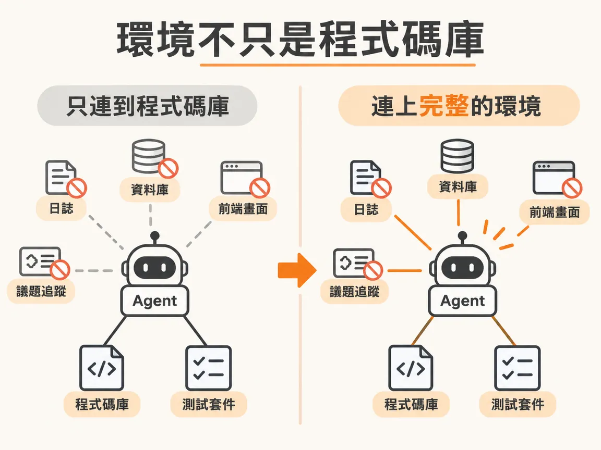
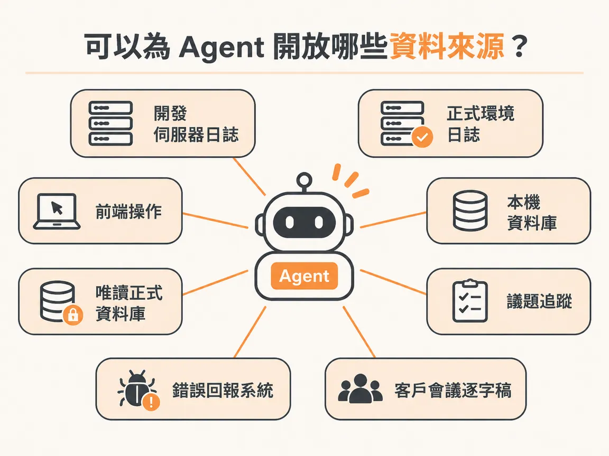

# 為什麼只給檔案系統與測試的 Agent 等於盲的

在讓 AI agent 協助開發時，很多人會花大量心力建立自動化檢查。從程式碼風格檢查（lint rules）、單元測試，到突變測試（mutation testing），這些自動化檢驗手段確實貫穿了高品質開發的核心。

但光有這些還不夠。如果 agent 缺乏了解自身運作環境的「資料來源（data sources）」，它就無法真正驗證自己寫出來的成果。

## 環境不只是程式碼庫

當我們思考 agent 在環境中運作的架構時，很容易把所謂的「環境」直接窄化成「專案的程式碼庫（codebase）」。

真實的環境遠比程式碼豐富得多。Agent 運作的周遭充滿了各種資料來源，也就是它隨時能調取資訊的管道。這些資料源有些本來就擺在那裡隨時可用，有些則需要稍微花點功夫配置才能順利接通。

現實情況中，環境裡往往已經存在大量有用資訊，agent 卻完全摸不到。例如：

- 沒有提供 agent 存取唯讀版正式環境資料庫（read-only production database）所需的帳號密碼。
- Agent 無法查看部署平台或正式環境的運作日誌（production logs）。
- 它甚至看不到本機開發伺服器（dev server）的輸出日誌，也抓不到瀏覽器主控台（browser console）噴出的錯誤訊息。

如果一個 agent 只能碰本機檔案系統和測試套件，它在做決策時就像個瞎子。單元測試能保證邏輯符合預期，但無法告訴 agent 真實系統正在發生什麼事。

## 可以為 Agent 開放哪些資料來源？

相反地，一個富含資料的環境，對 agent 來說會是生產力極高的地方。能開放給 agent 存取的資料源越多，它就越能準確地自我驗證。

實務上可以考慮為 agent 接上以下幾種資料來源：

- **開發伺服器與主控台日誌**：直接讀取 dev server logs 與前端 console 的即時報錯。
- **實際操作前端介面**：讓 agent 具備在應用程式畫面上點擊、操作與巡覽的能力。
- **資料庫**：提供本機測試資料庫（local database），或是有適當權限控管的唯讀正式資料庫。
- **正式環境日誌**：讓 agent 追查真實線上環境發生的異常軌跡。
- **議題與錯誤追蹤工具**：串接 Issue Tracker（如 GitHub Issues、Jira）與錯誤回報系統（如 Sentry、Bugsnag），讓它能調閱發生的例外狀況與使用者回報。
- **客戶會議紀錄**：建立一個包含所有客戶訪談與會議逐字稿的知識庫（Wiki），讓 agent 能直接查閱使用者在訪談中對這款軟體的真實需求與說法。

## 完善 Agent 的回饋迴路

不管是自動化測試還是上述的各種資料來源，核心目的都在於建立完整的回饋迴路（feedback loop）。

Agent 的運作本質就是「從環境中收集回饋，再根據回饋採取下一步行動」。只依賴測試，收集到的回饋維度就只有紅燈與綠燈；一旦補足了伺服器日誌、錯誤追蹤與真實資料庫等環境資料源，agent 才能在更寬廣、更真實的情境下審視自己的程式碼，做出合理的工程判斷。
