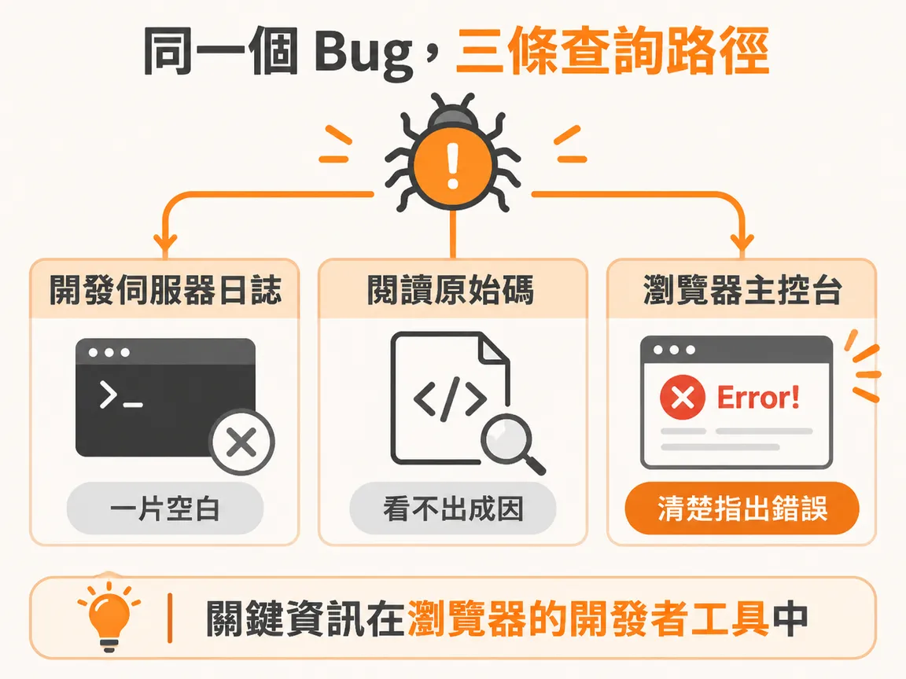
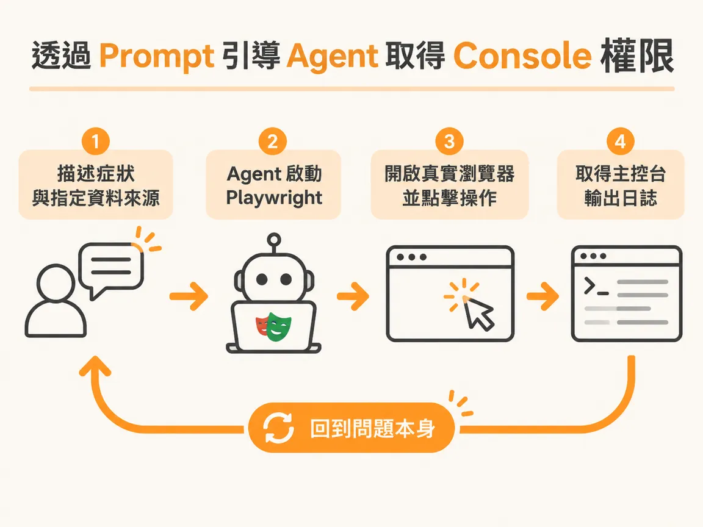
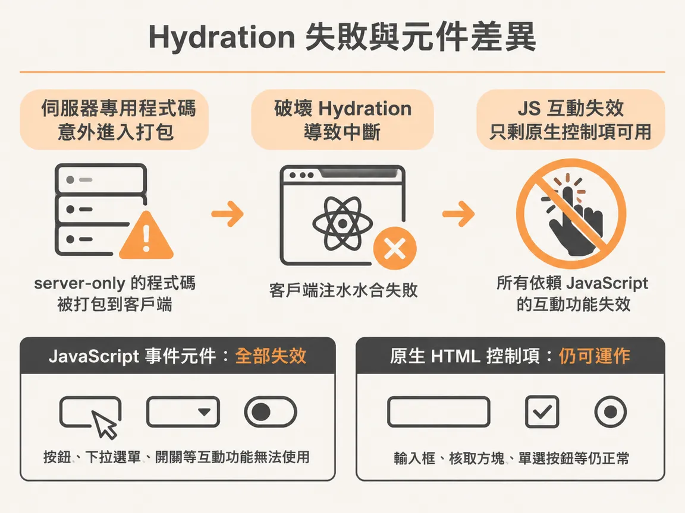
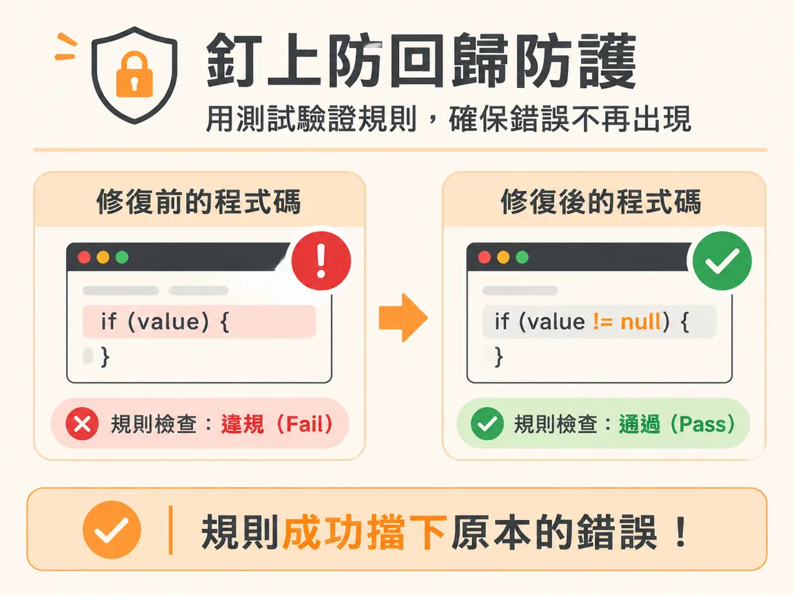

# 用 Browser Console 與診斷迴圈排查 Bug 並建立防回歸防護

在前端開發排查問題時，如果沒有對齊關鍵的資料來源，除錯往往會淪為瞎猜。要解決棘手的 bug，核心在於建立一個可重現的反饋迴圈，並給予除錯工具存取真實執行環境紀錄的權限。

在專案執行 `npm run reset diagnosing bugs` 時，會觸發一個名為 `diagnosing bugs` 的技能。這是一套專門用來處理困難問題的除錯紀律，背後的作法是透過能穩定重現問題的手段——例如一個會失敗的測試、一段 HTTP 腳本，或是一行 CLI 指令——建立起反饋迴圈。然而，這個迴圈能否成功抓出問題，關鍵在於工具能否取得正確的資料來源。

## 症狀與隱藏的資料來源

專案中隱藏了一個看似微小卻很棘手的 bug。畫面上方的 Cadence 介面一切運作正常，點擊跳轉到各個子系統也沒有問題。但是當你嘗試操作底部的使用者切換面板時，會發現異常現象：底部的下拉選單可以正常展開，但上方的選鈕卻完全無法點擊，而且畫面左下角的深色模式切換開關也毫無反應。

如果這時只去看開發伺服器（Dev Server）的日誌，就算讓 AI agent 自己去跑 `npm run dev` 觀察輸出，終端機裡也不會出現任何有用的報錯紀錄。純靠人工去逐行翻閱程式碼雖然有可能猜出端倪，但真正的關鍵其實藏在另一個地方：在瀏覽器頁面上點擊右鍵打開開發者工具（Inspect），就會發現錯誤訊息完整出現在 Browser Console 裡，而這正是終端環境下的 agent 預設讀取不到的資料。



## 透過 Prompt 引導 Agent 取得 Console 權限

要讓 agent 順利除錯，方法是向它具體描述問題症狀，同時明確指定資料來源：

> 前端介面出現異常：開發用 UI 面板中，上方的選鈕無法運作，但底部的下拉選單正常；此外深色模式開關也失效了。我懷疑你目前缺少排查所需的關鍵資料，請先連線到 Browser Console 查看錯誤紀錄。開發伺服器目前運作在 localhost 5175。請使用 diagnosing bugs 技能進行排查。

如果預設沒有自動觸發技能，直接在提示詞中明確加入「diagnosing bugs」即可。

Agent 接收到指令後，會開始運用 Playwright 配合環境中的 Chrome 瀏覽器啟動除錯。Playwright 會打開真實的瀏覽器實例、模擬點擊行為確認元件是否能夠互動，更重要的是，它讓 agent 得以直接擷取 Browser Console 的日誌輸出。



## Hydration 失敗與元件差異

從 Console 抓出的頁面載入錯誤揭露了核心原因：伺服器專用（server-only）的程式碼外洩到了客戶端打包（client bundle）中。這個外洩直接破壞了 React 的 Hydration（客戶端注水水合）機制，導致客戶端所有的 JavaScript 互動邏輯全面失效，整支應用程式只剩下不需要依賴 JS 的純 HTML 控制元件還能運作。



這解釋了為什麼深色模式開關與上方的切換按鈕完全動不了，因為它們仰賴客戶端事件：

<!-- source: sources/real-engineer/20261116/supplement/cohort-005-project/app/components/dev-ui.tsx#L94-L107 -->

```tsx
          <Button
            size="sm"
            variant="outline"
            className="w-full justify-between"
            onClick={() => setOpen(!open)}
          >
            Switch user
            <ChevronDown
              className={cn(
                "size-3 transition-transform",
                open && "rotate-180"
              )}
            />
          </Button>
```

而底部的國家選擇選單之所以還能正常展開，是因為它使用的是原生的 HTML `<select>` 標籤：

<!-- source: sources/real-engineer/20261116/supplement/cohort-005-project/app/components/dev-ui.tsx#L144-L156 -->

```tsx
            <select
              name="country"
              defaultValue={devCountry ?? ""}
              onChange={(e) => e.target.form?.requestSubmit()}
              className="w-full rounded-md border bg-background px-2 py-1.5 text-sm"
            >
              <option value="">Auto-detect</option>
              {countries.map((c) => (
                <option key={c.code} value={c.code}>
                  {c.name} ({c.code})
                </option>
              ))}
            </select>
```

## 假說驗證與修復

`diagnosing bugs` 技能的核心流程在於先建立一個持續、穩定失敗的驗證迴圈。它會提出假說並驗證，如果第一個假說無法解釋現象，就會持續嘗試其他假說，直到找到符合所有徵兆的成因。

確認是伺服器代碼外洩導致 Hydration 中斷後，agent 觀察到資料載入階段其實已經提供了所有使用者資料，於是調整實作方式，改用不直接引用伺服器端資料庫模組的替代路徑，順利修復了客戶端打包。

## 釘上防回歸防護

修復程式碼並不是除錯的終點。這項技能包含了一個內建的檢討機制，目的是確保同樣的架構錯誤未來不再發生。

Agent 在修正程式碼後，主動呼叫專案中的 `lint boundaries` 指令，使用 Dependency Cruiser 新增了一條架構邊界規則：禁止從 `AppComponents` 執行期引用 `AppDB`。

為了驗證防護確實生效，它會執行測試確認：
1. 在帶有 bug 的舊程式碼上，這條規則會亮紅燈（fail）。
2. 在套用修復後的程式碼上，規則順利轉為綠燈（pass）。



許多人認為 AI agent 不擅長排查複雜 bug，通常不是因為推理能力不足，而是因為缺乏取得關鍵日誌的管道。一旦讓 agent 連接上 Browser Console 等真實資料來源，它解析與比對大量日誌的效率往往遠高於人工排查；再搭配建立反饋迴圈與設定防回歸邊界規則，就能在快速除錯的同時，徹底封堵問題再次發生的可能。
