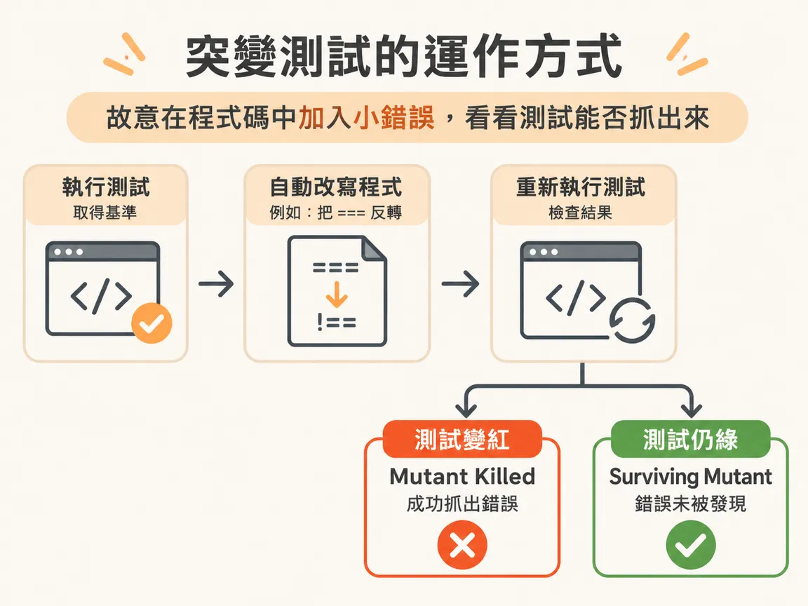
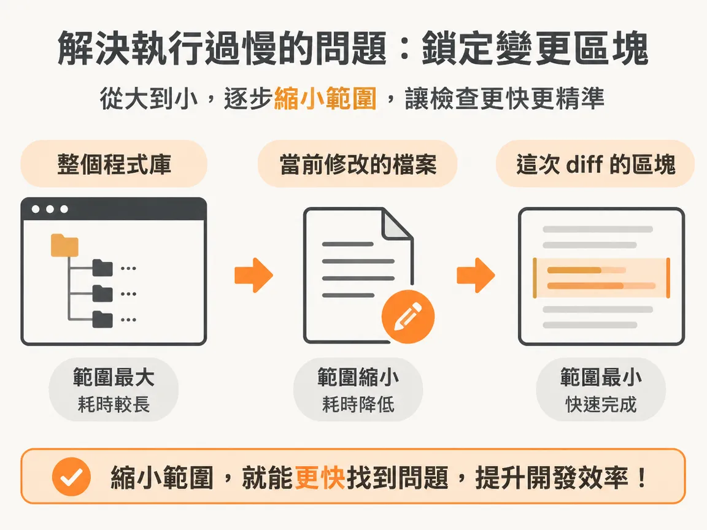
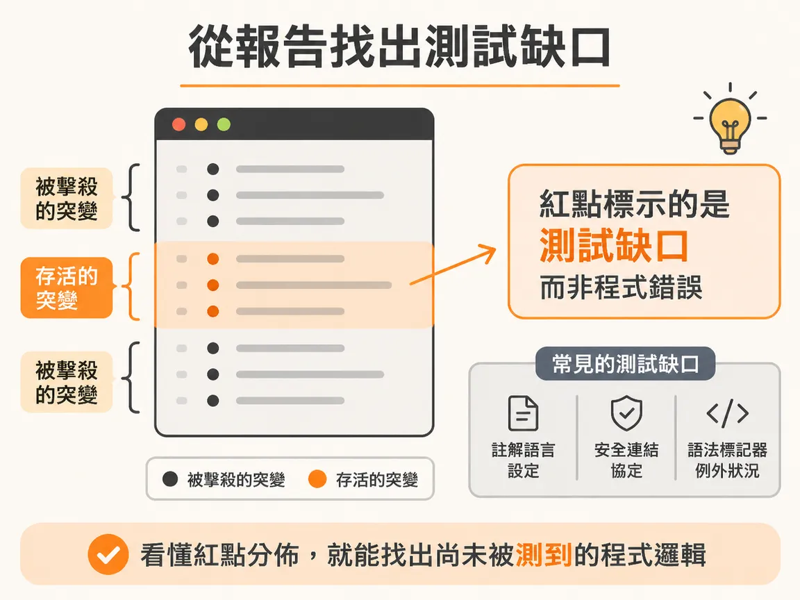

# 突變測試：用存活突變檢驗測試有效性

寫了自動化測試，而且測試全部亮綠燈，這代表程式碼真的安全了嗎？

自動化測試能幫我們檢查執行時期的行為，並在 AI agent 改動程式時攔截非預期的回歸錯誤（regression）。然而，光是「測試通過」甚至「覆蓋率很高」，都不代表測試套件真的有防禦力。如果測試只是把程式碼跑過一遍，卻沒有斷言關鍵邏輯，潛在的 bug 依然會溜進正式環境。

要確認測試套件是否真的有效，最誠實的檢驗方式就是突變測試（Mutation Testing）。

## 突變測試的運作方式

突變測試的核心邏輯很直覺：如果故意在程式碼裡塞入 bug，現有的測試抓得出來嗎？



以一個含有邏輯判斷的函式（例如計算範圍起點的 `rangeStart`）為例，突變測試的步驟如下：

1. **取得基準線**：先跑一次原本的測試套件，確認目前所有測試都能正常通過。
2. **注入突變（Mutate）**：工具會自動竄改原始碼。例如把全等運算子 `===` 改成反向條件、把減號 `-` 改成加號 `+`、把邏輯運算 `&&` 換成 `||`、把布林值硬改成 `true` 或 `false`，或是把字串判斷 `startsWith` 改成 `endsWith`。
3. **重新執行測試**：程式碼被植入這些小破壞後，工具會重新跑測試。
4. **判定突變結果**：
   - **被殺死的突變（Killed Mutant）**：程式碼被竄改後，測試立刻亮紅燈報錯。這代表測試有確實抓出異常。
   - **存活的突變（Surviving Mutant）**：即使把運算符號顛倒或邏輯反轉，測試居然還是綠燈通過。這代表測試套件存在盲點，根本沒有驗證到這行邏輯的產出。

雖然名詞聽起來很具侵略性，但突變測試的目標，就是要盡可能找出並消除那些存活的突變。

測試套件的寫法如果像下面這樣，逐一驗證不同輸入條件與邊界值的輸出：

<!-- source: sources/real-engineer/20261116/supplement/cohort-005-project/app/lib/ppp.test.ts#L71-L94 -->

```typescript
  describe("calculatePppPrice", () => {
    it("returns full price for tier 1", () => {
      expect(calculatePppPrice(4999, "US")).toBe(4999);
    });

    it("applies 30% discount for tier 2", () => {
      expect(calculatePppPrice(4999, "BR")).toBe(3499);
    });

    it("applies 50% discount for tier 3", () => {
      expect(calculatePppPrice(4999, "IN")).toBe(2500);
    });

    it("applies 70% discount for tier 4", () => {
...

    it("returns 0 for free courses", () => {
      expect(calculatePppPrice(0, "IN")).toBe(0);
    });

    it("returns full price for null country", () => {
      expect(calculatePppPrice(4999, null)).toBe(4999);
    });
  });
```

當突變工具試圖竄改折扣比例或邏輯判斷時，這些精準的斷言就能立刻將突變殺死。

## 解決執行過慢的問題：鎖定變更區塊

突變測試最大的痛點是速度極慢。每改動一個地方就要重新跑一次測試，如果對著整個程式庫執行，往往得花上好幾個小時。

實務上的解法是縮小範圍：



- **只測暫存檔案（Staged Files）**：不要掃描整個專案，只針對當前修改的檔案執行。
- **只測變更區塊（Hunks）**：即便同一個檔案很長，也只突變這次 git diff 真正改動的程式碼片段。

在實際操作中，可以使用 Stryker.js 來負責執行突變測試。透過重設並帶入未暫存修改的指令：

<!-- derived -->

```bash
npm run reset -- relative-comment-links --unstaged
npm install
```

安裝好 Stryker.js 後，`package.json` 會提供 `test:mutation` 指令。

AI agent 最初看到突變報告時，往往不知道該如何判讀與修正。透過回顧會議（retro）的反思，可以額外替 agent 建立專屬的突變測試技能（skill），設定為在執行完 `npm run test:mutation` 讀取報告時觸發，引導 agent 自主掃描存活突變並補強測試。

## 從報告找出測試缺口

以修改 Markdown 解析邏輯的 `comment-markdown.server.ts` 為例，若只針對變更區塊執行：

<!-- derived -->

```bash
npm run test:mutation
```

搭配 agent 的修復，整個過程僅花 51 秒（包含所有 agent 呼叫），突變分數就從 55.56% 提升到 100%，所有 diff 內的突變全數被擊殺。

打開 `reports/mutation/mutation.html` 的 HTML 報告，可以放大看到每一行被改動的細節，例如哪個條件被改成 `true`、哪段字串判斷被改掉。

如果進一步把範圍擴大到「整個檔案」，就能看到完整突變測試的面貌。在整個檔案上執行後，報告顯示出 35 個被擊殺的突變，但也抓出了 31 個存活突變。報告上的紅點清晰標記出測試缺口：例如移除註解語言設定、拿掉安全連結協定、或是語法標記器（highlighter）內部的例外狀況。



根據這份報告補足測試後，突變分數從原本的 50% 拉高到 90%。補上的測試包含：

- 各種語言的語法標記是否正常。
- 語法標記器發生例外時的容錯處理（這是原本完全沒預想到的 bug）。
- 是否正確轉義（escape）`&` 符號。
- 是否保留 HTTP 連結、`mailto:` 連結以及相對路徑連結。

這些補進來的測試都有扎實的驗證目的，而不是為了衝覆蓋率湊出來的無效測試。

## 將突變分數視為資訊，而非閘門

在提升測試品質時，並不一定要強求 100% 的突變擊殺率。

突變測試更適合作為提供給開發者與 AI agent 的「高品質資訊輸入」，而不是一個非黑即白、未達標就阻擋流程的硬性閘門（deterministic gate）。如果把它硬塞進 pre-commit hook，只會拖慢日常開發節奏。

較好的做法，是將突變測試放在 agent 完成任務後的自我驗證流程中。你可以設定一個參考門檻（例如 85% 或 90%），鼓勵 agent 在交付前參考突變報告修補盲點。透過存活突變提供的具體回饋，測試套件就能持續維持在真正具備防禦力的狀態。
