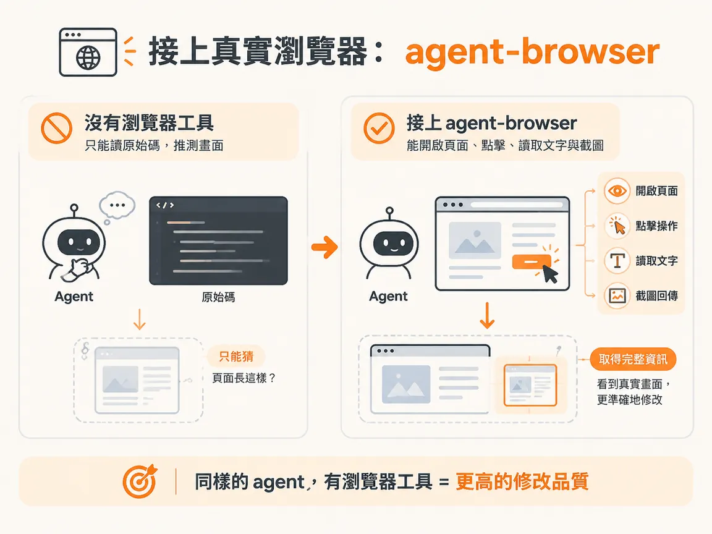
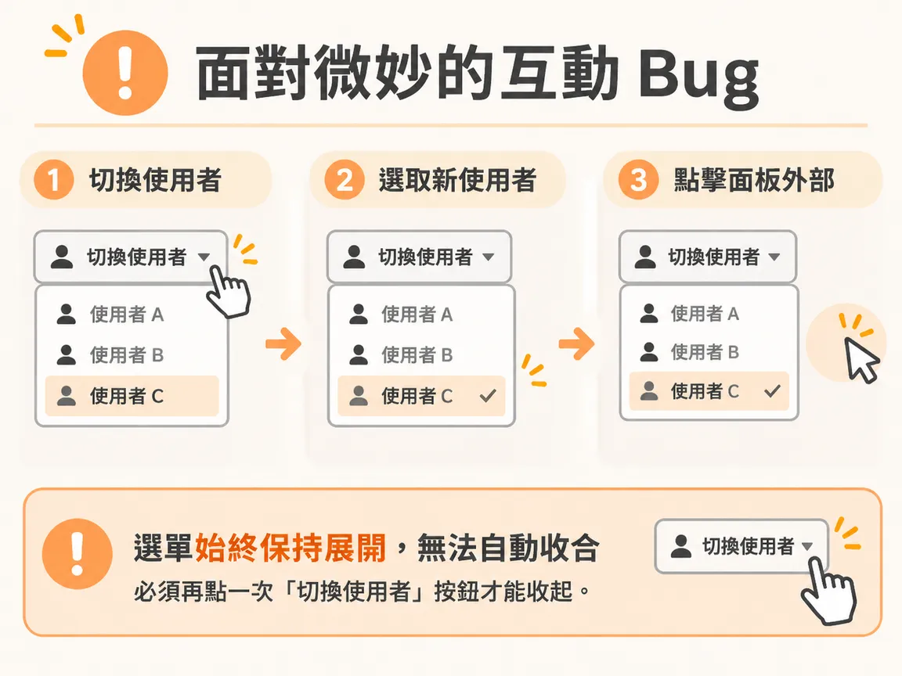
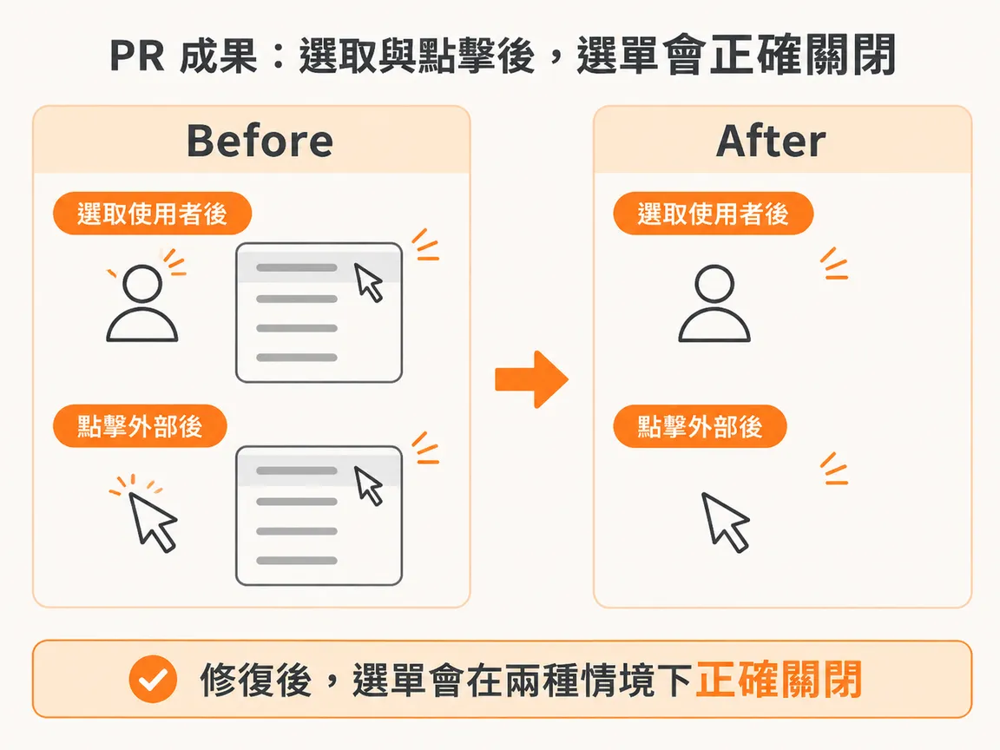

# 用 agent-browser 驗證前端修改並產出 PR 截圖證據

在維護前端介面時，有些問題光看程式碼很難察覺，像是選單展開後點擊外面沒有關閉、選完項目後下拉選單卡在畫面上等互動細節。這些問題在靜態程式碼中幾乎看不出端倪，但只要打開瀏覽器親手點一次，問題就一目了然。

如果想讓 AI agent 幫忙修復這類前端問題，就必須替它裝上一雙眼睛，讓它能夠操作真實瀏覽器來驗證自己的修改。

## 替 Agent 接上真實瀏覽器：agent-browser

在專案開始前，先透過指令整理環境：

<!-- derived -->

```bash
npm run reset agent browser
npm install
npm run db:migrate
npm run db:seed
```

重設目前分支、安裝相依套件並完成資料庫遷移與資料填補（seed），就能得到一個乾淨的工作環境。

接著在 `agents.md` 中，會看到新增的 `agent-browser` 區塊。`agent-browser` 本質上是建立在 Playwright 之上的輕量封裝工具（thin wrapper），讓 agent 能直接在終端機裡驅動真實瀏覽器操作應用程式。透過它，agent 可以執行一連串指令：

* `agent browser open`：開啟指定頁面
* `agent browser snapshot`：取得當前 DOM 結構快照
* `agent browser click`：點擊畫面元素
* `agent browser fill`：在輸入框填入文字
* `agent browser get text`：讀取畫面上的文字
* `agent browser screenshot`：替當前畫面截圖

在前端專案中，接上瀏覽器工具與否帶來的差距非常巨大。只要啟用這項能力，agent 產出修改的品質往往會有飛躍性的提升，成效就像換了更高等級的模型一樣。



這套設定放在專案內的 `docs/agent-browser`。雖然形式很像 Skill，但本質上是 `agents.md` 裡指向這份詳細說明的 Context 指標。Agent 在使用 `agent-browser` 之前，都會先閱讀這個檔案。這種做法比直接丟官方文件更好，因為我們可以在裡面記錄專屬於這個應用的特殊操作細節；如果某次瀏覽器操作出錯進行事後檢討（retro），也有固定的地方能保存這些學到的經驗。

## 面對微妙的互動 Bug

這次要處理的是一個困擾已久的互動問題：在開發者介面（Dev UI）中切換使用者時，選取了新使用者之後，切換使用者的分頁選單並不會自動關閉；就算點擊選單以外的空白處，它依然維持開啟狀態，必須手動再點一次「切換使用者」按鈕才能收起。



對人類來說，進到瀏覽器按幾下就知道哪裡壞了；但要 agent 光憑純文字程式碼去理解這種視覺互動，非常困難。讓 agent 親自去點瀏覽器，能讓它真正站在使用者的角度體會操作流程。

這次的任務不只要 agent 修好這個問題，還要它建立 Pull Request（PR），並且在 PR 中附上證據（evidence）。我們要求它擷取修復前（before）與修復後（after）的截圖，讓審查者只要瞄一眼 PR 內容，就能立刻確認問題已被修復。這樣不僅強迫 agent 自行驗證工作成果，也大幅降低人工審查的負擔。

## 撰寫 Prompt 與執行修復

我們可以直接將問題描述與需求寫入提示詞：

> Dev UI 的使用者選取器有一些奇怪的互動：當你選取一位使用者時，選取面板不會關閉，而且點擊面板外部也無法將它關閉。請建立一個 PR 來修復這個問題，並使用截圖作為修復證據。

送出提示詞後，agent 會開始解析指令。雖然專案的 commit 歷史可能有點特殊，導致它在挑選 PR 的 base branch 時多了一些步驟，但很快就能看到它依照 `agents.md` 的指示，開始呼叫 `agent browser click` 等指令操作畫面，並成功在瀏覽器中重現問題。

確認 bug 存在後，agent 會修改程式碼，接著再度啟動瀏覽器進行驗證。

有些人會擔心讓 agent 跑瀏覽器截圖與驗證非常消耗 token。但在實際測試中，整趟流程花費約 38.1k tokens，成本相當合理。前端驗證非常適合搭配較高的 Effort Level（推理思考程度）。因為 Effort Level 代表模型願意為產出的資產投入多少心力，而在驗證階段，我們是在建立「這項修改確實有效」的扎實證據，投入的思考越多，產出的驗證品質與可靠度就越高。

## PR 成果與 Before／After 截圖證據

完成後，agent 順利送出 PR。檢視程式碼變更（diff），可以看到它在元件中加入了 `useRef` 與 `useEffect` 來監聽外部點擊事件，邏輯相當合理。

更具價值的是 PR 內文中的 Before 與 After 截圖：



* **Before 截圖**：清楚呈現選取使用者後，面板依然開啟；點擊面板外部，面板同樣卡在畫面上。
* **After 截圖**：清楚呈現選取使用者後面板立刻關閉；點擊面板外部時面板也能順利收合。

許多人審查 PR 時只在乎「修好後的畫面」，但「修復前的截圖」其實同樣關鍵。修復前的截圖能證明 agent 當初確實找對了問題、重現了正確的錯誤情境，而不是改了半天卻修到不相干的地方。

這項修改的影響範圍（blast radius）僅限於 Dev UI，而且屬於隨時可回復的雙向門決策（two-way door）。切換到對應分支親自點擊確認，點選外部能關閉，切換使用者也能正常收合，修改確實完全生效。

將 agent 與前端真實瀏覽器接軌，不僅能讓它建立自動驗證的能力，還能產出極具說服力的 PR 截圖證據。甚至有團隊會進一步將這些截圖配上文字轉語音（TTS）API 製作成操作說明影片，讓審查者一目了然。當未來的軟體交付節奏持續加快、PR 數量大量增加時，這種自動化的視覺驗證與證據產出將會是不可或缺的開發標準流程。
