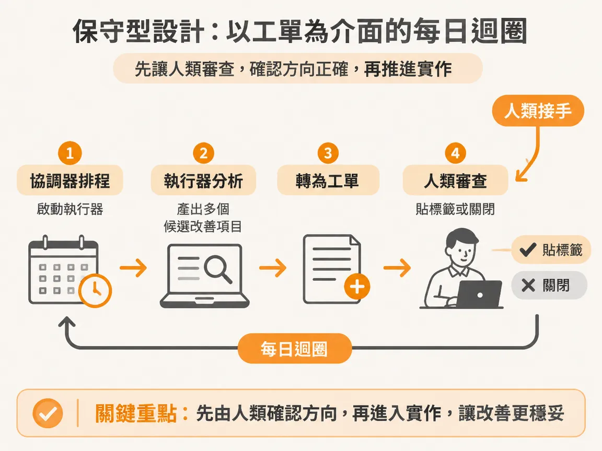
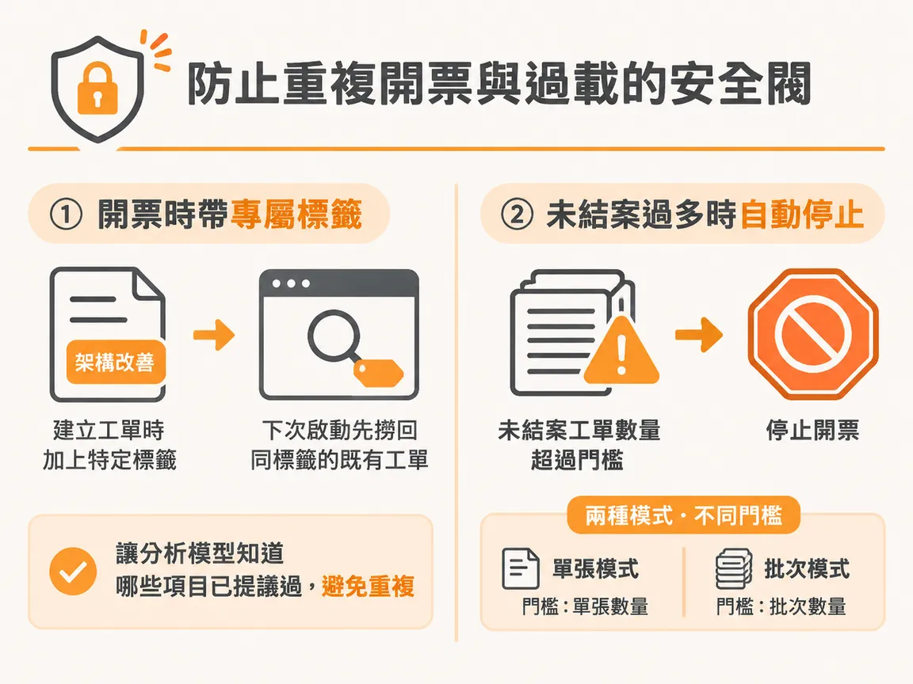
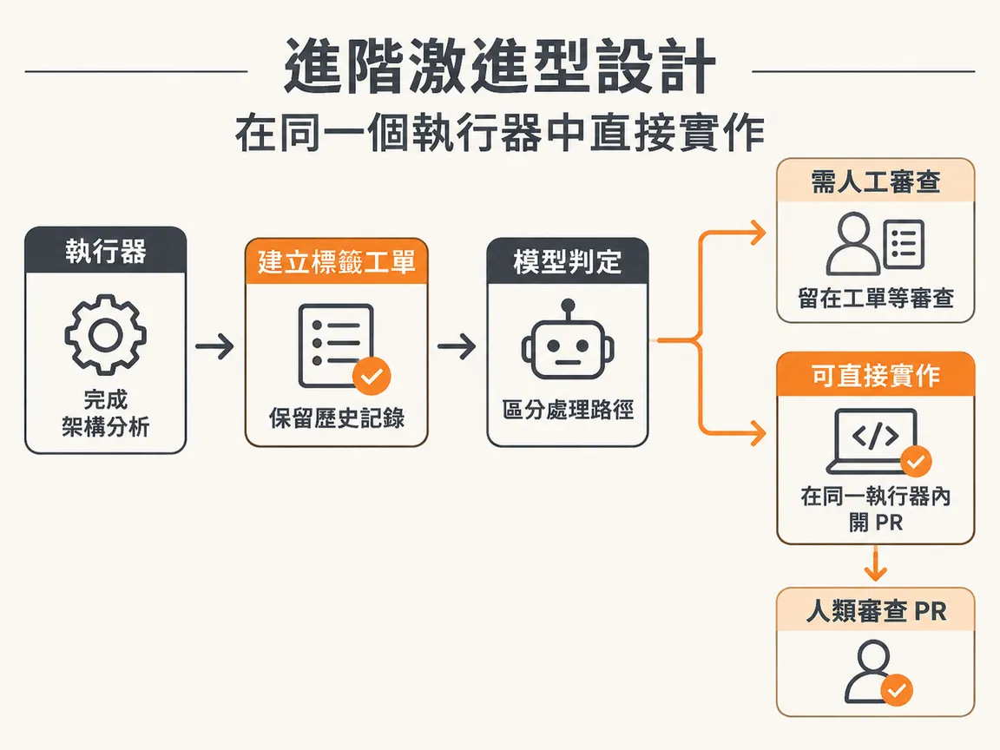

# 設計每日執行的 Codebase 架構改善流程

讓 AI 自動改善程式庫架構時，最容易碰到的問題不是模型給不出建議，而是它每天不斷提出重複的重構想法，甚至在短時間內開出幾十張工單，直接淹沒工程團隊的追蹤系統。

在軟體工廠中，協調器（Orchestrator）扮演調度各項自動化作業的核心角色。它具備依照固定週期執行迴圈的能力，無論是每天、每小時或每分鐘，都能啟動處理程序、排程執行器（runner）、到工單追蹤系統（ticket tracker）執行操作，或在 Git 主機上建立 PR。

利用這個能力，可以建立第一個架構改善流程：每天自動檢視專案架構，並提出一組修改建議。設計這類流程時，先從放慢步調的保守機制開始，確認整套煞車運作正常，再逐步提高自動化程度。

## 保守型設計：以工單為介面的每日迴圈

最穩當的起步方式，是在 AI 產生建議後先交給人類審查，先確認方向正確再往下實作。整體運作流程如下：

1. **定時啟動執行器**：由協調器設定排程迴圈，例如每天執行一次，啟動一個執行器跑「改善程式庫架構」（Improved Codebase Architecture）流程。
2. **產出架構報告**：該技能會產生一份 HTML 報告，列出多個有潛力的候選改善項目。雖然技術上可以把報告部署到內部空間供人瀏覽，但更實用的做法是將建議轉化為具體的通知或工作項目。
3. **過濾候選項目並開票**：在執行器內部，可以選擇將多個候選項目過濾成單一最佳項目，或是針對每一個候選項目在工單追蹤系統中各自建立一張新工單。
4. **人類介入審查**：人類工程師收到工單後進行審核。通過審查的工單可貼上對應標籤，後續再由協調器指派實作 agent 去處理；若當下不可行，則可直接關閉。

## 防止重複開票與過載的安全閥

如果缺乏防護機制，自動化流程很快就會變成噪音製造機。設計這個流程時，必須建立兩道防護：

### 1. 專屬標籤（Label）與上下文過濾

為了避免執行器每天重複開出內容大同小異的工單，系統建立工單時必須帶有特定標籤（例如標示來自架構改善流程）。執行器在啟動時，會先撈取帶有該標籤的現存工單作為上下文，讓分析模型知道哪些項目已經被提議過，避免重複提案。

### 2. 工單張數門檻（停止條件）

當團隊工作重心轉移，工程師可能有一陣子無法抽空審查這些自動產生的建議。這時系統必須有能力自動煞車：

- **單一推薦模式**：如果每次執行只產生一張工單，可以設定「現存未結案的相關工單超過 5 張就暫停執行」。
- **批次推薦模式**：如果每次是將候選項目全數開票，工程師一天可能會收到 3 到 6 張工單，此時停止門檻可以適度拉高到 20 張。

只要累積的未處理工單超過設定門檻，迴圈就會停止開票，直到人類工程師介入消化或關閉現存工單為止。

## 控制節奏的系統變數

要調整這套架構改善流程的速度，有三個核心控制變數：

- **執行頻率**：如果每天跑一次產生 3 到 6 張工單讓團隊負擔太重，可以調慢為每兩天執行一次；反之若團隊消化速度快，也可以縮短週期。
- **停止門檻上限**：依據團隊在各階段的消化能力，動態調整 5 張或 20 張的未結案上限。
- **候選項目篩選標準**：在執行器內提高標準，只允許評分最高或特別明確的候選項目成案，藉此控制產出量並提高工單品質。

## 進階激進型設計：在同一個執行器中直接實作

如果想追求更高程度的自動化、減少人類在工單階段的審查負擔，可以採用另一種更激進的設計：把人類介入的時間點往後移。

在此架構下，同一個執行器跑完架構分析後，先為所有候選項目建立標籤工單（保留歷史記錄），接著由模型自行給出判定，區分出哪些項目已經可以直接實作、哪些項目仍需人工審查：

- **需要人類審查的項目**：維持原樣留在工單追蹤系統中，等待工程師審核。
- **可直接實作的項目**：在同一個執行器內（例如透過同一個 context window 內的子代理人）立即著手實作程式碼，實作完成後在 Git 主機直接建立 PR，最後才由人類審查 PR 本身。

### 激進設計的潛在風險

跳過工單審查直接發 PR 的做法雖然能產出更多程式碼，但存在明顯的工程隱憂：架構改善往往涉及大規模且細節繁雜的重構，這類工作極度消耗 context window。如果讓執行器在同一個上下文內連續實作，很容易撞上 context window 上限，導致模型在品質下滑的低效區間裡寫程式，產出劣質的修改。

因此，軟體工廠應先從「人類審查工單」的保守型架構開始運作。有了工單標籤管理與數量安全閥，確定系統不會失控產生重複工作後，再依專案性質評估是否開放特定項目直接進入自動實作與建立 PR。

這種以門檻與標籤控制節奏、確保每一步都受控的原則，同樣適用於程式碼品質規則的推進。下一階段要解決的，是如何把這套迴圈應用在 lint 規則的逐步收緊上。
