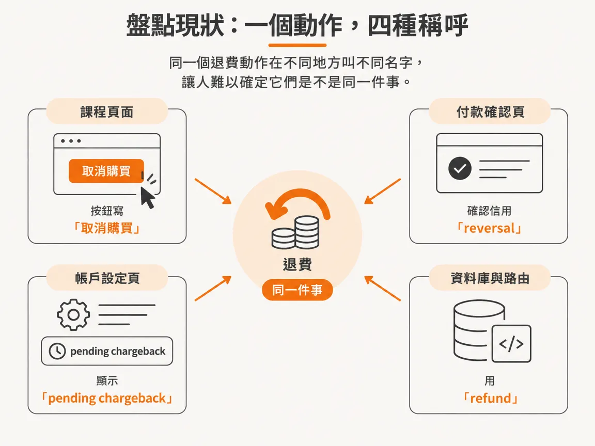
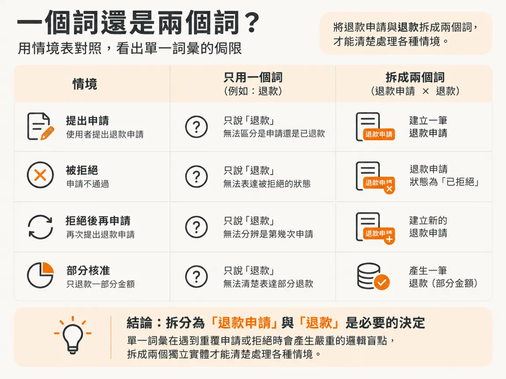
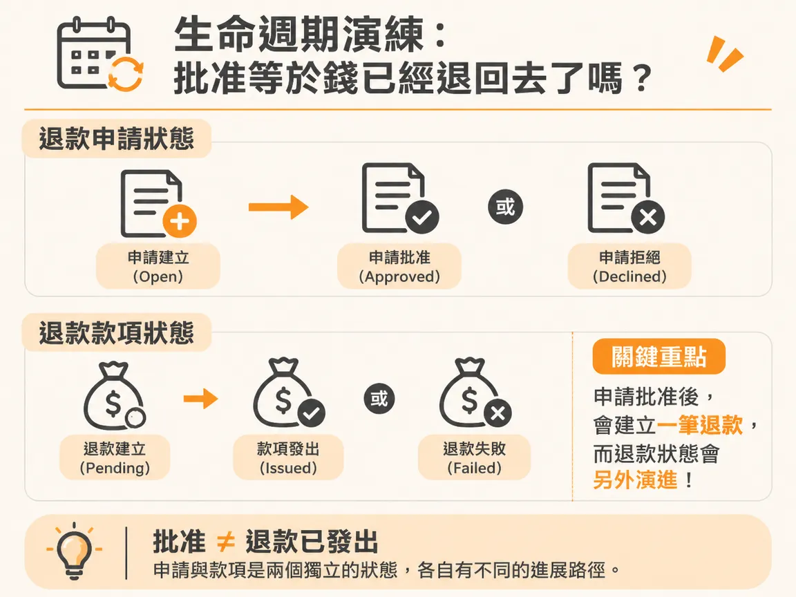

# 用 grill-with-docs 與情境表釐清領域詞彙與功能邊界

在同一個應用程式裡，同一個動作往往會被不同的人用不同的詞彙稱呼。當使用者想退費時，按鈕寫著「取消購買」，寄出的確認信標題寫著「折讓（Reversal）」，後台設定頁面顯示「待處理拒付（Pending Chargeback）」，資料庫與路由檔案裡卻又寫著「退款（Refund）」。

這樣的詞彙混亂不僅讓使用者困惑，也會直接反映在程式碼的命名、資料庫欄位與錯誤訊息中。如果專案中尚未建立領域詞彙表（`Glossary.md`），光是靠工程師直覺更名很容易顧此失彼。這時可以搭配 `grill-with-docs` 技能，透過與模型對話、搭配「情境表（Scenario Testing）」比對不同稱呼在邊界案例下的語意，逐步挑出最精準的詞彙並劃定功能的邊界。

## 盤點現狀：一個動作，四種稱呼

在開始盤點詞彙之前，專案可能完全沒有任何術語定義文件。若要定義一個核心實體，通常也得連帶定義周圍的其他相關詞彙，才能讓術語的語意完整。

在一次全新的對話階段中啟動 `grill-with-docs`。這個技能會載入兩個子技能：`grilling` 負責一輪一輪追問，`domain-modeling` 負責把結論寫成 glossary 與 ADR。開場只需要把症狀講清楚，不必先想好答案：

<!-- source: sources/real-engineer/20261116/supplement/index.html#L399-L403 -->

```text
/grill-with-docs There's a lot of confusion in the application around kind of what pending
  chargeback or reversal means. There's some inconsistent language that's used in the email
  that we send to users versus what we show on the screen. I want to start bootstrapping a
  glossary of the stuff around that that we might need and figuring out and firming up the
  language.
```

這段開場同時做三件事：指出混淆的具體詞（pending chargeback、reversal）、指出混淆發生的兩個面（寄給使用者的 email 與螢幕上的畫面）、說明目標是「先把 glossary 墊起來、把語言敲定」，而不是馬上改程式。專案此時一份 glossary 都沒有，所以第一個詞定下來之後，還得補上讓它說得通的其他詞。

模型在爬梳程式碼後，通常能抓出所有互相衝突的命名。以課程購買的退費流程為例，程式碼中同時出現了四種說法：



1. **資料庫與路由**：使用 `refund`（例如 `RefundStatus.Requested`）。
2. **課程頁面按鈕與表單**：寫著「取消我的購買（cancel my purchase）」。
3. **確認信函**：使用「折讓（reversal）」。
4. **設定頁面**：標示為「待處理拒付（pending chargeback）」。

在路由與信件實作中，就能看到這種各說各話的命名：

<!-- source: sources/real-engineer/20261116/supplement/cohort-005-project/app/routes/courses.$slug.tsx#L370-L394 -->

```tsx
const CANCEL_WINDOW_DAYS = 14;
const CANCEL_WATCH_LIMIT_SECONDS = 2 * 60 * 60;
const CANCEL_COMPLETION_LIMIT = 0.5;

function getPurchaseForCourse(userId: number, courseId: number) {
  return db
    .select()
    .from(purchases)
    .where(and(eq(purchases.userId, userId), eq(purchases.courseId, courseId)))
    .orderBy(sql`${purchases.createdAt} desc`)
    .get();
}

function getRequestedRefund(purchaseId: number) {
...
    .from(refunds)
    .where(
      and(
        eq(refunds.purchaseId, purchaseId),
        eq(refunds.status, RefundStatus.Requested)
      )
    )
    .get();
}
```

<!-- source: sources/real-engineer/20261116/supplement/cohort-005-project/app/routes/courses.$slug.refund.ts#L88-L112 -->

```typescript
/**
 * The confirmation the learner gets in their inbox. There is no mail
 * transport wired up yet, so the built message goes to the server log.
 */
function buildReversalEmail(input: {
  learnerName: string;
  learnerEmail: string;
  courseTitle: string;
  amount: number;
}) {
  return {
    to: input.learnerEmail,
    subject: `Reversal requested — ${input.courseTitle}`,
    body: [
...
      `We have your Reversal request for "${input.courseTitle}".`,
      `The Reversal is for ${formatPrice(input.amount)}, the amount you paid.`,
      "",
      "Our team reviews every Reversal by hand. You do not need to do anything else — we will email you again when it is done.",
      "",
      "— The Cadence team",
    ].join("\n"),
  };
}
```

<!-- source: sources/real-engineer/20261116/supplement/cohort-005-project/app/routes/settings.tsx#L212-L221 -->

```tsx
      {pendingChargebacks.length > 0 && (
        <Card className="mt-8 max-w-md">
          <CardHeader>
            <h2 className="text-lg font-semibold">Pending Chargeback</h2>
            <p className="text-sm text-muted-foreground">
              {pendingChargebacks.length === 1
                ? "One chargeback is waiting on us."
                : `${pendingChargebacks.length} chargebacks are waiting on us.`}
            </p>
          </CardHeader>
```

除了頁面元件，甚至在錯誤訊息裡還會冒出不受控的字眼，例如「您觀看此課程的進度已過長，無法取消」。錯誤訊息也是使用者體驗與領域語言的一環，若與其他頁面用詞脫節，系統整體的邏輯感就會瓦解。

## 從第一個核心詞開始：refund

面對四種稱呼，模型通常會先拋出第一個問題：這個概念到底該叫什麼？

如果站在學員的角度思考，學員並不是想單純「取消」一筆已經完成的購買交易，而是想「退款」。同時，後端的資料庫綱要與 commit 紀錄原本就偏向使用 `refund`。因此，將核心概念定調為 `refund` 是最符合領域直覺的選擇。

## 一個詞還是兩個詞？用情境表對照

決定使用 `refund` 後，緊接著會遇到關鍵的結構問題：我們只需要「退款（refund）」這一個詞，還是需要兩個詞？

從生命週期來看，學員提出申請與款項真正退回，是兩個完全不同的事件。如果只用一個詞，在某些情境下會出現語意矛盾的句子，例如：

> 「退款被拒絕了，所以沒有進行任何退款（The refund was declined, so nothing was refunded）。」

這種句子讀起來非常彆扭。但如果直接拆成「退款申請（refund request）」與「退款（refund）」，兩個詞長得很像，是否真的有必要分開？在直接下決定之前，可以要求模型進行「情境測試（scenario testing）」，列出具體的使用者遭遇情境，並排對照「使用單一詞彙」與「使用兩個詞彙」在描述上的差別：

- **情境 A（學員提出申請，尚未審核）**：
  - 兩個詞：學員擁有一筆未結案的退款申請（open refund request）。
  - 一個詞：學員擁有一筆已申請的退款（requested refund）。
- **情境 B（管理員拒絕申請）**：
  - 兩個詞：退款申請被拒絕，且未核發任何退款（refund request was declined, no refund was issued）。
  - 一個詞：退款被拒絕（refund was declined）。
- **情境 C（被拒絕後，學員再次提出申請）**：
  - 兩個詞：學員建立了兩筆退款申請（two refund requests）。
  - 一個詞：一次購買卻有兩筆退款，且兩筆都沒有真正退款（one purchase, two refunds, neither was refunded）。
- **情境 D（部分退款，申請 79 元但只通過 40 元）**：
  - 兩個詞：退款申請為 79 元，實際退款為 40 元。
  - 一個詞：需要額外發明「申請退款金額」與「已退款金額」來區分。

當邊界案例在語言上說得通時，寫成程式碼就會變得非常直覺。從上述情境對照可以清楚看出，單一詞彙在遇到重覆申請或拒絕時會產生嚴重的邏輯盲點，因此拆分為 `refund request` 與 `refund` 兩個獨立實體是必要的決定。



## 劃定邊界：將「拒付（chargeback）」排除在範圍外

在質詢過程中，模型可能會詢問：由銀行端發起的「信用卡拒付（chargeback）」是否屬於這個領域的範圍？

這是一個幫助劃定術語表邊界的好問題。即使未來可能會介接金流處理這類爭議，但在現有系統與當前需求中，完全沒有處理銀行拒付的邏輯。

這時應該果斷將它標記為範圍外（Out of Scope，遵循 YAGNI 原則），避免把未來才可能用到的概念提前混進現有的領域模型中。如果模型在暫存的 `Glossary.md` 裡擅自加入了 `chargeback`，也必須在下一輪對話中要求移除，確保術語表只專注於當下的功能邊界。

## 生命週期演練：批准等於錢已經退回去了嗎？

確立了 `refund request` 與 `refund` 後，模型會進一步質詢實體之間的狀態關聯：申請獲得批准（approved），是否就代表錢已經退回學員的帳戶？

目前系統尚未串接像 Stripe 這類實際的金流處理服務，看似只有申請與通過。但如果未來串接了金流，這兩者顯然不是同步的。這時可以針對這個時間差再次進行情境測試：

1. **情境一（時間差）**：退款申請在週一通過，金流服務在週四才確認款項退回。如果在週二查看狀態，若只有單一狀態，畫面只能顯示「已退款」，但實際上錢還沒入帳，這對學員來說是不實資訊。
2. **情境二（金流處理失敗）**：管理員批准了申請，但金流處理器因為學員信用卡已停卡而拒絕交易。此時退款申請依然是「已批准」，但退款本身則是「失敗（failed）」。

透過這組情境測試，退款的完整生命週期就浮現出來了：



- 批准一筆退款申請（refund request），會建立一筆退款（refund）。
- 退款申請在審核通過後保持在「已批准（approved）」狀態。
- 退款實體則擁有自己的狀態：從「處理中（pending）」開始，最終變為「已發放（issued）」或「失敗（failed）」。

藉由釐清語言，整個功能的狀態機結構在還沒動手寫程式碼之前就已經定案。

## 消除口吃命名與確定畫面文案

在細化各實體的狀態命名時，常會遇到語意重複的「口吃現象」。例如未審核的退款申請，直覺可能會想命名為 `requested`，但組合起來就會變成「已申請的退款申請（a requested refund request）」。

改用 `open` 就能避免這種重複感：
- 退款申請（refund request）的狀態定為：`open`、`approved`、`declined`。
- 退款（refund）的狀態定為：`pending`、`issued`、`failed`。

當狀態確立後，學員在畫面上看到的文案也能完全對齊術語：
- 提出動作：`Request a refund`
- 系統通知信主旨：`Refund requested`
- 設定頁面標題：`Refund requests`
- 狀態提示文字：`Refund request open — waiting on us`

至於「退款失敗後是否要原地重試或重新發起」以及「退款完成後學員是否失去課程存取權限」，若屬於後續迭代才要實作的項目，皆可在這階段明確列為範圍外，避免討論失焦。

## 讓領域語言回饋到程式碼

當對話收斂、術語表確定後，模型會總結共識並列出需要修改的程式碼清單。這個重構過程會全面反映剛才討論出來的詞彙：

- **資料庫綱要（schema.ts）**：將原本的列舉值 `RefundStatus.Requested` 改為 `open`，並產生對應的資料庫遷移，將現有資料修正為 `open`。
- **設定頁面路由（settings.tsx）**：將 `pendingChargebacks` 替換為 `openRefundRequests`，卡片標題改為清楚的「退款申請」，區域變數也統一為 `openRefundRequests.length`。
- **課程路由（courses.$slug.tsx）**：查詢函式從 `getRequestedRefund` 改名為語意更精確的 `getOpenRefundRequest`，註解也從「取消要約」修正為「退款要約」。

當術語經過情境測試的嚴格檢驗，程式碼裡的型別、函式名稱與畫面文案就能維持高度一致。這類對齊領域語言的重構，不僅讓邊界案例在邏輯上一目了然，也讓後續維護程式碼的成本大幅降低。
