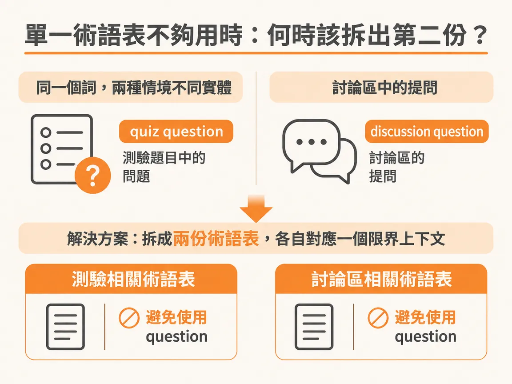
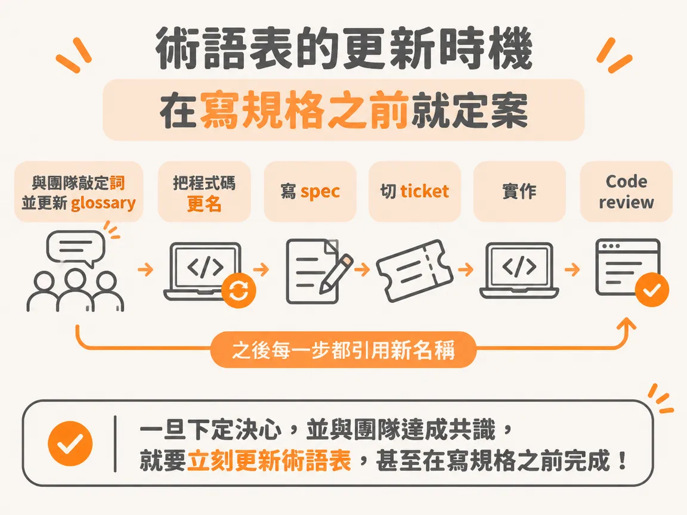
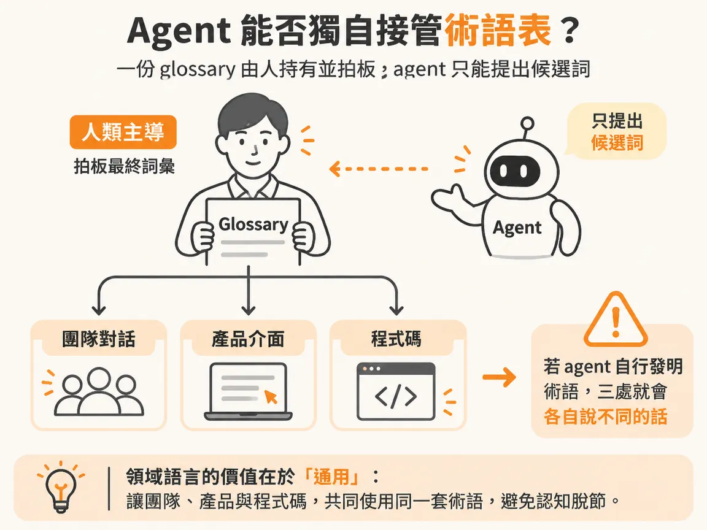

# 領域語言常見問題：何時拆出第二份術語表，以及人與 Agent 的分工

當專案逐漸變大、功能越來越多，團隊很快會遇到一個矛盾：原本清楚明確的領域詞彙表（glossary），開始出現重複或衝突的字詞；同時，在導入 AI agent 輔助開發後，團隊也容易好奇，這份維護起來耗費心力的術語表，能不能乾脆放手讓 agent 自己管理？

要維持程式碼與業務概念的一致性，關鍵在於搞清楚何時該拆分術語表，並守住「人類主導語言定義」的原則。

## 單一術語表不夠用時：何時該拆出第二份？

專案剛開始時，一份全域的 `glossary.md` 通常就足夠。但隨著系統規模成長，同一個字在不同情境下的意義往往會開始打架。

在線上教學系統 Cadence 中就有個典型例子：測驗（quiz）裡有題目與答案（questions and answers），學員需要作答；而在課程的討論區（discussions）裡，學員同樣可以提出問題（questions），講師則在討論介面檢視所有回覆。這兩者在資料庫裡都是各自獨立的實體，如果全都只叫 `question`，溝通與命名很快就會陷入混亂。

一開始最簡單的做法是在實體名稱前加上前綴，永遠明確稱呼為 `quiz question` 或 `discussion question`，完全不在系統裡單獨使用 `question` 一詞。這類似平台管理員（platform admin）與團隊管理員（team admin）的做法，兩者各自獨立，在術語表的「避免使用（avoid）」區塊中明確禁止單獨稱呼為 `admin`。

然而，當系統愈來愈龐大，你會發現前綴多到無法負擔。這往往代表組織內其實正在發生兩場完全不同的對話，各自使用著不同的詞彙體系。正如 Eric Evans 在《領域驅動設計》（Domain-Driven Design, DDD）中所指出的，任何大型專案都不可能只有單一模型在運作。

理想上，一家大公司會使用單一的一套語言描述所有業務；但在實務上，不同部門的關注點截然不同。以「退款（refund）」與「簽帳爭議／拒付（chargeback）」為例：

* **產品團隊**：只在乎學員提出的退款請求以及退款的結果，在產品中只要統稱「退款」即可。
* **財務部門**：底層模型複雜得多，退款與信用卡爭議扣款（chargeback）在會計和金流處理上是兩碼子事，而產品介面根本不需要關心這些細節。

兩個團隊都沒有錯，這正是同一個組織內部並存的兩套通用語言（ubiquitous language）。在 DDD 中，這被稱為限界上下文（bounded context），也就是該部門或業務範疇所運作的邊界。

如果這兩個部門的工程師都在同一個程式碼儲存庫（repository）中協作，就必須把這種邊界明確化。拆分的基本原則非常直接：**只要你發現有兩個限界上下文試圖硬塞進同一份術語表時，就應該拆開。**

在領域塑模的架構設計中，你可以選擇以下兩種配置方式：
1. **單一上下文**：在儲存庫根目錄放一份全域的術語表。
2. **多重上下文**：在根目錄使用 `glossary_map.md`，將不同目錄或模組對應到各自獨立的術語表。

架構決策紀錄（ADR）也是同樣的道理。影響全公司的決定可以記錄在全域的 ADR，而屬於個別邊界範疇的規則，則維護在該上下文自己的 ADR 中即可。

## 術語表的更新時機：在寫規格之前就定案

在一般的開發循環中，團隊通常會經歷：用文件盤點與探詢（Grill with Docs）→ 撰寫規格（spec）→ 拆分任務票券（tickets）→ 實作（implement）→ 程式碼審查（code review）。

這份術語表的修改應該在哪個時間點合併（merge）？

答案是：**一旦你下了決心，並與團隊達成共識，就要立刻更新術語表，甚至在動筆寫規格之前就要完成。**

提早更新術語表有兩個主要好處：
1. **規格與任務更精確**：到了實作階段，程式碼庫的命名早已調整成期望的樣貌。你自己手動更新 `glossary.md`，確認文字精準無誤後，再去寫 spec 與 ticket，規格內引用的概念就不會產生歧義。
2. **提前完成重新命名**：如果在盤點時發現程式碼中有需要更名的檔案或實體，請在開規格前就先把程式碼更名完成。這樣規格與任務所指向的檔名都是最新狀態，後續導航與實作才會順暢。

## 如何挑出好詞彙？

好的術語不是工程師在辦公室裡憑空發明的。軟體大多數時候是為了解決真實使用者的問題，因此最好的領域語言往往來自你的使用者。

如果產品內部的概念與真實使用者心中的思考模型高度吻合，這套系統不論在使用上還是維護上都會非常直覺。要做到這點，最簡單的做法就是**認真傾聽使用者的對話**，從他們描述問題與流程的字句中挖掘想法，放進術語表與產品模型中。在專案初期尤其要與大量使用者交談，從真實情境中提煉出系統需要的概念。

## 術語表需要一開始就準備好嗎？

使用 Grill with Docs 時，並不需要預先準備好一份完整的術語表。你可以從完全沒有術語表的狀態開始，隨著探詢與討論逐步累積，讓整體架構越變越清晰。

事實上，術語表永遠沒有完全完工的一天，邊界上永遠會冒出待釐清的概念。新增與精簡術語表本身是件相當費力的腦力工作，因為你是在即時釐清整個產品的核心模型。建議的節奏是：**放慢步調，只建立眼下開發功能所必需的詞彙**。過於匆忙往往會產出品值低落的項目，後續還得花更多力氣刪改整理。

## Agent 能否獨自接管術語表？

在 AI 工具普及後，許多人會想：能不能乾脆把術語表完全交給 agent 維護，人不再介入審核？

讓 agent 單獨擁有與管理術語表，是讓專案語言徹底失控最快的方式。

領域語言的價值在於「通用」（ubiquitous）——它必須同時被團隊、產品以及程式碼共同使用。今天的團隊成員不只有人類，還加入了 agent；如果放任 agent 自行發明名詞，它所創造出來的術語體系將脫離現實，與人類團隊日常使用的語言背道而馳，造成嚴重的認知脫節。

Agent 可以協助整理或提供建議，但術語表的擁有權必須牢牢留在人類手中。親自維護與把關這份詞彙表，是人類工程師對整個程式碼健康度最有價值的貢獻之一。

## 團隊協作與實踐

領域語言的核心，本質上是在人類團隊、Agent、程式碼以及領域專家之間建立一座共同的溝通橋樑。

如果你目前正處在開發團隊中，不需要等到正式流程改進，現在就可以在日常工作中實踐這些方法——哪怕只是在日常討論中改變提問方式，讓大家對用詞多一點敏銳度。特別是運用文件探詢與盤點（Grilling）的過程，不需要侷限在命令列終端機內，最適合它的場所，其實就是團隊平日討論工作的溝通工具，例如 Slack 或 Discord 等頻道，直接在所有人看得到的地方對焦詞彙與模型。
