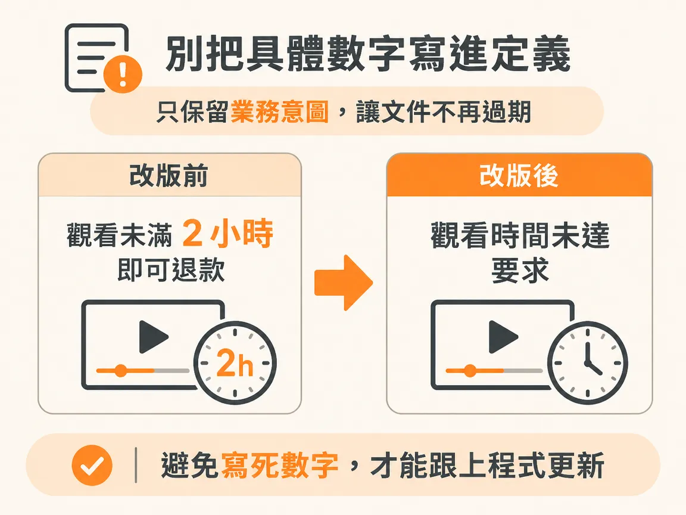
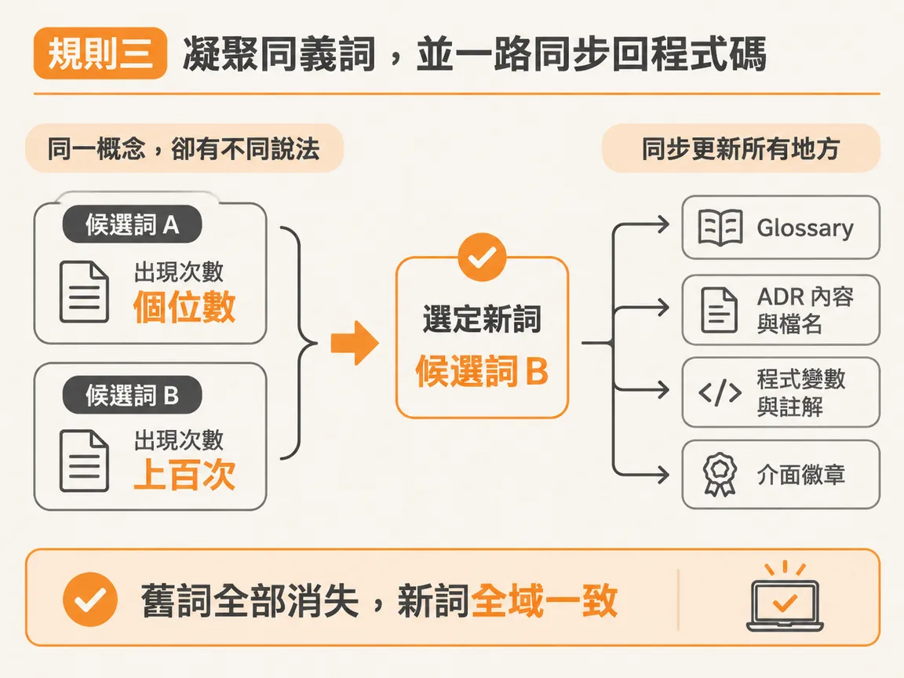

# 用三條修剪規則替 Glossary 瘦身

如果你給一個人一個抽屜，久了裡面一定會塞滿各式各樣的雜亂線材；如果你給 AI agent 一個 Markdown 檔案，時間一長，它也一定會往裡面塞滿垃圾。

在專案開發過程中，這種情況非常自然。只要程式碼庫歷經頻繁改動，又或者團隊成員沒有刻意維護領域語言，`glossary.md`（詞彙表）就會越積越厚。幾百行甚至上千行、塞滿一堆沒人使用的術語並非少見。例如在管理課程影片的真實專案中，詞彙表隨便就能膨脹到 732 行、170 個術語，甚至連 `local only command` 或 `ISO week` 這種東西都被塞了進去，根本沒人能一次在腦中記住這麼多概念。

詞彙表一旦失去焦點，agent 讀了反而會抓不到核心概念。要讓詞彙表隨時保持尖銳、好讀且高度可重用，我們必須學會如何精準修剪。

## 規則一：剔除實作細節與通用程式詞彙

agent 非常喜歡在詞彙表裡紀錄實作細節。在清理專案時，常見被抓出來的項目有：

- 資料表與欄位名稱（例如 `refunds table`、`refunded at`、`resolved by user ID`）
- 界面元件與通用名詞（例如 `button`、`component`、`loader`、`CWD`）

這些詞彙都不該出現在領域詞彙表裡，原因有兩個：

1. **實作細節變動極為頻繁**：把程式碼特有的欄位或資料表塞進詞彙表，只要實作一改，詞彙表就立刻過期。
2. **通用名詞對領域建模毫無幫助**：大家都知道按鈕是點擊後觸發動作的元件，元件本身也太過通用。在課程管理系統裡，這些詞彙無法解釋系統獨特的業務邏輯。

另一種常見的實作細節是**網址與路由機制**。例如 `slug`（課程網址用的安全名稱）。這時候要問一個問題：學員、講師或管理員平時討論課程時會說 `slug` 嗎？如果它純粹只是路由細節，且沒有成為全團隊共享的通用語言（Ubiquitous Language），就應該果斷移除。除非未來在使用者介面上讓使用者自己設定或生成 slug，並圍繞它產生了一套業務邏輯與 bug 討論，它才可能成為領域模型的一員。

詞彙表是一門取捨的藝術，原則是能縮到多短就縮到多短。

## 規則二：拿掉具體數字與規格，維持定義精簡

有些詞彙確實屬於業務領域，但描述方式卻完全走樣。

最經典的例子就是把具體數字寫死在定義中。例如退款章節中的 `watch limit`（觀看上限），詞彙表原本記載「觀看未滿 2 小時」，但實際上程式碼邏輯早就改成了「1 小時」。把實作的具體數值寫進詞彙表，只要限制數字調整，文件就會立刻過期出錯。

這時候的修剪方式是**移除具體數字**，只保留其業務意圖（例如「超過一定觀看長度則無法退款」），這樣詞彙表就不會因為參數變更而發霉。

另一種常見問題是把名詞定義寫成了「規格書」或「操作手冊」。例如一個 `job`（背景工作），原本條列了每種 job 的類型、重試規則與取消條件，整整寫了一大串。其實，它在詞彙表裡的定義一句話就能講完：「作者啟動後即可離開的背景作業」。

好的詞彙表定義應該落在兩句話以內，超過一百個字元往往就已經塞進過多細節。

## 規則三：凝聚同義詞，並一路同步回程式碼

詞彙表膨脹的另一個主因，是同一個概念在不同地方用了不同說法。這時要做好收斂與對齊：

- **壓縮模糊片語**：例如專案裡同時出現 `enrolment`（註冊／修課資格）與 `place on a course`（課程名額）。這種時候不要留著長片語，直接收斂成單一名詞 `enrolment`。
- **處理關聯狀態**：例如學員退款成功後失去資格，定義為 `lapsed`（失效註冊）。由於這個詞彙會出現在講師介面的名冊徽章上，直接對使用者溝通，就必須保留，並緊貼在 `enrolment` 旁邊分類。
- **統一核心角色名稱**：例如專案裡有的地方寫 `student`，有的地方寫 `learner`。檢查全專案的出現頻率後，若發現 `student` 出現了 180 次，而 `learner` 只有 8 次，就應該直接拍板以 `student` 為準，把少數的 `learner` 全數替換。

這種修剪不能只停留在 Markdown 檔案內。選定正確的領域詞彙後，必須一口氣推進到全局：

1. **更新架構決策紀錄（ADR）**：將文件內容與檔案名稱中舊的片語（如 `place on a course`）全改成新詞彙（`enrolment`）。
2. **同步修改程式碼與註解**：把程式裡的變數命名、註解文字全數替換，消除所有破損之窗。

在 agent 的協助下，全局更名這類髒活的成本非常低。修剪詞彙表不只是刪除文字，而是釐清團隊該說什麼話；當用語越精確、詞彙表越精實，人與 AI 在理解程式碼時就越不容易走偏。
