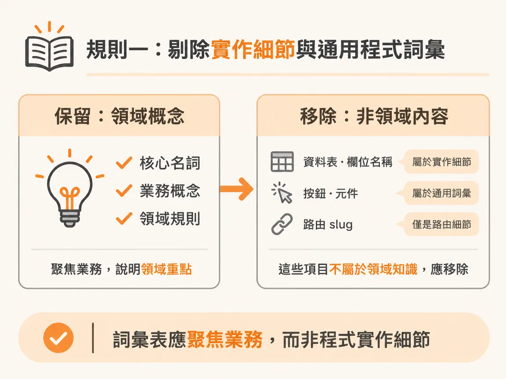

# 用三條修剪規則替 Glossary 瘦身

給人一個抽屜，久了裡面一定塞滿雜亂線材。給 AI agent 一個 Markdown 檔案，時間一長，裡面也必定塞滿各種垃圾。

專案開發時常遇到這種狀況。只要程式碼頻繁改動，或者團隊沒有刻意維護領域語言，`glossary.md`（詞彙表）就會越長越厚。動輒幾百行、上千行，裡面塞滿沒人使用的術語。在管理課程影片的真實專案裡，詞彙表隨便就能膨脹到 732 行、170 個術語，甚至連 `local only command` 或 `ISO week` 這類字眼都會出現。沒有人能同時在腦中記住這麼多概念。

詞彙表一旦失焦，agent 讀取時就抓不到核心。要讓詞彙表隨時保持精確、好讀而且高度可用，必須學會精準修剪。

## 規則一：剔除實作細節與通用程式詞彙

agent 非常喜歡在詞彙表裡紀錄實作細節。在清理專案時，常見被挑出來的項目有：

- 資料表與欄位名稱（例如 `refunds table`、`refunded at`、`resolved by user ID`）
- 介面元件與通用名詞（例如 `button`、`component`、`loader`、`CWD`）

這些詞彙都不該留在領域詞彙表裡，原因有兩個：

1. **實作細節經常變動**：把程式碼專用的欄位或資料表寫進詞彙表，只要實作一改，詞彙表就直接過期。
2. **通用名詞對領域建模毫無幫助**：大家本來就知道按鈕是點擊後觸發動作的元件。在課程管理系統中，這些通用元件無法代表系統獨特的業務邏輯。

網址與路由機制也是常見的實作細節，例如 `slug`（課程網址用的安全名稱）。這時可以想想：學員、講師或管理員平時討論業務時，真的會講 `slug` 嗎？如果它只是路由機制，沒有成為團隊通用的領域語言（Ubiquitous Language），就該直接刪除。除非未來介面開放讓使用者自行設定 slug，並圍繞它衍生出業務規則與相關討論，它才需要納入領域模型。

維護詞彙表講求取捨，原則就是能精簡就盡量精簡。

## 規則二：拿掉具體數字與規格，維持定義精簡

有些詞彙確實屬於業務領域，但描述方式卻很容易失焦。

最經典的例子就是把具體數字寫死在定義中。以退款章節的 `watch limit`（觀看上限）為例，詞彙表原本寫「觀看未滿 2 小時」，但實際上程式碼早就改成了「1 小時」。把實作的具體數字寫進詞彙表，只要業務限制一調整，文件內容就立刻脫節出錯。

這時的修剪原則是**抽離具體數字**，只留下背後的業務意圖，像是「超過特定觀看長度便無法退款」。這樣詞彙表就不會因為參數變更而頻繁失效。

名詞定義也常被寫成規格書或操作指南。例如 `job`（背景工作），原本詳列了各類型工作、重試規則與取消條件，篇幅極長。但它在詞彙表裡的核心定義只要一句話就夠：「作者啟動後即可離開的背景作業」。

良好的詞彙表定義應控制在兩句話以內。長度超過一百個字元，通常就代表塞入了過多細節。

## 規則三：凝聚同義詞，並一路同步回程式碼

詞彙表膨脹的另一個主因，同一個概念在各處往往有不同稱呼。這時必須徹底對齊：

- **精簡模糊片語**：專案中如果同時出現 `enrolment`（註冊／修課資格）與 `place on a course`（課程名額），不要保留冗長片語，直接收斂成單一名詞 `enrolment`。
- **處理關聯狀態**：學員退款成功後失去資格，定義為 `lapsed`（失效註冊）。由於此名詞會直接出現在講師介面的名冊標籤上與使用者溝通，因此必須保留，並緊鄰 `enrolment` 歸類。
- **統一核心角色名稱**：專案各處若分別寫著 `student` 與 `learner`，可以檢查全專案的出現頻率。若 `student` 出現了 180 次，而 `learner` 只有 8 次，就直接定案以 `student` 為準，將少數的 `learner` 全部換掉。

這類修改不能只停在 Markdown 檔案裡。確立領域詞彙之後，必須同步更新全局：

1. **更新架構決策紀錄（ADR）**：把文件內容與檔名中的舊片語（如 `place on a course`）全部替換成新詞彙（`enrolment`）。
2. **同步修改程式碼與註解**：直接改動程式裡的變數命名與註解文字，徹底消除不一致。

在 agent 協助下，全局更名這類繁瑣任務的執行成本非常低。修剪詞彙表不只是刪除文字，也是確立團隊的共同用語。用語越精準、詞彙表越精實，人與 AI 在理解程式碼時就越不容易失真。
