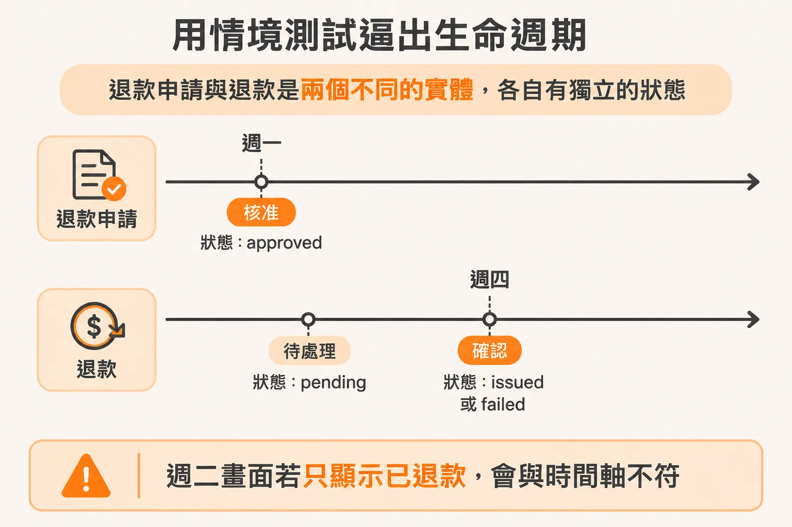
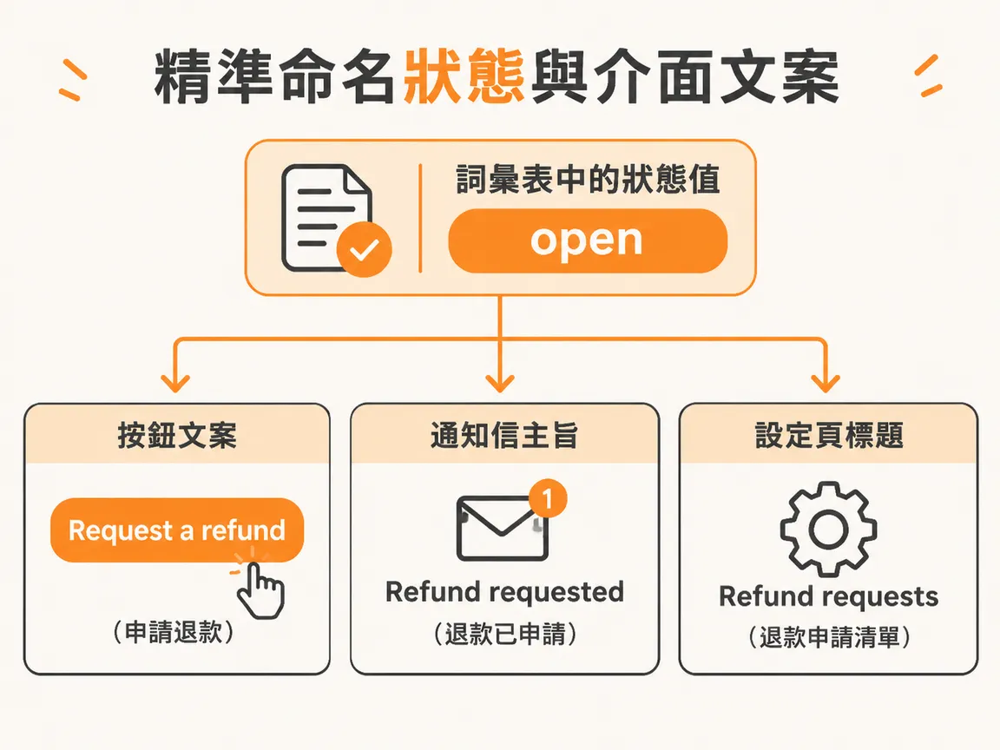
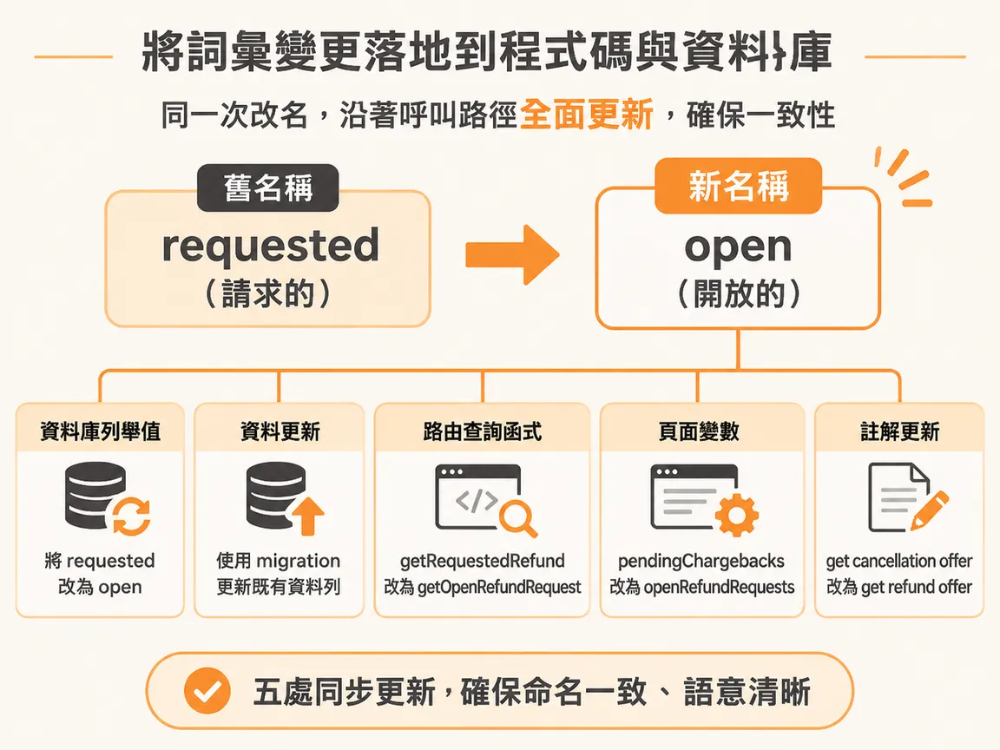

# 從詞彙表到程式碼：讓系統語言與介面說同一句話

在開發退款功能時，如果資料庫欄位寫著 `refunded`，畫面顯示「已退款」，但金流系統其實要三天後才確認撥款，這三天使用者看到的狀態就是一句謊言。

問題往往出在領域語言不夠精確。當團隊只用一個籠統的字眼（例如 `refund`）涵蓋所有流程，程式碼、介面文案與資料庫狀態就會開始打架。透過情境測試（scenario testing）梳理詞彙表（glossary），能把模糊的概念拆解成精確的狀態機，並一路落實到資料庫 schema、路由與畫面。

## 用情境測試逼出生命週期

在定義詞彙時，工具可能會自動塞入一些不適合的字眼（例如把爭議款項的 `chargeback` 混進一般退款詞彙表），這時必須主動排除不屬於當前領域的詞。接著，利用具體的時間軸情境進行驗證：

- **情境一：** 退款申請在週一通過審核，但金流處理商直到週四才確認完成撥款。週二時，學員 Liam 會在畫面上看到什麼？如果系統只有 `refund` 一個詞，畫面直接顯示已退款，這整整三天就是錯誤資訊。因此，退款流程需要生命週期：「退款申請」（refund request）被核准，而「退款本身」（refund）處於處理中（pending）。
- **情境二：** 如果金流處理商因為 Liam 的信用卡已剪卡而拒絕退款，結果會是什麼？此時退款失敗（failed），但原本的退款申請仍然維持「已核准」（approved）的紀錄。

這兩個情境釐清了一件事：退款申請與退款本身是兩個不同的實體，各自需要獨立的狀態：



1. **退款申請（Refund Request）：** 建立後處於待處理狀態；一旦被審核，狀態變為已核准（approved）或已拒絕（declined），且後續維持已核准。
2. **退款實體（Refund）：** 當退款申請核准後建立，初始為處理中（pending），最後變為已發出（issued）或失敗（failed）。

釐清語言後，功能的模型就自然成形了。

## 精準命名狀態與介面文案

當退款申請剛建立、尚未有人處理時，該叫什麼狀態？直覺可能會想用 `requested`，但組合起來會變成「requested refund request」，語義產生結巴與重複。改成 `open`，語意就清晰許多——這是一筆「open refund request」（未結案的退款申請）。

畫面的呈現也能直接對齊這個定義，例如在後台顯示：「Refund request open, waiting on us」（退款申請處理中，等待我方審核）。

在梳理過程中，難免會遇到其他延伸問題，需要果斷劃分範圍：
- **頁面與路由的資格檢查不一致：** 這是刻意留在資料庫的既有問題，不應混在詞彙梳理時處理，留待獨立階段修復。
- **全額退款的計算基準：** 實作時直接採用使用者實際支付的金額（`amountPaid`）。
- **退款失敗後的重試機制：** 失敗的退款究竟該原地重試還是建立新單，這牽涉金流處理商的具體串接行為，現階段先標記為超出範圍（out of scope）。
- **退款與課程存取權限的連動：** 退款發出後學員是否立刻失去課程權限、購買紀錄是否更名為「已退款購買」，這同樣先留到後續階段處理。

確定核心範圍後，學員端看到的介面文案便能完全建立在詞彙表上：按鈕寫著「Request a refund」（申請退款）、通知信標題為「Refund requested」（退款已申請）、設定頁面標題則是「Refund requests」（退款申請清單）。畫面上出現的每一個詞，都成為領域詞彙表裡有明確定義的術語。



## 將詞彙變更落地到程式碼與資料庫

詞彙表定案後，就能將這套語言落實至程式碼中。在重構前，專案的 schema、資料表定義與路由充斥著混雜的命名：

<!-- source: sources/real-engineer/20261116/supplement/cohort-005-project/app/db/schema.ts#L232-L254 -->

```typescript
export const refunds = sqliteTable(
  "refunds",
  {
    id: integer("id").primaryKey({ autoIncrement: true }),
    purchaseId: integer("purchase_id")
      .notNull()
      .references(() => purchases.id),
    status: text("status")
      .notNull()
      .$type<RefundStatus>()
      .default(RefundStatus.Requested),
    // The learner's own words, in the box on the course page.
    reason: text("reason").notNull(),
    // Null until someone approves — a declined request refunds nothing.
    amountRefunded: integer("amount_refunded"),
    requestedAt: text("requested_at")
      .notNull()
      .$defaultFn(() => new Date().toISOString()),
    resolvedAt: text("resolved_at"),
    resolvedByUserId: integer("resolved_by_user_id").references(() => users.id),
  },
  (table) => [index("refunds_purchase_idx").on(table.purchaseId)]
);
```

<!-- source: sources/real-engineer/20261116/supplement/cohort-005-project/drizzle/0009_clear_professor_monster.sql#L1-L12 -->

```sql
CREATE TABLE `refunds` (
	`id` integer PRIMARY KEY AUTOINCREMENT NOT NULL,
	`purchase_id` integer NOT NULL,
	`status` text DEFAULT 'requested' NOT NULL,
	`reason` text NOT NULL,
	`amount_refunded` integer,
	`requested_at` text NOT NULL,
	`resolved_at` text,
	`resolved_by_user_id` integer,
	FOREIGN KEY (`purchase_id`) REFERENCES `purchases`(`id`) ON UPDATE no action ON DELETE no action,
	FOREIGN KEY (`resolved_by_user_id`) REFERENCES `users`(`id`) ON UPDATE no action ON DELETE no action
);
```

在原本的路由邏輯中，送出申請時直接在 `refunds` 寫入 `RefundStatus.Requested`：

<!-- source: sources/real-engineer/20261116/supplement/cohort-005-project/app/routes/courses.$slug.refund.ts#L215-L237 -->

```typescript
  db
    .insert(refunds)
    .values({
      purchaseId: purchase.id,
      status: RefundStatus.Requested,
      reason: parsed.data.reason,
    })
    .returning()
    .get();

  const email = buildReversalEmail({
    learnerName: learner.name,
    learnerEmail: learner.email,
    courseTitle: course.title,
    amount: refundableAmount,
  });

  console.log(
    `[email] to=${email.to} subject=${email.subject}\n${email.body}`
  );

  return redirect("/settings");
}
```

設定頁面甚至將查詢變數命名為 `pendingChargebacks`，把退款與拒付爭議混為一談：

<!-- source: sources/real-engineer/20261116/supplement/cohort-005-project/app/routes/settings.tsx#L58-L76 -->

```tsx
  const pendingChargebacks = db
    .select({
      id: refunds.id,
      courseTitle: courses.title,
      courseSlug: courses.slug,
      amountPaid: purchases.amountPaid,
      reason: refunds.reason,
      requestedAt: refunds.requestedAt,
    })
    .from(refunds)
    .innerJoin(purchases, eq(refunds.purchaseId, purchases.id))
    .innerJoin(courses, eq(purchases.courseId, courses.id))
    .where(
      and(
        eq(purchases.userId, currentUserId),
        eq(refunds.status, RefundStatus.Requested)
      )
    )
    .all();
```

重構時，資料庫的 enum 值從原本語意重複的 `requested` 正式調整為 `open`，並搭配 Migration 更新既有資料：

<!-- derived -->
```sql
UPDATE refunds SET status = 'open' WHERE status = 'requested';
```

隨後整條呼叫路徑的命名也全面對齊：
- 設定頁面路由中，原本令人費解的 `pendingChargebacks` 變數與查詢，全面更名為 `openRefundRequests`。
- 介面邏輯使用 `openRefundRequests.length` 判斷未結案數量，並顯示「One refund request is waiting on us」。
- 課程頁面原本的 `getRequestedRefund` 改為 `getOpenRefundRequest`。
- 程式碼註解原本寫著 `get cancellation offer`，也同步修正為 `get refund offer`，消除過期概念。



## 建立統一語言的連鎖效應

只要領域語言確定下來，程式碼的重構就有明確的依據。無論是資料庫欄位、API 查詢、變數命名甚至註解，都能說同一套語言，大幅降低維護與閱讀的認知負擔。

這種梳理方式能不斷推展。例如在系統中，「學員」一詞是叫 `user`、`learner`、`instructor` 還是 `admin`？只要發現語言界線模糊，就能運用相同的情境測試方法，逐步把模糊的猜測轉化為嚴謹的程式邏輯。
