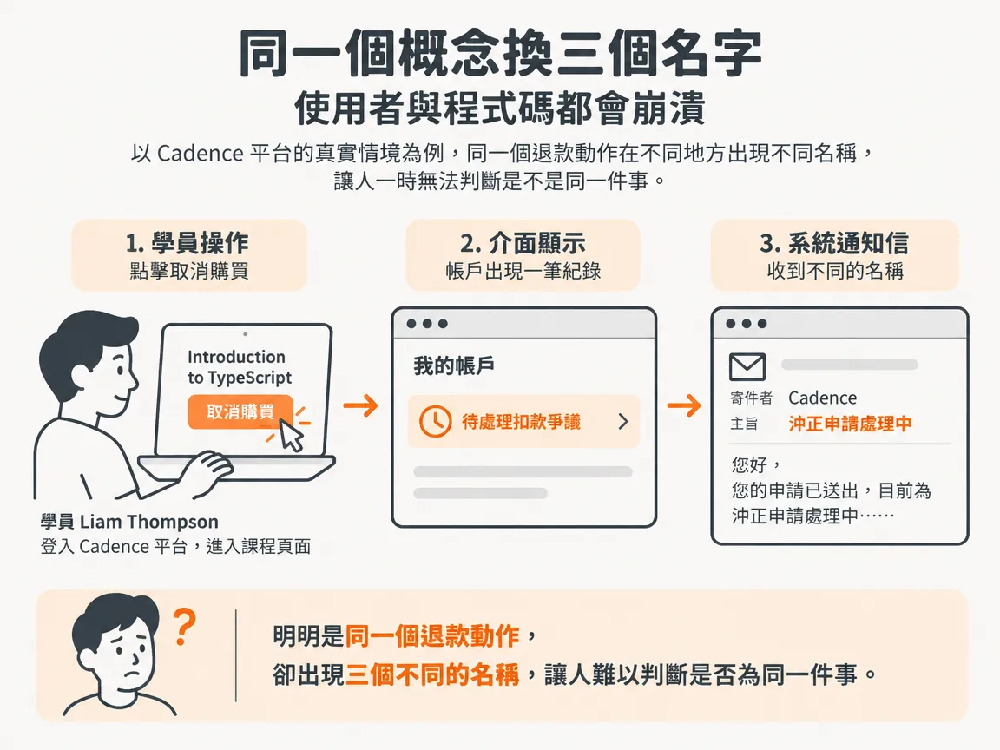
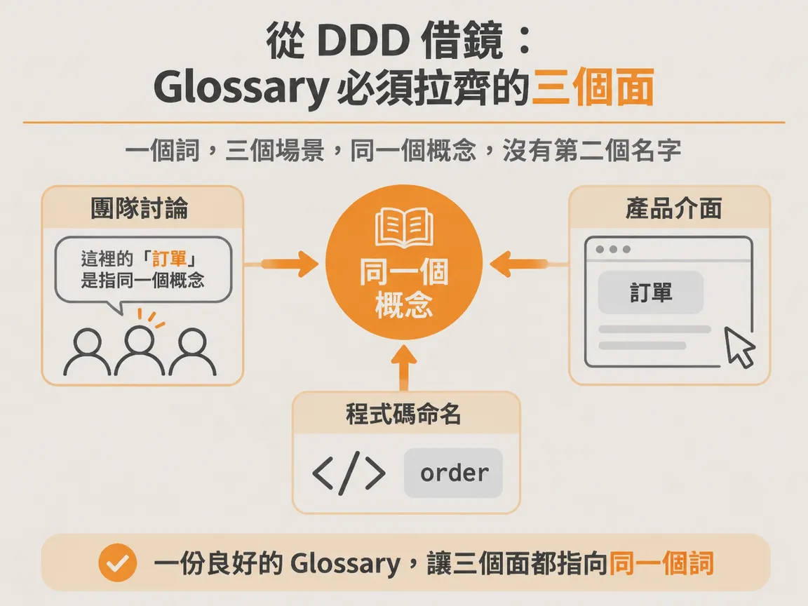

# 為什麼同一個概念有四個名字會變成程式裡的真 Bug？

自從 2025 年 12 月 AI 寫程式變得切實可行以來，人與 AI 溝通時所使用的語言，就成了決定產出品質的關鍵。

許多人低估了溝通品質對 Agent 的影響。

定義事物的方式、語句精準緊湊還是冗長含糊，都會直接反映在 Agent 寫出的成果上。

現在的模型常給人一種難以溝通的印象。

如果在線上課程平台 Cadence 中詢問 Agent：「學員可以退錢嗎？（can a learner get their money back?）」

Agent 很可能會這樣回答：

> 「reversal eligibility envelope 會由 cancellation gate 進行評估，一旦 entitlement lease 被釋放，就會轉交給 chargeback settlement handler。」

這句話一口氣冒出了四個憑空捏造的名詞：`reversal eligibility envelope`、`cancellation gate`、`chargeback settlement handler` 和 `entitlement lease`。

這些名詞在既有的程式碼庫裡根本不存在，全都是 Agent 自己自作主張發明出來的。

Agent 會這麼做，是因為這對它來說具備極高的 Token 效率（token efficient）。

把大量概念壓縮進一個短詞裡，它就能反覆使用這個詞。

這省去了每次推理過程中都要向自己解釋一遍的成本。

但是對閱讀的人類來說，如果 Agent 沒事先解釋這些術語是什麼意思，這段回覆就會變成一場災難。

## 同一個概念換三個名字，使用者與程式碼都會崩潰

解決這個問題最有效的辦法，是在使用者與 Agent 之間維護一份共享詞彙表（`glossary.md`）。

這件事看似簡單，卻對後續的開發與維護影響深遠。

語言不一致的問題往往不會立刻以拋出錯誤的形式出現。

它更像是一種「不是 Bug 的語言毛病」，卻會帶來連鎖傷害。

以 Cadence 平台上的真實狀況為例：學員 Liam Thompson 登入後，點進「Introduction to TypeScript」課程。他在畫面上點擊「取消購買（cancel my purchase）」，系統介面接著顯示帳戶裡有一筆「待處理扣款爭議（pending charge back）」。與此同時，他在終端機中看到的系統通知信件，標題卻寫著「沖正申請處理中（reversal request pending）」。

使用者只是想取消購買。

收到的信件寫著沖正（reversal），畫面又跳出扣款爭議（chargeback）。

同一個動作在使用者介面與流程裡換了三種說法，體驗非常糟糕。

在實際專案裡，一件事叫三個名字可能極端了點，但一件事有兩個名字卻屢見不鮮。

更糟糕的是，這種不一致會直接蔓延到程式碼中。在專案裡搜尋 `cancellation`、`reversal` 和 `chargeback`，會發現程式碼庫裡同時並存著：

- `get_cancellation_offer`
- `pending_chargebacks`
- `build_reversal_email`

這是語言混亂演變成真正 Bug 的核心原因。

當 Agent 需要理解或修改這套退款流程時，必須在程式碼中四處翻找這些指稱同一件事、名稱卻完全不同的片段。

一旦 Agent 用其中一個名詞（例如找 cancellation）去檢索，卻找不到其他形式的實作，它就會誤以為這項功能還不存在。

接著，它就會重複實作一套一模一樣的邏輯。

重複程式碼（code duplication）與邏輯脫鉤的臭蟲，就是這樣悄悄產生的。

## 從 DDD 借鏡：Glossary 必須拉齊的三個面

這個解決思路的核心，是領域驅動設計（Domain-Driven Design, DDD）中的「通用語言」（Ubiquitous Language）。

不需要照單全收 DDD 裡所有複雜的架構技術（例如聚合根 Aggregate 或事件溯源 Event Sourcing）。

關鍵在於「Ubiquitous（無所不在）」。

這個語言必須在所有出現的地方都完全一致，也就是一份良好的詞彙表（Glossary）必須徹底拉齊以下三個面：

1. **團隊內部討論的語言**：團隊成員溝通、開會、描述手頭正在打造的功能時所使用的詞彙。
2. **產品對外呈現的語言**：真實產品介面上顯示的文字，以及終端使用者在操作產品時稱呼的名字。
3. **程式碼庫內部的語言**：變數、函式、資料表欄位與類別所使用的命名。

過去沒有 AI 的軟體專案中，很常看到產品畫面上叫一個名字、程式碼裡叫另一個名字，團隊私下聊又叫第三個名字。

替正在打造的事物找到精準、唯一且公認的名稱時，功能基本上就已經完成了一半。

這代表已經知道如何在對話中精確使用它、如何討論邊界條件，以及如何清楚向 AI 下達指令來建立它。

## 如何在開發流程中定下詞彙？

落實這套做法的方式，是在釐清要蓋什麼功能的同時，把該用的語言一起定下來。

做法是將原本單純提問的 `grill me` 技能升級為 `grill with docs`。

這項技能以釐清需求為基礎，上方再疊加一層「領域建模（domain modeling）」技能。

在提問與對焦需求（grilling session）的過程中，領域建模技能會主動挑戰使用的名詞與說法。

它會拋出邊界情況的情境，檢視定義是否牢靠。

專案概念與決策一旦成形，它就會立刻將名詞定義寫入專案的 `glossary.md`。

決策脈絡也會同步記錄在 `docs/ADR`（架構決策紀錄）資料夾中。

在整個工作環境中，其他所有後續介入的 Agent 技能都會主動讀取這份 `glossary.md`。

在開工前拉齊團隊口語、產品介面與程式碼三者的名詞，Agent 就不再需要自創代名詞。

它也不會在程式庫中因為找不到既有實作而反覆造輪子。

這能從根本上杜絕名詞分裂引發的邏輯錯誤。
