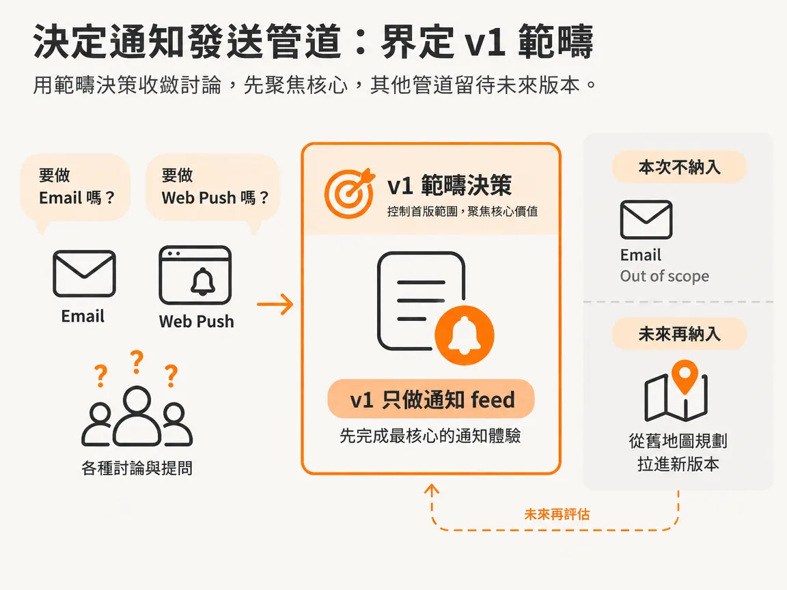
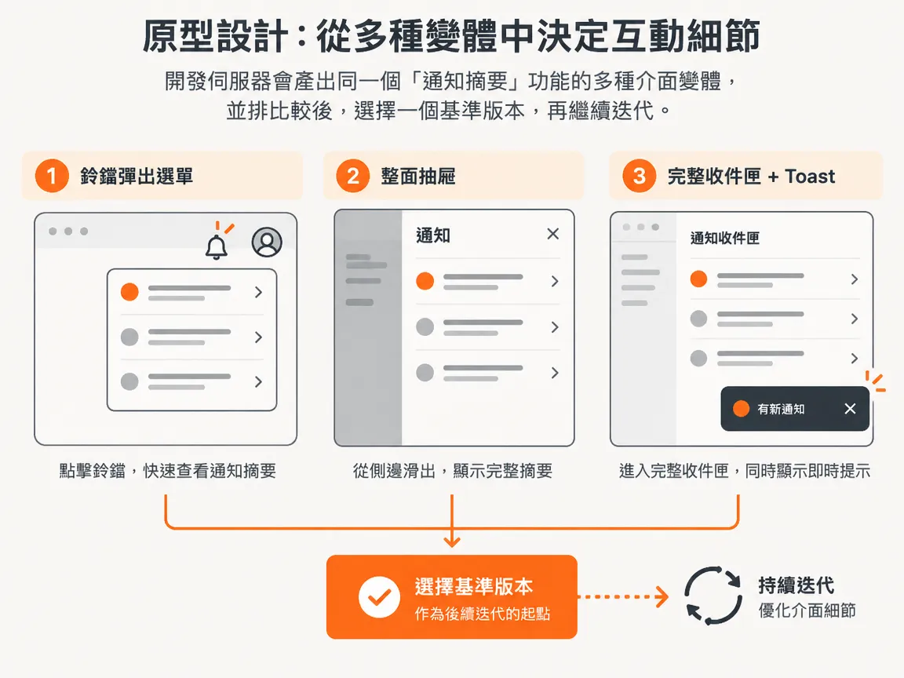
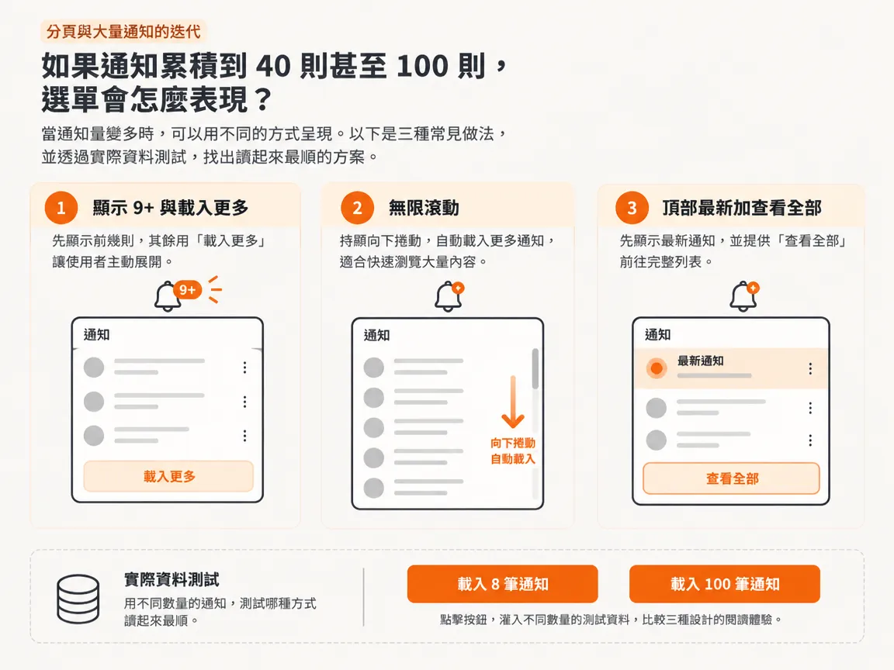
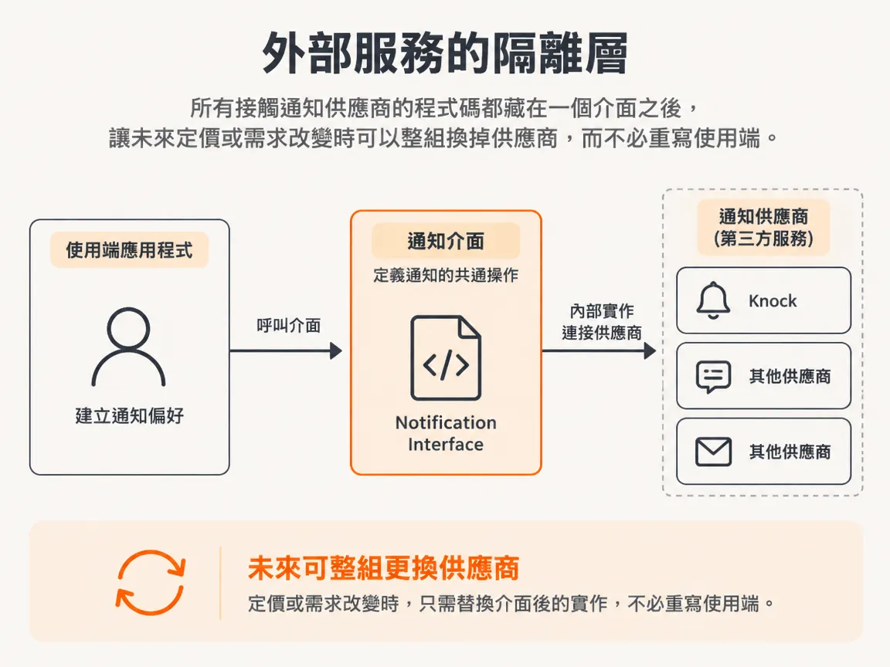
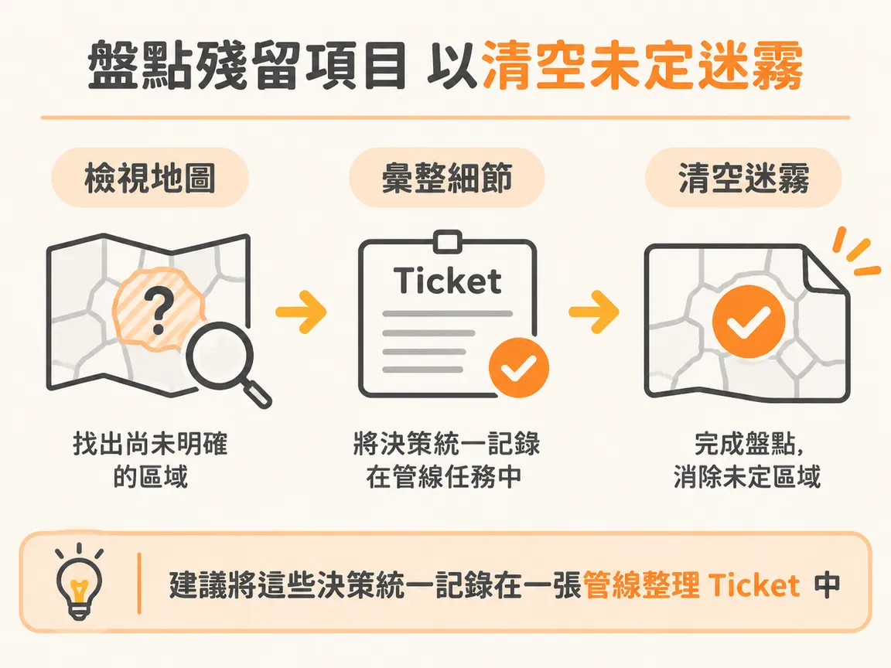

# 清空迷霧：推進 Ticket 並收斂出完整的 Wayfinder 地圖

規劃系統時，最怕規格停留在模糊不清的階段。

如果地圖上還留著沒定義清楚的邊界、沒收尾的 Ticket，或是被標記為「尚未明確（not yet specified）」的迷霧，這張地圖就無法直接交付開發。

這時的目標很單純。

逐一清空剩下的盤問（grilling）與原型（prototype）Ticket。

處理好功能邊界的決策。

最後掃除地圖上所有的迷霧，把整份規劃收斂到可以直接轉成規格（spec）的狀態。

---

## 決定通知發送管道：界定 v1 範疇

清理本地環境時，先切換到移除暫時實驗程式碼的狀態（例如 `remove knock spike`）。

確認本地沒有殘留的原型代碼。

接著開啟 AI 代理人，透過 Wayfinder 接下第一個問題：通知到底要走哪些發送管道？

這個盤問環節的核心在於控制首版範圍：



1. **是否所有通知都會進入通知摘要（Notification Feed）？**  
   答案是肯定的，所有通知都會在系統介面內的 feed 呈現。

2. **Email 是否納入 v1？**  
   目前已經選定並接入第三方服務。
   這個服務未來可以當作所有通知的中心樞紐。
   現階段先不把 Email 放進 v1，日後再來擴充。

3. **Web Push 是否納入 v1？**  
   同樣先排除在外。
   保持範疇精簡，才能快速推進到終點線。

4. **現有系統（Cadence）已在發送的退款信件如何處置？**  
   曾有建議打算鑄造一個新名詞「交易型郵件（transactional email）」，將它與通知體系切割。
   但多發明一個概念只會讓架構更複雜。
   更好的做法是把退款信直接視為通知。
   未來通知系統擴充出 Email 管道時，再補上信件寄送功能。
   退款核准或拒絕的舊郵件，也等通知系統支援 Email 管道時再正式移除。

5. **退款申請收據（Refund Requested Receipt）的特例**  
   使用者申請退款時，通常需要收到確認收據。
   雖然原本的通則是「先不發信」，但這屬於少數破例的情況。
   決策是依然將它定義為通知事件，未來再透過 Email 管道補發。
   這是實作需求打破既有通則的具體例子。

6. **未納入範疇的項目放哪裡？**  
   Email 該歸入「範疇之外（out of scope）」還是「尚未明確（not yet specified）」？
   答案是「範疇之外」。
   這張地圖明確綁定在第一版要交付的成果上。

把項目標示為 Out of scope 有個很大的好處。

Wayfinder 地圖會以 Pull Request 形式關閉並保存在 issue tracker 裡，成為明確的歷史紀錄。

未來要做下一版時，隨時可以翻出這張舊地圖，把當時移出範疇的項目重新拉進新地圖來規劃。

其餘幾項簡單的實作問題確認後，這輪盤問順利達成共識。

因為沒有涉及名詞定義表或架構決策紀錄（ADR）的改動，直接關閉 Ticket 即可。

---

## 原型設計：從多種變體中決定互動細節

清空代理人的 context 後，繼續抓取下一個原型設計 Ticket：通知摘要（Notification Feed）實際長什麼樣子？

在真實工作情境中，如果剩下的幾個 Ticket 彼此獨立，可以同時開兩個代理人分別跑不同面向的盤問。

雖然大腦需要切換視角，但因為討論的是同一個系統的不同環節，並行推進能大幅節省時間。

當原型代理人消耗約 7.29 萬個 token 完成建置後，開發伺服器會跑起具備多種介面變體的雛形：



* **變體 A（鈴鐺彈出選單 / Bell Popover）**：點擊鈴鐺彈出浮層，顯示如「James Park 回覆了你的問題」等項目，並附有「全部標為已讀（Mark all as read）」按鈕，整體視覺俐落。
* **變體 B（抽屜式面板 / Drawer）**：提供灌入測試資料的按鈕（例如以講師 Marcus Johnson 身分灌入 8 則通知），展開時佔據整個右側抽屜。視覺負擔過大，體驗不夠理想。
* **變體 C（完整收件匣搭配 Toast 提示）**：提供獨立的完整頁面，具備過濾條件與詳細清單。

原型設計的價值，在於提供具體畫面來直接驗收互動偏好。

測試變體 A 時會發現兩個優秀的細節。

點擊能精準跳轉到對應頁面並標為已讀。

介面明確區分了「看過（seen）」與「已讀（read）」。

重新整理頁面後，鈴鐺上的紅點計數會消失（已看過）。

通知旁的提示圓點依然保留，直到使用者真正點擊或標示已讀（已處理）。

### 分頁與大量通知的迭代

如果通知累積到 40 則甚至 100 則，選單會怎麼表現？



將問題拋回給代理人，指定偏好變體 A 的方向，並要求探索分頁處理。

代理人接著提問了幾個邊界條件：
* 留言被刪除時，通知是否應從 feed 移除？（是的，應移除）
* 點擊跳轉應去往最精確的位置。
* 退款申請確認通知在開啟後可自動標為已讀。

隨後代理人產出多種處理長清單的彈出變體，並提供測試 8 筆與 100 筆資料的按鈕：
* **A1**：顯示「9+」計數，清單底部提供「載入更多（Load more）」按鈕。
* **A2**：無限滾動（Infinite scroll），隨滑動持續載入。
* **A3**：頂部顯示最新通知，下方附帶「查看全部（See all）」按鈕。

對比之後，無限滾動（A2）的體驗最流暢。

不過畫面上有些多餘的設計需要精簡：
* 拿掉頂部不必要的未讀與已讀計數統計。
* 保留文字明確的「全部標為已讀」按鈕，不要使用意義不明的勾選框（checkbox）。
* 縮小方塊內的圖示尺寸。

### 降回低保真討論邊界情境

介面調整到位後，還剩下一個邏輯問題。

使用者沒有未讀通知時，打開鈴鐺應該永遠顯示舊通知嗎？

已讀通知何時該消失？

代理人這時主動退回低保真度（lower fidelity）的文字選項進行討論，提供四種方案：
1. **保留所有歷史紀錄（Keep all history）**
2. 僅顯示未讀，並附帶「顯示更早通知」的連結
3. 打勾代表完成，點擊後即從選單中移除
4. 顯示未讀加上近期短時間內的通知

直接採用第一種「保留所有歷史紀錄」最單純、可預期，也符合直覺。

善用低保真文字來拍板邏輯，不必每次都花費 token 重新生成介面。

至此原型 Ticket 即可順利結案。

---

## 建立通知偏好並抽換抽象層

最後一張決策 Ticket 探討系統內的通知偏好設定。

清理 context 後對 Ticket 展開簡短盤問。

除了一一確認基本設定，這裡必須補上一項核心架構限制：**任何接觸第三方服務（如 Knock）的程式碼，都必須隔離在介面（Interface）之後**。



引入外部 SaaS 雖然方便，但定價策略隨時可能變更，服務也可能不再符合需求。

程式碼層級必須保留隨時抽換供應商的彈性。

這項決策確立後，最後一張盤問 Ticket 也宣告解決。

---

## 清空 Not Yet Specified 的迷霧

到這個階段，所有子任務 Ticket 都已全數關閉。

地圖還不能算真正完成。

「尚未明確（Not yet specified）」區塊裡還留有一長串的迷霧項目。

要將地圖收尾，最後一步是清理 context。

將規格編號帶入 Wayfinder，直接要求代理人針對「尚未明確」裡殘留的事項發起收尾盤問（grilling session）：

<!-- derived -->
```text
我們已經關閉了所有 ticket，但在 not yet specified 區塊裡還有一些殘留項目。
我們可以針對這些內容進行盤問嗎？我希望能清空所有迷霧後再關閉地圖。
```

代理人整理出 10 個收尾問題。

這些多半是前續討論中已經隱含答案、只需最後拍板確認的事務性細節。

建議將這些決策統一記錄在一張管線整理 Ticket（plumbing ticket）中。



逐一確認這些細節無誤後，代理人便會建立並認領該 Ticket，正式清空地圖上的所有迷霧。

整張地圖在此刻完整收斂。

每一個決定、每一輪盤問紀錄與原型驗證，都化為索引完整、定義精確的上下文。

整張 Wayfinder 地圖也正式進入可直接轉為具體規格（spec）的就緒狀態。
