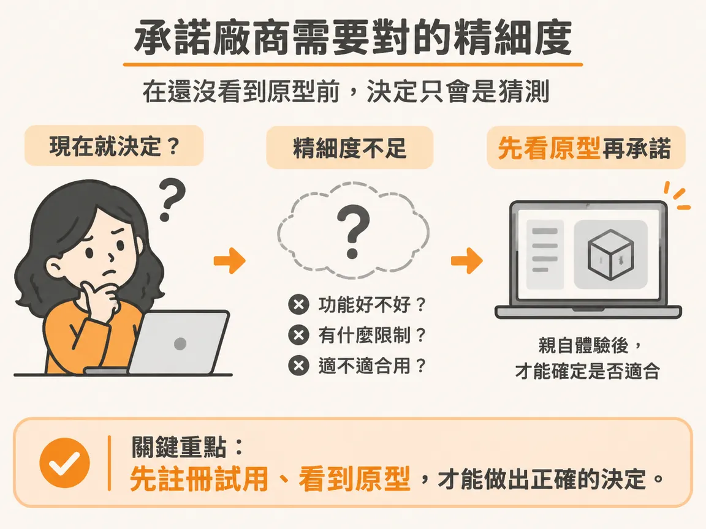
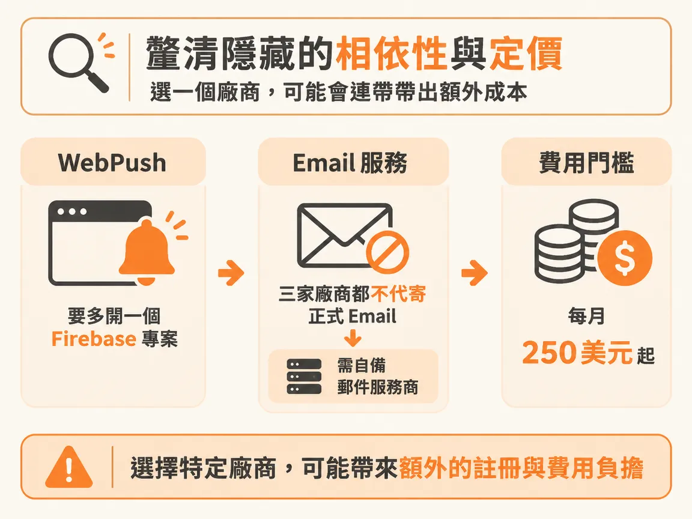
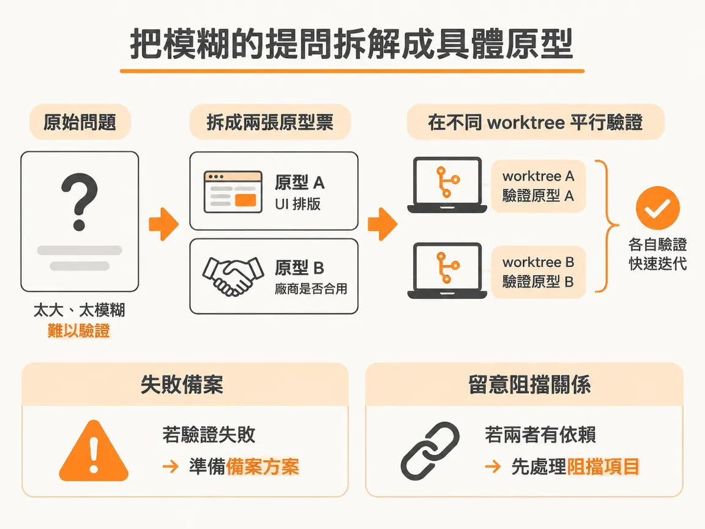
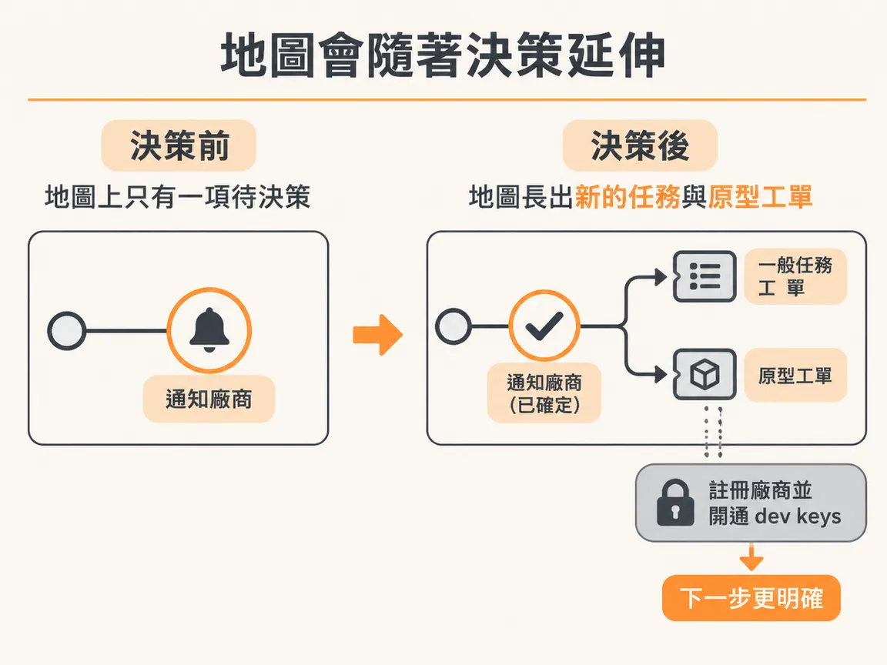

# 在 Grilling 遇上無法決定的事：用 Prototype 與 Task 撥開迷霧

梳理專案地圖時，一定會碰上需要做決策的關卡。以挑選通知廠商（notification vendor）的 grilling 工單為例，表面上看只是從幾家服務中挑選，但實際問答時，很多問題無法光靠嘴巴討論就定案。

這時候硬問下去，只會得到憑空捏造的猜測。正確的做法是辨識出「這件事目前缺乏足夠的精細度」，果斷把不確定的部分轉成具體任務（task）或原型（prototype）。

## 承諾廠商需要對的精細度

接下地圖上的第 16 號工單，清空前一次對話 session 後，啟動 Wayfinder 針對這張票進行 grilling。

Agent 拋出的第一個問題通常很直接：我們要不要直接選定 Knock 作為通知廠商？

這其實是一個棘手的決策，因為在這個時間點做決定，這時兩者的精細度（fidelity）完全不在同一個層次。只有在真正註冊帳號、實際操作功能、摸清限制，甚至做出一個原型後，才能確定 Knock 到底適不適合。

遇到這種狀況，不要在 grilling 當下勉強做出承諾。可以直接告訴 Agent：必須先看到原型，才能正式承諾採用 Knock。目前保持「願意先試試看」的開放心態，只要發現 Knock 不符合需求，隨時能轉向其他方案。

## 釐清隱藏的相依性與定價

隨著對話推進，grilling 能幫忙逼出許多隱藏在規格背後的細節。例如挑選特定廠商時，往往伴隨著額外的註冊要求：

- **額外服務綁定**：如果要支援 WebPush，Knock 是透過 FCM 發送，這代表專案必須額外開一個 Firebase 專案。
- **寄件服務需自備**：無論是 Knock、Courier 還是 MagicBell，通常都只負責路由，不會替你寄送正式環境的 Email，必須自己串接郵件服務商。

Agent 接著會詢問：這些額外帳號是要現在立刻全部註冊，還是等確定需要時再處理？答案很明確：非必要的外部服務註冊一律往後推，直到真正需要時再動手。

至於商業層面的問題，例如每個月 250 美元的費用門檻（pricing cliff）是否可以接受，只要當下評估確認可以負擔，就能直接定案。

執行這類流程時，往往會感覺眼前有一層迷霧。選了某家廠商才發現後面牽扯出一堆額外設定，難免讓人覺得繁瑣、超出原本預期。很多架構細節，往往就是得透過這樣具體的問答才能被逼出來。

## 把模糊的提問拆解成具體原型

釐清了 Knock 需要原型驗證後，Agent 會問：這個原型到底要證明什麼？

原本的地圖上可能已經有一張「在 cadence 中通知摘要長怎樣」的票，但那張票處理的是 UI 與排版，不是通知廠商的功能是否契合。

此時 Agent 會建議多開一張更小、更專注的原型工單，例如「Knock 是否經得起 cadence 的考驗」。把驗證拆成小工單非常有價值，因為開發時甚至可以在不同的 Git worktree 中，同時平行驗證這兩組原型。

確認原型的方向後，剩下的收尾問題就容易回答了：

1. **失敗備案**：如果 Knock 原型驗證不順利，可以把 Courier 當作備案。
2. **前後相依關係（Blocking relationship）**：原型工單要等什麼？它目前會被「註冊通知廠商並開通 dev keys」這張任務卡住。

接受這些相依性建議後，Agent 就會結束這場簡短的 grilling，並把結論完整記錄到工單上。

## 地圖會隨著決策延伸

完成對話後回頭看地圖，挑選通知廠商的決策已經確立，同時地圖上也長出了新的分支：一張一般任務工單，以及一張新的原型工單。

以「Knock 是否經得起 cadence 的考驗」這張原型票為例，右側清楚標示了阻擋關係——必須先完成「註冊通知廠商並開通 dev keys」。因此下一步要做的事情就非常明確，直接先去執行開通金鑰的任務。

專案地圖並不是一開始就畫好不變的靜態架構。在 grilling 中發現某件事問不出來，就將它轉化為原型驗證或準備工作。隨著每一次決策拍板與新獲得的資訊，地圖會持續展開，對最終要打造的系統也會越來越清楚。
