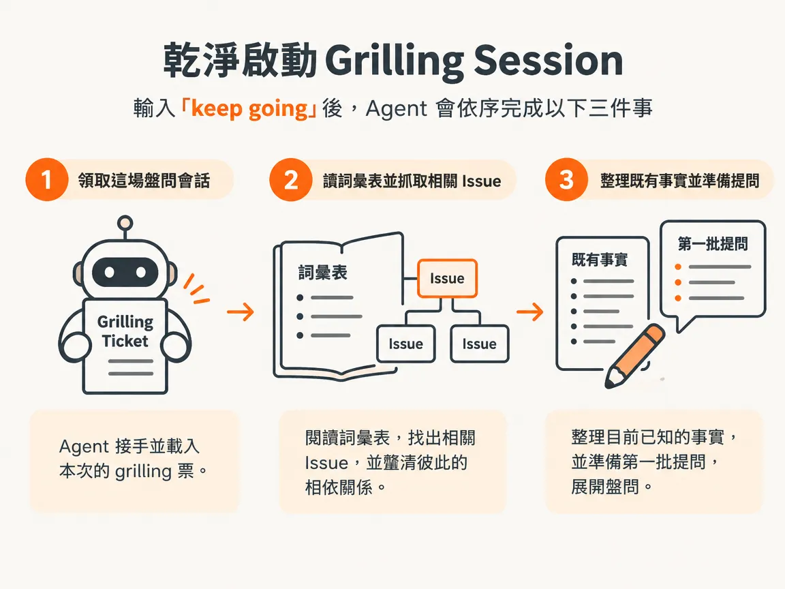
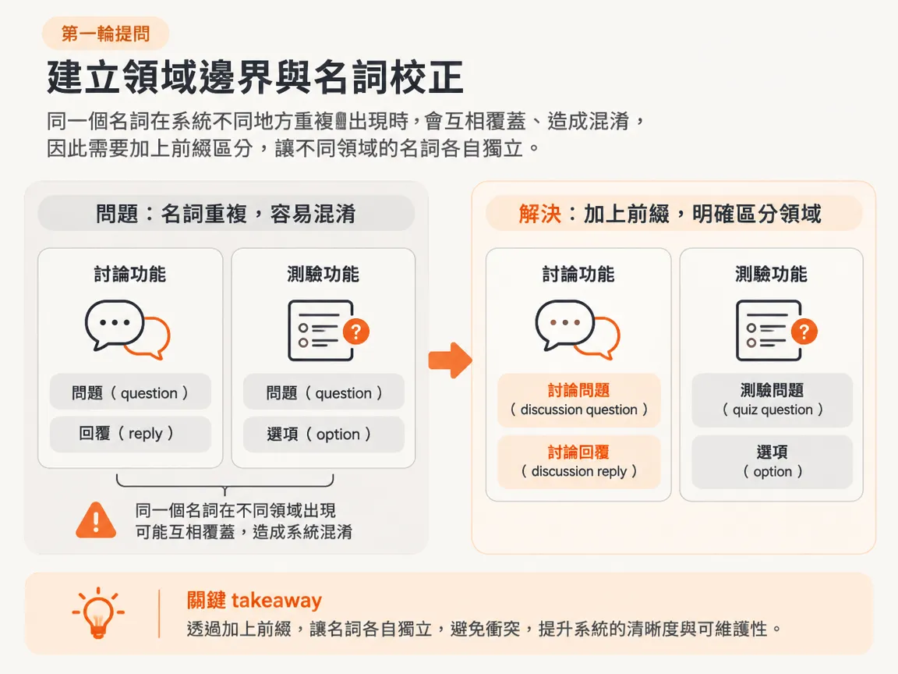
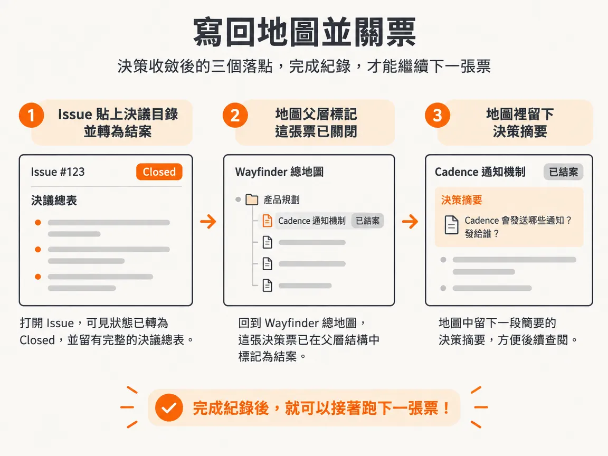

# 執行一張 Grilling Ticket：從釐清決策到結案寫回地圖

當系統規格充滿不確定性時，最怕的是還沒想清楚就急著寫程式。在 Wayfinder 地圖中，許多待辦事項本身是決策票（grilling ticket），目的是透過密集的問答，把模糊的業務邏輯問到收斂，再把共識寫回地圖與詞彙表（glossary）。

這篇教學會帶你實際跑完一張決策票——以「Cadence 會發送哪些通知？發給誰？」為例，示範如何啟動 Agent、逐步校正名詞與規則，最後關閉票券並把決議同步回整體架構地圖。

## 乾淨啟動 Grilling Session

如果你想跟著示範完全從頭開始，可以先執行重置指令碼；若要延續先前的進度，直接基於自己目前的 Wayfinder 地圖執行即可。

拿到題目的 Issue 連結後，請不要直接在原本充滿雜亂對話的 Agent 視窗中繼續操作。請先在終端機輸入 `clear` 清空畫面，保持工作環境乾淨，接著執行 Wayfinder 並帶入該 Issue 的網址：

<!-- derived -->
```bash
wayfinder <ISSUE_URL>
```

送出後，輸入「keep going」讓 Agent 正式啟動。Agent 接手後會執行以下動作：



1. 宣告領取（claim）這個 Wayfinder 盤問會話（grilling session）。
2. 透過終端機指令讀取現有的詞彙表（`glossary.md`），並抓取所有相關 Issue 來釐清相依關係。
3. 檢查現有程式碼與規格，整理出一批既有事實（facts），並根據領域模型準備第一批提問。

## 第一輪提問：建立領域邊界與名詞校正

Agent 準備好後，會列出第一波標準問題。面對 Agent 的建議，你的工作是判斷合理性，並在業務細節有衝突時給出精確修正：

- **問題一（什麼算通知）與問題二（退款申請結果）**：Agent 的切分方式很合理，直接同意即可。
- **問題三（退款申請與平台管理員）**：Agent 會運用先前建立好的領域名詞來提問與建議，邏輯合理，直接採納。
- **問題四（退款發放，Refund Payouts）**：這個概念雖然已經寫在詞彙表裡，但在目前運行的程式碼中還不存在。Agent 建議先將它歸類在「尚未定義（not yet specified）」區塊，這符合目前的系統現況，選擇同意。
- **問題五（團隊管理員認領席次）**：建議合理，予以採納。
- **問題六（每當有新學員註冊，講師是否該收到通知）**：Agent 提出了預設做法，但這裡需要加上業務彈性。有些講師喜歡隨時收到通知獲得肯定，對某些講師來說卻是干擾。因此我們提出決策：這項設定必須「允許個別講師自訂」。
- **問題七（問題與回覆）**：Agent 建議將「問題（question）」與「回覆（reply）」正式收錄進詞彙表。但在系統裡，測驗也有問題（quiz questions）。為了避免名詞衝突互相踩腳，我們要求 Agent 加上前綴，正名為「討論問題（discussion question）」與「討論回覆（discussion reply）」。
- **問題八（課程獲得評價時講師是否收通知）**：同意 Agent 的建議。
- **問題九（新增單元時是否通知已註冊學員）**：同意 Agent 的建議，也就是新增課程內容時「不通知」現有學員。
- **問題十（平台管理員應收到的通知項目）**：同意建議。



第一輪結束後，Agent 會把共識寫入 `glossary.md`，將名詞正式更新為 `discussion question` 與 `discussion reply`。

## 第二輪提問：追問深層細節並收斂共識

名詞確立後，Agent 會針對剛剛衍生出的邏輯發起第二輪細節確認：

- **問題十一（註冊通知的預設狀態）**：針對剛才決定的講師註冊通知，確認預設是開啟還是關閉。同意建議。
- **問題十二（哪些註冊類型計入通知範圍）**：同意建議。
- **問題十三（誰會收到討論回覆的通知）**：同意建議。
- **問題十四（編輯或刪除討論問題／回覆是否發送通知）**：確認任何編輯或刪除操作皆不發送通知。同意建議。
- **問題十五（來自平台管理員或其他講師的討論問題）**：特殊身分發問的情境處理。同意建議。

回答完這輪問題後，雙方對這張票的業務邏輯已經達成完全共識（shared understanding）。

## 寫回地圖並關票

共識形成後，Agent 會整理出一份完整的決策目錄（catalog），以清晰的表格列出所有通知情境、觸發條件與接收對象。

這時 Agent 會詢問是否將這份目錄發布為該 Issue 的結案說明（resolution comment）並正式結案。你只需要同意它的建議（例如回覆「Go ahead and close it out」），Agent 就會自動完成關票手續。

打開該 Issue，你會看到狀態已經轉為 Closed，底下留有一張漂亮的決議總表。回到 Wayfinder 總地圖查看，這張決策票也已經在父層結構中標記為結案，並附上了簡要的決策摘要（「Cadence 會發送哪些通知？發給誰？」）。



透過這種流程，你可以全程保持在專注決策的狀態，不必分心去煩惱程式實作。把決議完整寫回地圖後，就可以安心收工，俐落地接手下一張決策票。
