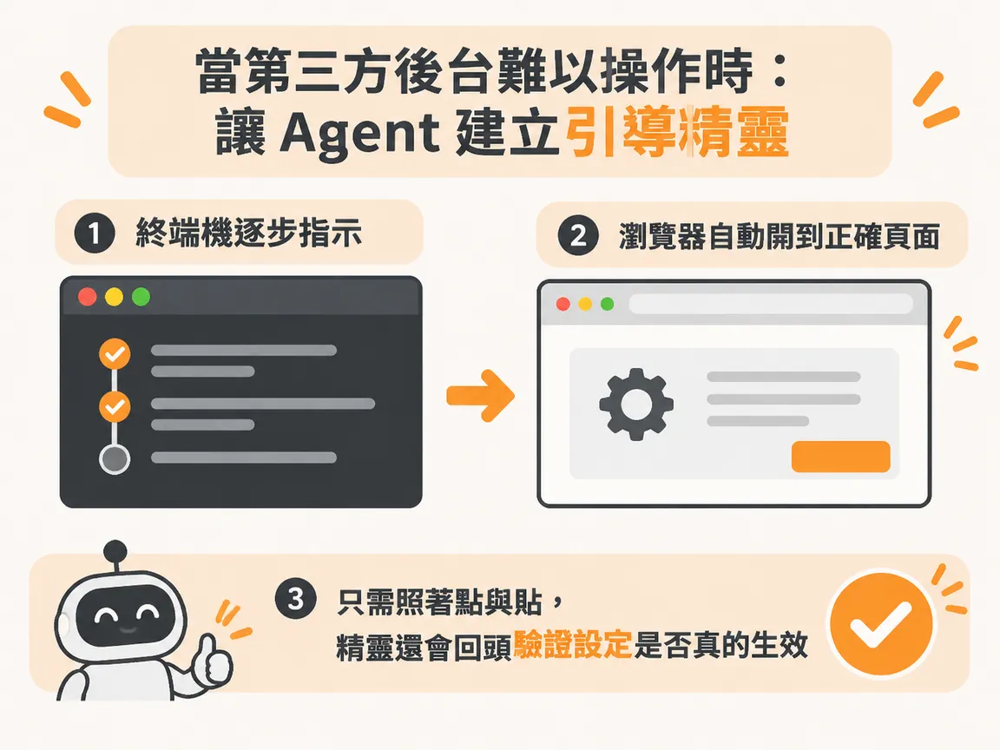
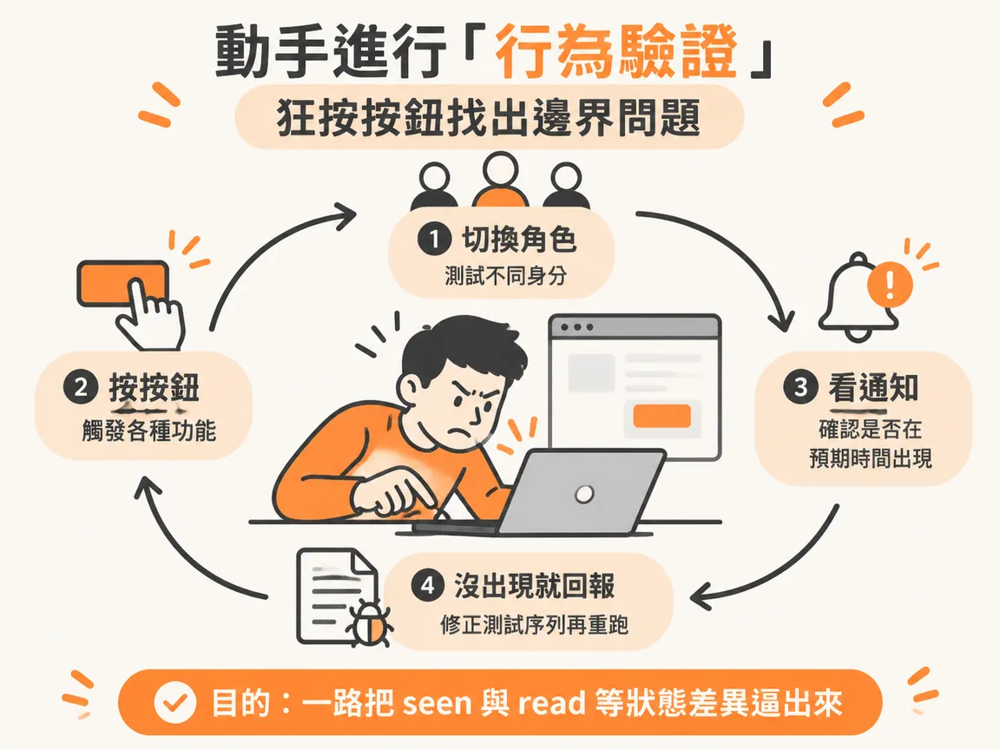

# 用 Prototype Ticket 把決策拉到高擬真度，驗證行為才關票

在規劃軟體架構或挑選第三方服務時，單看文件往往難以察覺實際整合的盲點。此時最有效的方法不是寫出完美的正式程式碼，而是開啟一張專門的 Prototype Ticket（原型工單）。透過高擬真度（high fidelity）的原型，親自操作並驗證行為，直到所有決策都確認無誤，才能關閉票券。

## 原型工單的核心精神：高擬真度反饋與隨意拋棄

原型工單並不是要在主要程式庫裡堆疊未成熟的程式碼，它的運作模式與先前的研究（research）工作類似：

- **獨立分支存放**：原型程式碼放在隨機、拋棄式的分支中（例如 `prototype-knock-spike`），不合併進主分支（main checkout）。這樣既能讓本機 Agent 隨時存取與參考，又不會讓 Agent 誤以為這是正式環境的程式碼。
- **高額 Token 消耗的「Vibe Coding」**：原型階段本來就會消耗大量 Token。你可以不斷要求 Agent：「我不喜歡這個，換成那種做法」，在快速往返的調整中，把架構決策直接體現在畫面上。
- **程式碼可以走捷徑**：負責原型的技能（skill）通常被允許忽略生產環境規範。例如出現 `catch (e) { /* null */ }` 這種直接吞掉錯誤的寫法在 Code Review 是禁忌，但在原型中完全可以接受。
- **關票條件是「決策整合與行為驗證」**：原型工單不是寫完原型就結束，而是要等到你的所有決策都落實進去、功能行為驗證正確，才算完成。

## 啟動原型：以 Wayfinder 測試 Knock 通知服務

以在 Cadence 系統中整合第三方通知服務 Knock 為例，當 API key 準備就緒後，便可以清空 Agent 的上下文，啟動 Wayfinder 執行這張原型工單。

Wayfinder 的優勢在於它有一個全域地圖（map）。以往手動探索容易擔心清空上下文會遺失成果，但 Wayfinder 會把決策寫回地圖中，新啟動的 Session 只要抓取所需資料即可，非常節省 Token。

這次 Agent 認領了 prototype skill 後，自動執行了幾個動作：
1. 查閱 Knock 官方文件並安裝 Node SDK。
2. 結合先前地圖中記錄的 Knock 研究資料。
3. 在獨立分支建置一個拋棄式路由，並在 `localhost:5199` 啟動開發伺服器，準備驗證工單上的 4 項檢查點（checks）。

## 當第三方後台難以操作時：讓 Agent 建立引導精靈

伺服器跑起來後，檢查點一「簽署的使用者權杖（signed user tokens）」順利通過：只要有公開金鑰與該權杖，使用者就能讀取自己的通知動態（feed）。

但檢查點二到四需要先在 Knock 後台完成設定。面對繁瑣的第三方介面，若不想自己迷失在後台選單中，可以直接要求 Agent：「可以為我建立一個精靈（wizard）來設定檢查點二到四需要的東西嗎？」因為系統具備模型呼叫技能（model invoked skill），Agent 便會自動呼叫對應技能生成引導腳本。

開啟新終端機執行這個精靈後，螢幕左邊是終端機引導、右邊是瀏覽器：

1. **建立討論回覆工作流程**：建立名為 `discussion reply` 的 workflow，新增 `discussion` 分類，在流程建置器中加入 `in-app feed` 頻道步驟，設定步驟範本的 Markdown 內容，最後儲存並 commit 到 development 環境。精靈還會自動觸發並驗證設定是否生效。
2. **建立註冊工作流程**：同樣建立 `enrollment` workflow，填入對應的 Markdown 範本並提交。

### 從撞牆中淬煉出的架構決策

到了精靈的第三階段，要求在平台偏好設定（platform preferences）中，將 `enrollment` 分類底下的 in-app feed 預設關閉。

Knock 的偏好設定介面相當複雜，即便在偏好中心（Preference Center）找到了選項，也找不到修改預設值（defaults）的地方。這時將整個卡住的階段文字直接貼回給 Agent，尋求協助或確認是否能用程式化解決。

在嘗試與討論的過程中，意外得出了重要決策：**我們根本不需要在 Knock 後台設定這個預設值**。

因為 Cadence 系統在將講師資料同步至 Knock 時，可以直接將使用者的偏好設定寫入「enrollment off」；當使用者主動選擇加入時，Cadence 再將其切換為「on」。這個在操作第三方服務時遇到的阻礙，反而替系統省去了一道後台設定程序。這正是原型的真正價值：提早摸清工具是否合手，並找出真正可行的架構路徑。

## 動手進行「行為驗證」：狂按按鈕找出邊界問題

跳過不必要的設定後，便可進入原型介面。這類原型並非講求精美的 UI，而是「行為是否正確（does it behave right）」的原型——畫面上會充滿各種測試按鈕，讓你能自由切換身分、測試邏輯並嘗試把它玩壞。

以多角色切換為例進行驗證：

1. **驗證討論回覆通知**：
   - 登入為 Sarah Chen，按下對 Emma Wilson 問題的回覆按鈕。
   - 切換至 Emma Wilson，在 Headless feed 中確認通知是否在 3 秒內出現。
   - 測試過程發現按鈕沒有作用，向 Agent 回報後，發現是原型本身的錯誤。Agent 修正後重新指示測試序列：改以 Sarah Chen 觸發通知給 Olivia Martinez，登入 Olivia 的帳號後便順利看到通知出現。
2. **驗證已讀與已看狀態**：
   - 測試單則通知的「標為已讀（mark read）」與「標為未讀」。
   - 點擊「全部標為已看（mark all as seen）」時發現沒有外觀變化。向 Agent 回報後才釐清 Knock 的行為機制：標為「已看（seen）」並不等同於「已讀（read）」，只有已讀項目才會反灰變淡。
3. **驗證預設關閉與主動加入（Opt-in）**：
   - 依序以 Olivia 與其他學生身分點擊「註冊並通知 Marcus Johnson」。此時 Marcus 的動態中完全不該收到新通知，符合預設關閉的期待。
   - 切換為 Marcus 點擊「加入註冊通知（opt in enrollment）」。
   - 再換成 James Park 進行註冊通知，切回 Marcus 時，便順利看到來自 James Park 的通知。

## 紀錄經驗並關閉工單

經歷一輪扎實的測試與除錯後，原型成功驗證了所有核心行為。此時的 Session 大約消耗了 107k tokens，仍在合理運算範圍內。

最後告訴 Agent：「我對這個原型很滿意，QA 已經足夠，把我們的學習收穫存回地圖吧。」

Agent 隨即關閉這張原型工單，並在結案摘要中清楚記錄關鍵決策與踩坑經驗（gotchas）：
- 預設關閉機制改由 Cadence 同步時寫入，而非依賴 Knock 後台設定。
- 釐清 Knock 系統中 seen 與 read 的狀態差異。

這就像傳統敏捷開發中的探針（Spike）。透過高擬真度的原型，在初期先把硬仗打完；未來負責正式實作的 Agent 將有完整的實作脈絡與現成範例可以參考，開發過程將變得無比輕鬆。
