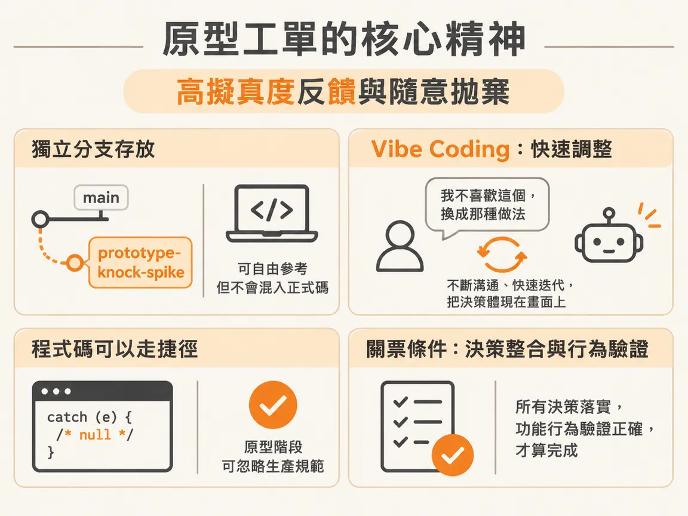
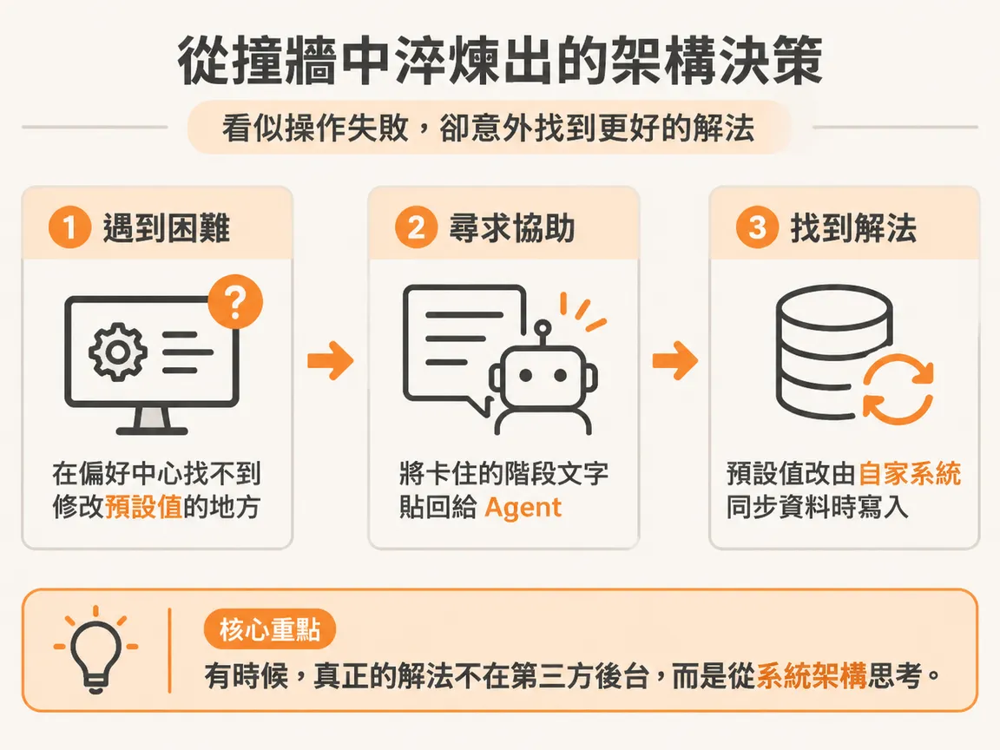
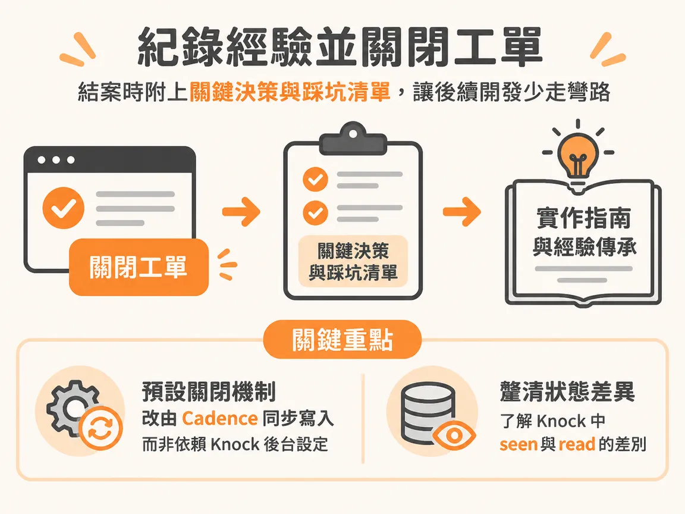

# 用 Prototype Ticket 把決策拉到高擬真度，驗證行為才關票

在規劃軟體架構或挑選第三方服務時，光看文件很難發現實際整合會踩到的坑。

這時最有效的方法不是直接寫出正式程式碼，而是開一張專門的 Prototype Ticket（原型工單）。

打造高擬真度（high fidelity）的原型，親自操作並驗證系統行為。確認所有技術決策都沒問題後，才把工單關閉。

## 原型工單的核心精神：高擬真度反饋與隨意拋棄

原型工單不是要把不成熟的程式碼塞進主要專案中。它的運作邏輯跟前期的研究（research）工作很像：

- **放在獨立分支**：原型程式碼放在隨機、拋棄式的分支中（例如 `prototype-knock-spike`），不要合併進主分支（main checkout）。本機 Agent 能隨時讀取參考，也不會把這些實驗程式碼誤當成正式環境邏輯。
- **高 Token 消耗的「Vibe Coding」**：原型階段本來就會消耗大量 Token。隨時向 Agent 提出調整要求，把架構決策直接反應在操作畫面上。
- **程式碼可以抄捷徑**：負責原型的技能（skill）不需要遵守正式環境的規範。即使出現 `catch (e) { /* null */ }` 這種直接忽略錯誤的寫法，在原型開發中也完全可以接受。
- **關票條件在於「決策拍板與行為驗證」**：原型不是寫完畫面就算數。必須落實所有架構決策，並確認功能行為完全正確，工單才算完成。

## 啟動原型：以 Wayfinder 測試 Knock 通知服務

以在 Cadence 系統整合第三方通知服務 Knock 為例。

準備好 API key 後，清空 Agent 的上下文，啟動 Wayfinder 執行這張原型工單。

Wayfinder 的特色在於擁有全域地圖（map）。傳統手動探索常擔心清空對話會遺失進度，Wayfinder 則會把決策同步記錄在地圖裡。新啟動的 Session 只要抓取需要的資料，非常節省 Token。

Agent 取得 prototype skill 後，會自動執行幾個步驟：
1. 查閱 Knock 官方文件，安裝 Node SDK。
2. 匯入地圖中先前留下的 Knock 研究資料。
3. 在獨立分支建立一個拋棄式的路由，在 `localhost:5199` 跑起開發伺服器，準備驗證工單上的 4 項檢查點（checks）。

## 第三方後台不好操作時：讓 Agent 建立引導精靈

伺服器啟動後，檢查點一「簽署的使用者權杖（signed user tokens）」順利通過。只要有公開金鑰和這組權杖，使用者就能讀取自己的通知動態（feed）。

檢查點二到四必須先在 Knock 後台完成設定。

如果不想在繁瑣的第三方介面裡迷路，可以直接要求 Agent 建立精靈（wizard），指引完成檢查點二到四的設定。系統內建模型呼叫技能（model invoked skill），Agent 會自動呼叫對應功能，產出操作導引腳本。

開啟新終端機執行這個精靈後，螢幕左邊放終端機引導，右邊放瀏覽器：

1. **建立討論回覆工作流程**：建立名為 `discussion reply` 的 workflow，加上 `discussion` 分類。在流程建置器加入 `in-app feed` 頻道步驟，設定範本的 Markdown 內容，儲存並 commit 到 development 環境。精靈會自動觸發並驗證設定是否生效。
2. **建立註冊工作流程**：同樣建立 `enrollment` workflow，填入對應的 Markdown 範本並提交。

### 從卡關中逼出真正的架構決策

執行到精靈第三階段時，需要進到平台偏好設定（platform preferences），將 `enrollment` 分類底下的 in-app feed 預設關閉。

Knock 的偏好設定介面相當複雜，就算在偏好中心（Preference Center）找到選項，也找不到修改預設值（defaults）的欄位。這時可以把卡住的畫面文字複製給 Agent，請它協助確認能不能用程式碼解決。

在反覆測試與討論後，得出了一個關鍵結論：**根本不需要在 Knock 後台設定這個預設值**。

Cadence 將講師資料同步到 Knock 時，就能順手將使用者的偏好設定帶入「enrollment off」。等使用者主動加入，Cadence 再將狀態改成「on」即可。

操作第三方服務遇到的阻礙，反而替系統省下一道後台設定手續。這就是原型的真正價值：提早確認工具是否好用，摸索出切實可行的架構路線。

## 動手進行「行為驗證」：狂按按鈕找出邊界問題

跳過不必要的設定，進入原型介面。這類原型並非講求精美的 UI，而是要確認「行為是否正確（does it behave right）」的原型。畫面上會有大量的測試按鈕，方便切換身分、測試邏輯，試著找出破綻。

透過多角色切換進行驗證：

1. **驗證討論回覆通知**：
   - 登入為 Sarah Chen，點擊回覆 Emma Wilson 提問的按鈕。
   - 切換至 Emma Wilson，在 Headless feed 確認通知是否在 3 秒內跳出。
   - 測試時如果按鈕沒有反應，回報給 Agent。確認是原型自身的錯誤後，Agent 會修復程式碼並重新規劃測試流程：改由 Sarah Chen 觸發通知給 Olivia Martinez，登入 Olivia 帳號後確認收到通知。
2. **驗證已讀與已看狀態**：
   - 測試單則通知的「標為已讀（mark read）」與「標為未讀」。
   - 點擊「全部標為已看（mark all as seen）」時，外觀如果沒有變化，向 Agent 詢問。藉此釐清 Knock 的機制：標為「已看（seen）」不等於「已讀（read）」，只有已讀的項目才會變灰。
3. **驗證預設關閉與主動加入（Opt-in）**：
   - 換成 Olivia 與其他學生身分，點擊「註冊並通知 Marcus Johnson」。Marcus 的動態完全不該收到通知，符合預設關閉的規則。
   - 切換成 Marcus，點擊「加入註冊通知（opt in enrollment）」。
   - 換成 James Park 送出註冊通知，切回 Marcus 時，就會看到來自 James Park 的通知。

## 記錄經驗並關閉工單

經過一輪測試與除錯，原型成功驗證了所有核心行為。整趟 Session 大約消耗 107k tokens，在合理範圍內。

確認測試充足後，指示 Agent 把這次學到的成果存回地圖。

Agent 隨即關閉這張原型工單，並在結案摘要寫下關鍵決策與踩坑經驗（gotchas）：
- 預設關閉機制由 Cadence 同步資料時寫入，不依賴 Knock 後台設定。
- 釐清 Knock 系統中 seen 與 read 的狀態定義差異。

這就像敏捷開發裡的探針（Spike）。利用高擬真度的原型把硬仗打在前面，未來負責正式開發的 Agent 就能對照完整的實作脈絡與現成範例，後續建置會省力許多。
