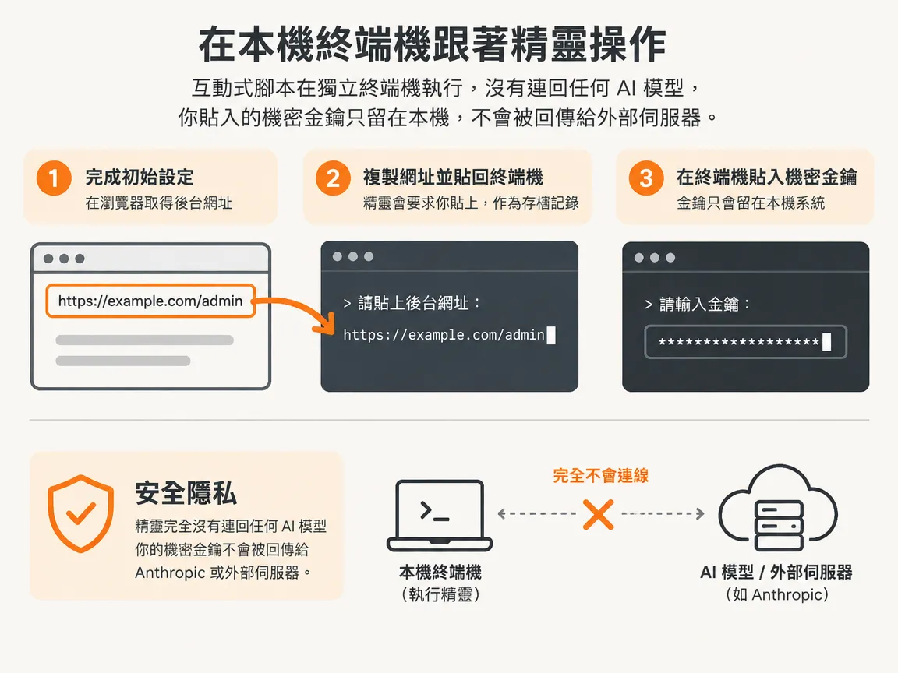

# 用互動式精靈處理只有人類能做的設定任務

在 Wayfinder 地圖推進專案時，有些工作無法直接交給 agent 全自動處理。例如註冊第三方服務、在後台手動建立專案，或是取得開發用的 API 金鑰。這些需要人工介入的操作，在地圖上會建立為 task ticket。這類票券帶有 `task` 標籤，處於 unclaimed 且隨時能開始的狀態。

手動註冊外部服務相當繁瑣。當專案需要同時串接四到五家廠商時，在不同後台之間切換很容易漏掉步驟或貼錯金鑰。專案內建了解決這個問題的輔助 skill。只要執行 `npm run reset add wizard skill`，本機目錄就會新增一個名為 `wizard` 的技能。

這個技能會產生互動式 Bash 導覽精靈（wizard），按步驟引導完成人工操作。它適合用在開通基礎設施、設定憑證或 CI 機密變數、操作陌生的第三方後台，或是執行單次的資料遷移與切換。這項技能屬於 model-invoked skill，agent 會在適當時機自動呼叫並產生精靈腳本。

## 讓 Agent 自動生成設定精靈

讓模型自行判斷調用時機，關鍵在於 description 是否夠詳盡、引導詞是否切中任務情境。在終端機執行 Wayfinder 並帶入註冊 NOC 服務的票券編號後，agent 會順利觸發該技能。agent 會說明它將建立精靈腳本，帶領完成 NOC 後台註冊，並把取得的金鑰存入本機的 `.env`。

此時 agent 已經完整閱讀了先前的調研記錄、Wayfinder 地圖，以及這張票券依賴的所有前置票券。agent 清楚掌握專案進度與選用的 NOC 方案。它還主動查詢 NOC 官方文件，確認後台介面的路徑結構，避免精靈產生錯誤步驟。整個生成過程消耗約 44k 個 token，隨即在本地產出 Bash 設定腳本。

這類導覽精靈具備高度互動性，無法直接在 Claude Code 或 agent 本身的 Bash 模式中執行。操作時必須另開獨立終端機視窗來跑腳本。螢幕可切分為左右兩半：左邊放置終端機與 agent，右邊放置瀏覽器。精靈在執行期間會自動開啟對應的網頁。

## 在本機終端機依精靈步驟操作

在獨立終端機啟動腳本後，精靈會自動開啟 `dashboard.noc.app`，並以顏色標示明確步驟：

1. 註冊或登入帳號，並為專案建立組織（例如 Cadence）。
2. 停留在免費的開發者方案（free developer plan），不啟動試用或升級付費版。
3. 透過左上角的環境選單，切換至開發環境（development）。

完成初始設定後，精靈會要求複製瀏覽器網址列的後台 URL 並貼回終端機存檔。使用這套本機精靈最大的好處是安全隱私：精靈本身沒有連線至任何 AI 模型。在終端機輸入的所有機密金鑰只會存放在本地系統，不會傳送至 Anthropic 或其他外部伺服器。

精靈接著會引導點擊左側側邊欄底部的 Settings，進入 channels and sources。隨後在 in-app feed 建立名為 `cadence feed` 的頻道。若後台已有現成頻道，直接複製該頻道 ID 貼上即可。

精靈會再指示前往左側側邊欄 Platform 下方的 API keys 頁面複製 Public Key。收到金鑰後，精靈會要求在同一頁面找到 Application Signing Keys 區塊，產生金鑰並複製單行的 Base64 編碼字串。精靈已預先開啟正確網址，也交代了點選位置與輸入格式，操作時只需依序點擊與貼上。

進入開啟增強安全模式（enhanced security mode）步驟時，精靈會說明 NOC 官方文件並未明確標示該開關位置。精靈建議先從 API keys 頁面或環境設定尋找。在 API keys 頁面找到開關並切換啟用後，只要在終端機輸入 `y` 確認，設定即告完成。

精靈最後會將四個設定值直接寫入本機的 `.env` 檔案：
- `feed channel id`
- `public API key`
- `secret API key`
- `nox signing key`

由於 `.env` 預設已加入 `.gitignore`，這些開發憑證不會被誤提交到公開儲存庫。

## 讓 Agent 驗證設定並結案回地圖

執行完精靈後，回到原本的 agent 視窗，通知精靈已執行完畢，請 agent 驗證本地設定。

Agent 在檢查環境變數時，會在不輸出完整金鑰的情況下驗證格式，防止敏感憑證在環境中洩漏。這項檢查可以提早發現貼上時被截斷的長簽名金鑰（signing key）。若金鑰未完整寫入，不需要重新執行整套精靈。直接詢問 agent 該步驟的手動修正方式，回到後台重新複製完整字串補回 `.env` 即可。

修正完成後再次請 agent 驗證。確認格式無誤後，agent 會發送帶有簽名 token 的實際 API 請求，向 NOC 伺服器驗證金鑰權限是否真正有效。

API 測試成功後，agent 會將任務的解決紀錄（resolution）寫回 Wayfinder 地圖，正式關閉這張票券。為設定工作產生導覽精靈雖然多了一道步驟，但在面對大量第三方服務時，能大幅降低人工出錯的機率，並確保進度受到確實驗證與留存。
