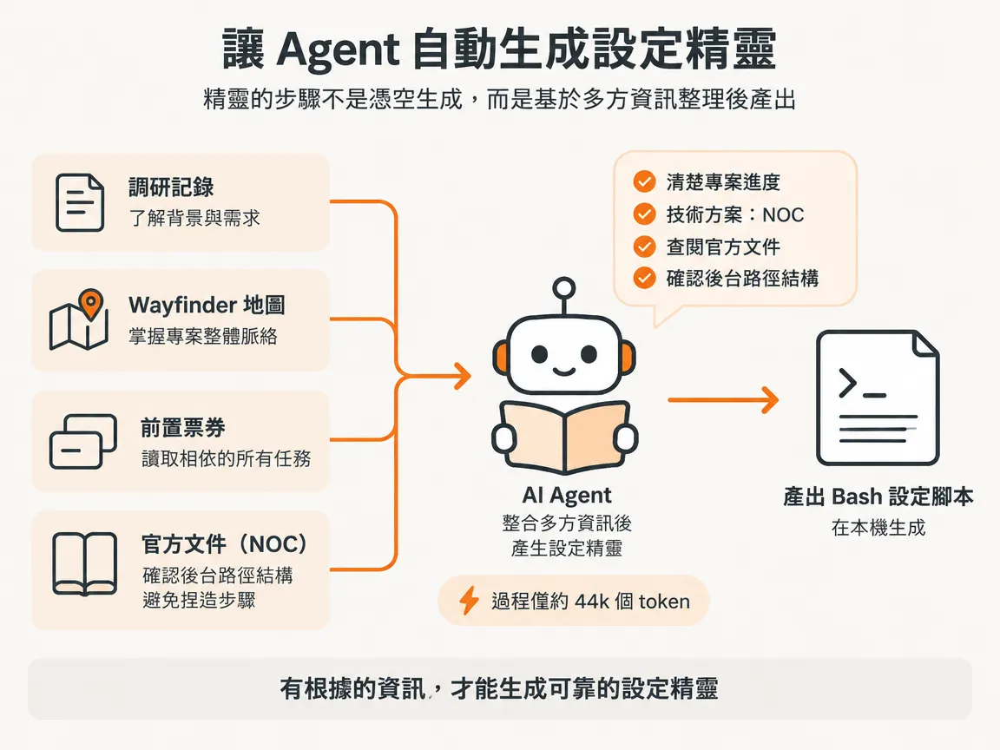
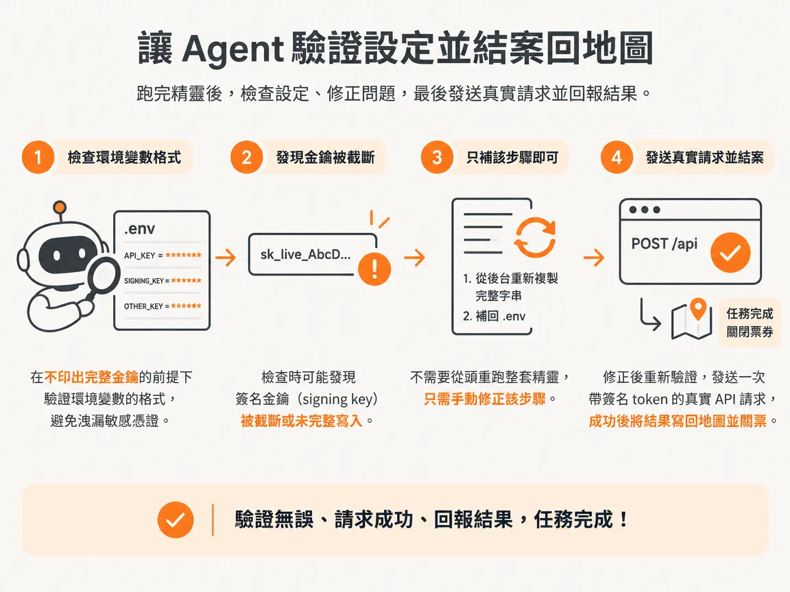

# 用互動式精靈處理只有人類能做的設定任務

在 Wayfinder 地圖推進專案時，有些工作沒辦法直接丟給 AI 代理（agent）全自動完成，例如註冊第三方服務、在網頁後台點擊建立專案、或是取得開發用的 API 金鑰。這類需要人類親自操作的工作，在地圖上會開成任務票券（task ticket）。這張票券帶有 Wayfinder 的 `task` 標籤，處於無人認領（unclaimed）且隨時可開始的狀態。

手動註冊這些外部服務其實相當繁瑣，尤其是當專案一次得串接四、五個不同廠商時，在各種陌生的管理後台之間跳轉很容易漏掉步驟或複製錯金鑰。為了解決這個痛點，專案裡內建了一個輔助技能（skill）。只要執行 `npm run reset add wizard skill`，本地目錄就會加入一個名為 `wizard` 的技能。

這個技能會自動產生一支互動式的 Bash 導覽精靈（wizard），專門一步步帶領人類完成只有人類能做的事。它適合用在開通基礎設施、設定憑證或 CI 機密變數、瀏覽不熟悉的第三方後台，或是執行單次的資料遷移與切換。它的目標就是把這些繁雜的雜事變得盡可能簡單無腦。由於這是一個由模型自行調用的技能（model-invoked skill），agent 會在合適的時機自動叫出它來產生精靈腳本。

## 讓 Agent 自動生成設定精靈

讓模型自行決定何時調用技能，最大的考驗在於描述（description）寫得夠不夠詳盡、引導詞是否準確切中當前的任務情境。在終端機呼叫 Wayfinder 並帶入這次要註冊 NOC 服務的票券編號後，agent 便成功觸發了這個技能，並回應它會建立一支精靈，帶領使用者完成 NOC 後台註冊，再把產生的金鑰寫回本地的 `.env` 檔案。

此時 agent 已經完整閱讀了先前的調研記錄、Wayfinder 地圖，以及這張票券依賴的所有前置票券。它清楚知道目前的專案進度、選定的技術方案是 NOC，甚至還主動去翻閱了 NOC 的官方文件，確認後台路徑的確切結構，避免導覽精靈憑空捏造步驟。整個生成過程僅花費了約 44k 個 token，就在本機產出了一支 Bash 設定腳本。

需要特別注意的是，這類導覽精靈是高度互動式的腳本，不能直接在 Claude Code 或 agent 本身的 Bash 模式中執行。你必須開啟一個獨立的終端機視窗，把腳本貼過去跑。建議把畫面分成兩半：左邊放執行精靈的終端機與 agent，右邊放瀏覽器，因為精靈在執行過程中會自動幫你開啟對應的網頁網址。

## 在本機終端機跟著精靈操作

在獨立終端機按下 Enter 啟動腳本後，精靈會自動打開 `dashboard.noc.app`，並依色列出清楚的指引步驟：

1. 註冊或登入帳號，並為專案（例如 Cadence）建立組織。
2. 停留在免費的開發者方案（free developer plan），不要啟動試用或升級付費方案。
3. 透過左上角的環境切換選單，切換到開發環境（development）。

完成初始設定後，精靈會要求你把網址列上的後台 URL 複製貼回終端機當作存檔記錄。使用這套本機精靈最大的好處是安全隱私：精靈本身完全沒有連回任何 AI 模型，你在終端機貼入的任何機密金鑰只會留存在本機系統，絕對不會被回傳給 Anthropic 或外部伺服器。

接下來，精靈會引導點擊左側邊欄底部的 Settings，進入 channels and sources，在 in-app feed 建立一個名為 `cadence feed` 的頻道。如果你發現後台已經有現成的頻道，直接複製貼上該頻道 ID 即可。

隨後精靈指示前往左側邊欄的 Platform 底下的 API keys 頁面複製 Public Key。當精靈接收到對應的金鑰後，會進一步要求在同一個頁面找到 Application Signing Keys 區塊，產生一組金鑰並複製單行的 Base64 編碼字串。精靈不僅把網址開好，還把要點哪個按鈕、要貼哪種格式交代得一清二楚，使用者只需要機械式地點擊與貼上。

到了開啟增強安全模式（enhanced security mode）的步驟時，精靈甚至坦承了文件的不明確之處：它提示 NOC 的官方文件並未清楚寫出這個開關的確切位置，建議使用者先從 API keys 頁面或環境設定找起。在 API keys 頁面找到開關並切換完成後，只要在終端機輸入 `y` 確認，整個設定流程就大功告成。

精靈最後會把這四個設定值直接寫入本地的 `.env` 檔案：
- `feed channel id`
- `public API key`
- `secret API key`
- `nox signing key`

因為 `.env` 平時就已經被加進 `.gitignore`，所以不用擔心這些本機開發憑證在未來被誤提交到公開的程式碼儲存庫中。

## 讓 Agent 驗證設定並結案回地圖

跑完精靈後，回到原本的 agent 視窗，告訴它精靈已經順利執行完畢，請它驗證本地的設定是否正確。

Agent 在檢查環境變數時，會特別注意在不印出完整金鑰的前提下驗證格式，避免把敏感憑證直接載入環境中洩漏。這一步驗證非常關鍵，因為在實際檢查時，可能會發現比較長的簽名金鑰（signing key）在貼上時被截斷、沒有完整寫入。遇到這種狀況時，不需要從頭重跑整套精靈，直接問 agent 該步驟的手動修正方式，手動去後台重新複製完整字串並補回 `.env` 即可。

修正完成後再次請 agent 驗證。確認格式無誤後，agent 還會發起一次帶有簽名 token 的真實 API 請求，親自對著 NOC 的伺服器測試金鑰是否真的具備有效權限。

當 API 請求測試成功，agent 便會把這次任務的解決記錄（resolution）寫回 Wayfinder 地圖，正式關閉這張任務票券。雖然為設定工作特地生成導覽精靈看起來多了一道手續，但當專案必須面對大量第三方廠商的初始設定時，這種方式能大幅降低人為出錯的機率，並確保地圖上的進度有被確實驗證與記錄。
