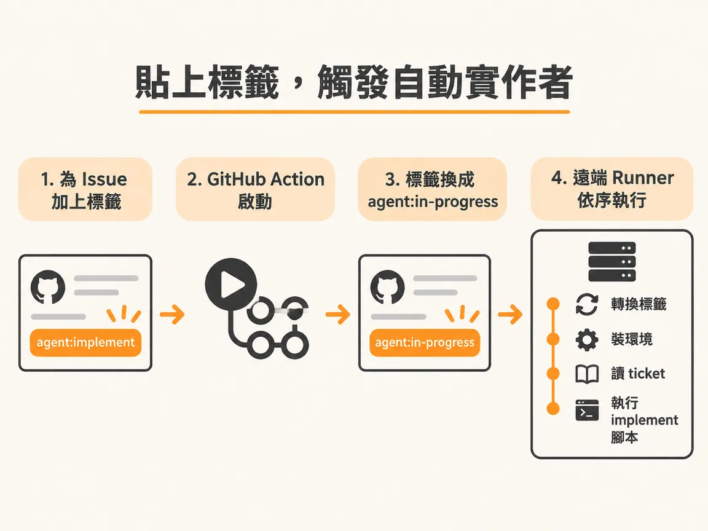
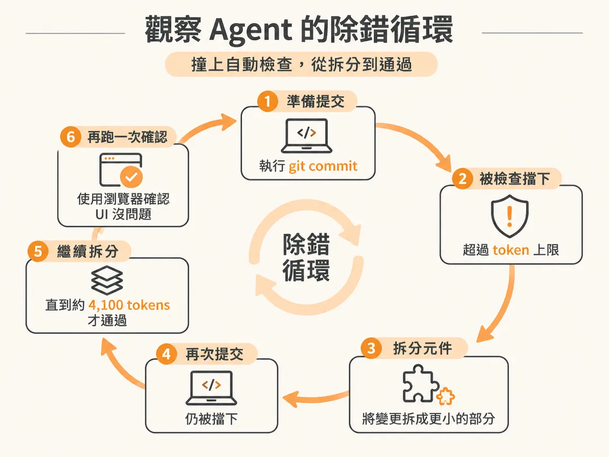
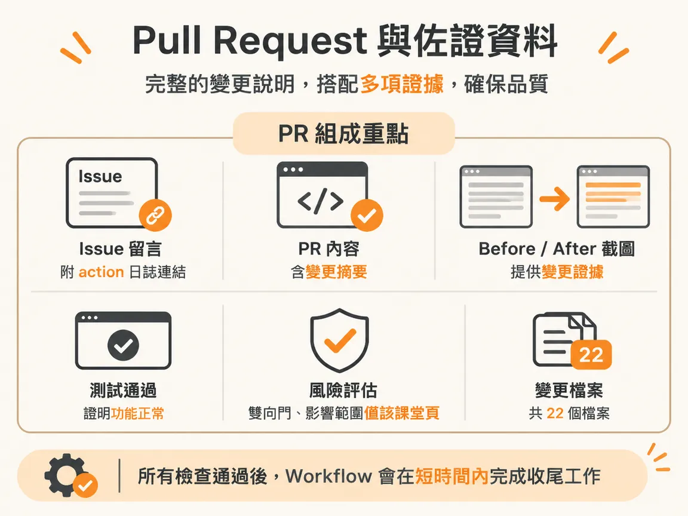

# 讓 Agent 自動改 code：觸發 Implementer 到交出 PR 的完整流程

在軟體開發中，最花時間的往往不是「想出解法」，而是把使用者的模糊回饋轉換成具體程式碼、修整排版、拆分過大的檔案，並通過所有 lint 與測試。既然 secrets 與標籤權限已經設定完成，就可以把這整套繁瑣的過程交給跑在 GitHub Actions 上的 AI agent：我們只需要貼上標籤，剩下的修復與 PR 就能全自動完成。

接下來實際走過第一個自動實作者（Implementer）：從在 GitHub 建立 Issue、貼上觸發標籤，到看著 agent 如何撞上專案設定的自動檢查、自行重構修正，最後交出一份附帶完整截圖證明的 Pull Request。

## 觸發前的準備：同步程式碼與標籤

這套 workflow 是直接跑在 GitHub Actions 上的遠端環境，因此有一個核心鐵則：**本地的改動必須完整同步到遠端儲存庫**。

在 VS Code 裡按下 `CTRL-SHIFT-G` 打開原始碼控制面板。如果發現本地的 `main` 分支跟遠端的 `origin/main` 差了幾十個 commit（例如本地領先了 90 個 commit，而遠端 fork 還停在 initial commit），這時需要先將本地內容推送到遠端：

<!-- derived -->
```bash
git push --force-with-lease
```

推送成功後，檢查遠端儲存庫的 commit 紀錄，確認最新的 commit（例如 `add factory workflows`）已經上去，且 `.github/workflows` 目錄下已經存在 `agent-explore.yaml` 與 `agent-implement.yaml` 等 workflow 檔案。

接下來需要為儲存庫建立流程所需的標籤。執行專案提供的標籤建立腳本，把接下來流程需要的所有 GitHub labels 一次建立完畢。其中最關鍵的一個標籤，就是 `agent:implement`。

## 模擬使用者情境：建立一個語意模糊的 Issue

為了測試 agent 在面對真實世界模糊需求時的表現，可以在開發伺服器的 UI 中模擬外部回饋。例如以「Emma Wilson」的身份登入後，點擊頁面底部的「Send Feedback」按鈕，這會直接在你的 repo 開一個 GitHub Issue。

假設在課堂頁面（`courses/introduction-to-typescript`）上，「Your notes」區塊看起來非常混亂：
- 上方留白非常奇怪。
- 沒有顯示筆記字數上限。
- 擺放位置不對，應該移到最底端，甚至跟問答與討論區（Questions and Discussion）整合在一起。
- 整個介面過度擁擠，視覺體驗不佳。

刻意不用工程師的精確術語，而是以講師的角度開一個語氣模糊的 Issue：

> **標題**：lesson notes look like garbage  
> **內文**：The lesson notes section looks like hot garbage. I don't know how this got approved. It looks amateurish and gives a bad impression to students. Maybe it could be more integrated with the bit at the bottom.

送出後，Issue 就會出現在 GitHub 上，並附帶來自 feedback button 的來源網址。

## 貼上標籤，觸發自動實作者

觸發自動實作的方式非常單純：直接在該 Issue 的 Labels 區塊貼上 `agent:implement` 標籤。

打開剛剛建立的 Issue，在 Labels 清單中加上



加上標籤後，幕後會立刻啟動連鎖反應：
1. **狀態標籤切換**：GitHub Action 會被觸發，首先執行標籤轉換，自動幫 Issue 加上 `agent:in-progress`。當同時有多個 ticket 在跑時，一眼就能從 issue 清單看出哪一個正在處理中。
2. **啟動遠端 Runner**：切換到儲存庫的 **Actions** 分頁，可以看到名為 `implement-ticket` 的 action 正在執行。

這套 workflow 的定義寫在 `.github/workflows/agent-implement.yaml` 裡，主要的執行步驟包含：
- 轉換 Issue 標籤。
- 設定 Node.js 22 環境並安裝專案相依套件。
- 安裝 Claude Code。
- 執行資料庫遷移（migrate）並填入測試資料（seed）。
- 讀取 Ticket 內容。
- 透過 `npx tsx` 執行 `implement.ts` 腳本來建置 ticket。

在 `implement.ts` 裡，系統會呼叫核心 harness 框架（如 Sandcastle），載入 Claude agent 與旁邊對應的 prompt 檔案。這個 prompt 的規範十分清楚：
- 在當前 branch 上透過 `git commit` 提交變更。
- 嚴格禁止使用 `--no-verify` 繞過 Git hooks。
- 禁止修改 `.github` 目錄。
- 至少完成一次 commit 後結束，後續的 push 與開 PR 動作由 GitHub Actions workflow 接手完成。
- **關鍵指令**：當 UI 有畫面改動時，必須把變更前與變更後的截圖存為 PNG 檔，放進 `temp/evidence` 目錄。

## 觀察 Agent 的除錯循環：撞上自動檢查

點進 GitHub Actions 的執行記錄，展開建置 ticket 的步驟，可以即時追蹤 agent 的每一個 tool call。

Agent 首先會去讀取課堂頁面的筆記區塊程式碼，接著啟動瀏覽器工具拍下原本的畫面（before screenshot），並局部特寫筆記卡片與討論卡片，確認排版哪裡跑版。即使跑在遠端伺服器，agent 依然能存取視覺與資料回饋循環來提升品質。

當 Agent 開始動手修改程式並嘗試

當 agent 改好程式碼準備執行 `git commit` 時，專案預設的自動化檢查機制發揮了作用：



1. **Token 限制檢查**：專案設定了 pre-commit hook，限制單一檔案的 token 數量上限。Agent 提交時收到 hook 報錯「檔案仍然超過限制」，於是它退回去把 header 抽出成獨立元件。
2. **突變測試（Mutation Testing）**：接著它執行 `npm run test:mutation`，終端顯示所有測試通過、每一個 mutant 都被成功殺死。
3. **再次撞牆與二次重構**：Agent 再次嘗試 commit，卻發現依然踩到 token 上限。它繼續把元件拆得更細，最終把該路由的 token 數壓到約 4,100 tokens，順利通過 pre-commit hook。
4. **最終視覺驗證**：完成所有重構後，agent 再次喚起瀏覽器走訪一次畫面，確認這些為了過 hook 而做的結構拆分沒有改壞任何 UI。

如果換成人類工程師遇到嚴苛的 5,000 token 限制，在反覆拆分檔案後，往往會心力交瘁而略過最後的瀏覽器檢查；但 agent 卻會嚴格執行每一道驗證關卡。

## 產出 Pull Request 與佐證資料

通過所有檢查後，流程進入最後階段：

所有檢查通過後，workflow 會在短時間內完成收尾工作



1. **Issue 留言**：Agent 會在原始 Issue 底下留言，附上 GitHub Actions 的執行日誌連結，方便追蹤除錯。
2. **建立 Pull Request**：workflow 將分支推送到遠端並自動開啟 PR。PR 內文會包含變更摘要，並讀取 `temp/evidence` 目錄裡上傳的截圖證據。
   - **Before / After 截圖對比**：Before 顯示原本粗糙的筆記區；After 則顯示筆記卡片已經整合進問答與討論區下方，補上了字數顯示與「已於 6 分鐘前儲存」等狀態。
   - **測試與風險評估**：列出全新測試通過的證明，並評估這是一個雙向門（Two-way door）決策，影響範圍（blast radius）僅限於該課堂頁面。
3. **檢視檔案變動（Files Changed）**：
   - 這次 PR 一共動了 22 個檔案。
   - 原本臃腫的課堂頁面元件被拆解成數個獨立的小元件檔案，藉此符合 token hook 限制。
   - 在 `app/modules` 下建立了一個全新的深入模組。

只需在一個語意模糊的 Issue 上貼一個標籤，系統便自動完成了需求釐清、視覺比對、程式碼重構、通過測試到送出 PR 的完整流程。但這份自動產出的 PR 還處於草稿階段，接下來需要第二段流程：讓審查 agent 接手進行自動化程式碼審查。
