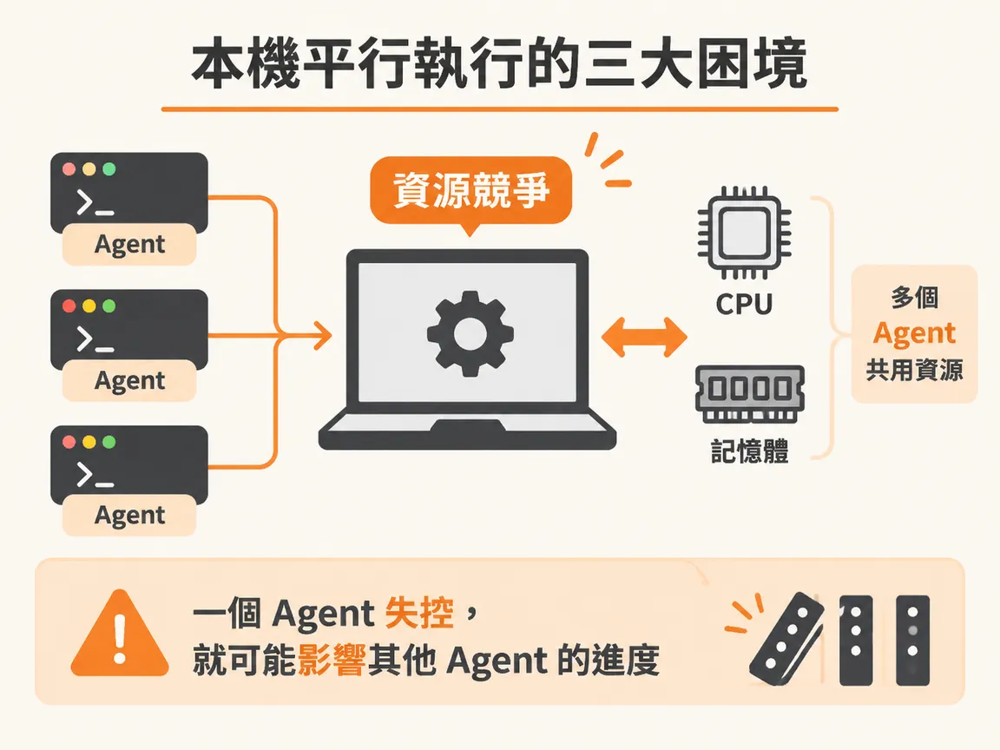
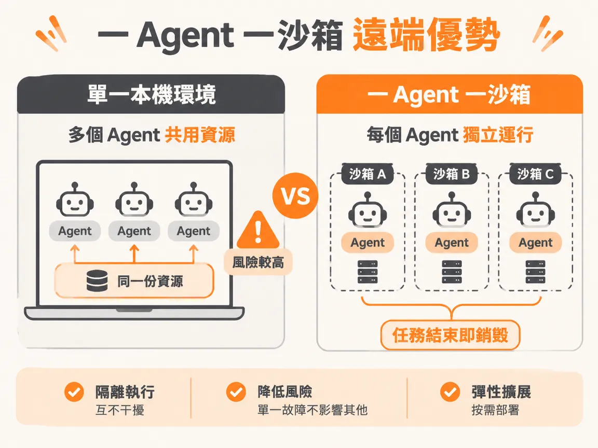
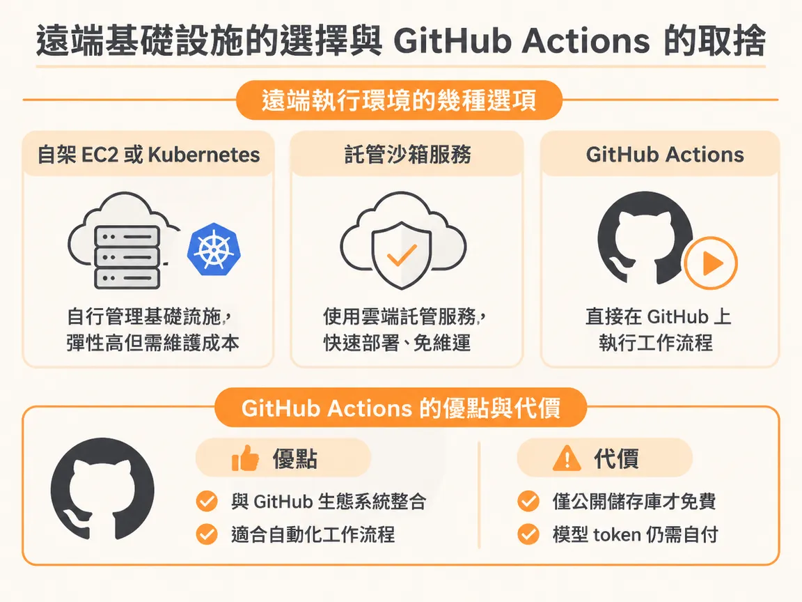

# 為什麼本機撐不住平行 Agent？遠端沙箱架構與 GitHub Actions 的取捨

要讓軟體工廠真正實現 AFK，讓多個 agent 同時處理實作與審查，立刻會撞上一個物理層面的架構難題：如果想要一口氣啟動大量 agent 同時工作，這些 agent 到底該跑在哪裡？

直覺上可能想直接在本機終端機一口氣開好幾個視窗，但這個做法很快就會遇到瓶頸。

很多人的第一直覺是在自己的電腦上多開幾個終端機跑 Agent

## 本機平行執行的三大困境

本機環境最大的優勢是緊密的人機協作（Human-in-the-loop）。Agent 就在螢幕前，只要它卡住或產出不如預期，你隨時可以中斷它、向它提問，或是接手修改。這種緊密的互動非常適合前期探索與快速打造原型。

然而，一旦進入自動化量產階段，本機環境就完全撐不住了：

1. **硬體資源競爭**：每個 coding agent 在執行時都需要編譯、跑測試、分析語法樹，甚至載入大型相依套件。多個 agent 同時在本機運作，會直接吃光 CPU 與記憶體，拖垮整台電腦的效能。
2. **Git 工作樹（worktree）管理極為複雜**：為了不讓多個 agent 互相覆蓋未提交的程式碼，必須在本機維護大量獨立的 Git worktree。一旦數量變多，目錄切換與狀態清理會變得非常混亂。
3. **爆炸半徑（Blast Radius）無法隔離**：Agent 擁有下指令與修改檔案的權限。如果在執行過程中出現非預期的危險行為，例如誤刪環境變數、弄壞全域設定或寫壞本地檔案，受災的就是整台開發機。更糟的是，這會連帶摧毀其他正在跑的 agent 進度，損失大量已經完成的工作。
4. **協同合作困難**：跑在本機的 agent 只有該台電腦的擁有者看得到。就算能透過工具分享，也遠不如團隊成員都能自由調度、共同監看來得靈活。

如果想讓 agent 在離開座位時持續推進進度，就必須把工作負載從本機移往遠端。

## 「一 Agent 一沙箱」的遠端優勢

最理想的解法，是「一 Agent 一沙箱（Sandbox）」，並且把每個執行個體放進隔離的沙箱中。

解決平行問題的標準解法，是改採「一個 Agent 一個遠端伺服器」的架構

這種架構帶來了本機無法比擬的優點：

- **彈性橫向擴展**：需要幾個 agent，就動態開出幾台遠端伺服器或容器；任務一結束，立刻關閉銷毀。系統擴充能力不再受限於單一實體機的規格。
- **嚴密的故障隔離**：每個沙箱都是拋棄式環境。就算 agent 在沙箱內下了危險指令或把系統搞壞，受影響的也只有那台伺服器，其他 agent 與本機環境依然安全無虞。
- **透明的團隊協作**：遠端伺服器成為團隊共用的基礎設施。大家都能看見每個 agent 的即時狀態、輸出結果與進度，任何人都能調用資源加入生產流程。

## 遠端基礎設施的選擇與 GitHub Actions 的取捨

遠端沙箱有很多具體實作方式。可以直接在 AWS 上開 EC2 實體或架設 Kubernetes 叢集；也可以選擇專為程式碼沙箱打造的託管服務，例如 Daytona、E2B 或 Vercel。

在設計遠端沙箱時，技術選項非常多元

但在驗證架構與設計自動化工廠時，另一個非常實用的平台是 **GitHub Actions**。

### 為什麼選擇 GitHub Actions？

1. **免費額度門檻低**：GitHub Actions 對公開儲存庫（Public Repository）提供免費的執行額度。不需要額外註冊第三方雲端平台，也不用擔心測試階段產生龐大的伺服器帳單。
2. **原生整合專案脈絡**：軟體工廠需要規格書（Specs）與任務單（Tickets），而這些通常就存在 GitHub Issues 或 Pull Requests 裡。跑在 GitHub Actions 上的 agent 能直接讀寫專案脈絡，每一道工作流程（Workflow）產生的結果，也能無縫傳給下一個步驟使用。
3. **容易串接 CLI 工具**：在遠端執行環境中，可以透過工具把 coding agent 包裝起來呼叫。例如利用 Sandcastle 這類函式庫，就能在 TypeScript 流程中封裝 Claude Code、Open Code 或 Codex 等命令列工具，把提示詞檔案（Prompt file）傳入沙箱中驅動 agent 執行任務。

### 需要承擔的取捨

GitHub Actions 雖然便利，但也有架構上的限制：

- **儲存庫公開限制**：若要享受免費運算時間，專案儲存庫必須設為公開。若是企業內部專案或私有程式碼，就必須支付 Actions 的分鐘數費用，或是自行架設 Self-hosted Runner。
- **模型 Token 成本依然存在**：GitHub Actions 只負責提供沙箱與 CPU 運算。跑在裡面的 coding agent（例如使用 Claude 3.5 Sonnet 或 Opus 等級的模型）仍然會消耗大量 token，這部分必須綁定開發者自己的 API 憑證，預算上需要另外編列。
- **啟動與冷啟動延遲**：每次觸發工作流程，都需要重新拉取 runner 映像檔並安裝相依套件，啟動速度通常不如常駐的專用沙箱服務迅速。

## 本機與遠端的分工

將軟體工廠搬上遠端沙箱，並不代表本機開發從此消失。

最理想的開發模式是雙軌並行：本機環境保留給需要快速回饋、緊密對話的原型驗證與除錯；而那些定義清晰、需要平行處理、耗時較長的工作流程，則交給遠端沙箱裡的 agent 大量執行。

決定好把 GitHub Actions 當作沙箱之後，下一步就要把權限、模型 token 與觸發標籤設定好，讓工廠能安全啟動。
