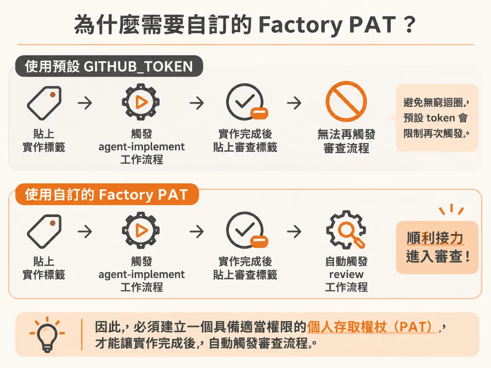
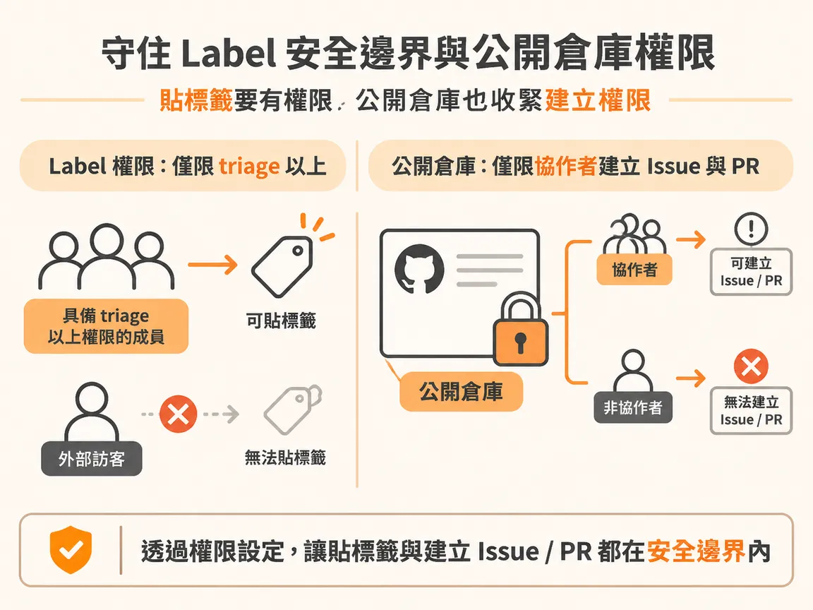
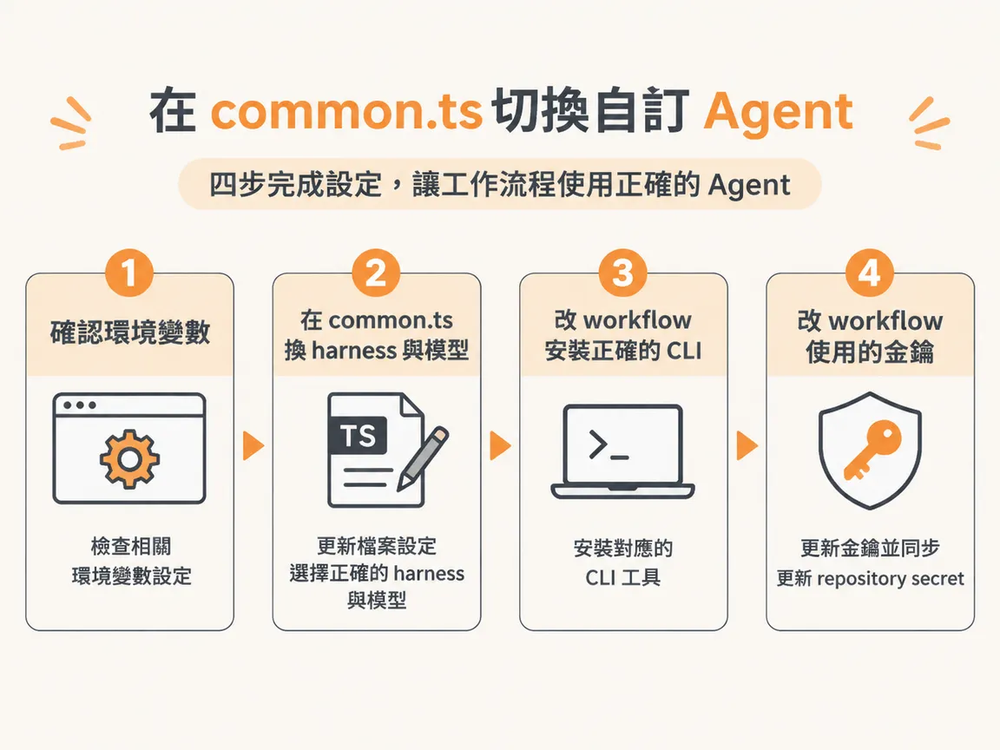

# 設定 Factory 權限、模型金鑰與切換自訂 Agent

選定 GitHub Actions 作為遠端沙箱後，要讓這座軟體工廠自主運轉，最關鍵的一步是打通權限與模型憑證。工廠的核心邏輯是將開發切分成「探索」、「實作」與「審查」等階段，並透過 GitHub Actions 串聯執行。如果權限沒設定好，工作流程就無法自動觸發下一個步驟；如果沒有守好標籤（Label）的安全邊界，公開儲存庫甚至可能被外部非預期觸發而消耗 token。

## 匯入 Factory 工作流程

在開始設定之前，先在專案中匯入工廠所需的工作流程檔案：

<!-- derived -->
```bash
npm run reset add factory workflows
```

這項指令會在 `.github/workflows/` 目錄下加入工廠所需的所有工作流程 YAML 檔，包括 `explore`、`implement`、`review` 和 `update-branch` 等。每個檔案內都有註解，說明該工作流程的觸發時機與執行內容。

## 為什麼需要自訂的 Factory PAT？

在 `.github/workflows/` 的工作流程中，會看到它們需要一些 Secret，其中最核心的是 `FACTORY_PAT`（Factory Personal Access Token）。

GitHub Actions 本身其實附帶一個預設的 `GITHUB_TOKEN`，但它有一個嚴格的限制：**由 `GITHUB_TOKEN` 執行的操作，無法再觸發其他 GitHub Actions**。這是 GitHub 為了避免使用者寫出無窮迴圈而設計的安全機制。

然而，軟體工廠的運作邏輯正好相反

工廠的主要驅動方式是在 Issue 或 Pull Request（PR）上貼標籤（Label）。當有人給 Issue 貼上實作標籤時，會觸發 `agent-implement` 工作流程；當實作完成後，工廠會自動為它加上審查標籤，接著自動觸發 `review` 工作流程。如果只用預設的 `GITHUB_TOKEN`，實作完成後貼上標籤就無法啟動審查流程。因此，必須建立一個具備適當權限的個人存取權杖（PAT）。



## 建立 Fine-grained PAT 與設定 Repository Secret

建立專屬權杖的步驟如下：

1. 點擊 GitHub 個人頭像進入 **Settings**。
2. 畫面拉到最下方，點擊左側的 **Developer settings**。
3. 依序點選 **Personal access tokens** -> **Fine-grained tokens**，然後點擊 **Generate new token**。
4. 設定權杖名稱，例如 `cohort factory token`。
5. 到期日（Expiration）可設定為 90 天。
6. 在 Repository access 選擇 **Only select repositories**，並指定你的工廠專案儲存庫（例如 `cohort-005` 專案）。
7. 設定 Permissions（權限）：
   - **Actions**：設為 `Read and write`（讓工作流程有權限觸發新的 Action）。
   - **Issues**：設為 `Read and write`。
   - **Pull requests**：設為 `Read and write`。
   - **Contents**：設為 `Read and write`（讓 agent 有權限將程式碼推送到分支）。
   - **Workflows**：設為 `Read and write`（讓 agent 能更新工作流程本身）。
   - 其餘權限皆維持 `No access`。
8. 點擊 **Generate token** 並立刻複製產生的權杖。

接著將權杖存入專案儲存庫：

1. 回到專案儲存庫，點選 **Settings** -> **Secrets and variables** -> **Actions**。
2. 在 **Repository secrets** 區塊點擊 **New repository secret**。
3. 名稱必須完全符合大小寫與底線：`FACTORY_PAT`。
4. 貼上剛才複製的權杖內容，點擊 **Add secret**。

## 守住 Label 安全邊界與公開倉庫權限

工廠依賴標籤來觸發，這意味著「誰能貼標籤」直接關係到專案安全與模型費用的消耗。

工廠的每一步都靠貼標籤來觸發



在 GitHub 預設機制下，一般外部訪客無法任意給 Issue 或 PR 貼標籤，只有具備儲存庫 `Triage` 權限以上的人員才能操作。

不過，由於 GitHub Actions 在公開儲存庫（Public repository）提供免費的執行額度，很多練習用的工廠儲存庫會設為公開。為了防止外部人員或網路機器人建立大量 Issue 或惡意 PR，建議調整專案設定：

1. 進入儲存庫的 **Settings**。
2. 在 **General** 設定中找到 **Issues** 與 **Pull requests** 區塊。
3. 將 Issue 與 Pull Request 的建立權限限制為僅限協作者（Collaborators only）。

這樣就能確保只有授權的成員能開啟任務與觸發工廠運作。

## 設定模型供應商憑證

Agent 在本機終端機執行時，登入資訊會存放在本機環境；但當它在遠端 GitHub Actions 伺服器上執行時，就必須透過環境變數傳入模型憑證。

如果使用 Claude Code 訂閱制方案，可以在終端機執行以下指令：

<!-- derived -->
```bash
claude setup-token
```

這個指令會引導完成登入流程，並產生一組有效期為一年的長效認證 token。複製該 token 時要特別注意：因為字串非常長，在部分終端機畫面換行時容易意外夾帶換行符號（`\n`），請確保複製的是乾淨的一整行字串。

取得 token 後，回到儲存庫的 **Settings** -> **Secrets and variables** -> **Actions**，新增一個名為 `CLAUDE_CODE_OAUTH_TOKEN` 的 Repository Secret，並將 token 貼入。

完成後，Repository secrets 應至少具備 `FACTORY_PAT` 與 `CLAUDE_CODE_OAUTH_TOKEN` 兩組金鑰。請注意，GitHub Actions 預設會從預設分支（通常是 `main`）讀取工作流程定義，因此測試時務必確認改動已經推送到 `main` 分支。

## 在 common.ts 切換自訂 Agent

如果不是使用 Claude Code 訂閱制，而是使用 API Key，或是想改用 OpenAI Codex、OpenCode、Pi 或 GitHub Copilot，工廠支援靈活切換不同 agent。

工廠選擇 Agent 的核心檔案位在

切換設定主要集中在 `.sandcastle/common.ts`，相關的環境變數範例如下：



<!-- source: sources/real-engineer/20261116/supplement/cohort-005-project/.sandcastle/.env.example#L1-L5 -->

```bash
# Anthropic API key
# If you want to use your Claude subscription instead of an API key, see https://github.com/mattpocock/sandcastle/issues/191
ANTHROPIC_API_KEY=
# GitHub personal access token
GH_TOKEN=
```

在 `common.ts` 中，預設定義了 `sandcastle.claudecode`，並傳入所使用的模型與環境變數。這個設定會被 `build`、`explore`、`implement` 等各個工作流程共用，因此只要在 `common.ts` 修改一次，就能套用到所有工廠流程。

### 改用 Anthropic API Key
如果依然使用 Claude Code，但想改用 API Key 計費而非訂閱制：
1. 在所有工作流程（`.github/workflows/*.yml`）中，將參考的 `CLAUDE_CODE_OAUTH_TOKEN` 全數替換為 `ANTHROPIC_API_KEY`。
2. 到儲存庫的 Repository secrets，將 `CLAUDE_CODE_OAUTH_TOKEN` 移除或改為新增 `ANTHROPIC_API_KEY`。

### 改用 OpenAI Codex 或其他 Harness
如果想切換成 Codex：
1. 開啟 `.sandcastle/common.ts`，將 agent 換成 `sandcastle.codex`，並將模型改為搭配 Codex 使用的模型名稱。
2. 修改工作流程檔案：原本的工作流程包含安裝 Claude Code 的步驟（`Install Claude Code`），需全域搜尋並替換為安裝 OpenAI Codex 的指令。
3. 將工作流程內所有 `CLAUDE_CODE_OAUTH_TOKEN` 替換為 `OPENAI_API_KEY`。
4. 到儲存庫的 Repository secrets 新增 `OPENAI_API_KEY`。

如果想使用的 agent 尚未被 Sandcastle 支援，Sandcastle 允許自行擴充 Agent Provider，只要實作符合架構即可提出 PR。

### 切換 Agent 的四步通則
無論選用哪一種 harness，切換步驟皆相同：
1. 確認該 harness 所需的環境變數。
2. 在 `.sandcastle/common.ts` 切換對應的 harness 與模型。
3. 修改 `.github/workflows/`，安裝正確的 harness CLI。
4. 修改工作流程傳入的環境變數名稱，並在 GitHub Repository secrets 建立對應金鑰。

## 注意後續更新指令：改用 cherry pick

自訂了 `common.ts` 與工作流程後，這些改動需要持續保留在專案中。

從此時開始，**不要再執行 `npm run reset`**。`npm run reset` 會重置整個專案並刪除所有現有改動，這會讓辛苦設定的自訂 agent 被還原回預設的 Claude 設定。

若要跟進後續課程的改動，請改用：

<!-- derived -->
```bash
npm run cherry pick
```

這項指令只會將最新的課程變更 cherry-pick 到目前分支，保留既有的設定。如果執行時遇到合併衝突（merge conflicts），可以直接請本機 agent 協助排解衝突。

完成設定後，檢查專案狀態：`common.ts` 已綁定想要的 agent、工作流程中已移除未使用的 `CLAUDE_CODE_OAUTH_TOKEN`、GitHub Secrets 包含 `FACTORY_PAT` 與對應的模型憑證，工廠便已準備就緒。接下來，就能透過第一個標籤真正觸發實作 agent。
