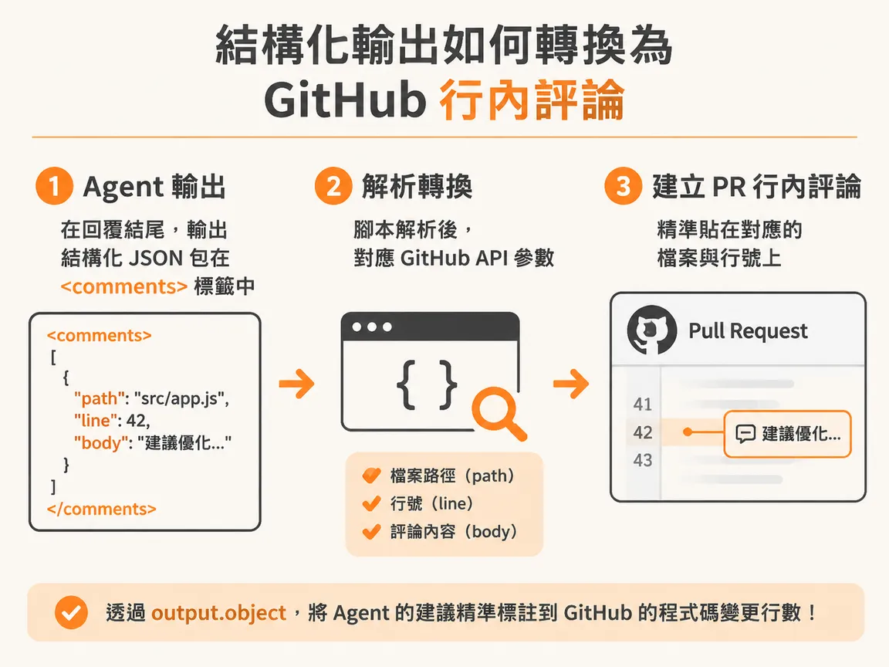
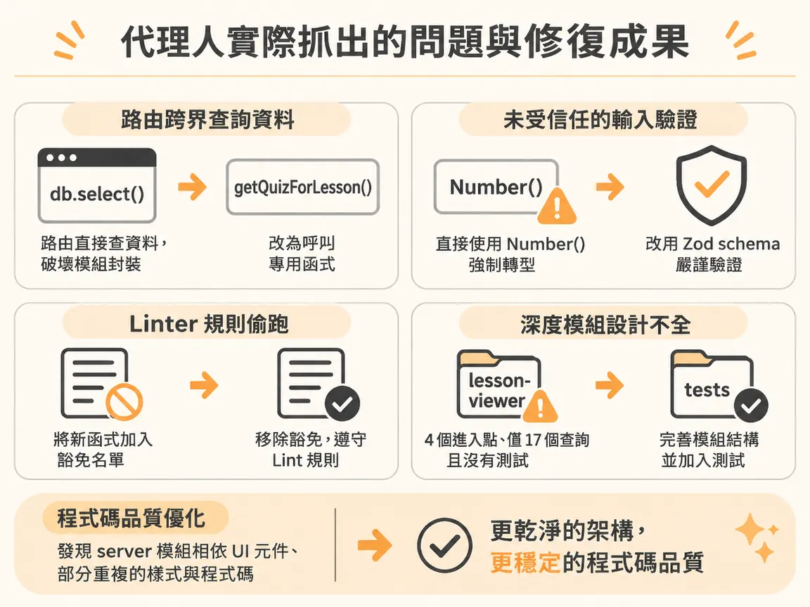
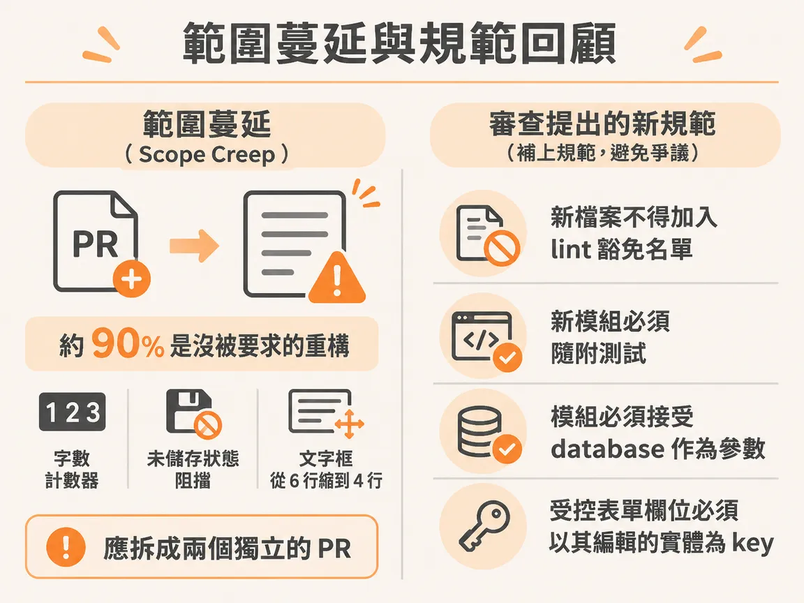

# 用 agent:review 標籤啟動自動審查與結構化行內評論

當實作 agent 完成任務並送出 Pull Request 時，這份 PR 預設會處於草稿（Draft）狀態。雖然專案上的基本自動化檢查（CI checks）都已通過，但程式碼尚未經過深入審查，因此還不到交付給人類工程師接手的階段。

為了把這兩段流程銜接起來，儲存庫中準備了一個專用標籤：`agent:review`。只要在 Draft PR 上貼上這個標籤，就會啟動專屬的 GitHub Action，執行程式碼審查技能（code review skill），自動修復能處理的問題，最後將 PR 整理到人類審查者隨時能接手的狀態。

## 自動審查的提示詞與流程設計

貼上 `agent:review` 標籤後，觸發的工作流程定義在 `agent-review.yaml` 中。它的整體架構與先前的實作流程非常相似，核心差異在於使用的審查提示詞（`review/prompt.md`）。

審查提示詞的核心原則非常明確：
- 盡可能減少人類審查者的工作負擔。
- 只要能在目前分支上直接修正的發現，就由審查 agent 立即修復並建立 commit。
- 無法自動修復的問題，則留在 PR 上供人類決策。

在提示詞模板中，Sandcastle 支援透過雙大括號語法注入參數，例如傳入 PR 的 `base_ref`、`branch` 與 `PR number`，讓審查 agent 能動態取得當前分支的上下文資訊。

## 結構化輸出如何轉換為 GitHub 行內評論

審查 agent 抓出問題後，未修復的事項不能只是一長串散落在摘要裡的文字，而是需要直接標註在程式碼對應的位置上。提示詞中明確指示：「所有留下來未修復的發現，都會變成在該檔案與行號上的行內評論（inline comment），系統會要求你以結構化輸出提供這些內容。」

這項機制仰賴 Sandcastle 的

這個轉換流程仰賴了 `output.object` 功能：
1. 提示詞要求 agent 在回覆結尾輸出一個包裹在 `<comments>` XML 標籤內的結構化物件。
2. 物件內容為符合特定 Schema 的 JSON 陣列，每個項目都包含三項關鍵資訊：檔案路徑（`path`）、行號（`line`）以及評論內容（`body`）。
3. 工作流程後續的腳本取得這份結構化輸出後，直接對應 GitHub API 建立 PR 行內評論所需要的參數，將 agent 的建議精準貼在程式碼變更的具體行數上。

這套結構化輸出機制內部也加入了錯誤處理邏輯，確保 agent 回傳格式稍有偏差時能被妥善解析，提高自動化執行的穩定度。此外，審查 agent 同樣具備附加截圖的能力，能將驗證時的畫面證據一起附在報告中。

## 代理人實際抓出的問題與修復成果

審查 Action 執行完畢後，PR 上會出現一份詳細的審查摘要、多則針對特定程式碼位置的行內評論，以及審查 agent 直接推送的修復 commit。

以實際執行的成果為例，審查代理人先處理了幾項直接修復的架構問題

以下是審查 agent 抓到並立即處理的架構問題：
- **路由跨界查詢資料**：原本路由檔案直接呼叫 `db.select` 抓取資料，破壞了模組封裝。審查 agent 將其改為呼叫 `getQuizForLesson` 函式。
- **未受信任的輸入驗證**：原本程式碼直接使用 `Number()` 進行強制轉型，審查 agent 將其替換為嚴謹的 Zod schema 驗證，讓 `quizId` 透過安全的方式傳入。
- **Linter 規則偷跑**：實作者為了規避單一函式行數上限（max lines per function）的檢查，直接把新函式加進豁免清單（lint exemption list）。審查者直接指正：「新檔案一開始就加入本該被清空的豁免名單是不對的。」
- **深度模組設計不全**：新增的 `lesson-viewer` 模組雖然放進了模組目錄，但內部開了 4 個進入點卻只重新匯出 17 個單薄查詢（thin queries），而且完全沒有附帶 `test` 資料夾，並未真正達到深度模組的標準。
- **程式碼重複與相依性問題**：抓出了 server 模組直接相依 UI 元件的架構錯誤，以及部分重複的樣式與程式碼。

### 抓出重構帶來的 React 狀態臭蟲

在規格變更方面，雖然 PR 達成了原始工單的要求（將筆記改為類似問答與討論的卡片樣式），但 agent 指出大約 90% 的變更屬於未經要求的重構（unrequested refactor）。更嚴重的是，這段重構引發了兩個嚴重的 React 狀態臭蟲：
- 筆記輸入框被改寫成受控元件（controlled component），但當使用者點擊「上一課」、「下一課」或側邊欄連結切換課程時，課程 A 的草稿文字仍殘留在輸入框中。此時使用者只要在課程 B 點擊儲存，就會直接用 A 的筆記覆蓋掉 B 的筆記。
- 點擊儲存後，「未儲存變更」的狀態標記無法正常清除。

審查 agent 藉由實際驅動並操作軟體進行重新驗證（re-verification），抓出了這個經典的狀態不同步 bug，並在隨後推送的 commit 中，替 `LessonNotes` 元件加上對應的 `key`，確保切換實體時狀態會正確重設，同時補上了相應的測試。

## 範圍蔓延與規範回顧

除了抓出具體程式碼錯誤，審查 agent 還列出了 PR 留下的範疇問題與規範建議：

除了直接修復臭蟲與提出行內評論

- **範圍蔓延（Scope Creep）**：路由拆分與重構的幅度過大，掩蓋了原本單純的樣式修改，這份變更理應拆成兩份獨立的 PR。此外，實作者還自行加入了字數計數器、未儲存狀態阻擋、將文字框從 6 行縮到 4 行等未被要求的行為。
- **審查想要但程式碼規範中未載明的規則**：Agent 像是進行隨堂回顧（retro），列出專案未來應該白紙黑字寫入規範的項目，包括「新檔案不得加入 lint 豁免名單」、「新模組必須隨附測試」、「模組必須像 `notes.server.ts` 一樣接受 database 作為參數」，以及「受控表單欄位必須以其編輯的實體作為 key」。

檢查 agent 留下的變更，可以看到補齊的 `key`、新增的測試、抽取的 `getQuizForLesson` 查詢以及 Zod schema。透過 `agent:review` 標籤，原本未經檢驗的 Draft PR 便能自動完成抓錯、自動修補、產出行內標註與整理總結，讓人類工程師能接手進行最核心的確認。
