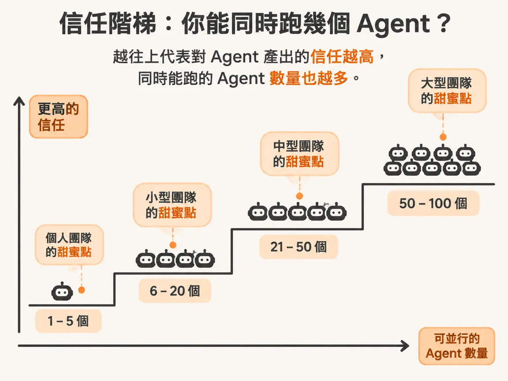
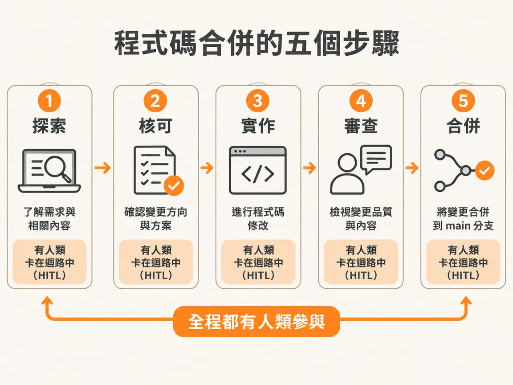
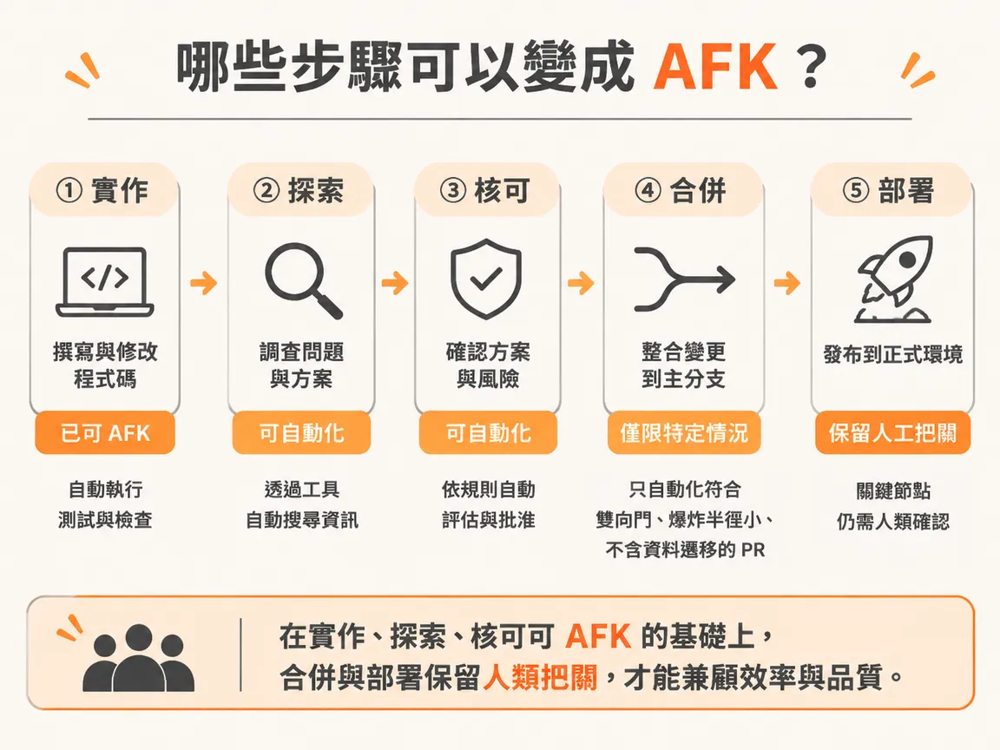

# 爬上信任階梯：從手動顧 5 個 Agent 到 50 個並行運作的軟體工廠

把 AI 導入日常開發時，第一直覺通常是先踩煞車：加入 automated checks、設定 automated review，設法讓 agent 放慢速度，好讓人類有餘裕審查，拉高產出的品質。

學會怎麼踩煞車之後，接下來要做的事情正好相反：要踩下油門，加快整個工廠的運轉節奏，讓更多工作能自主排程並行推進。

## 信任階梯：你能同時跑幾個 Agent？

P-Stack 的作者 Lauren Tan 曾提出一個很生動的視覺化概念

核心邏輯非常直接：**你越信任 agent 的工作成果，就能讓越多個 agent 同時並行**。

剛開始接觸時，你可能只敢同時跑一到五個 agent，隨時盯著它們的輸出。但當你對產出的品質越來越有信心，就能持續疊加數量，最終讓 50 個、甚至是 100 個 agent 同時運作。這會讓團隊每個月推動的 PR 數量暴增。

你在這個階梯上會爬到哪一階，取決於團隊對 token 花費的接受度，以及想把自動化推到多遠。每個人都會找到屬於自己的甜蜜點（happy place）——在那個位置上，出貨速度夠快、token 與價值的比例合理，而且團隊做出來的成果比以往任何時候都好。

但很多人一聽到「同時跑 50 個 agent」，第一個反應往往是：難道要親自去給這 50 個 agent 一個個下 prompt 嗎？那根本是一場災難。

要讓 50 個 agent 平順運作而不至於抓狂，關鍵在於重新檢視程式碼合併到 `main` 分支的完整流程。

## 程式碼合併的五個步驟

目前把一項工作合併到 `main` 分支，通常會經歷五個階段

1. **探索（Explore）**：思考究竟要打造什麼，可能是透過深入詰問（grilling session），或是讓 agent 嘗試重現與摸索 bug。
2. **核可（Approve）**：在某個時間點拍板定案，確認「好，我們就做這個」。這步有時會跟探索混在一起，或是帶著既定想法直接進場，但總會有一個拍板確認的動作。
3. **實作（Implement）**：讓 agent 退到後台開始寫程式碼、完成工作。
4. **審查（Review）**：檢查成果，一部分由 agent 進行，另一部分由人類親自看。
5. **合併（Merge）**：由人類按下按鈕，把程式碼推進 production。

在傳統或現行流程中，這五個步驟都屬於 HITL（Human-in-the-loop，人類在迴路中）。即使每一步都有 agent 參與，人類依然全程卡在每個環節裡。

## 哪些步驟可以變成 AFK？

如果要把產能拉到極致，我們必須思考把哪些步驟轉變成 AFK

* **實作（Implement）基本上已經是 AFK**（Away from keyboard，脫離鍵盤）：人類負責前期的探索與核可，agent 獨自去實作，人類只要在審查時回來看結果就好。
* **審查（Review）也大致能做到 AFK**：審查主要用來改進流程，並在遇到無法逆轉的「單向門」（one-way doors）時抓出真正危險的問題。
* **探索（Explore）能自動化**：agent 能自主在儲存庫裡尋找潛在問題或 bug，驗證它們是否屬實，並主動寫出最小重現案例（reproduction）；或是讓 agent 自動回覆進來的 feature requests，分析可行性並釐清需要修改的範圍。
* **核可（Approve）也能自動化**：遇到 bug 回報時，如果 agent 自動跑出來的重現案例令人滿意，系統就能自動核可，直接指派給負責實作的 agent 接著寫 code 與 review。人類工程師只需要在最後階段看完整的資訊即可。
* **合併（Merge）的部分自動化**：並不是所有 PR 都需要人工點擊。如果是隨時能復原的「雙向門」（two-way doors）、爆炸半徑很小（small blast radius）、且不涉及資料庫遷移（data migrations）的變更，完全可以交由系統自動合併。

## 軟體工廠的真正面貌

軟體工廠的核心，就是把原本需要人類手動探索、手動核可、手動實作甚至手動合併的檢查點，逐一抽離人類的介入。

把人類抽出來之後，推進速度就會瞬間暴增。但踩油門的前提是隨時踩得住煞車：必須確保有人類把關機制守住輸出品質，否則這樣的架構極度容易失控，淪為毫無品質可言的「廢話大砲」（slop cannon）。

只要煞車踩得穩、流程理得順，這套軟體工廠架構就是目前打造高品質軟體最快的方式。那麼，當我們準備同時啟動幾十個 agent 時，這些工作負載究竟該跑在哪裡？這就是下一步要面對的基礎設施問題。
