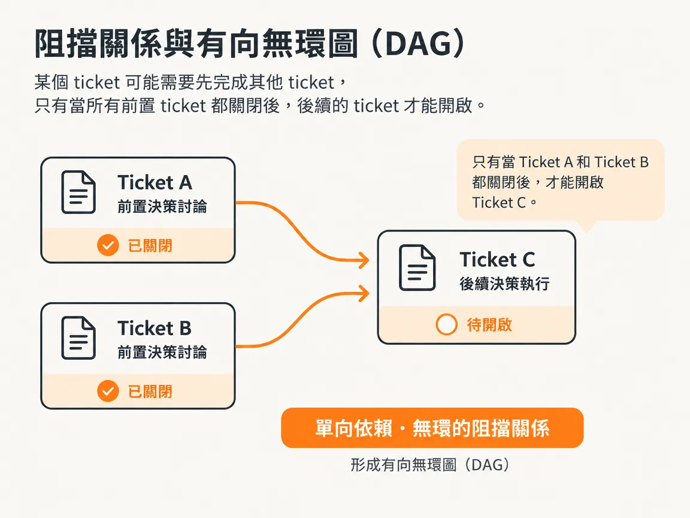
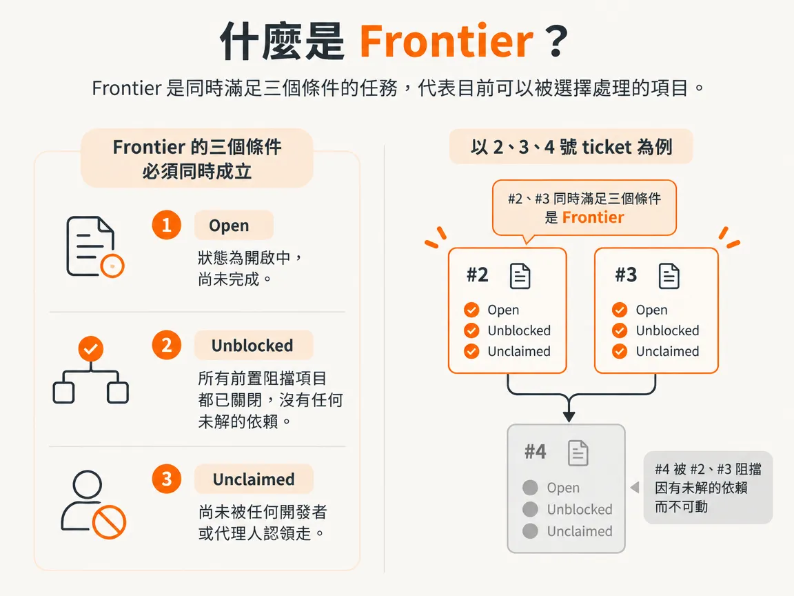
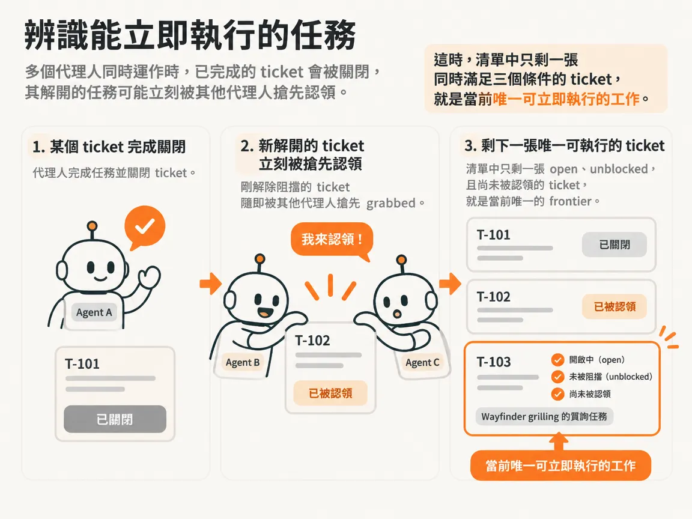

# 用 Ticket 的 Blocking 關係畫出 DAG，並找出可執行的 Frontier

在規劃大型專案或架構決策時，最常遇到的問題不是「要做什麼」，而是「現在到底可以先做哪一件事」。當任務彼此牽連，若沒有釐清前後依賴關係，團隊或自動化代理人（Agent）很容易卡在尚未定案的前提上。

解決這個問題的核心機制，在於建立 ticket 之間的阻擋（blocking）關係。

## 阻擋關係與有向無環圖（DAG）

在規劃地圖中，ticket 彼此之間常存在前置條件。例如，在做出某個特定架構決策之前，可能必須先完成另外兩個決策討論。換句話說，只有當這兩個前提決策 ticket 都被關閉（closed）時，後續的 ticket 才能正式開啟（open）。

現代 issue 追蹤工具大多內建這種依賴追蹤功能，例如 GitHub 的「blocked by」機制，允許一張 ticket 設定它被哪些其他 ticket 阻擋。依賴規則非常明確：**只有當所有阻擋它的 ticket 全部都關閉時，這張 ticket 才會變成解除阻擋（unblocked）的狀態。**

這些帶有單向阻擋關係的 ticket，在結構上會形成一個有向無環圖（Directed Acyclic Graph，簡稱 DAG）。在大型專案中，整張規劃地圖甚至能涵蓋 50 到 60 張 ticket，支撐起極具規模的規格規劃。

## 什麼是 Frontier？

當 ticket 組成 DAG 後，我們需要判斷當下有哪些任務能立即著手進行。在圖論與任務規劃中，這個集合被稱為「邊界」（Frontier）。

Frontier 的定義非常嚴格，必須同時滿足三個條件：
1. **Open**：狀態為開啟中，尚未完成。
2. **Unblocked**：所有前置阻擋項目都已關閉，沒有任何未解的依賴。
3. **Unclaimed**：尚未被任何開發者或代理人認領走。

舉例來說，假設地圖上有 2 號、3 號與 4 號 ticket。4 號 ticket 被 2 號與 3 號阻擋；只要 2 號和 3 號尚未關閉，4 號就處於 blocked 狀態，不能動工。此時，處於 open 且 unblocked 的 2 號與 3 號就是當前的 frontier。因為彼此互不阻擋，它們可以同時並行處理。

## 驅散戰爭迷霧：動態演進的規格地圖

規劃過程並不是一開始就能畫出完整的 DAG，而是像在遊戲中驅散「戰爭迷霧」（fog of war）。當你做出一項決策，這項決策往往會帶出更多需要決定的新問題。

例如，在針對 2 號 ticket 進行探路（wayfinding）討論的過程中，你可能會發現原本沒料到的新問題，因而建立了 5 號 ticket 並加入地圖。當 5 號 ticket 討論完成並關閉後，通往最終目標的路徑便豁然開朗。接著把後續的 6 號 ticket 也完成時，通往目的地的路徑就全部就緒，整張地圖也就能正式轉化為一份完整的規格（spec）。

決策會逐步開拓空間，透過每一步探索撥開迷霧，讓通往終點的 DAG 結構越來越清晰。

## 辨識能立即執行的任務

在實際執行與分派任務的介面中，我們通常可以清楚看到 ticket 的幾種狀態：
- **Open**：正在進行或等待處理。
- **Currently blocked**：前方還有阻擋項目未完成，暫時不能碰。
- **Assigned / Grabbed**：已經被其他子代理人（sub-agent）或成員認領。

當多個代理人同時在系統中運作時，可能某些 ticket 剛好在此刻完成關閉，而剛解開阻擋的 ticket 隨即被其他代理人搶先認領（grabbed）。這時，如果清單上只剩下一張 open、unblocked、且尚未被認領的 ticket（例如被標記為 Wayfinder grilling 的質詢討論任務），它就是當前系統中唯一真正可用的 frontier，也就是下一步唯一可以立即投入執行的工作。

