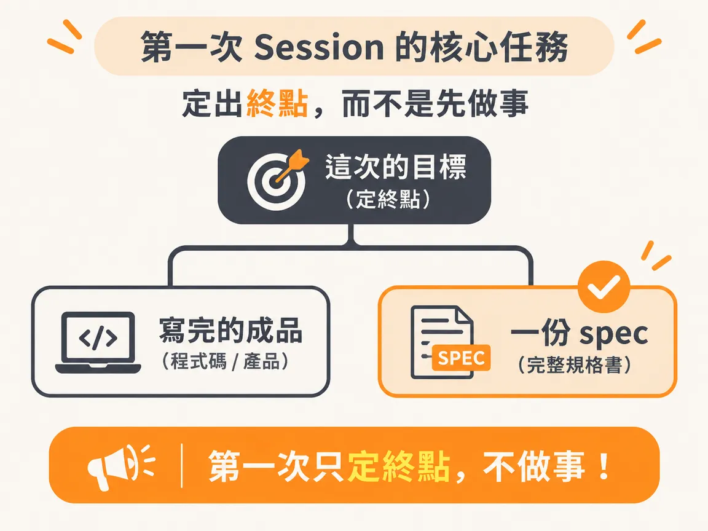
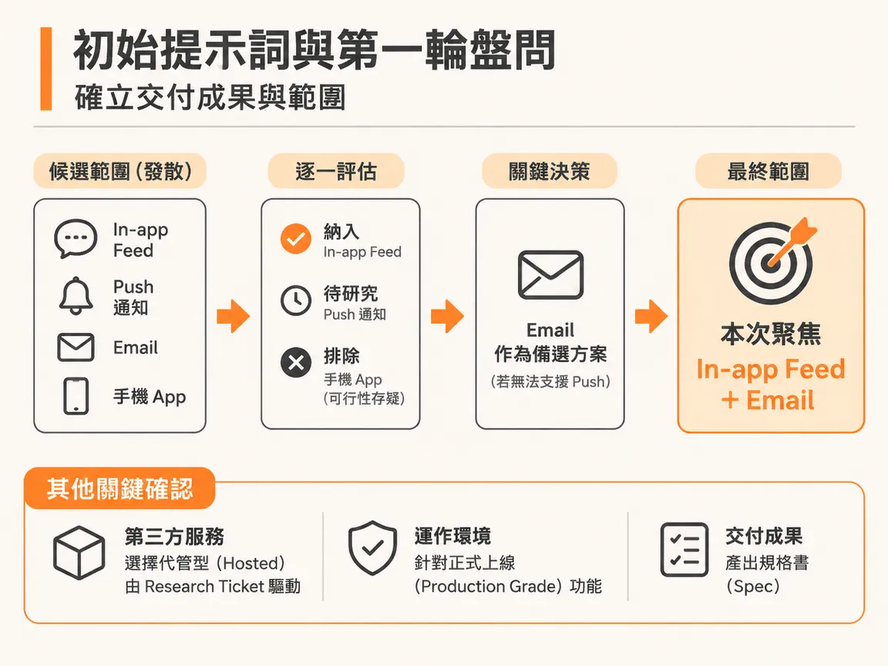
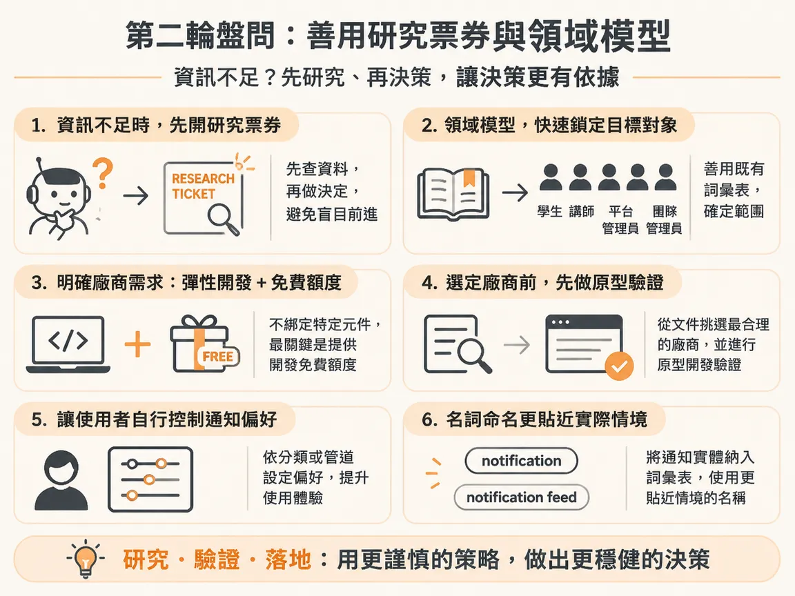
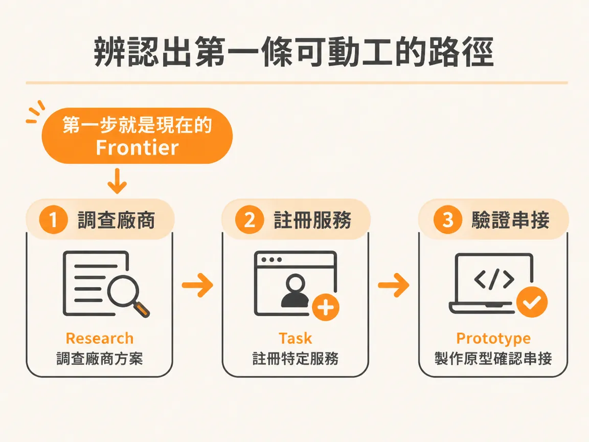

# 啟動第一次 Wavefinder Charting：從迷霧中定出規格地圖

當你清楚 Wavefinder 的設計初衷、核心概念與底層資料結構後，下一步就是實際拿它來規劃新功能。

以線上學習平台 Cadence 為例，團隊一直想加入「應用程式內通知」（in-app notifications）。這個功能的目標很明確：要讓學員持續回流、講師在有人留言時能即時收到通知，甚至在事情發生時讓手機震動。這意味著系統很可能必須串接某個第三方服務。

然而，當真正準備動工時，往往會立刻感受到一股「戰爭迷霧」（fog of war）：目前完全不清楚該怎麼從現況走到目標終點。不知道通知鈴鐺該放在畫面何處、整體介面視覺該長什麼樣，也不確定哪些系統事件需要發送通知。當心中浮現這種不知所措的焦慮感與迷霧時，正是啟動 Wavefinder 的最佳時機。

## 第一次 Session 的核心任務

打開終端機啟動 Wavefinder session 後，你的第一步是描述想做的功能。

請務必記住，這場 session 的任務是定出終點（destination），而我們在此刻想要的終點並不是「已經寫完的程式碼或成品」，而是一份「完整規格書（spec）」。在最初輸入的提示詞（prompt）中，一定要明確說出這一點。

啟動後，系統會展開一段盤問環節（grilling session）。面對系統丟出來的問題，直接回答「我不知道」完全沒有問題。第一次 session 的目的單純就是繪製地圖、標出戰爭迷霧散落在哪裡，並定義清楚終點究竟是什麼。

過程中，你要特別注意是否有研究票券（research ticket）落地，以及票券產生後流程如何推進。等到對話告一段落、一切塵埃落定，再去閱讀產出的地圖與票券內容。

## 初始提示詞與第一輪盤問：確立交付成果與範圍

起手的提示詞不需要過度定義細節：

> 我想在 Cadence 裡面打造 in-app notifications。我希望能用真正的第三方服務來處理，並釐清要發送哪些類型的通知，同時弄清楚它在應用程式裡的實際樣貌。

應用程式內通知是業界非常成熟的概念，現階段不需要寫得鉅細靡遺。輸入後，系統會載入盤問與領域建模（domain modeling）技能，運作機制本質上就像一場帶著額外導航能力的「grill with doc」對話。

隨後，系統開始拋出第一輪問題：

1. **這張地圖的完成定義（done）是什麼？** 是要一份規格書（spec）、可運作的成品（working build），還是只要做完決策？這裡直接回答選「spec」。系統很清楚 spec 和 working build 是兩個最主要的交付選項。
2. **具體範圍是什麼？什麼算 in-app？** 在地圖繪製的初期，界定範圍極為關鍵，否則很容易無限發散。團隊確定需要應用程式內的動態消息（in-app feed），但也希望能有推播通知（push notifications），甚至可以評估電子郵件。不過 Cadence 目前並沒有手機原生 App，手機通知的實際可行性存疑，或許最後需要預設改走 email。
3. **第三方廠商（vendor）是否尚未確定？** 系統建議將選擇 vendor 列為地圖的一環，並由 research ticket 驅動。這個判斷很合理，我們明確需要代管型（hosted）第三方服務，完全不打算自行架設（self-host）。
4. **這份功能是在什麼環境脈絡下運作？** Cadence 目前使用的是開發環境的使用者切換介面（dev UI user switcher），尚未接入正式的身分驗證（auth）。這份規格書是要針對正式上線等級（production grade）的功能來寫嗎？回答：沒錯，必須是 production grade。

## 第二輪盤問：善用研究票券與領域模型

回答完第一批問題後，系統會綜合上下文展開第二輪提問：

1. **第二個通訊管道該如何決定？** in-app feed 已經定案，但推播與 email 該現在直接決定、先做研究，還是在規格書裡同時涵蓋這三種管道？系統建議開一張 research ticket 來評估。這時直接同意它的建議即可。很多 AI 代理人（agent）在缺乏資訊時會盲目硬往前衝，但這裡的系統展現了必要的克制，清楚知道需要先向外搜尋調查。
2. **哪些使用者角色在範圍內？** 系統從既有的領域詞彙表（glossary）中抓出了學生（student）、講師（instructor）、平台管理員（platform admin）與團隊管理員（team admin）。之前做好的領域建模在這裡直接發揮了價值，因此可以直接確定：通知目錄（catalog）必須涵蓋這全部四個角色。
3. **廠商必須支援哪些能力？** 系統詢問是否需要 React in-app feed 元件（不管是預製好的 prebuilt 還是 headless 元件）。回答是：團隊有能力自己刻前端介面，不需要綁定廠商的元件；最關鍵的硬性需求是提供開發階段可用的免費額度（free tier）。
4. **選定廠商前是否要親自試用？** 系統詢問，當研究將範圍縮小到兩家時，是要單純看文件做決定，還是開一張 task ticket 兩家都註冊來試用？考量到維護成本，註冊越少外部服務越好，因此策略定為：從文件中挑出一間最合理的廠商，接著針對它做原型開發（prototype）來驗證是否可行。
5. **使用者能否自行控制通知偏好？** 偏好設定該依分類（category）還是依管道（channel）區分？此處直接採納系統的專業建議。
6. **名詞命名與領域建模：** 系統建議將通知實體加入詞彙表，並提議使用「notification」與「inbox」。在這邊可以依直覺微調，要求系統使用「notification」與「notification feed」，這對團隊來說更貼近實際使用情境。

## 辨認出第一條可動工的路徑

走完這兩輪問答，即使完整的地圖檔案還沒最終落地，前進的路線已經非常具體：第一步是派出 research ticket 調查廠商方案，接著開出一張註冊特定服務的 task ticket，最後進行原型製作來確認串接細節。

透過這種方式，原本模糊不清的焦慮感會被拆解成清楚的邊界與具體問題。終點被嚴格鎖定在「規格書」，懸而未決的未知數被轉交給研究任務，而團隊也能一眼看出第一個真正可以著手動工的探索邊界（frontier）。
