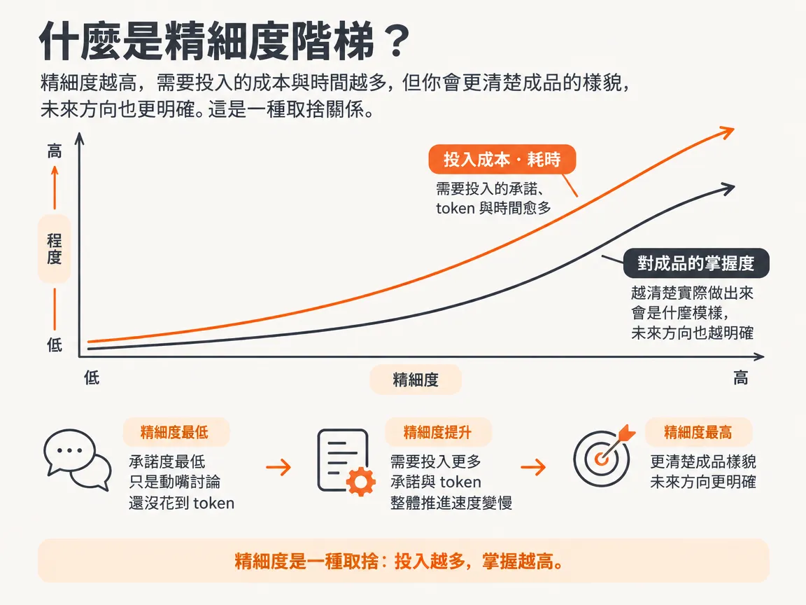

# 運用精細度階梯規劃任務：善用 Agent 的低成本原型

使用 AI agent 協作時，如果流程開始讓人覺得卡卡的、節奏不太對勁，通常是規劃的方式出了問題。遇到這種狀況，回頭檢視 AI 出現前的傳統軟體開發方法，往往能找到解法。

在 AI 出現之前，討論產品規劃的經典代表是 Ryan Singer 寫的《Shape Up》。這本書的核心觀念只有三個：找出工作正確的「形狀」（shape）、在合適的「精細度」（fidelity）展開討論，最後把對的東西交付上線。

## 什麼是精細度階梯？

規劃一項功能或任務時，你可以選擇停在低精細度，也可以一路拉高到高精細度。這就像是一段階梯：

1. **純討論（Low fidelity）**：透過深入盤問與釐清（grilling），找出描述這項功能該用的精確詞彙與概念。
2. **麵包板（Breadboarding）**：不畫介面細節，只用簡單的方框和箭頭，釐清使用者需要執行的動作流程。
3. **線框圖（Wireframes）**：開始思考畫面在頁面上如何組織排列，把不同頁面串接起來，確認整體架構的形狀。
4. **原型（Prototyping）**：寫出半成品程式碼（half working code），實際感受運作流程。
5. **正式程式碼（Actual working code）**：一路推進到能實際在正式環境（production）穩定運作的完整程式碼。

階梯的每一層，代表著不同的承諾成本（commitment）。

在最低的精細度，你的承諾度最低——大家只是動嘴討論，連呼叫 AI 寫程式的 token 都還沒花到。隨著精細度往上拉，你需要投入的承諾與 token 就會變多，整體的推進速度也會變慢；但相對地，精細度越高，你就越清楚實際做出來會是什麼模樣，未來的方向也越明確。

## Agent 讓拉高精細度變得非常便宜

在過去，跳過討論直接做原型非常昂貴，因為工程師得花好幾天手寫程式碼，如果方向錯了代價極高。因此傳統開發強烈建議大家多停留在低精細度。

但 agent 出現之後，這個平衡被打破了。現在製作原型變得非常便宜，AI 可以在幾分鐘內產出半成品的程式碼供你摸索。這意味著你隨時能以比以前更高的精細度工作。

即便如此，這不代表所有事情都要直接寫成程式碼。有些部分依然應該停留在低精細度的討論，把觀念與詞彙定義清楚；只有在需要驗證關鍵問題時，才拉高到原型階段。理想的工作模式，是在每一項子任務中隨時切換到最適合它的精細度。

## 解決 Session 管理與精細度的挑戰：Wayfinder

在實際操作時，往往會面臨兩個棘手的問題：
1. 規劃階段複雜的對話紀錄（session）管理。
2. 如何在整個過程中，替計畫的每個部分隨時挑選正確的精細度。

為了解決這兩個問題，發展出了一套稱為「Wayfinder」的規劃技巧。它能將大型任務拆解並跨越多個 session 進行規劃，並為計畫中的每一個環節評估該停留在討論，還是該拉高到原型。

當你面對充滿未知（unknown unknowns）、有大量假設需要驗證，或者完全不知道該如何把功能整合進既有架構時，這種技巧格外有效。只要你還不確定終點該怎麼走，就能透過靈活調整精細度，一步一步找出前進的路徑。
